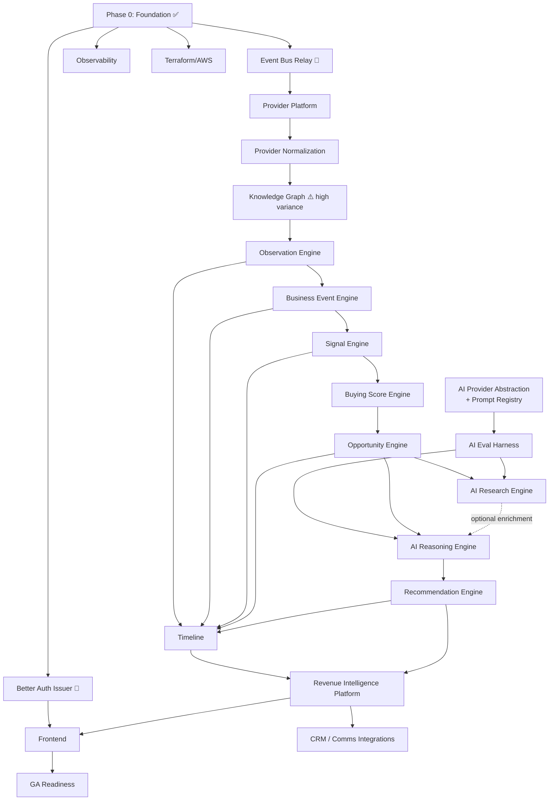

# IMPLEMENTATION_ROADMAP.md

> **Owner:** CTO / Principal Architect · **Audience:** Engineering, TPM, Exec
> **Status:** Living document — revised at each milestone boundary
> **Source of truth:** [`docs/architecture/`](docs/architecture/) (19 documents, 27 ADRs), [`CLAUDE.md`](CLAUDE.md), [`PRODUCT_DIFFERENTIATORS.md`](PRODUCT_DIFFERENTIATORS.md)
>
> This roadmap sequences *what gets built and in what order*. It does not introduce architecture — every module, boundary, and technology named here is already ratified. Where this document and the architecture set disagree, the architecture set wins and this document is the bug.

---

## 1. Current Implementation Audit

Audit performed against the ratified thirteen-module map in [04-modules.md](docs/architecture/04-modules.md) plus the Workspace & Tenancy foundation.

### Measured state

| Dimension | Value |
|---|---|
| Architecture documents | 19 + 27 ADRs — **complete and internally consistent** (651 cross-links verified) |
| Core modules implemented | **1 of 14** (Workspace & Tenancy) |
| Production code | ~2,660 LOC (`signora_platform` 1,288 · `modules` 1,250 · `apps` 124) |
| Migration code | 581 LOC across 4 revisions, verified reversible |
| Tests | **116 passing** (79 unit, 37 integration) · ~2,058 LOC |
| Test coverage | **Not measured** — `pytest-cov` is not installed (see Technical Debt) |
| Type checking | mypy `strict` clean across 71 files |
| Boundary enforcement | 3 import-linter contracts, verified to fail on deliberate violation |
| Frontend | **Not started** |
| Infrastructure-as-code | **Not started** (Docker Compose for local only) |

### Honest characterisation

**The foundation is disproportionately strong relative to the surface area built.** Tenancy, authentication, authorization, the error contract, pagination, and the transactional outbox are production-grade and adversarially tested. That is the correct order — these are the things that are ruinous to retrofit — but it means **~95% of the product's differentiating capability is still ahead**, and none of the intelligence pipeline exists yet.

Two findings from the audit deserve executive attention:

1. **There is no working end-to-end authentication path.** [ADR-0026](docs/architecture/adr/0026-jwt-boundary-architecture.md) makes Better Auth in Next.js the token *issuer*. The API verifies correctly and is well tested — but nothing currently mints a token except the test suite. Until the Next.js issuer exists, no human can authenticate against Signora. This is the single highest-priority unblocker and it sits outside the Python codebase.

2. **The event bus is half-built by design, and that half is the blocking half.** The transactional outbox (the durability guarantee) is complete and tested. The relay — `LISTEN/NOTIFY` → Redis → ARQ dispatch — is not. It was deliberately deferred because dispatch with zero consumers is untestable. That deferral is now the constraint: **every pipeline module is blocked on it**, because every pipeline module is an event consumer.

---

## 2. Existing Completed Modules

### Workspace & Tenancy — ✅ Complete

All five Clean Architecture layers present, `public/` contract exported, 5 use cases, 4 REST endpoints.

| Layer | Contents |
|---|---|
| `domain/` | Workspace, Membership aggregates · WorkspaceRole · domain events · exceptions |
| `application/` | 4 ports (Protocols) · 5 use cases |
| `infrastructure/` | SQLAlchemy models & repositories · outbox adapter · tenant-context adapter · query service · composition root |
| `interface/` | FastAPI router · request/response schemas · error mappings |
| `public/` | Event payload contracts · `WorkspaceQueryPort` |

### Platform (`signora_platform/`) — ✅ Complete for current scope

| Component | Status | Notes |
|---|---|---|
| `db/` | ✅ | Base, audit/tenancy mixins, async sessions, RLS context helpers, thin base repository |
| `event_bus/` | ⚠️ **Partial** | Envelope, outbox model, `EventPublisher` — **relay/dispatch missing** |
| `auth/` | ✅ | RS256 verifier (pinned algorithms), principal, errors |
| `authorization/` | ✅ | Casbin model + policy + enforcer |
| `api/` | ✅ | Error envelope, exception handlers, DI chain, cursor-page envelope |
| `pagination.py` | ✅ | Transport-neutral keyset primitives |
| `settings.py` | ✅ | Typed, env-sourced, JWT config required |

### Data layer — ✅ Complete for current scope

Four reversible migrations: outbox table · workspace/membership schema with RLS · least-privilege `signora_app` role · `SECURITY DEFINER` self-sufficient RLS predicates.

---

## 3. Missing Modules

### Core intelligence modules — 13 of 13 outstanding

Listed in pipeline order. This order is a **hard dependency chain**, not a preference: each consumes the previous stage's events.

| # | Module | Depends on | Complexity |
|---|---|---|---|
| 1 | Provider Platform | Event bus runtime | High — 5 vendor adapters, quota, scheduling, circuit breaking |
| 2 | Provider Normalization | Provider Platform | Medium-High |
| 3 | Knowledge Graph | Provider Normalization | **Very High** — entity resolution is the hardest problem in the system |
| 4 | Observation Engine | Knowledge Graph | Medium |
| 5 | Business Event Engine | Observation Engine | High — taxonomy *and* detection runtime |
| 6 | Signal Engine | Business Event Engine | High — scoring models |
| 7 | Buying Score Engine | Signal Engine | Medium-High — time-decay, weighting |
| 8 | Opportunity Engine | Buying Score Engine | Medium |
| 9 | AI Research Engine | Opportunity Engine, AI Platform | **Very High** — agentic, multi-step |
| 10 | AI Reasoning Engine | Opportunity Engine, AI Platform | High |
| 11 | Recommendation Engine | AI Reasoning Engine | Medium |
| 12 | Timeline | Multiple (read-side) | Medium — + Meilisearch |
| 13 | Revenue Intelligence Platform | Multiple (composition) | Medium-High |

### Platform components outstanding

| Component | Blocking? | Notes |
|---|---|---|
| **Event bus relay + ARQ worker fleet** | 🔴 **Blocks all 13 modules** | `LISTEN/NOTIFY` → Redis → ARQ, per-stage pools, DLQ |
| **Provider Abstraction Layer** | Blocks Provider Platform | Port + adapter base classes |
| **AI Provider Abstraction Layer** | Blocks both AI engines | Port + Claude/OpenAI/Gemini adapters |
| **Integration Abstraction Layer** | Blocks CRM/comms | Port + adapter base classes |
| **Internal Prompt Registry** | Blocks AI engines | Versioned templates, provenance |
| **AI Evaluation Harness** | 🟠 Blocks *trustworthy* AI | Horizon-1 priority (R-10) |
| **Bought-infra adapters** | Varies | Stripe, Novu, PostHog, Flagsmith, Resend, Meilisearch, S3/MinIO |
| **Observability** | 🟠 Blocks operability | OpenTelemetry, Sentry, structured logging with `correlation_id` |
| **Better Auth issuer (Next.js)** | 🔴 **Blocks all human access** | Outside Python codebase |
| **Frontend application** | Blocks all demos | Entire Next.js 15 app |
| **Terraform / AWS IaC** | Blocks any deploy | ECS, RDS, ElastiCache, S3, Secrets Manager |

---

## 4. Milestones

### Estimation basis — read this before quoting any number

Estimates are in **engineer-weeks (ew)** so they re-scale to whatever team you actually staff. Calendar conversions below assume a **reference team of 6 engineers at 80% effective capacity** (~4.8 productive ew/week), because that is the smallest team that can run the parallel workstreams in §6 without thrashing.

These are **planning estimates carrying real uncertainty**, widest on Knowledge Graph and AI Research Engine — the two genuinely research-flavoured components. Treat ranges as ranges. The observed velocity datapoint we have (Workspace & Tenancy: a comparatively simple module, delivered with 116 tests and adversarial security testing) suggests this codebase's quality bar is expensive per module, and the estimates reflect that deliberately.

---

### Phase 0 — Foundation · ✅ **COMPLETE**

Delivered: project skeleton, tenancy with RLS, JWT auth boundary, Casbin, shared API layer, transactional outbox, CI pipeline definition.

---

### Phase 1 — Runtime Spine 🔴 **CRITICAL PATH**
**~22–30 ew · ~5–6 calendar weeks**

Nothing downstream can start without this. Three of the four items are blockers with nothing else able to proceed around them.

| Deliverable | Est. | Why it's here |
|---|---|---|
| Event bus relay + ARQ worker fleet + DLQ | 5–7 ew | Unblocks all 13 pipeline modules |
| Better Auth issuer in Next.js + frontend shell | 6–8 ew | Unblocks all human access; without it there is no demo |
| Observability: OpenTelemetry, Sentry, structured logging | 4–5 ew | Debugging the async pipeline without `correlation_id` tracing is untenable |
| Terraform/AWS baseline (ECS, RDS, ElastiCache, Secrets Manager) | 5–7 ew | Unblocks any environment above local |
| `pytest-cov` + coverage gate in CI | 0.5 ew | Currently unmeasured |
| Abstraction layer scaffolds (provider, AI, integration ports) | 2–3 ew | Unblocks Phases 2 and 4 |

**Exit condition:** an event published by Workspace & Tenancy is observably relayed to an ARQ worker, traced end-to-end, in a deployed environment, by a human who authenticated through Better Auth.

---

### Phase 2 — Data Ingestion & Substrate
**~31–43 ew · ~7–9 calendar weeks**

| Deliverable | Est. |
|---|---|
| Provider Platform (registry, quotas, scheduling, health, 5 adapters) | 8–12 ew |
| Provider Normalization (mapping rules, provenance, dedup) | 6–8 ew |
| **Knowledge Graph (entity resolution, merge, graph schema)** | **12–16 ew** |
| Observation Engine | 5–7 ew |

**Highest-variance item in the entire roadmap: Knowledge Graph.** Entity resolution across five providers with conflicting, partial records is a genuine data-science problem, not a CRUD problem. Recommend a **timeboxed 2-week spike before committing** the estimate, and treat this as the leading candidate for schedule slip.

---

### Phase 3 — Intelligence Pipeline
**~29–43 ew · ~6–9 calendar weeks**

| Deliverable | Est. |
|---|---|
| Business Event Engine (taxonomy + detection runtime) | 10–14 ew |
| Signal Engine (scoring, correlation, decay) | 8–12 ew |
| Buying Score Engine (composite, time-decayed) | 6–10 ew |
| Opportunity Engine (qualification, lifecycle) | 5–7 ew |

**Scoring quality is iterative, not one-shot.** Budget for the models here to be revised repeatedly once real data flows. The estimates cover a *defensible v1*, not a tuned final model.

---

### Phase 4 — AI Platform & Reasoning
**~38–52 ew · ~8–11 calendar weeks**

| Deliverable | Est. |
|---|---|
| AI Provider Abstraction Layer (Claude/OpenAI/Gemini adapters) | 6–8 ew |
| Internal Prompt Registry (versioned, provenance-tracked) | 3–4 ew |
| **AI Evaluation Harness (R-10)** | **6–8 ew** |
| AI Reasoning Engine | 8–12 ew |
| AI Research Engine (agentic, multi-step) | 12–16 ew |
| Recommendation Engine | 6–8 ew |

**Build the evaluation harness before the engines, not after.** [17-future-recommendations.md](docs/architecture/17-future-recommendations.md) names it the single highest-leverage AI investment, and the sequencing matters: without it, every prompt change after this point ships blind. This is the one place in the roadmap where I would push back hard on any proposal to reorder for speed.

---

### Phase 5 — Product Surface
**~34–48 ew · ~7–10 calendar weeks**

| Deliverable | Est. |
|---|---|
| Timeline (read model + Meilisearch indexing) | 6–8 ew |
| Revenue Intelligence Platform (composition, prioritized views) | 8–10 ew |
| Frontend — full application | 20–30 ew |

Frontend can and should run in parallel from Phase 1 onward against agreed OpenAPI contracts; the estimate here is total effort, not a serial tail.

---

### Phase 6 — GA Readiness
**~36–50 ew · ~8–10 calendar weeks**

| Deliverable | Est. | Resolves |
|---|---|---|
| Load testing: RLS, Meilisearch, pgvector at target scale | 6–8 ew | R-03, R-08 |
| AI spend governance (budgets, ceilings, alerting) | 4–5 ew | R-01 |
| CRM integrations (Salesforce, HubSpot, Pipedrive, Zoho) | 12–18 ew | — |
| Comms/email/calendar integrations | 6–8 ew | — |
| Billing (Stripe), notifications (Novu), analytics, flags | 5–7 ew | — |
| SOC 2 readiness engineering work | 6–8 ew | R-12 |
| PII classification + retention implementation | 4–6 ew | R-04, R-05 |

---

### Aggregate

| | Engineer-weeks | Calendar (6 eng @ 80%) |
|---|---|---|
| **Total remaining to GA** | **~190–266 ew** | **~10–14 months** |

**Confidence: moderate.** The dominant risks to this number are Knowledge Graph (Phase 2), AI Research Engine (Phase 4), and the two cross-functional policy items (R-04, R-05) whose lead time is controlled by Legal, not engineering.

---

## 5. Dependencies

### Hard dependencies (cannot be parallelised away)

1. **Event bus relay → everything.** Single largest unblock in the roadmap.
2. **Better Auth issuer → any human access.** Blocks every demo and every user test.
3. **Pipeline order is a DAG.** Signal Engine cannot be meaningfully built before Business Event Engine exists to emit into it.
4. **AI Platform → both AI engines.**
5. **Eval harness → trustworthy AI.** Technically the engines can ship without it; they should not.

### Soft dependencies (parallelisable with contract discipline)

- Frontend ← API contracts (OpenAPI-first lets UI lead the backend)
- Integrations ← Revenue Intelligence Platform (adapter shape is stable earlier)
- Observability, IaC, load testing — continuous, not phase-bound

---

## 6. Parallel Workstreams

Five streams. The critical path is **A**; everything else exists to keep A unblocked and to avoid a serial tail at the end.

| Stream | Scope | Staffing | Runs |
|---|---|---|---|
| **A — Pipeline** 🔴 | Provider Platform → Recommendation Engine | 2–3 eng | Phase 2 → 4, continuous |
| **B — AI Platform** | Abstraction layer, prompt registry, eval harness, model routing | 1–2 eng | From Phase 1, ahead of Stream A's arrival at Phase 4 |
| **C — Product Surface** | Better Auth issuer, frontend, Timeline/RI UI | 1–2 eng + design | From Phase 1, continuous |
| **D — Platform & Ops** | Relay, observability, IaC, load testing, SOC 2 | 1 eng | Continuous |
| **E — Integrations** | CRM, comms, email, calendar, billing | 1 eng | From Phase 5 |

**Sequencing rule:** Stream B must reach "eval harness complete" *before* Stream A reaches Opportunity Engine. If B slips, A should slow rather than build AI engines without evaluation.

---

## 7. Architecture Checkpoints

Formal gates. A phase does not close until its checkpoint passes. Each is a review against named documents — not a vibe check.

| Checkpoint | When | Verifies |
|---|---|---|
| **AC-1 — Event Bus Contract** | End of Phase 1 | Relay delivers at-least-once; consumers idempotent on `event_id`; DLQ works; `correlation_id` traced end-to-end ([06-events.md](docs/architecture/06-events.md)) |
| **AC-2 — Provider Abstraction Integrity** | End of Phase 2 | No vendor SDK type outside an adapter; adding a 6th provider requires zero domain changes ([13-integrations.md](docs/architecture/13-integrations.md)) |
| **AC-3 — Tenancy Under Load** | Phase 2 close | Every new table has `workspace_id`, forced RLS, `SECURITY DEFINER` predicates; `WHERE`-less query test per table; both session shapes tested ([11-tenancy.md](docs/architecture/11-tenancy.md) v4) |
| **AC-4 — Evidence Chain Integrity** | End of Phase 3 | Every signal/score traces to source observations; provenance unbroken ([PRODUCT_DIFFERENTIATORS.md](PRODUCT_DIFFERENTIATORS.md) §1 differentiator) |
| **AC-5 — AI Abstraction & Safety** | Phase 4 mid | No vendor SDK in domain/application; output validated before trust; prompt versions recorded ([14-ai-architecture.md](docs/architecture/14-ai-architecture.md)) |
| **AC-6 — AI Evaluation Gate** | Phase 4 close | Golden sets exist; regression testing on prompt change is CI-enforced; evidence-completeness is a release gate (R-10) |
| **AC-7 — Module Boundary Audit** | Every phase | import-linter contracts extended per module and *proven to fail* on a deliberate violation ([15-project-structure.md](docs/architecture/15-project-structure.md)) |
| **AC-8 — Scale Validation** | Phase 6 | RLS/Meilisearch/pgvector load-tested at target scale (R-03, R-08) |
| **AC-9 — Security & Compliance** | Phase 6 | Least-privilege verified; PII policy implemented; SOC 2 evidence collectable (R-04, R-12) |

---

## 8. Acceptance Criteria

### Per module — all must hold

- [ ] All five Clean Architecture layers present and correctly directed (`domain/` imports nothing framework-level)
- [ ] `public/` contract exported; no other module imports past it
- [ ] import-linter contract added **and demonstrated to fail** on a deliberate violation
- [ ] Every workspace-owned table: `workspace_id`, `created_at`, `updated_at`, `created_by`, `updated_by`, forced RLS, granted to `signora_app` **in the same migration**
- [ ] At least one integration test issuing a `WHERE`-less query, asserting only current-workspace rows return
- [ ] Both session shapes tested (user-scoped and workspace-scoped)
- [ ] Published events match [06-events.md](docs/architecture/06-events.md); consumers idempotent on `event_id`
- [ ] Domain errors mapped centrally; no `HTTPException` in domain/application
- [ ] Endpoints follow [19-api-conventions.md](docs/architecture/19-api-conventions.md): error envelope, cursor pagination, no entity leakage
- [ ] mypy `strict` clean; ruff clean
- [ ] Unit tests use fakes; integration tests use real PostgreSQL as `signora_app`
- [ ] Failure paths tested, not only golden paths
- [ ] Architecture docs updated **in the same PR**

### Per AI component — additionally

- [ ] All vendor access through the AI Provider Abstraction Layer
- [ ] Output validated against a Pydantic schema before downstream trust
- [ ] Prompt template versioned in the Prompt Registry; version recorded on every result
- [ ] Context assembly scoped strictly to one `workspace_id`
- [ ] Evaluation cases added to the golden set

---

## 9. Definition of Done

A milestone is done when **every** statement is true:

1. **Functionally complete** — every acceptance criterion above met for every module in the milestone.
2. **Architecturally verified** — the milestone's architecture checkpoint has formally passed.
3. **Tested** — unit, integration, and failure-path coverage; the full suite green; coverage measured and not regressed.
4. **Observable** — every new async flow is traceable via `correlation_id` and emits latency/throughput/error metrics. An untraceable background process is not production-ready.
5. **Secure** — tenant isolation proven by test, not asserted; no secrets in code; least privilege verified.
6. **Documented** — affected architecture documents updated in the same change; new ADR for any new technology or vendor.
7. **Deployable** — runs in a deployed environment, not only locally.
8. **No shortcuts** — no TODOs in application code, no placeholders, no mock implementations, no dead code, no skipped tests.
9. **Risk register current** — [16-architecture-risks.md](docs/architecture/16-architecture-risks.md) updated; new risks logged with severity, likelihood, and owner.
10. **Status updated** — [PROJECT_STATUS.md](PROJECT_STATUS.md) reflects reality.

---

## 10. Recommended Immediate Sequence

The next four work items, in order, with rationale:

1. **Event bus relay + ARQ worker fleet** — unblocks 13 modules. Nothing else competes for priority.
2. **Better Auth issuer in Next.js** — without it, nobody can log in; every demo is blocked. Sits outside the Python codebase, so it can run fully in parallel with (1).
3. **Observability** — the async pipeline is about to get much harder to debug. Instrumenting before the complexity arrives is far cheaper than after.
4. **Knowledge Graph spike (timeboxed, 2 weeks)** — retire the roadmap's largest estimation risk early, while it is still cheap to re-plan around.

Provider Platform follows once (1) lands.
