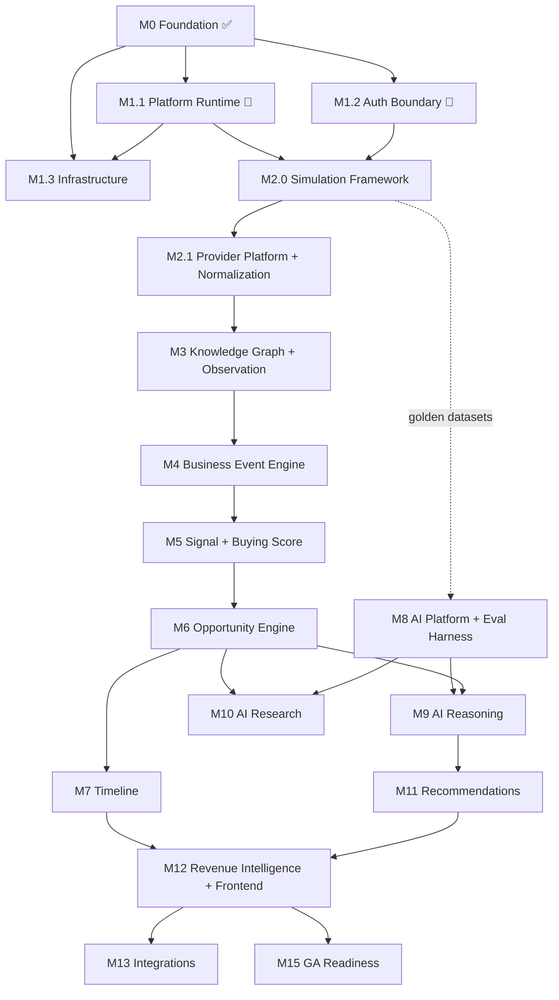

# IMPLEMENTATION_ROADMAP.md

> **Owner:** CTO / Principal Architect · **Audience:** Engineering, TPM, Exec
> **Status:** Living document — revised at each milestone boundary
> **Revision:** **v2** — M1 split into M1.1/M1.2/M1.3; Provider Simulation Framework added as milestone M2.0; every milestone now carries Demo Scenario, User-Visible Outcome, Definition of Done, Rollback Strategy, Operational Readiness Checklist, and Simulator Requirement.
> **Source of truth:** [`docs/architecture/`](docs/architecture/) (19 documents, 27 ADRs), [`CLAUDE.md`](CLAUDE.md), [`PRODUCT_DIFFERENTIATORS.md`](PRODUCT_DIFFERENTIATORS.md)
>
> This roadmap sequences *what gets built and in what order*. It does not introduce architecture — every module, boundary, and technology named here is already ratified. Where this document and the architecture set disagree, the architecture set wins and this document is the bug.

---

## 1. Current Implementation Audit

Audit performed against the ratified thirteen-module map in [04-modules.md](docs/architecture/04-modules.md) plus the Workspace & Tenancy foundation.

### Measured state

| Dimension | Value |
|---|---|
| Architecture documents | 19 + 27 ADRs — **complete and internally consistent** (651 cross-links verified) |
| Core modules implemented | **1 of 14** (Workspace & Tenancy) |
| Production code | ~2,660 LOC (`signora_platform` 1,288 · `modules` 1,250 · `apps` 124) |
| Migration code | 581 LOC across 4 revisions, verified reversible |
| Tests | **116 passing** (79 unit, 37 integration) · ~2,058 LOC |
| Test coverage | **Not measured** — `pytest-cov` is not installed |
| Type checking | mypy `strict` clean across 71 files |
| Boundary enforcement | 3 import-linter contracts, verified to fail on deliberate violation |
| Frontend | **Not started** |
| Infrastructure-as-code | **Not started** (Docker Compose for local only) |

### Honest characterisation

**The foundation is disproportionately strong relative to the surface area built.** Tenancy, authentication, authorization, the error contract, pagination, and the transactional outbox are production-grade and adversarially tested. That is the correct order — these are the things that are ruinous to retrofit — but **~95% of the product's differentiating capability is still ahead**.

Two audit findings drive the M1 structure:

1. **There is no working end-to-end authentication path.** The API verifies tokens correctly and is well tested, but nothing mints them except the test suite. Until the Next.js issuer exists, no human can authenticate. → **M1.2**
2. **The event bus is half-built, and that half is the blocking half.** The outbox (durability) is complete; the relay (dispatch) is not. Every pipeline module is an event consumer, so all 13 are blocked on it. → **M1.1**

---

## 2. Existing Completed Modules

### Workspace & Tenancy — ✅ Complete

All five Clean Architecture layers, `public/` contract exported, 5 use cases, 4 REST endpoints.

| Layer | Contents |
|---|---|
| `domain/` | Workspace, Membership aggregates · WorkspaceRole · domain events · exceptions |
| `application/` | 4 ports (Protocols) · 5 use cases |
| `infrastructure/` | SQLAlchemy models & repositories · outbox adapter · tenant-context adapter · query service · composition root |
| `interface/` | FastAPI router · request/response schemas · error mappings |
| `public/` | Event payload contracts · `WorkspaceQueryPort` |

### Platform (`signora_platform/`)

| Component | Status | Notes |
|---|---|---|
| `db/` | ✅ | Base, audit/tenancy mixins, async sessions, RLS helpers, base repository |
| `event_bus/` | ⚠️ **Partial** | Envelope, outbox model, `EventPublisher` — **relay/dispatch missing** |
| `auth/` | ✅ | RS256 verifier (pinned algorithms), principal, errors |
| `authorization/` | ✅ | Casbin model + policy + enforcer |
| `api/` | ✅ | Error envelope, exception handlers, DI chain, cursor-page envelope |
| `pagination.py` | ✅ | Transport-neutral keyset primitives |
| `settings.py` | ✅ | Typed, env-sourced |

---

## 3. Missing Components

### Core intelligence modules — 13 of 13 outstanding

Pipeline order is a **hard dependency chain**, not a preference.

| # | Module | Complexity |
|---|---|---|
| 1 | Provider Platform | High |
| 2 | Provider Normalization | Medium-High |
| 3 | Knowledge Graph | **Very High** — entity resolution |
| 4 | Observation Engine | Medium |
| 5 | Business Event Engine | High |
| 6 | Signal Engine | High |
| 7 | Buying Score Engine | Medium-High |
| 8 | Opportunity Engine | Medium |
| 9 | AI Research Engine | **Very High** — agentic |
| 10 | AI Reasoning Engine | High |
| 11 | Recommendation Engine | Medium |
| 12 | Timeline | Medium |
| 13 | Revenue Intelligence Platform | Medium-High |

### Platform components outstanding

| Component | Blocking? | Milestone |
|---|---|---|
| Event bus relay + worker fleet + DLQ | 🔴 Blocks all 13 modules | M1.1 |
| Observability (OTel, Sentry, structured logging) | 🟠 Blocks operability | M1.1 |
| Better Auth issuer (Next.js) | 🔴 Blocks all human access | M1.2 |
| Frontend application | Blocks all demos | M1.2 → M5 |
| Terraform / AWS IaC | Blocks any deploy | M1.3 |
| **Provider Simulation Framework** | 🟠 Blocks offline dev, deterministic demos, AI eval | **M2.0** |
| Provider Abstraction Layer | Built *with* the simulator (its first implementation) | M2.0 |
| AI Provider Abstraction Layer + Prompt Registry | Blocks both AI engines | M8 |
| AI Evaluation Harness | Blocks trustworthy AI | M8 |
| Integration Abstraction Layer | Blocks CRM/comms | M14 |
| Bought-infra adapters | Varies | M14–M15 |

**Deferred by ruling (YAGNI):** Provider, AI, and Integration ports are **not** built speculatively. Each is built alongside its first concrete implementation — Provider Port in M2.0 (simulator), AI Provider Port in M8, Integration Port in M14. This follows `CLAUDE.md` §6: no abstractions for hypothetical future needs.

---

## 4. Milestone Structure

### Numbering

M1 has been split into three milestones; M2.0 is a new dedicated milestone inserted before data ingestion. **All other milestone numbers are unchanged**, so [PRODUCT_ROADMAP.md](PRODUCT_ROADMAP.md) and [AI_MATURITY_ROADMAP.md](AI_MATURITY_ROADMAP.md) remain valid.

| Implementation milestone | Product milestone | Phase |
|---|---|---|
| M0 ✅ | M0 | 0 |
| **M1.1** Platform Runtime | M1 | 1 |
| **M1.2** Authentication Boundary | M1 | 1 |
| **M1.3** Infrastructure | M1 | 1 |
| **M2.0** Provider Simulation Framework | *(new — internal enablement)* | 1→2 |
| M2.1 Provider Platform & Normalization | M2 | 2 |
| M3 Knowledge Graph & Observation Engine | M3 | 2 |
| M4–M15 | M4–M13 | 3–6 |

### Effort summary

| Milestone | Effort | Calendar @ 6 eng | Parallel with |
|---|---|---|---|
| M1.1 Platform Runtime | ~15.5 ew | ~3 wks | M1.2, M1.3 |
| M1.2 Authentication Boundary | ~11.5 ew | ~2.5 wks | M1.1, M1.3 |
| M1.3 Infrastructure | ~6 ew | ~1.5 wks | M1.1, M1.2 |
| **M2.0 Provider Simulation Framework** | **~17–24 ew** | ~4–5 wks | Partially with M1.3 |
| M2.1 → M15 | ~175–240 ew | — | See §8 |

**Total to GA: ~225–305 ew ≈ 11–16 months** at 6 engineers / 80% capacity.

That is an increase over v1's 190–266 ew. The simulator is the cause, and it is a deliberate, justified investment — see §7 for what it returns.

---

## 5. Milestone Definitions

Every milestone below specifies: Scope · Simulator Requirement · Demo Scenario · User-Visible Outcome · Definition of Done · Rollback Strategy · Operational Readiness Checklist.

---

### ✅ M0 — Secure Multi-Tenant Foundation · **COMPLETE**

**Scope:** Architecture set, Workspace & Tenancy module, platform foundation, RLS tenancy, JWT verification, Casbin, CI.

**Simulator requirement:** ❌ None — no provider data involved.

**Demo scenario:** Internal only. Run the RLS regression suite against pre-fix policies (fails) and post-fix (passes), demonstrating isolation is proven rather than asserted.

**User-visible outcome:** None. Foundation only.

**Definition of Done:** ✅ Met — 116 tests, mypy strict clean, 3 boundary contracts held, migrations reversible.

**Rollback strategy:** N/A (no deployed environment existed).

**Operational readiness:** N/A.

---

### 🔄 M1.1 — Platform Runtime

**Scope:** Redis in CI · structured logging · OpenTelemetry · Sentry · event bus schema (DLQ + idempotency ledger) · outbox relay · subscription/dispatch · ARQ worker fleet · retry & DLQ · pipeline metrics · coverage gate.

**Effort:** ~15.5 ew · **Tasks:** T1–T11 (see §6)

**Simulator requirement:** ❌ **Not required.** Verified with a test-only consumer in the integration suite. The simulator enters at the Provider layer, which does not exist yet — using it here would be building the wrong thing first.

**Demo scenario:**
> *"Watch an event travel the platform."* Create a workspace through the existing API. Show the `outbox_event` row committed in the same transaction. Show the relay claiming it, marking `relayed_at`, and enqueueing to Redis. Show an ARQ worker consuming it. Then show the same event delivered twice and the handler running **exactly once**. Finally, force a handler failure and watch it retry with backoff, then land in `dead_letter_event` without blocking the queue — and replay it successfully. Throughout, follow one `correlation_id` across all three processes in a single trace.

**User-visible outcome:** **None.** This is pure infrastructure. Do not demo to customers.

**Definition of Done:**
- [ ] Event published → relayed → consumed, proven under concurrency (two relay instances never double-enqueue)
- [ ] Idempotency platform-owned: duplicate delivery invokes a handler exactly once, via `processed_event`
- [ ] Retry with exponential backoff; bounded attempts; DLQ capture; replay works
- [ ] Redis outage leaves events unrelayed and recoverable — **zero loss**
- [ ] `correlation_id` traced across API → relay → worker in one OpenTelemetry trace
- [ ] Every log line carries `workspace_id` and `correlation_id`; no token or secret ever logged (test-enforced)
- [ ] Worker pools independently runnable and scalable; graceful shutdown drains in-flight work
- [ ] RLS context established from the event envelope before any handler touches the database
- [ ] Metrics emitted: queue depth, dispatch latency, retry rate, DLQ rate, outbox lag
- [ ] Coverage measured with a CI baseline gate
- [ ] `06-events.md` updated with relay semantics, the two new tables, and the platform-owned idempotency decision

**Rollback strategy:**
- **Code:** relay and workers deploy as separate ECS services (M1.3). Rolling back = scaling the relay to zero. Events accumulate unrelayed in the outbox and drain on redeploy — **no data loss**, because the outbox is the durable source of truth.
- **Schema:** migration 0004 is reversible. `dead_letter_event` and `processed_event` are additive; dropping them loses only dispatch bookkeeping, not domain state.
- **Blast radius:** nil for the existing API — no current endpoint depends on dispatch.

**Operational readiness checklist:**
- [ ] Runbook: how to inspect the outbox backlog, drain a queue, replay from DLQ
- [ ] Alert: DLQ write rate > 0 (any dead letter is worth a human look at this stage)
- [ ] Alert: outbox lag (oldest unrelayed event age) exceeds threshold
- [ ] Alert: relay process down
- [ ] Dashboard: per-pool queue depth, dispatch latency, error rate
- [ ] Documented worker pool scaling procedure
- [ ] Redis failure mode tested and documented

---

### 🔄 M1.2 — Authentication Boundary

**Scope:** Next.js 15 scaffold · Better Auth · Google & Microsoft OAuth · RS256 JWT issuance · signing key management · typed API client · frontend shell · E2E auth journey.

**Effort:** ~11.5 ew · **Tasks:** T12–T18

**Simulator requirement:** ❌ **Not required.** No provider data involved.

**Demo scenario:**
> *"First real login."* A human opens Signora, signs in with Google, lands in the app, creates the workspace "Acme Revenue", and sees it listed. A second human signs in with Microsoft, creates their own workspace, and **provably cannot see the first user's** — shown live, not asserted. Then show the JWT itself: RS256, correct claims, 15-minute expiry, and the backend rejecting a token signed by any other key.

**User-visible outcome:** ✅ **First real user-visible functionality.** Users can sign in and manage workspaces. Design-partner onboarding can begin here.

**Definition of Done:**
- [ ] Google and Microsoft OAuth sign-in work end to end
- [ ] JWT claims match [18-authentication.md](docs/architecture/18-authentication.md) §JWT Contract **exactly**
- [ ] **Contract test:** a token minted by Next.js verifies against the real Python verifier, in CI
- [ ] Private signing key present only in the Next.js tier; **test asserts it is unreachable from Python**
- [ ] Token refresh works; expired tokens produce `token_expired`, prompting refresh
- [ ] Better Auth tables live in a dedicated `auth` schema in the existing PostgreSQL instance
- [ ] Frontend: sign in, create workspace, list, switch, sign out — against the real API
- [ ] E2E Playwright journey passes in CI, **including the tenant-isolation negative case**
- [ ] Frontend CI enforces ESLint, Prettier, TypeScript, Vitest
- [ ] `18-authentication.md` updated with issuer-side configuration as built

**Rollback strategy:**
- **Frontend:** versioned static deploy; roll back by repointing to the previous build. No backend coordination needed.
- **Auth schema:** isolated in the `auth` schema, so a rollback cannot affect application tables.
- **Key rotation failure:** documented procedure to revert to the prior key pair; because both tiers read keys from configuration, this is a config rollback, not a code deploy.
- **Blast radius:** total for user access, nil for data — the API tier is unchanged by this milestone.

**Operational readiness checklist:**
- [ ] Runbook: signing-key rotation procedure, tested at least once
- [ ] Runbook: OAuth provider misconfiguration diagnosis
- [ ] Alert: authentication failure rate spike (misconfiguration or attack)
- [ ] Alert: token verification failure rate at the API
- [ ] OAuth client secrets in AWS Secrets Manager, never in code
- [ ] Session/token TTLs documented and agreed
- [ ] Frontend error tracking (Sentry) wired with source maps

---

### 🔄 M1.3 — Infrastructure

**Scope:** Terraform (VPC, RDS PostgreSQL 17, two ElastiCache clusters, Secrets Manager) · ECS services for API and workers · Traefik/ALB with TLS · deployment pipeline · staging environment · automated migrations · rollback validation.

**Effort:** ~6 ew · **Tasks:** T19–T20

**Simulator requirement:** ❌ **Not required.**

**Demo scenario:**
> *"Ship it and un-ship it."* Merge to `main`; watch the pipeline run migrations as a privileged pre-deploy task, deploy API and worker services, and pass health/readiness checks. Then deliberately deploy a broken build, watch it fail readiness, and **roll back to the previous version with the documented procedure** — timed. Show `signora_app` connecting as a non-superuser, and secrets resolving from Secrets Manager with none present in the image.

**User-visible outcome:** **None directly** — but this is what makes M1.2's login reachable by anyone outside a developer's laptop.

**Definition of Done:**
- [ ] Staging provisioned entirely from Terraform; `plan` clean and idempotent
- [ ] API + at least one worker pool running in staging
- [ ] Migrations run automatically pre-deploy under the **privileged** identity, never the app role
- [ ] Application connects as `signora_app` (non-superuser, `NOBYPASSRLS`) — verified in the deployed environment, not just locally
- [ ] Two separate ElastiCache clusters (queue vs. cache), per [ADR-0007](docs/architecture/adr/0007-caching-layer.md)
- [ ] All secrets from AWS Secrets Manager; **no secret in any image or repository**
- [ ] TLS terminated; HTTP redirects to HTTPS
- [ ] **Rollback executed and timed at least once**, not merely documented
- [ ] RDS automated backups enabled; restore tested once
- [ ] `ADR-0022` updated with as-built topology

**Rollback strategy:**
- **Application:** ECS keeps the previous task definition; rollback is a revision revert. Target: **under 10 minutes, verified.**
- **Migrations:** every migration reversible (already CI-enforced). **Standing rule: expand-then-contract.** A deploy never ships a destructive schema change in the same release as the code depending on it — this is what keeps application rollback safe without a database restore.
- **Infrastructure:** Terraform state versioned; `plan` reviewed before every apply.
- **Blast radius:** total. This milestone is where rollback discipline stops being theoretical.

**Operational readiness checklist:**
- [ ] Runbook: deploy, rollback, emergency stop
- [ ] Runbook: database restore from backup, tested
- [ ] Alert: ECS service unhealthy / task flapping
- [ ] Alert: RDS CPU, connections, storage headroom
- [ ] Alert: ElastiCache memory and eviction rate (both clusters)
- [ ] Deployment pipeline requires green CI to proceed
- [ ] On-call rotation and escalation defined
- [ ] Staging is a faithful shape of production (smaller, not different)

---

### 🆕 M2.0 — Provider Simulation Framework

**Scope:** Provider Port (first concrete implementation) · simulation framework (datasets, scenario engine, virtual clock) · realistic payload generation for 5 providers · fault/timing/duplicate injection · sync-mode simulation · 10 demo scenarios · deterministic AI-evaluation support.

**Effort:** ~17–24 ew · Detailed design in **§7**

**Simulator requirement:** ✅ **This milestone builds it.**

**Demo scenario:**
> *"A company, simulated end to end."* Select Scenario 1 (High-Growth SaaS). The simulator emits realistic Apollo, CoreSignal, BuiltWith, and Similarweb payloads — byte-identical in shape to what the real vendors return — through the **same ingestion path production will use**. Show raw payloads landing with full provenance. Then re-run the identical scenario and show byte-identical results: **deterministic**. Then inject a provider timeout, a duplicate delivery, and a delayed update, and show the pipeline handling each correctly. All with zero external network calls — **pull the network cable and run it again**.

**User-visible outcome:** **None for customers.** Substantial internally: every subsequent milestone becomes demonstrable, testable, and developable offline.

**Definition of Done:**
- [ ] Provider Port defined **and validated by a working implementation** (the simulator), not designed speculatively
- [ ] Simulated adapters for Apollo, CoreSignal, BuiltWith, Similarweb, NeverBounce, producing payloads matching each vendor's documented response shape
- [ ] Adapter selection is **configuration only** — zero `if simulated:` branching anywhere in domain or application code
- [ ] **Production safety guard:** the simulator refuses to activate when `environment == "production"` unless an explicit, logged override is set. Test-enforced.
- [ ] All 10 demo scenarios authored and runnable
- [ ] **Determinism proven:** identical scenario + seed → byte-identical payloads across runs and machines
- [ ] Fault injection: timeout, 5xx, rate-limit, malformed payload, partial response
- [ ] Timing control: instant, real-time, and accelerated replay
- [ ] Duplicate-event and delayed-update simulation
- [ ] Sync modes: full snapshot, incremental, webhook delivery
- [ ] Entire pipeline runnable with **no network access** — verified in CI with egress blocked
- [ ] Datasets versioned; a dataset change is a reviewable diff
- [ ] New architecture document `20-provider-simulation.md` + ADR recording the framework decision

**Rollback strategy:**
- **Code:** the simulator is additive platform code. Disabling it is a configuration change; no production path depends on it.
- **Risk of accidental production use:** mitigated by the environment guard above, which is the single most important control in this milestone. A simulator silently active in production would fabricate customer data — this is treated as a P0-class hazard and tested accordingly.
- **Datasets:** versioned and immutable once published; a bad dataset is reverted, not edited in place.
- **Blast radius:** nil in production if the guard holds; total for development and demos if it breaks.

**Operational readiness checklist:**
- [ ] Simulator status (active/inactive, scenario, seed) visible in `/health` output for non-production environments
- [ ] Logs unambiguously mark simulated payloads at ingestion — **an engineer must never mistake simulated data for real**
- [ ] Alert: simulator active in any environment where it should not be
- [ ] Documented procedure for adding a new provider simulation
- [ ] Documented procedure for authoring a new scenario
- [ ] Dataset provenance recorded (source, generation date, version)

---

### M2.1 — Provider Platform & Normalization

**Scope:** Provider Platform (registry, credentials, quotas, scheduling, health, circuit breaking) · real vendor adapters · Provider Normalization (mapping, provenance, dedup).

**Effort:** ~14–20 ew

**Simulator requirement:** ✅ **Required.** Integration tests and CI run entirely against simulated providers. Real vendor calls are exercised only in a dedicated, manually-triggered contract-test suite — never in the standard CI path.

**Demo scenario:** Add a target account list. Watch ingestion populate raw records with full provenance across five providers. Show the same company enriched by three providers simultaneously with conflicting values recorded rather than silently resolved. Run against simulated providers for the deterministic version; against one real provider for the live version.

**User-visible outcome:** Minimal — an ingestion status view. Signora is "watching" accounts but showing nothing yet.

**Definition of Done:** Provider Port unchanged from M2.0 (proof the abstraction was right) · 5 real adapters behind it · quota/rate-limit compliance · circuit breaking verified against a simulated outage · 100% provenance coverage · per-provider cost tracked · adding a 6th provider requires zero domain changes.

**Rollback strategy:** Per-provider feature flags — a misbehaving adapter is disabled without a deploy. Ingestion is idempotent, so replay after rollback is safe.

**Operational readiness:** Alerts on provider health, quota exhaustion, cost anomaly, ingestion failure rate · runbook for provider credential rotation and vendor outage.

---

### M3 — Knowledge Graph & Observation Engine

**Effort:** ~17–23 ew · **Simulator requirement:** ✅ Required — entity-resolution evaluation needs labelled, deterministic datasets, which the simulator supplies.

**Demo scenario:** Show "Acme Corp", "Acme Corporation Inc.", and a differently-named legal entity resolving into one record, with merge history explaining why. Simulator scenario 10 (ICP match) provides the labelled ground truth.

**User-visible outcome:** One canonical company record per entity — visible in a basic entity view.

**Definition of Done:** Labelled evaluation set (≥1,000 pairs) · precision >95%, recall >90% · duplicate rate <2% · merges auditable and reversible · embeddings workspace-scoped and RLS-enforced.

**Rollback strategy:** Merges reversible by design; a bad resolution model is reverted and entities re-resolved from observations, which are immutable.

**Operational readiness:** Alerts on merge-rate anomaly and resolution latency · runbook for reversing an incorrect merge.

---

### M4–M15 — Remaining Milestones

Detailed Definition of Done, rollback, and readiness sections are authored **at each milestone's planning boundary**, when the preceding milestone's learnings are available. Planning distant milestones in the same detail as near ones produces false precision. Scope and simulator requirements are fixed now:

| Milestone | Scope | Effort | Simulator | Demo enabled by |
|---|---|---|---|---|
| **M4** | Business Event Engine | 10–14 ew | ✅ Required | Scenarios 2, 4, 5, 8 |
| **M5** | Signal Engine + Buying Score Engine | 14–22 ew | ✅ Required | Scenarios 1, 6, 7 |
| **M6** | Opportunity Engine | 5–7 ew | ✅ Required | Scenario 10 |
| **M7** | Timeline | 6–8 ew | ✅ Required | All scenarios |
| **M8** | AI Platform + Prompt Registry + **Eval Harness** | 15–20 ew | ✅ **Critical** — golden sets come from simulated datasets | All scenarios |
| **M9** | AI Reasoning Engine | 8–12 ew | ✅ Critical | Scenarios 1, 5, 9 |
| **M10** | AI Research Engine | 12–16 ew | ✅ Critical | Scenarios 3, 9 |
| **M11** | Recommendation Engine | 6–8 ew | ✅ Required | All scenarios |
| **M12** | Revenue Intelligence Platform + full frontend | 28–40 ew | ✅ Required | All scenarios |
| **M13** | CRM / comms / calendar integrations | 18–26 ew | ⚠️ Partial — CRM sandboxes for outbound | — |
| **M14** | Billing, notifications, analytics, flags | 5–7 ew | ❌ Not required | — |
| **M15** | GA readiness: load testing, SOC 2, PII, spend governance | 20–27 ew | ✅ Load testing uses simulator at volume | — |

---

## 6. M1 Task Breakdown

Approved task set. Full per-task detail (purpose, dependencies, files, DB/API impact, tests, docs, complexity, acceptance) was presented and approved separately; summarised here for tracking.

### M1.1 — Platform Runtime

| ID | Task | Complexity | Depends on |
|---|---|---|---|
| T1 | Coverage measurement + CI gate | XS · 0.25 ew | — |
| T2 | Redis service in CI | XS · 0.25 ew | — |
| T3 | Structured logging foundation | M · 1.5 ew | — |
| T4 | OpenTelemetry tracing | M · 2 ew | T3 |
| T5 | Sentry error tracking | S · 0.5 ew | T3 |
| T6 | Event bus schema (`dead_letter_event`, `processed_event`, outbox columns) | S–M · 1 ew | — |
| T7 | Outbox relay process 🔴 | L · 3 ew | T2, T6 |
| T8 | Subscription registry, dispatch, platform-owned idempotency 🔴 | L · 3 ew | T6, T7 |
| T9 | ARQ worker entry points + per-stage pools | M · 1.5 ew | T8 |
| T10 | Retry policy + dead-lettering | M · 1.5 ew | T8, T9 |
| T11 | Pipeline observability metrics | S–M · 1 ew | T4, T7–T10 |

### M1.2 — Authentication Boundary

| ID | Task | Complexity | Depends on |
|---|---|---|---|
| T12 | Next.js 15 scaffold + tooling | M · 1.5 ew | — |
| T13 | Better Auth + Google/Microsoft OAuth 🔴 | L · 3 ew | T12 |
| T14 | RS256 JWT issuance per ADR-0026 🔴 | M · 1.5 ew | T13 |
| T15 | Signing-key management | S–M · 1 ew | T14 |
| T16 | Typed API client (generated from OpenAPI) | M · 1.5 ew | T12 |
| T17 | Frontend shell | M · 2 ew | T13, T16 |
| T18 | E2E auth journey (Playwright) | M · 1 ew | T15, T17 |

### M1.3 — Infrastructure

| ID | Task | Complexity | Depends on |
|---|---|---|---|
| T19 | Terraform baseline (VPC, RDS, 2× ElastiCache, Secrets Manager) | L · 3 ew | — |
| T20 | ECS services + deploy pipeline + rollback validation | L · 3 ew | T19, T9 |

---

## 7. Provider Simulation Framework — Design

> Full specification will be authored as `docs/architecture/20-provider-simulation.md` with an accompanying ADR during M2.0. This section fixes the design intent.

### Why this is platform, not tooling

The simulator is a **permanent platform capability**, held to production standards: reviewed, typed, tested, boundary-enforced. It is not scaffolding to be deleted later. Four capabilities depend on it permanently:

1. **Offline development** — the full pipeline runs with no external network.
2. **Deterministic demos** — a demo that depends on a live vendor is a demo that fails in front of a customer.
3. **Repeatable integration tests** — CI must never depend on third-party availability, rate limits, or cost.
4. **AI evaluation** — golden sets require identical inputs producing comparable outputs over time. Without determinism, AI quality cannot be measured, and [17-future-recommendations.md](docs/architecture/17-future-recommendations.md) names the eval harness the single highest-leverage AI investment.

### Architectural placement

**The simulator enters at the Provider layer and nowhere else.** It produces raw provider payloads identical in shape to real vendor responses, then the standard pipeline runs untouched:

```
Simulated Provider Adapter  ─┐
                             ├─→ Provider Port ─→ Provider Platform ─→ Provider Normalization
Real Provider Adapter       ─┘                          ↓
                                                  Knowledge Graph → Observation Engine
                                                        ↓
                                          Business Event Engine → Signal Engine
                                                        ↓
                                        Buying Score → Opportunity Engine
                                                        ↓
                                      AI Research / AI Reasoning → Recommendations
```

**No stage after Provider may be entered directly.** Injecting a synthetic observation or a pre-built signal would test a path production never takes and produce demos that prove nothing.

### Placement in the codebase

| Component | Location | Rationale |
|---|---|---|
| Simulation framework (datasets, scenario engine, clock, fault injection) | `signora_platform/simulation/` | Shared technical infrastructure; no module dependency — satisfies the `signora_platform` → `modules` prohibition |
| Simulated provider adapters | `modules/provider_platform/infrastructure/adapters/simulated/` | Adapters belong with other adapters; `modules` → `platform` is the allowed direction |
| Scenario & dataset definitions | `signora_platform/simulation/datasets/`, `scenarios/` | Versioned, reviewable, diffable |

**The simulator is the first implementation of the Provider Port.** This is deliberate: it satisfies the YAGNI ruling (the port is built with a concrete implementation, not speculatively) *and* validates the port design with working code before any vendor adapter is written or any vendor contract signed.

### Capabilities

| Capability | Detail |
|---|---|
| Load predefined datasets | Versioned company/people/technographic/traffic fixtures with stable identifiers |
| Generate realistic payloads | Per-vendor response shapes matching each vendor's documented format |
| Replay historical events | Ordered event timelines replayed against a virtual clock |
| Control event timing | Instant · real-time · accelerated (e.g. 30 simulated days per minute) |
| Simulate provider failures | Timeout · 5xx · rate limit · malformed payload · partial response |
| Simulate delayed updates | Late-arriving data, out-of-order relative to `occurred_at` |
| Simulate duplicate events | Same payload delivered N times — exercises idempotency for real |
| Simulate webhook deliveries | Inbound webhook path, including replayed and out-of-order deliveries |
| Simulate incremental syncs | Delta-only payloads since a watermark |
| Simulate full snapshots | Complete re-sync, exercising dedup and merge |

### Determinism contract

Given the same **dataset version + scenario + seed**, the simulator produces byte-identical payloads on every run and every machine. All randomness is seeded; no wall-clock or ambient state leaks into generation. This is what makes AI evaluation over time meaningful rather than anecdotal, and it is an explicit acceptance criterion, not an aspiration.

### Demo scenario library

Ten scenarios, each a realistic multi-provider event timeline with expected downstream outcomes:

| # | Scenario | Primary signal exercised |
|---|---|---|
| 1 | High-growth SaaS company | Composite growth across headcount, traffic, funding |
| 2 | Hiring surge | Job-posting velocity in a specific function |
| 3 | Technology migration | Technographic change — displacement of an incumbent tool |
| 4 | Executive change | Leadership hire in a buying-relevant role |
| 5 | Funding announcement | Capital event, budget-availability inference |
| 6 | Website traffic spike | Engagement inflection |
| 7 | Buying intent increase | Multi-source intent correlation |
| 8 | New office expansion | Geographic expansion |
| 9 | Competitor displacement | Technographic + hiring + content signals combined |
| 10 | Company becomes an ideal ICP match | Firmographic drift into ICP over time |

**Scenario assertions accumulate as the pipeline is built.** In M2.0 a scenario asserts on raw payloads and normalized records only. As each downstream module ships, that scenario's assertions extend — observations in M3, business events in M4, signals and scores in M5, opportunities in M6, reasoning in M9, recommendations in M11. By M11 each scenario is a full end-to-end regression test. This is a feature of the design, not a limitation: the scenario library becomes the pipeline's regression suite.

### AI evaluation support

- Deterministic inputs → reproducible AI inputs → comparable outputs across model and prompt versions
- Expected-outcome fixtures per scenario, forming the seed of the golden sets for M8's eval harness
- Model/prompt version recorded against each evaluation run, so quality change is attributable
- **Estimated saving:** because M8's eval harness inherits datasets and expected outcomes from here, its cost drops from 6–8 ew to roughly 4–6 ew. Part of M2.0's investment is repaid directly.

### Safety

**The single most important control in this milestone:** the simulator must never activate in production. A simulator silently active against customer workspaces would fabricate intelligence — a P0-class trust failure.

- Environment guard: refuses to activate when `environment == "production"` absent an explicit, logged override
- Ingestion logs unambiguously mark simulated payloads
- Simulator state exposed in non-production health output
- Alert if the simulator is active anywhere it should not be
- All four controls are test-enforced, not conventions

---

## 8. Dependencies



**Hard dependencies:**
1. **M1.1 → everything** — the relay unblocks all 13 modules
2. **M1.2 → any human access** — no login, no demo
3. **M2.0 → M2.1** — the Provider Port is defined by the simulator and reused by real adapters
4. **M2.0 → M8** — golden datasets for AI evaluation
5. **Pipeline order M2.1 → M11 is a strict DAG**

**Notable soft dependency:** M8 (AI Platform + Eval Harness) can begin as early as M4 in a parallel stream, provided M2.0 has landed. It must complete before M9.

---

## 9. Parallel Workstreams

| Stream | Scope | Staffing | Runs |
|---|---|---|---|
| **A — Pipeline** 🔴 | M2.1 → M11 (critical path) | 2–3 eng | From M2.0 completion |
| **B — AI Platform** | M8, then M9/M10 support | 1–2 eng | From M4, ahead of Stream A's arrival |
| **C — Product Surface** | M1.2, then M7/M12 frontend | 1–2 eng + design | Continuous from day one |
| **D — Platform & Ops** | M1.1, M1.3, M15 | 1 eng | Continuous |
| **E — Simulation** | M2.0, then scenario extension per milestone | 1 eng | M2.0, then ~0.5 eng ongoing |

**M1 phase (immediate):** M1.1, M1.2, M1.3 run **fully in parallel** — separate codebases, near-zero contention. Longest path ≈ 11 ew ≈ 3 weeks.

**Stream E does not end at M2.0.** Each subsequent milestone extends the scenario library with its own assertions — budget ~0.5 ew per milestone for that, which is why the scenario library stays current rather than rotting.

**Sequencing rule:** Stream B must reach "eval harness complete" before Stream A reaches M9. If B slips, A slows rather than shipping AI engines without evaluation.

---

## 10. Architecture Checkpoints

| Checkpoint | When | Verifies |
|---|---|---|
| **AC-1 — Event Bus Contract** | M1.1 close | At-least-once delivery; platform-owned idempotency; DLQ; `correlation_id` traced end-to-end ([06-events.md](docs/architecture/06-events.md)) |
| **AC-2 — Auth Boundary Integrity** | M1.2 close | No private key in Python tier; claims match contract exactly; contract test green ([18-authentication.md](docs/architecture/18-authentication.md)) |
| **AC-3 — Deployment & Rollback** | M1.3 close | Rollback executed and timed; migrations expand-then-contract; app connects as non-superuser in a deployed environment |
| **AC-4 — Simulator Fidelity** | M2.0 close | Simulator enters only at Provider layer; adapter selection is config-only; determinism proven; production guard test-enforced |
| **AC-5 — Provider Abstraction Integrity** | M2.1 close | Provider Port unchanged from M2.0; no vendor SDK type outside an adapter ([13-integrations.md](docs/architecture/13-integrations.md)) |
| **AC-6 — Tenancy Under Load** | M3 close | Every new table: `workspace_id`, forced RLS, `SECURITY DEFINER` predicates, `WHERE`-less query test, both session shapes ([11-tenancy.md](docs/architecture/11-tenancy.md)) |
| **AC-7 — Evidence Chain Integrity** | M6 close | Every signal/score/opportunity traces to source observations |
| **AC-8 — AI Abstraction & Safety** | M9 mid | No vendor SDK in domain/application; output validated before trust; prompt versions recorded |
| **AC-9 — AI Evaluation Gate** | M8 close | Golden sets exist; regression testing CI-enforced; evidence-completeness is a release gate |
| **AC-10 — Module Boundary Audit** | Every milestone | import-linter contracts extended and **proven to fail** on deliberate violation |
| **AC-11 — Scale Validation** | M15 | RLS, Meilisearch, pgvector load-tested at target scale using simulator-generated volume |
| **AC-12 — Security & Compliance** | M15 | Least privilege verified; PII policy implemented; SOC 2 evidence collectable |

---

## 11. Acceptance Criteria (per module)

Unchanged from v1 — all must hold:

- [ ] Five Clean Architecture layers, correctly directed
- [ ] `public/` contract exported; no module imports past it
- [ ] import-linter contract added **and demonstrated to fail** on a deliberate violation
- [ ] Every workspace-owned table: `workspace_id`, `created_at`, `updated_at`, `created_by`, `updated_by`, forced RLS, granted to `signora_app`, **in the same migration**
- [ ] Integration test with a `WHERE`-less query asserting only current-workspace rows return
- [ ] Both session shapes tested (user-scoped, workspace-scoped)
- [ ] Published events match [06-events.md](docs/architecture/06-events.md); **idempotency is platform-provided — modules must not implement their own**
- [ ] Domain errors mapped centrally; no `HTTPException` in domain/application
- [ ] Endpoints follow [19-api-conventions.md](docs/architecture/19-api-conventions.md)
- [ ] mypy `strict` clean; ruff clean
- [ ] Unit tests use fakes; integration tests use real PostgreSQL as `signora_app`
- [ ] Failure paths tested
- [ ] **Simulator scenario extended** with this module's assertions (from M2.0 onward)
- [ ] Architecture docs updated in the same PR

---

## 12. Definition of Done (global)

A milestone is done when **every** statement holds:

1. **Functionally complete** — all acceptance criteria met.
2. **Architecturally verified** — the milestone's checkpoint has formally passed.
3. **Tested** — unit, integration, failure paths; suite green; coverage measured and not regressed.
4. **Observable** — every async flow traceable via `correlation_id`, emitting latency/throughput/error metrics.
5. **Secure** — tenant isolation proven by test; no secrets in code; least privilege verified.
6. **Documented** — architecture documents updated in the same change; new ADR for any new technology or vendor.
7. **Deployable** — runs in a deployed environment (from M1.3 onward).
8. **Demonstrable** — the milestone's Demo Scenario runs successfully, **using simulated provider data wherever live integrations are unavailable**.
9. **Reversible** — rollback strategy documented and, for infrastructure milestones, executed at least once.
10. **Operationally ready** — readiness checklist complete: runbooks, alerts, dashboards.
11. **No shortcuts** — no TODOs in application code, no placeholders, no mocks, no dead code, no skipped tests.
12. **Risk register current** — [16-architecture-risks.md](docs/architecture/16-architecture-risks.md) updated.
13. **Status updated** — [PROJECT_STATUS.md](PROJECT_STATUS.md) reflects reality.

---

## 13. Recommended Immediate Sequence

M1.1, M1.2, and M1.3 start **simultaneously** — they contend for nothing.

| Order | Work | Stream | Why |
|---|---|---|---|
| 1 | T1, T2, T6 (coverage, CI Redis, event schema) | D | Zero dependencies; unblock everything else same-day |
| 1 | T12 (Next.js scaffold) | C | Zero dependencies, different codebase |
| 1 | T19 (Terraform baseline) | E | Zero dependencies |
| 2 | T3 → T4/T5 (observability) | D | Instrument before the pipeline's complexity arrives |
| 2 | T7 → T8 → T9 → T10 (relay chain) 🔴 | D | The critical path |
| 2 | T13 → T14 → T15 (Better Auth → JWT → keys) 🔴 | C | The other critical path |
| 3 | T11, T16–T18, T20 | All | Convergence and verification |
| 4 | **Knowledge Graph spike (timeboxed, 2 weeks)** | A | Retire the roadmap's largest estimation risk while re-planning is cheap |

**After M1 closes: M2.0 (Provider Simulation Framework) before any pipeline module.** Building Provider Platform first would mean developing and testing it against live vendors — the exact dependency the simulator exists to eliminate.
