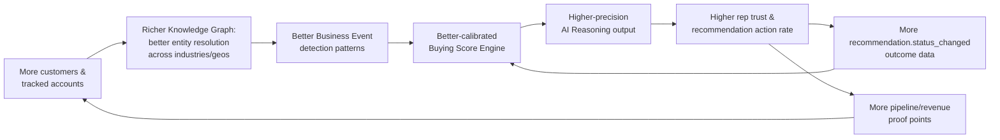

# PRODUCT_DIFFERENTIATORS.md

> **Status: Governing Strategy Document — Board & Executive Level**
> Prepared by the Signora Product Strategy Team, convened as: CEO, Chief Product Officer, Chief Revenue Officer, Principal Product Manager, VP of Sales, Enterprise Account Executive, Revenue Operations Leader, AI Product Architect, B2B SaaS Strategist, and Competitive Intelligence Analyst.
>
> **This document governs every future feature, engineering decision, roadmap item, and architectural investment.** It sits alongside [`CLAUDE.md`](CLAUDE.md) (how we build) and [`docs/architecture/`](docs/architecture/) (what we've built) as the third leg of Signora's operating constitution: **why we build it, and whether it's worth building at all.** Any proposal that cannot survive the [Decision Filter](#decision-filter) at the end of this document should be rejected or deprioritized, regardless of how easy it would be to ship.
>
> We were not asked to validate Signora. We were asked to stress-test it. Where the existing architecture is strong, we say so and explain why. Where it is exposed, we say that too.

---

## Vision

### What category is Signora creating?

Let's be precise about a real risk before we claim anything: **"Revenue Intelligence" is not an open category name.** Gong built a genuinely strong brand around that exact term, anchored in conversation intelligence — analyzing what happens *inside* deals. If Signora simply adopts the same label without differentiation, we become "Gong, but different," which is a losing frame in every analyst report and every prospect's mental model.

So we are deliberately splitting the term from the category:

- **Operationally**, we still say "AI Revenue Intelligence Platform" — because that's how the market searches, how analysts bucket us, and how budget gets allocated today. Refusing to use language buyers already use is a rookie positioning mistake.
- **Strategically**, we are building and will message toward owning a sharper, ownable sub-category: **Buying Intelligence** — the discipline of continuously determining *who* is in-market to buy, *why now*, *what evidence supports it*, and *what to do next*. Gong tells you what happened in a conversation you already had. Signora tells you which conversation to have in the first place, and arms you for it.

This is not a cosmetic distinction. It changes what we build. A conversation-intelligence company optimizes for call volume and transcript analysis. A buying-intelligence company optimizes for external signal fusion, entity understanding over time, and explainable judgment about accounts a rep hasn't even talked to yet. Signora's entire pipeline — Provider Platform → Knowledge Graph → Observation Engine → Business Event Engine → Signal Engine → Buying Score Engine → Opportunity Engine → AI Research/Reasoning Engines → Recommendation Engine — is architected for the second thing, not the first.

### Long-term vision

Signora's long-term vision is to become **the reasoning layer of B2B revenue** — the system every revenue team consults before deciding where to spend their next hour, the way engineering teams consult a build pipeline before shipping. Not a report you pull up once a week. Not a database you query when you remember to. A standing, continuously-reasoning system that has already done the work by the time a human opens it.

In five years, the category leader in Buying Intelligence should be defined by whether it can answer, with evidence, four questions faster and more reliably than a skilled human analyst ever could: *Who should we pursue? Why now? What changed? What should we do next?* Signora's bet is that this is achievable — not as a dashboard feature, but as a first-class AI reasoning system with a persistent, provenance-tracked understanding of every account it watches.

### Why should this company exist?

Because the actual bottleneck in modern B2B revenue generation is not data. Data is commoditized — ZoomInfo, Apollo, and a dozen intent vendors have made sure of that. The bottleneck is **judgment at scale**: the ability to look at hundreds of thousands of noisy, fragmented, partially-contradictory external signals per account and decide, correctly and explainably, which ones matter, right now, for this specific company. That has historically only been done well by a small number of extremely experienced sales strategists, one account at a time, and it does not scale past a few dozen accounts per person.

That is an AI reasoning problem, not a workflow-automation problem and not a data-aggregation problem. Every competitor in this market is optimized for one of those two adjacent problems. Nobody has fully committed to solving the reasoning problem as a first-class, evidence-preserving, explainable system. That gap is why Signora should exist.

---

## Product Positioning

### One sentence

**Signora is the AI reasoning layer that tells revenue teams exactly which companies to pursue, why now, and what to do next — with evidence, not guesses.**

### One paragraph

Revenue teams don't lack data — they're drowning in it. Between a CRM, a contact database, an intent-data subscription, a handful of Slack signal alerts, and a conversation-intelligence tool, most sales organizations now pay for six to ten tools that each hand back more raw information for a human to interpret, with none of them actually deciding anything. Signora is different: it is not a database, not a dashboard, and not an alert firehose. It is a continuously-running AI system that ingests company intelligence from many providers, fuses it into a persistent knowledge graph, detects the business events that actually matter, correlates them into scored buying signals, reasons over the result with full evidence provenance, and hands revenue teams a small number of explained, prioritized, actionable recommendations — the same judgment a world-class sales strategist would produce, at a scale no human team can match.

### One page

Every revenue organization above a certain size runs the same broken loop today. Marketing and sales buy a contact database (ZoomInfo, Apollo) to know *who exists*. They buy an intent or ABM platform (6sense, Demandbase) to guess *who might be interested*, usually as an opaque score nobody fully trusts. They buy a sales engagement tool (Outreach, Salesloft) to *execute* outbound at scale, often against accounts nobody has actually vetted. They buy a conversation-intelligence tool (Gong, Chorus) to understand *what happened* after a conversation finally occurs. And underneath all of it sits a CRM (Salesforce, HubSpot) that is a system of record, not a system of judgment — it faithfully stores whatever a human typed in, and tells you nothing about what to do next.

Every one of these tools does its narrow job reasonably well. None of them closes the loop. A rep can have all six open in six tabs and still not know, with confidence, which of their two hundred assigned accounts to call this morning, or why. That gap — between *having data* and *having a decision* — is where sales time actually gets wasted, where pipeline forecasts become guesswork, and where marketing and sales disagree about who's "really" in-market.

Signora exists to close that gap directly, as its entire product, not as a bolt-on AI feature. The architecture reflects this on purpose: raw provider data is normalized and resolved into a persistent Knowledge Graph of companies and people; every meaningful change is recorded as a provenance-tracked Observation; Observations are classified into Business Events using a maintained taxonomy; Business Events are correlated into scored Signals; Signals are aggregated into a time-decayed, account-level Buying Score; sufficiently strong Buying Scores become qualified Opportunities; Opportunities are handed to an AI Research Engine (for deep, on-demand synthesis) and an AI Reasoning Engine (for fast, structured, evidence-cited explanation); and the result becomes a Recommendation — a specific, prioritized, explained next action, not a score to be reinterpreted. Every stage of that chain is inspectable. Every recommendation can answer "why do you think that?" with a full evidence trail back to the original observations, because the pipeline was built for that from day one, not retrofitted for it after a customer asked.

This is why Signora is not a CRM, not a dashboard, not an analytics tool, and not a contact database, and should never become any of them. It is the missing reasoning layer that sits above the data layer (providers, contact databases) and below the execution layer (CRM, sequencing tools), doing the one job none of them do: deciding, with evidence, what a revenue team should do next.

---

## Core Problem

### What problem exists today?

Revenue teams cannot convert the volume of available external signal into reliable, explainable action fast enough to matter. The signal exists — funding rounds, leadership changes, hiring surges, technology adoption, traffic shifts, intent spikes — scattered across a dozen data sources with inconsistent coverage, inconsistent freshness, and no shared schema. Turning that into "call this account, mention this, because of this" today requires either (a) a human doing hours of manual research per account, which does not scale past a handful of accounts, or (b) a black-box score from an ABM/intent vendor that reps routinely distrust and ignore, or (c) a rules engine ("if this signal fires, send this Slack alert") that generates volume without judgment and burns out its own users within months.

### Why do existing tools fail?

Three structural reasons, each mapping to a different failure mode we've catalogued in our competitive analysis below:

1. **They solve one layer of the problem and stop.** Contact databases (ZoomInfo, Apollo) solve *reach*. Conversation intelligence (Gong) solves *what happened in the room*. ABM platforms (6sense, Demandbase) solve *marketing orchestration*. Sales engagement tools (Outreach, Salesloft) solve *execution volume*. None of them solve *judgment* — deciding which account, with what evidence, right now. Buyers are forced to assemble judgment themselves, by hand, across all of these tools.

2. **They optimize for signal volume, not signal precision.** The newest cohort of "signal-based GTM" tools (Unify, Warmly, Common Room) genuinely improved on the old ABM model by moving faster and integrating more sources — but their core mental model is still "if signal, then alert" or "if signal, then play." That is workflow automation triggered by data, not reasoning about data. The well-documented failure mode is alert fatigue: RevOps teams report turning off Slack notifications within a quarter because the signal-to-noise ratio never improved as volume increased.

3. **They present conclusions without evidence.** 6sense and Demandbase-style predictive scores are frequently criticized, by their own customers, for being unexplainable — "why is this a 92?" — which means sales reps, who are trained to distrust anything they can't defend in front of a prospect, quietly ignore the score and go back to gut instinct. A recommendation a rep can't explain to their own manager is a recommendation that doesn't get acted on, no matter how statistically accurate it is.

### Why is the problem difficult?

Because solving it correctly requires four hard things at once, and most competitors have chosen to be excellent at one of them instead:

- **Entity resolution across noisy, conflicting, partial data sources** is a genuinely unsolved problem at most companies — matching "Acme Corp," "Acme Corporation Inc.," and a LinkedIn page with a slightly different legal name into one canonical company record, reliably, across millions of companies, is expensive, slow to get right, and gets *more* valuable the longer a system has been doing it. This is why we treat the Knowledge Graph as our most defensible moat (see [Product Moats](#product-moats)).
- **"Why now" requires memory, not snapshots.** A single observation ("VP of Engineering hired") means almost nothing in isolation. The same observation combined with "raised Series B four months ago" and "job postings for platform engineers up 40% this quarter" is a genuinely strong buying signal. Producing that synthesis requires a system that remembers and correlates over time — a timeline, not a lookup.
- **Explainability is architecturally expensive to retrofit.** If a system is built to output a score first and explain later, the explanation is usually a post-hoc rationalization, not a real evidence chain — and sophisticated buyers can tell the difference. Building evidence-first, provenance-tracked reasoning has to be a foundational architecture decision, which is exactly what Signora's Observation → Business Event → Signal → Buying Score → Opportunity → Reasoning pipeline is.
- **Precision requires the discipline to say nothing, not just the ability to say something.** Every incumbent in this space is incentivized to surface more signals, more alerts, more scored accounts — it looks like more value in a demo. The harder, more valuable discipline is suppression: correctly deciding an account is *not* worth a rep's time right now, and staying quiet about it. Almost nobody in this market has built for that on purpose.

---

## Ideal Customer Profile

We are deliberately narrow here. A platform trying to serve everyone from a two-person PLG startup to a Fortune 100 enterprise will be mediocre at both. Signora's architecture — provider fusion, persistent knowledge graph, AI reasoning over qualified opportunities — is built for a specific kind of buyer, and we should say so plainly rather than write ICP language vague enough to apply to any SaaS company.

| Dimension | Profile |
|---|---|
| **Company size** | 200–5,000 employees on the *customer's* side (our buyer), selling into other businesses (B2B). Below this, teams are usually too small to need a dedicated judgment layer above their existing tools; a founder-led sales motion doesn't need account prioritization at scale. |
| **Revenue** | Mid-market to upper-mid-market: roughly $20M–$1B ARR, with a dedicated SDR/AE motion and a named RevOps function. This is the range where pipeline-generation efficiency becomes a board-level metric, and where a "which accounts, why now" problem is expensive enough to justify a dedicated platform. |
| **Sales maturity** | Already running an account-based or hybrid ABM/outbound motion, already using at least one of ZoomInfo/Apollo (contact data) and one of Salesforce/HubSpot (CRM), and increasingly one intent or signal tool (6sense, Clay, Unify, Warmly). Signora's best customer is not replacing nothing — they are consolidating and upgrading a stack that has already proven the category matters to them but is failing them on judgment. |
| **Buying behavior** | Complex sale: $10K–$250K+ ACV, multi-threaded buying committee, 30–180 day sales cycles. Reps manage 50–300+ named/target accounts and cannot manually research all of them weekly. RevOps leadership is measured on pipeline generation efficiency and forecast accuracy, not just activity volume. |
| **Pain points** | Reps spend hours per week on manual account research; pipeline quality is inconsistent because account selection is guesswork or stale intent scores; marketing (ABM-sourced accounts) and sales (rep instinct) disagree about who's actually in-market; existing signal tools have already caused alert fatigue; CRM data is stale because nobody wants to manually update it; onboarding a new rep to an existing territory takes weeks because there's no persistent account narrative to hand them. |

**Secondary ICP, explicitly deferred, not ignored:** product-led-growth companies with usage-based buying signals (a Common Room-style motion). This requires different observation sources (product usage, not just firmographic/technographic) and a different Business Event taxonomy. It's a credible expansion market, not today's focus — chasing it now would dilute the Provider Platform and taxonomy investment the primary ICP needs. Revisit once the primary ICP's flywheel (see below) is proven.

---

## Jobs To Be Done

Ranked by priority. The ranking itself is a strategic statement: everything below Job 1 exists to make Job 1 trustworthy and actionable, not to stand alone as separate feature pillars.

1. **"Tell me which accounts to pursue right now, and why."** The core job. Every other capability in the product either feeds this job or is a downstream consequence of it. If Signora only ever did this one thing extremely well, it would still be worth paying for.
2. **"Give me evidence I can actually use — in the call, in the email, in the deal review."** Prioritization without usable evidence is just another score. This is the job that makes reps *trust* the recommendation enough to act on it, and it's the job the Timeline and provenance chain exist to serve.
3. **"Tell me what changed since I last looked."** Revenue teams don't re-research an account from scratch every week — they need to know what's new. This is a retention-critical job: it's the reason a rep opens Signora on a Tuesday they weren't planning to, and it's what turns the product from a one-time research tool into a daily habit.
4. **"Tell me what to do next — specifically."** Not "this account is hot," but "reach out to this VP, reference this event, in the next 3 days, via this channel." This is the job the Recommendation Engine exists to close, and it's the job that ties Signora directly to pipeline outcomes rather than research-tool usage.
5. **"Help me not waste time on accounts that aren't ready."** The most underserved job in this entire market. Every competitor tells reps who's hot; almost none of them confidently tell reps who to *stop* chasing. Time reclaimed from dead accounts is just as valuable as time directed toward live ones, and it's a much easier ROI story to prove.
6. **"Let me trust this system enough to act without re-verifying everything myself."** A meta-job, but the one that actually determines adoption. If reps have to double-check Signora's evidence before using it, the product has failed regardless of how accurate it is underneath. This is why evidence-chained reasoning and calibrated confidence are non-negotiable product principles, not nice-to-haves.
7. **(RevOps/Leadership job) "Show me whether our GTM motion is actually working, at the signal level — not just pipeline vanity metrics."** A secondary but strategically important job for the buyer (not just the user): RevOps leaders need to see whether the signals driving pipeline are real and improving, which is what justifies renewing and expanding the contract.

---

## Product Principles

Each principle exists because a specific, named failure mode in this market makes the opposite behavior tempting and common. We name the temptation deliberately.

**1. Evidence Before Opinion.**
Every recommendation must be traceable to the specific observations that produced it. *Why it matters:* the single most common complaint about existing intent/ABM scoring (6sense, Demandbase) is that it's a black box. A score without a "because" gets ignored by reps trained to distrust unexplained numbers. This principle is why the Observation → Business Event → Signal → Buying Score → Opportunity → Reasoning chain is provenance-tracked end to end at the architecture level, not just in the UI.

**2. Recommendations Over Dashboards.**
Success is a rep acting on a recommendation, not a rep viewing a report. *Why it matters:* dashboards are how legacy BI and analytics tools measure engagement, and it's a trap — "time on dashboard" is not correlated with pipeline generated, and optimizing for it produces a product people check out of habit rather than one that changes what they do. Dashboards remain available (Revenue Intelligence Platform, Timeline) as a *fallback* surface for exploration, never as the primary success metric.

**3. Continuous Intelligence, Not Point-in-Time Snapshots.**
The system watches accounts continuously and remembers what it has seen. *Why it matters:* stale intelligence is worse than no intelligence, because it creates false confidence — a rep acting on a three-month-old "hot" signal looks worse than a rep with no signal at all. This is why the Knowledge Graph and Timeline are architected as living, updating systems, not periodic snapshot exports.

**4. Context Over Data.**
A single fact is close to worthless; the same fact combined with related facts about the same entity is often decisive. *Why it matters:* this is precisely the synthesis work a good sales strategist does manually and that no raw-data vendor (ZoomInfo, Apollo, most intent providers) attempts to do for the customer. It's also why Business Event Engine and Signal Engine exist as distinct stages rather than exposing raw observations directly — an unprocessed observation feed is a firehose, not intelligence.

**5. Precision Over Volume.**
One explained, high-confidence recommendation beats fifty raw alerts. *Why it matters:* this directly targets the alert-fatigue failure mode that has already damaged trust in the "signal-based GTM" cohort (Unify, Warmly, and their predecessors). The temptation to show more signals because it demos well is real and must be actively resisted — the AI Reasoning Engine's job includes suppression, not just synthesis.

**6. AI-First, Not AI-Bolted-On.**
Reasoning is the product, not a feature layered onto a CRUD app after the fact. *Why it matters:* nearly every legacy competitor (Salesforce Einstein, HubSpot's AI features, ZoomInfo's "Copilot"-style additions) is adding AI to an existing system-of-record or system-of-reach product. Bolted-on AI inherits the data model and UX assumptions of the product it was added to, which is why it usually feels shallow. Signora's event-driven, reasoning-centric pipeline exists because the product was designed around reasoning from the first architectural decision, not retrofitted.

**7. Workflow Over Reporting.**
Recommendations should show up where revenue teams already work — CRM, Slack, email — not require a new tab to be checked. *Why it matters:* every additional tool a rep must remember to open is adoption friction, and this market is already littered with abandoned point-solution tabs. The Integration Abstraction Layer exists specifically so Signora can push intelligence into existing workflows rather than demanding a new habit.

**8. Truth Over Vanity Metrics.**
We resist inflating "signals detected" or "accounts scored" counts, even when a bigger number would demo better or read better in a board deck. *Why it matters:* those numbers measure system activity, not customer value, and optimizing internally for them would corrupt the product exactly the way it has corrupted several ABM vendors' public metrics. Our own [North Star Metrics](#north-star-metrics) are deliberately outcome-based, not volume-based, for this reason.

---

## Competitive Differentiators

| Differentiator | Description | Customer Value | Difficulty to Copy | Engineering Investment | Strategic Importance |
|---|---|---|---|---|---|
| **Evidence-Chained Reasoning** | Every recommendation is traceable, in one click, back through Opportunity → Buying Score → Signal → Business Event → Observation to the original provider data. | Reps and managers can defend a recommendation to a prospect or to leadership without re-verifying it themselves — this is the trust unlock competitors lack. | **High.** Requires the entire pipeline to be provenance-first from the schema layer up; cannot be retrofitted onto a scoring engine that wasn't designed for it. | High (already the core architecture — see [06-events.md](docs/architecture/06-events.md), [14-ai-architecture.md](docs/architecture/14-ai-architecture.md)) | **Critical** — this is the single biggest wedge against 6sense/Demandbase's black-box reputation. |
| **Persistent Knowledge Graph & Entity Resolution** | Canonical, continuously-updated understanding of every company/person entity, reconciled across every provider. | Eliminates duplicate/conflicting records, gives every downstream stage a reliable foundation, and gets more accurate the longer a customer uses the product. | **Very High.** Multi-year data and engineering investment; the classic hard-to-replicate B2B data-fusion problem. | High (Knowledge Graph module, ongoing) | **Critical** — see [Product Moats](#product-moats), ranked #1. |
| **Buying Score Engine (composite, decayed, explainable)** | A single account-level propensity score, aggregated from multiple time-decayed signals, with full traceability to its inputs — explicitly separated from raw per-signal scoring. | Reps get one trustworthy number instead of a wall of individual alerts; leadership gets a consistent, explainable prioritization metric across the whole book of business. | **Medium-High** once data volume exists to calibrate it; **Low** to build a shallow version (which is exactly what several competitors have done, and why theirs are distrusted). | Medium-High, compounds with usage | **High** |
| **AI Research Engine (agentic, on-demand deep research)** | A distinct reasoning stage that performs multi-step, agentic synthesis on a qualified opportunity — not just a structured scoring call. | Gives reps a genuinely deep account brief on demand, comparable to what a research analyst would produce, in minutes instead of hours. | **High.** Requires an architecture that separates fast structured reasoning from slow agentic research (most competitors have only the former, if they have reasoning at all). | High (new module, [ADR-0025](docs/architecture/adr/0025-module-boundary-evolution.md)) | **High**, and rising — this is the differentiator most likely to be undervalued today and decisive in 3 years. |
| **Negative Signal / Deprioritization Intelligence** | The system explicitly tells reps which accounts are *not* worth pursuing right now, with reasoning, rather than only surfacing positive signals. | Reclaims rep time from dead accounts — an underserved, easy-to-prove ROI story almost no competitor tells. | **Medium.** Technically straightforward once the Buying Score Engine exists; the difficulty is organizational discipline (see Principle 5) more than engineering. | Low-Medium (a policy/product decision more than a new module) | **Medium-High** — cheap to build, high differentiation, currently unclaimed territory. |
| **Timeline as Narrative Memory** | A chronological, per-entity feed turning raw pipeline output into a readable account story, usable for rep onboarding and QBRs. | New reps inherit full account context instantly instead of starting from zero; managers get a defensible account history for reviews. | **Low-Medium** as a standalone feature; **High** to make it *good* because it depends on everything upstream being accurate. | Medium (Timeline module) | **Medium** — a strong retention and UX differentiator, but a projection of other moats, not one itself. |
| **Multi-Provider Fusion with Reconciliation** | Provider Platform orchestrates many data providers and resolves conflicts/gaps automatically, rather than requiring a customer to hand-build a "waterfall" (the Clay model). | Removes the need for a dedicated "GTM engineer" role to maintain data pipelines — a real, named pain in the Clay user base. | **Medium.** Any well-funded competitor can integrate the same providers; the durable edge is fusion/reconciliation quality, not provider count. | Medium-High (Provider Platform module) | **High** for adoption and time-to-value, even though it's a shallower long-term moat than the Knowledge Graph. |
| **Self-Improving Recommendation Loop** | `recommendation.status_changed` feeds back into Signal Engine as a new input — the system learns from what reps actually acted on or dismissed. | Recommendation quality improves over time per customer, and (in aggregate, privacy-safe form) across the whole platform. | **High** once real outcome volume exists; **near-impossible to copy quickly** because it requires both the architecture and the accumulated data. | Medium today, compounding | **High**, long-term — this is the mechanism behind the [Product Flywheel](#product-flywheel). |

---

## Competitive Analysis

### Comparison matrix

Ratings: **Strong** · **Moderate** · **Weak** · **None** (as a category fit, not as a criticism of execution within their chosen scope).

| Capability | Salesforce | HubSpot | Gong | Clay | 6sense | Demandbase | ZoomInfo | Apollo | Common Room | UserGems | Unify / Warmly | LinkedIn Sales Nav | **Signora** |
|---|---|---|---|---|---|---|---|---|---|---|---|---|---|
| System of record (CRM) | Strong | Strong | None | None | None | None | None | Weak | None | None | None | None | None *(by design)* |
| Contact/company data breadth | Weak | Weak | None | Moderate (via providers) | Moderate | Moderate | Strong | Strong | Weak | Weak | Moderate | Strong | Moderate *(via Provider Platform, not owned data)* |
| Intent/signal detection | Weak | Weak | None | Moderate | Strong | Strong | Moderate | Moderate | Strong (PLG-specific) | Strong (narrow: job changes) | Strong | None | **Strong** |
| Persistent entity knowledge graph | Weak | Weak | None | None | Weak | Weak | Weak | Weak | Weak | None | Weak | Moderate (LinkedIn's own graph) | **Strong** |
| Explainable, evidence-chained reasoning | None | Weak (gen-AI assist only) | Weak | None | Weak (black-box scoring) | Weak | None | None | Weak | Moderate (single-signal, so inherently explainable) | Weak | None | **Strong** |
| Conversation intelligence | None | None | **Strong** | None | None | None | Moderate (via Chorus) | None | None | None | None | None | None *(intentionally not built — see below)* |
| Workflow/action automation | Strong (config-heavy) | Strong | Moderate | Strong (DIY) | Moderate | Moderate | Weak | Strong (sequencing) | Moderate | Moderate | Strong | None | Moderate *(via Integration Abstraction Layer, growing)* |
| AI-native architecture (reasoning, not just gen-AI features) | Weak | Weak | Moderate | Weak | Weak | Weak | Weak | Weak | Weak | Weak | Moderate | None | **Strong** |
| Enterprise readiness (security, tenancy, scale) | Strong | Moderate | Strong | Weak | Strong | Strong | Strong | Moderate | Weak | Weak | Weak (young) | Strong | Moderate, improving *(see Risk R-12)* |

### Where Signora wins

- **Explainability against 6sense/Demandbase.** Their single biggest, most consistently cited customer complaint is opaque scoring. Signora's provenance-chained pipeline is a direct, structural answer, not a UI polish.
- **Reasoning depth against Unify/Warmly/Clay.** These are excellent at signal aggregation and workflow triggering; none of them has a genuine multi-stage reasoning system with a persistent knowledge graph. They automate rules over data; Signora reasons over context. This is the sharpest and most defensible line we can draw, because it's the competitor set most likely to be confused with us.
- **"Judgment" against ZoomInfo/Apollo.** Both are, correctly, providers *inside* our own architecture. Their customers already know they're "just a database" — that stigma is real and citable, and it's our best top-of-funnel positioning line: *the market has already decided contact data alone isn't enough; we're the next layer.*
- **Deprioritization intelligence against everyone.** Nobody in this comparison set confidently tells reps who to stop chasing. It's a nearly free differentiator sitting unclaimed.

### Where competitors remain stronger

- **Gong on conversation intelligence and enterprise trust in the term "Revenue Intelligence."** We will not out-build years of call-analysis infrastructure or their brand equity in this specific term, and we should not try.
- **ZoomInfo/Apollo on raw contact-level breadth and accuracy** (direct dials, verified emails at scale). We are architected to consume this as input, not to out-compete it.
- **LinkedIn Sales Navigator on professional-graph freshness.** LinkedIn's data access restrictions are a real, structural constraint, not a solvable engineering problem on our own — this is a genuine, acknowledged gap.
- **6sense/Demandbase on enterprise ABM/advertising orchestration** and marketing-side workflow depth. This is a different buyer (marketing) and a different job (media orchestration) than our core wedge.
- **Salesforce on system-of-record inertia and IT-level trust.** We will never win "replace the CRM," and should stop treating that as a battle worth fighting.

### How to close the gaps

1. **Conversation intelligence gap →** don't build call recording. Architect Observation Engine/Provider Platform to *optionally ingest* conversation-derived signals exported from Gong/Chorus/Salesloft as one more observation source. This converts a competitor's output into our input — a non-adversarial integration play that a pure competitor cannot easily offer, since it would mean helping a rival.
2. **LinkedIn data gap →** pursue official data-partnership access as it becomes available; in the interim, triangulate job-change and role signals from Provider Platform's other sources (Apollo, CoreSignal) and be honest internally that this is a bounded, accepted weakness, not a solved one.
3. **ABM/advertising orchestration gap →** do not build it. Integrate outward — push qualified opportunities/segments into 6sense/Demandbase-style platforms via the Integration Abstraction Layer if a customer already owns one, positioning Signora as the reasoning layer that makes their existing ABM spend more precise, not a replacement for it.
4. **Enterprise trust gap (security/compliance) →** this is a solvable, near-term gap, not a structural one. It is directly tracked as Risk R-12 in [16-architecture-risks.md](docs/architecture/16-architecture-risks.md) (SOC 2 readiness) and should be treated as a Horizon-1 priority per [17-future-recommendations.md](docs/architecture/17-future-recommendations.md) — every enterprise deal we lose to "you're too new/unproven" between now and closing that gap is a preventable loss.
5. **Raw data breadth gap (ZoomInfo/Apollo/LinkedIn) →** never attempt to close it by building our own data-collection operation. Close it by broadening Provider Platform's provider roster (see [ADR-0013](docs/architecture/adr/0013-company-intelligence-provider-strategy.md)) and by making fusion quality good enough that customers stop caring which single provider has the "best" raw record.

### What NOT to copy — by competitor

- **Salesforce:** don't become configuration-heavy, admin-dependent, or horizontally bloated. Complexity that requires a consultant to configure is a moat *against* us, not a feature to imitate.
- **HubSpot:** don't dilute focus by bundling marketing/CMS/service-desk functionality to chase "platform" status. Stay a specialist.
- **Gong:** don't build anything with a "surveillance" feel. Gong's own users' most common complaint is the big-brother sensation of being recorded and scored. Signora must feel like an ally that found a rep a warm account, never like a monitoring system.
- **Clay:** don't ship a low-level, spreadsheet-like configuration UI as the *primary* interface. It caps the product to power users and prevents company-wide, no-configuration trust — the opposite of what closes Job-to-be-Done #6 (trust without re-verification).
- **6sense/Demandbase:** don't ship a score without an explanation, ever, under any product-velocity pressure. And don't let the product drift toward being "a marketing tool sales tolerates" — stay seller-and-revenue-team-centric.
- **ZoomInfo/Apollo:** don't compete on becoming the primary owner-of-record for contact data. That race has a decade-long incumbent head start and is a commodity business, not a defensible one.
- **Unify/Warmly/Common Room:** don't chase feature-parity on every individual signal-source integration, and don't let the product become "just another Slack alert firehose" — that is the exact, already-documented failure mode of this cohort.
- **LinkedIn Sales Navigator:** don't build a manual browse/search tool as the primary UX. Manual hunting is the behavior Signora exists to eliminate, not emulate.

---

## What We Build

These are the capabilities that must become Signora's owned intellectual property, because they are the actual substance of the "reasoning layer" claim — anyone can buy data; almost nobody has built the reasoning system on top of it.

| Capability | Why it must be built, not bought |
|---|---|
| **Knowledge Graph** | The compounding, hard-to-replicate data-fusion asset at the center of everything. No vendor sells this off the shelf for our domain, and buying a generic graph database doesn't solve entity resolution — that's the actual IP. |
| **Provider Platform** | Reliable, cost-aware, multi-vendor data orchestration at scale is itself a competitive capability given how explicitly "multi-provider intelligence" is core to the product promise — not incidental plumbing. |
| **Provider Normalization** | Normalization quality across many inconsistent providers is hard-won domain IP that directly determines everything downstream. |
| **Observation Engine** | The provenance-tracked factual substrate is what makes Evidence Before Opinion (Principle 1) enforceable at all. |
| **Business Event Engine** | The taxonomy of what counts as a meaningful business event *for B2B buying intent specifically* is domain expertise no generic vendor has codified. |
| **Signal Engine** | Per-event scoring/correlation logic is the proprietary "so what" layer — nobody sells this for our specific domain. |
| **Buying Score Engine** | The composite, explainable, time-decayed account score is Signora's synthesized point of view on buying readiness — the direct answer to 6sense/Demandbase's black-box weakness, and it cannot be bought without becoming exactly the kind of opaque score we're positioned against. |
| **Opportunity Engine** | Qualification logic encodes our specific judgment about what "worth pursuing" means — this is a product opinion, not infrastructure. |
| **AI Research Engine** | Deep, agentic account synthesis is a direct product differentiator versus every competitor's shallower or nonexistent reasoning layer. |
| **AI Reasoning Engine** | The structured, evidence-cited explanation layer is the core AI differentiation the entire positioning rests on. |
| **Recommendation Engine** | Turning reasoning into a specific, prioritized action is the last mile of the product's actual value — and the mechanism behind the self-improving flywheel. |
| **Timeline** | The narrative memory surface is a primary, differentiated user-facing capability built entirely on our own proprietary pipeline output. |
| **Revenue Intelligence Platform** | The composed, workspace-level product surface is literally what customers are paying for — it cannot be outsourced. |

This list is intentionally identical to the thirteen core modules ratified in [09-build-vs-buy.md](docs/architecture/09-build-vs-buy.md) and [04-modules.md](docs/architecture/04-modules.md). That alignment is not a coincidence — it is confirmation that the engineering architecture and the product strategy are already the same bet.

---

## What We Buy

Commodity infrastructure that would be pure opportunity cost — and, in several cases, a security or compliance liability — to build ourselves.

| Category | Why we buy it |
|---|---|
| **Authentication & Authorization** (Better Auth, Casbin) | Identity and access are solved, security-critical problems; building them in-house adds pure liability with zero differentiation. |
| **Billing** (Stripe) | Subscription billing and payment compliance (PCI) are specialized, high-liability problems solved well by mature vendors. |
| **Search infrastructure** (Meilisearch) | The retrieval engine is commodity; what we index and how we rank it (Timeline, Buying Score) is where our value lives — buying the engine doesn't buy the judgment. |
| **Monitoring/Observability, Analytics, Feature Flags** (OpenTelemetry/Grafana/Sentry, PostHog, Flagsmith) | None of these are differentiated by being self-built; all are well-solved commodity categories. |
| **Object Storage, Notifications, Email** (S3, Novu, Resend) | Undifferentiated infrastructure with mature, cheap, low-risk vendors. |
| **Background job/workflow infrastructure** (Redis/ARQ, Temporal) | Durable job execution and workflow orchestration have serious correctness pitfalls if hand-built; this is explicitly a "never build" line item (see [09-build-vs-buy.md](docs/architecture/09-build-vs-buy.md)). |
| **Foundation AI models themselves** (Claude, OpenAI, Gemini) | We do not train or host frontier models — that is a different, capital-intensive business. We buy access to the best available reasoning substrate and build the orchestration, evidence chain, and domain judgment on top of it, which is where our actual differentiation lives. |
| **Raw company/people data** (Apollo, CoreSignal, BuiltWith, Similarweb, NeverBounce) | We do not originate firmographic, technographic, or contact data ourselves. We buy access to it and build the fusion, reasoning, and judgment layer that turns it into something a raw data vendor cannot sell. |
| **CRM, communication, email, calendar platforms** | These are the systems of record and interaction our customers already own; we integrate with them, we never compete to replace them. |

The unifying logic: **we buy anything where being "correct and boring" is the whole job, and we build anything where our specific point of view on B2B buying intent is the actual product.**

---

## Product Moats

Ranked from most to least defensible, with the reasoning behind the ranking made explicit — this is a judgment call, not a restatement of the module list.

**1. Knowledge Graph & Entity Resolution — the strongest moat.**
This is a classic compounding data asset: the longer the system runs, across more accounts and more customers, the better entity resolution gets, and the harder it becomes for a new entrant to catch up without years of the same investment. It also underpins every other capability — a weak graph degrades everything built on top of it. This is where we should be most protective of scope creep and most willing to over-invest.

**2. AI Reasoning Engine + AI Research Engine (the reasoning layer, including prompt/evaluation IP).**
Second, not first, because its full defensibility depends on accumulated evaluation and outcome data (see Risk R-10 — the evaluation harness doesn't exist yet) — but architecturally, it is already the hardest thing in this market to replicate quickly, because it requires *both* the persistent context (the graph) and the discipline of evidence-chained, dual-mode (fast structured + deep agentic) reasoning most competitors haven't attempted. Once the feedback loop from `recommendation.status_changed` starts genuinely tuning reasoning quality, this becomes a learning-system moat, not just a feature.

**3. Buying Score Engine (proprietary, outcome-calibrated scoring).**
Real, but currently a "moat in progress" — its ultimate strength depends on reaching enough real conversion-outcome data to make the scoring genuinely statistically superior to a generic intent score, the way credit-scoring models compound advantage with data volume. Ranked below the graph and reasoning layers because those have value from day one architecturally, while this one's edge is earned over time.

**4. Provider Platform (multi-provider orchestration and fusion).**
Real and valuable for time-to-value and reliability, but the shallowest of the top four — any well-funded competitor can and does integrate many of the same providers (Clay is proof this is achievable by a determined team). Our edge here is fusion and reconciliation *quality* at scale, not the mere existence of integrations, and that quality edge is real but more catchable than the graph or reasoning moats.

**5. Timeline (narrative memory).**
A genuinely strong UX and retention differentiator, and clearly distinct from every point-lookup competitor — but it is a *projection* of the other four moats onto a readable surface, not an independent moat. If the graph and reasoning underneath it were mediocre, the Timeline would just be a well-designed feed of mediocre information.

**6. Enterprise-grade multi-tenant architecture (RLS, workspace isolation, security posture).**
A "table stakes moat" — its presence doesn't win deals on its own, but its absence loses enterprise deals outright, especially once Risk R-12 (SOC 2 readiness) is closed. Worth ranking explicitly so engineering investment here isn't mistaken for a differentiation investment; it is a *qualification* investment.

**Others worth naming, not yet fully realized:** the self-improving recommendation feedback loop (item 9 in [Competitive Differentiators](#competitive-differentiators)) is the mechanism that, over years, could make moats #1–#3 compound faster than a fast-following competitor can catch up — it deserves continued investment even though it isn't yet a moat in its own right.

---

## User Experience Philosophy

### How should Signora feel?

Signora should feel like **a sharp, well-prepared chief-of-staff sitting next to every rep** — not a dashboard to check, not a database to query, not a system watching over anyone's shoulder. It should feel like the homework is already done by the time you sit down. The emotional target is *relief*, not *stimulation* — the opposite of the alert-fatigue, more-is-better instinct that has already burned out users of the signal-alert cohort.

### How should users describe it?

If we're succeeding, customers describe Signora in sentences like:

- "It already did the homework."
- "It told me *why*, not just *who*."
- "It didn't spam me — every alert actually mattered."
- "I trust it enough to bring it into the room."
- "It knew what changed before I did."

If instead customers start describing Signora as "another tool I have to check" or "yet another Slack channel I muted," that is a five-alarm signal that we've drifted from Principle 5 (Precision Over Volume) and Job 6 (trust without re-verification), regardless of what the usage metrics say.

### How should the AI behave?

- **Confident but calibrated** — states uncertainty honestly when the evidence is thin, rather than presenting every recommendation with the same false confidence. Overclaiming once is enough to lose a rep's trust for months.
- **Always shows its work** — never presents a conclusion without the evidence chain being one click away, consistent with the Evidence Before Opinion principle and the AI Reasoning Engine's validated-output-only architecture rule.
- **Terse and actionable, not verbose** — a rep needs a decision-ready summary, not an essay. Long AI-generated prose is a design failure in this product, not a sign of thoroughness.
- **Proactive but quiet** — surfaces what matters without being asked, and stays silent otherwise. The system's restraint is as much a feature as its insight.
- **Never fabricates evidence, ever** — this is a hard architectural and product rule, not a tuning preference, and it is already encoded as a non-negotiable in [14-ai-architecture.md](docs/architecture/14-ai-architecture.md) and [CLAUDE.md](CLAUDE.md) (AI output is untrusted until validated; never trigger action without it).
- **Speaks the language of revenue, not the language of the pipeline** — a user should never see the words "signal.scored" or "buying_score.updated." They should see "This account raised a $40M Series B and is hiring three platform engineers — reach out this week."

---

## What We Will Never Build

Explicit, permanent scope boundaries. Anything on this list that resurfaces as a roadmap proposal should be rejected at the [Decision Filter](#decision-filter) unless this document itself is formally revised.

- **A CRM.** We will never become a system of record. Every dollar spent trying to replace Salesforce/HubSpot is a dollar not spent on reasoning, and it puts us in a fight we cannot win against decades of IT-level trust and ecosystem lock-in.
- **Email marketing / sequencing / outbound execution.** Execution-layer tools (Outreach, Salesloft, Apollo's sequencer) are a different, commoditized business. Building one would dilute focus and put us in direct competition with several of our own Provider Platform partners.
- **Call recording / conversation intelligence.** This is Gong's business, requires an entirely different (and heavy) compliance and audio-infrastructure investment, and — per the integration strategy above — is more valuable to us as an *input* (via export/integration) than as a category we compete in directly.
- **General project management.** Completely outside the reasoning-layer thesis. Would only ever be a distraction.
- **General BI / dashboarding tooling.** We build exactly the reporting surfaces that expose our own pipeline's output (Timeline, Revenue Intelligence Platform); we do not build a general-purpose analytics tool for arbitrary customer data. That's a different, much more horizontal product with a different buyer.
- **An advertising platform / media buying.** This is 6sense/Demandbase's ABM-adjacent business, oriented around a marketing buyer we are not building for.
- **A primary contact-database business.** We will never try to out-collect ZoomInfo/Apollo/LinkedIn on raw data ownership. We fuse and reason over their data; we do not compete to become them.
- **A native calendar/scheduling tool.** Adjacent, commodity, already solved well by many vendors we integrate with instead.
- **HR / recruiting intelligence.** A genuinely adjacent market with genuine data overlap (hiring signals), which makes it a tempting distraction — but it is a different buyer, different JTBD, and different GTM motion. Explicitly out of scope.

The pattern across every item on this list: each one is a real, biggable business *someone else already runs well*, and each one would pull engineering investment away from the actual moats in the [Product Moats](#product-moats) section. Scope discipline here is not conservatism — it's what protects the moat investment from being diluted.

---

## North Star Metrics

Chosen deliberately to be outcome metrics, not activity or volume metrics — a direct application of Principle 8 (Truth Over Vanity Metrics). If a metric can go up while customer trust and pipeline outcomes go down, it is disqualified from this list, no matter how good it would look in a board deck.

### Primary metric

**Qualified Pipeline Generated per Recommendation Acted On** — the dollar (or standardized pipeline-stage) value of pipeline that can be attributed to a rep acting on a Signora recommendation, normalized per recommendation delivered. This is the one number that, if it's real and improving, proves the entire thesis of the company: that Signora's judgment, not just its data, is worth paying for.

### Supporting metrics

- **Recommendation acceptance rate** — % of recommendations acted on vs. dismissed. A leading indicator of trust (Job 6) and of Precision Over Volume (Principle 5) actually holding in practice.
- **Time-to-first-recommendation** for a newly onboarded workspace — a direct proxy for time-to-value.
- **Signal-to-noise precision** — % of surfaced opportunities reps rate as genuinely relevant, tracked explicitly to catch alert-fatigue drift before it damages retention, the way it has for competitors.
- **Target account coverage** — % of a workspace's tracked accounts with a current, evidence-backed Buying Score, as a measure of whether the Knowledge Graph and Provider Platform are actually keeping pace with the customer's book of business.
- **AI reasoning latency and cost per recommendation** — an internal efficiency metric tied directly to Risk R-01 (AI spend governance) and the AI Research Engine / AI Reasoning Engine split.

### Customer outcome metrics

- **Win rate on Signora-sourced opportunities vs. baseline** — the metric that ultimately justifies renewal and expansion.
- **Sales cycle length on Signora-sourced opportunities vs. baseline** — evidence-backed outreach should shorten cycles; if it doesn't, the reasoning isn't actually useful, no matter how sophisticated it looks internally.
- **Rep time reclaimed** — self-reported and, over time, inferred from behavior (fewer manual research sessions, faster account triage).

### AI quality metrics

- **Reasoning factual accuracy** — human-eval pass rate against golden test sets, the direct deliverable of the evaluation harness flagged as Risk R-10 and Horizon-1 priority in [17-future-recommendations.md](docs/architecture/17-future-recommendations.md). This is not optional infrastructure — it is the metric that protects the entire "evidence before opinion" positioning from quietly rotting as prompts and models change.
- **Evidence-completeness rate** — % of recommendations with a fully traceable, unbroken provenance chain. Any recommendation that fails this check should never reach a user; this metric should function as a release gate, not just a dashboard number.
- **False positive / dismissal-with-reason rate** — tracked per Business Event type and Signal type, to find and fix specific sources of noise rather than tuning the whole system blindly.

---

## Product Flywheel

Signora improves the more it is used — but the mechanism has to be described precisely, because it is not "more data equals a better product" in the generic, hand-wavy SaaS sense. It is two specific, compounding loops, both already implied by the ratified architecture.

**Loop 1 — the intelligence loop:** every new customer and tracked account adds entity-resolution and business-event pattern data. That data, aggregated at the *pattern* level (what a real funding-round observation looks like structurally amid provider noise, not any individual customer's actual deal data), improves detection quality and Buying Score calibration for everyone. Better Buying Scores produce higher-precision AI Reasoning output, which drives higher recommendation-acceptance rates (the primary North Star's leading indicator), which generates more `recommendation.status_changed` outcome data — the exact input the Buying Score Engine and evaluation harness need to keep improving. This loop only works if it respects the tenancy architecture strictly: no single customer's proprietary opportunity or account data ever leaks into another workspace's view (enforced today by PostgreSQL RLS, per [11-tenancy.md](docs/architecture/11-tenancy.md)) — what compounds across customers is pattern-level model and taxonomy quality, never raw customer data. Any product proposal that would blur this line must be rejected outright, both on trust grounds and on the explicit multi-tenancy principles this platform is built on.

**Loop 2 — the coverage loop:** better outcomes (Loop 1) generate the revenue and credibility to expand Provider Platform's roster (see [ADR-0013](docs/architecture/adr/0013-company-intelligence-provider-strategy.md)), which improves account coverage, which attracts customers with broader or more specialized data needs, which funds further provider expansion.

Both loops point at the same conclusion: **the flywheel is powered by Recommendation Engine's feedback loop and Provider Platform's expanding coverage, not by raw usage or seat count.** Growth metrics that don't feed one of these two loops (e.g., raw login frequency, dashboard views) should not be treated as flywheel evidence — a direct consequence of Principle 8.

---

## Future Vision (3–5 Years)

In three to five years, category leadership in Buying Intelligence should look like this:

- **The morning ritual shifts.** A rep's first action of the day is opening Signora's prioritized, explained account list — not the CRM, not an inbox, not a Slack channel. The CRM becomes what it always should have been: a system of record that Signora writes *into*, not a system reps start their day inside.
- **AI Research Engine becomes an on-demand analyst, not a background process.** "Research this account before tomorrow's call" returns a genuinely deep, evidence-backed brief in well under a minute, at a quality that would previously have taken a skilled analyst an hour.
- **The Buying Score becomes a cited, benchmarked statistic.** Sales leaders reference it in board decks the way marketers cite lead scores today — "accounts above a Signora Buying Score of X convert at 3x the base rate" — because enough outcome data has accumulated to make the claim statistically defensible, not aspirational.
- **Recommendations become genuinely action-adjacent, with a human always in the loop for anything privileged or outbound-facing** (never violating the AI-output-is-untrusted-until-validated rule that governs the architecture) — drafted talking points, suggested outreach angles, and evidence summaries ready for a rep to approve and send, not just a pointer to go research something themselves.
- **The reasoning layer becomes infrastructure other tools build on.** Once the Knowledge Graph and reasoning quality are proven, a natural evolution is exposing a scoped, governed intelligence API — letting adjacent GTM tools (and eventually partner/channel and post-sale expansion use cases) consume Signora's judgment rather than rebuilding their own shallow version of it. This is the Plaid-style "become the layer everyone builds on" path, and it should be pursued only once the core product's moat is unquestionably established — not as a distraction from it today.
- **Category leadership is externally recognized, not just internally claimed.** Analysts (Gartner, Forrester, and the trade press covering this space) begin using "Buying Intelligence" as a distinct category from "Revenue Intelligence" (Gong's conversation-analytics territory) and from "ABM/Intent" (6sense/Demandbase's territory) — with Signora named as the company that defined it, because we were the first to fully commit to the reasoning-layer thesis rather than treating AI as a feature bolted onto an existing product.

Category leadership, ultimately, is not a market-share number. It's the moment competitors start describing *themselves* relative to us, instead of the reverse.

---

## Engineering Alignment

Every differentiator above maps to specific, already-ratified architecture. This section exists so that engineering investment decisions can be traced directly back to a named competitive claim — if a proposed piece of engineering work doesn't appear as support for something in this table, that is itself a signal worth raising at the [Decision Filter](#decision-filter).

| Differentiator | Architecture modules | AI components | Infrastructure | Future investments that strengthen it |
|---|---|---|---|---|
| Evidence-Chained Reasoning | Observation Engine, Business Event Engine, Signal Engine, Buying Score Engine, Opportunity Engine ([04-modules.md](docs/architecture/04-modules.md)) | AI Reasoning Engine's provenance recording ([14-ai-architecture.md](docs/architecture/14-ai-architecture.md)) | Event envelope `correlation_id`/`causation_id` propagation ([06-events.md](docs/architecture/06-events.md)) | Evidence-completeness as a release-gating metric (Risk R-10 evaluation harness) |
| Persistent Knowledge Graph | Knowledge Graph, Observation Engine | pgvector-backed semantic entity/relationship search ([ADR-0008](docs/architecture/adr/0008-search-and-vector-retrieval.md)) | PostgreSQL 17 + RLS as the single system of record ([ADR-0006](docs/architecture/adr/0006-data-platform-primary-database-and-multi-tenancy.md)) | Entity-resolution model investment; load-testing at target scale (Risk R-03) |
| Buying Score Engine | Buying Score Engine, Signal Engine | Outcome-feedback loop via `recommendation.status_changed` ([06-events.md](docs/architecture/06-events.md)) | Postgres-outbox durability guarantees ([ADR-0011](docs/architecture/adr/0011-background-processing-and-event-bus-transport.md)) | Statistical calibration against real conversion data as volume grows |
| AI Research Engine | AI Research Engine ([ADR-0025](docs/architecture/adr/0025-module-boundary-evolution.md)) | AI Provider Abstraction Layer, multi-vendor routing (Claude/OpenAI/Gemini), OpenAI Embeddings + pgvector retrieval ([ADR-0012](docs/architecture/adr/0012-ai-platform-architecture.md)) | ARQ low-concurrency worker pool; ratified Temporal migration path for durable agentic workflows ([12-scalability.md](docs/architecture/12-scalability.md)) | Temporal migration once agentic workflows exceed ARQ's resumability limits |
| AI Reasoning Engine | AI Reasoning Engine | Internal Prompt Registry, Pydantic-validated structured output ([14-ai-architecture.md](docs/architecture/14-ai-architecture.md)) | AI-stage-dedicated ARQ worker pools ([12-scalability.md](docs/architecture/12-scalability.md)) | Formal evaluation harness (Risk R-10) — the single highest-leverage near-term AI investment |
| Negative Signal / Deprioritization | Buying Score Engine, Opportunity Engine | Confidence/uncertainty in structured reasoning output | — | Product policy work more than new infrastructure |
| Timeline / Narrative Memory | Timeline (read-model/projection module) | — | Meilisearch full-text/faceted search ([ADR-0008](docs/architecture/adr/0008-search-and-vector-retrieval.md)) | Meilisearch load-testing at target scale (Risk R-08) |
| Multi-Provider Fusion | Provider Platform, Provider Normalization | — | Provider Abstraction Layer ports-and-adapters ([13-integrations.md](docs/architecture/13-integrations.md)) | Expanded provider roster (Bombora, ZoomInfo, etc. — [ADR-0013](docs/architecture/adr/0013-company-intelligence-provider-strategy.md)) |
| Self-Improving Recommendation Loop | Recommendation Engine, Signal Engine (feedback consumer) | Outcome data feeding future evaluation/tuning | Internal Event Bus, at-least-once idempotent delivery ([06-events.md](docs/architecture/06-events.md)) | This *is* the long-term flywheel investment — sustained priority |
| Enterprise trust / multi-tenant scale | Workspace & Tenancy | — | RLS-enforced isolation, Better Auth + Casbin ([ADR-0010](docs/architecture/adr/0010-identity-and-access.md)) | SOC 2 program (Risk R-12), latency SLOs (Risk R-07) |

---

## Decision Filter

Every future feature request, roadmap item, or architectural investment must be run through these six questions before it is prioritized. This is not a formality — it is the enforcement mechanism for this entire document, in the same spirit that [CLAUDE.md](CLAUDE.md) enforces engineering discipline and [09-build-vs-buy.md](docs/architecture/09-build-vs-buy.md) enforces build/buy discipline.

1. **Does this strengthen one of our named differentiators?** (See [Competitive Differentiators](#competitive-differentiators).) If it doesn't map to one, name which one it's supposed to create — and be suspicious if it can't.
2. **Does this improve a customer outcome metric, not just an activity metric?** (See [North Star Metrics](#north-star-metrics).) "Users will click this more" is not a yes.
3. **Is this difficult for a competitor to copy within a quarter?** If any of Unify, Warmly, 6sense, or Clay could ship an equivalent in a sprint, it is not a differentiator — it may still be worth building as table stakes, but it should never be prioritized *as* a moat investment.
4. **Does this strengthen our AI reasoning advantage specifically** — evidence quality, explainability, precision, or the self-improving feedback loop — rather than just adding another AI-labeled feature?
5. **Does this increase workflow intelligence** (judgment delivered into where revenue teams already work) **rather than reporting surface area** (another dashboard, another export, another view)?
6. **Would removing this weaken Signora in a way a customer would actually notice and complain about?** If the honest answer is "probably not," that is itself the answer.

**How to use the score:** if the answer is **"No" to four or more of these six questions, reject or deprioritize the proposal outright** — do not schedule it "for later," remove it from consideration and say so explicitly. If the answer is "No" to two or three, it does not get default engineering time; it requires an explicit tradeoff discussion with product leadership before it is scheduled, the same way a new architectural dependency requires an RFC per [01-overview.md](docs/architecture/01-overview.md). Only proposals that score "Yes" on five or six of these questions should be treated as default-prioritized roadmap work.

This filter is deliberately harder to pass than most product teams are used to. That is intentional. A platform trying to become the category leader in Buying Intelligence cannot afford to spend engineering time on anything that doesn't compound one of the moats in this document — every quarter spent on a feature that fails this filter is a quarter a fast-following competitor gets to close the gap on the moats that actually matter.
