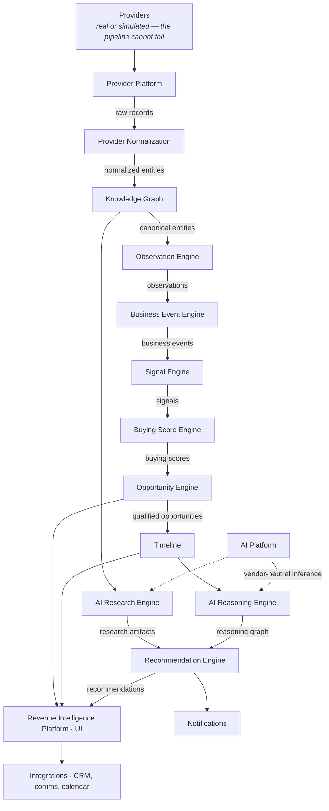

# PROJECT_STATUS.md

> **Revision:** v24 · **Last updated:** 2026-07-29 · **Reporting period:** M4 closed
> **Owner:** Technical Program Manager · **Audience:** Everyone
> Authoritative record of project state (CLAUDE.md §20d). Updated after every completed milestone, **before the next begins**.
>
> **This document has two halves.** The Executive Summary below is the entry point — read it to understand where the project stands. Everything after it is the detailed engineering record: milestone history, architectural decisions, rationale, risks, and debt. Nothing has been summarised away.

---

# Executive Summary

## 1 · What is Signora?

**Signora is an AI-powered Revenue Intelligence Platform.** It ingests signals about companies from third-party data providers — firmographics, technology stacks, funding events, hiring activity, behavioural buying intent — and reasons over them to surface *which accounts are worth a seller's attention right now, and why*.

The product's competitive advantage is the quality of that reasoning and the evidence chain behind it: every recommendation traces back to the observations that produced it. It is built as a modular monolith on a single PostgreSQL database with row-level tenant isolation, designed so any module could be extracted into its own service without changing its domain logic.

## 2 · Current Phase

| Phase | Status |
|---|---|
| **Platform Foundations** | ✅ **Complete** — runtime, auth, deployment, smoke verification, frontend |
| **Enablement** | ✅ **Complete** — Provider Simulation Framework |
| **Product Development** | 🔄 **In progress** — five pipeline stages built, through the Business Event Engine. Signora now produces sentences a CRO would recognise. |
| **AI Platform** | ⏳ Queued — M8 onward |
| **Production Readiness** | ⏳ Queued — cloud infrastructure, then GA |

## 3 · Overall Progress

| | |
|---|---|
| **Overall completion** | **~41%** by engineering effort (~131 of ~261–339 ew) |
| **Effort remaining** | **~130–208 ew** |
| **Milestones completed** | M0 · M1.1 · M1.2 · M1.3A · M1.4 · M1.5 · M2.0 · M2.1 · M2.2 · M3A · M3B · **M4** |
| **Current milestone** | **M5A — Signal Engine** (next) |
| **Projected to GA** | ~1.6–2.3 years at 3 engineers · ~2.5–3.4 at 2 · ~4.9–6.8 at 1 (80% capacity) |

## 4 · Roadmap Snapshot

Execution order is authoritative; milestone IDs are stable labels and deliberately **not** renumbered ([§5b](IMPLEMENTATION_ROADMAP.md#5b-execution-sequence)).

| # | Milestone | Purpose | Status |
|---|---|---|---|
| — | M0 | Secure multi-tenant foundation | ✅ Complete |
| — | M1.1 | Platform runtime — event bus, workers | ✅ Complete |
| — | M1.2 | Authentication boundary | ✅ Complete |
| — | M1.3A | Deployment foundation | ✅ Complete |
| — | M1.4 | Platform smoke test | ✅ Complete |
| — | M1.5 | Frontend foundation | ✅ Complete |
| — | M2.0 | Provider Simulation Framework | ✅ Complete |
| — | M2.1 | Provider Platform | ✅ Complete |
| — | M2.2 | Provider Normalization | ✅ Complete |
| — | M3A | Knowledge Graph | ✅ Complete |
| — | M3B | Observation Engine | ✅ Complete |
| — | M4 | Business Event Engine | ✅ Complete |
| 1 | **M5A** | **Signal Engine** | 🔴 **Next** |
| 7 | M5B | Buying Score Engine | ⏳ Queued |
| 8 | M6 | Opportunity Engine — **first sellable moment** | ⏳ Queued |
| 9 | M8 | AI Platform — abstraction, prompts, eval harness | ⏳ Queued |
| 10 | M9 | AI Reasoning Engine | ⏳ Queued |
| 11 | M10 | AI Research Engine | ⏳ Queued |
| 12 | M11 | Recommendation Engine | ⏳ Queued |
| 13 | M7 | Timeline | ⏳ Queued |
| 14 | M12 | Revenue Intelligence Platform + business UI | ⏳ Queued |
| 15 | M13 | Integrations — CRM, comms, calendar | ⏳ Queued |
| 16 | M14a | Notifications | ⏳ Queued |
| 17 | M14b | Billing, analytics, feature flags | ⏳ Queued |
| 18 | M14.5 | Cloud Infrastructure *(deferred from M1.3B)* | ⏳ Queued |
| 19 | M15 | GA readiness — load, SOC 2, PII, spend | ⏳ Queued |
| — | 🎯 | **General Availability** | |

## 5 · Platform Module Map

*What Signora is composed of. The roadmap answers **when**; this answers **what**.*

### Foundations — the substrate everything else is built on

| Module | Status | Milestone | Purpose | Consumes | Produces |
|---|---|---|---|---|---|
| **Workspace & Tenancy** | ✅ Complete | M0 | The tenancy root. Owns workspaces, memberships, and the RLS boundary every other module inherits. | User identity from the auth tier | Workspaces, memberships, and the `workspace_id` scope all data carries |
| **Authentication** | ✅ Complete | M1.2 | Better Auth in Next.js is the sole authentication authority; the Python tier only verifies RS256 JWTs and can never mint one. | OAuth sign-in (Google, Microsoft) | Verified principals, and the workspace hint every request re-verifies |
| **Platform Runtime** | ✅ Complete | M1.1 | The event spine: transactional outbox, relay, dispatch, platform-owned idempotency, retry, dead-lettering, worker pools. | Domain events from any module | At-least-once delivery to subscribed consumers, exactly-once effect |
| **Deployment Foundation** | ✅ Complete | M1.3A | Production images, per-tier database identities, a concurrency-safe migration runner, and a restart-safe stack. | Source and configuration | A running system that survives any component restart |
| **Frontend Foundation** | ✅ Complete | M1.5 | The frontend platform: design system, component library, shell, routing, session, query layer. No business screens. | API responses, session | The surface business screens plug into from M12 |
| **Provider Simulation Framework** | ✅ Complete | M2.0 | Produces realistic provider payloads without a provider, for development, testing, CI, demos, and deterministic AI regression. | Datasets and scenario manifests | Provider payloads, delivered through the Provider Port like any real provider |

### Product pipeline — raw data becomes commercial meaning

| Module | Status | Milestone | Purpose | Consumes | Produces |
|---|---|---|---|---|---|
| **Provider Platform** | ✅ Complete | M2.1 | Runs syncs against provider adapters: pages responses, stores raw records, tracks watermarks, classifies failures. Knows nothing of any specific provider. | Provider Port implementations | Raw provider records, and the events announcing them |
| **Provider Normalization** | ✅ Complete | M2.2 | Translates each vendor's shape into Signora's own vocabulary as **claims** — evidence, not resolved records. The only place a vendor's format is understood. | Raw provider records | Immutable claims, each with full provenance |
| **Knowledge Graph** | ✅ Complete | M3A | Resolves *which company* a provider is talking about, deterministically and explainably, and derives relationships between entities. **Resolves identity, never truth.** | Claims | Entities, identity bindings, resolution decisions, relationships, and claim sets |
| **Observation Engine** | ✅ Complete | M3B | Detects **structural change** in what a provider asserts — and refuses to judge whether it matters. Re-assertion and provider disagreement are never change. | Evidence attached to entities | Observations, each attributed to the provider that asserted it |
| **Business Event Engine** | ✅ Complete | M4 | Answers **"why is this business-relevant?"** — turns observations into typed business events in language a CRO recognises. Owns the taxonomy, Signora's business language; refuses all commercial judgement. | Observations | Business Events, typed against a versioned taxonomy |
| **Signal Engine** | 🔄 **Next** | M5A | Detects commercially meaningful sales signals from business events — the difference between "something happened" and "something worth acting on happened". | Business Events | Signals |
| **Buying Score Engine** | ⏳ Queued | M5B | Combines multiple signals into a continuously updated buying propensity score per account. | Signals | Buying Scores |
| **Opportunity Engine** | ⏳ Queued | M6 | Decides whether an account should become an actionable sales opportunity. **The first sellable moment.** | Buying Scores | Qualified Opportunities |
| **Timeline** | ⏳ Queued | M7 | The account narrative — every observation, event, signal, and score in chronological order, so a seller can read the story rather than the data. | Observations, Business Events, Signals, Buying Scores, Opportunities, Recommendations | The chronological account view |
| **Revenue Intelligence Platform** | ⏳ Queued | M12 | The composed product surface: the business screens sellers actually use, assembled from every module above. | Opportunities, Timeline, Recommendations, AI Reasoning | The customer-facing application |

### AI — explaining and acting on what the pipeline found

| Module | Status | Milestone | Purpose | Consumes | Produces |
|---|---|---|---|---|---|
| **AI Platform** | ⏳ Queued | M8 | The vendor abstraction layer, Prompt Registry, and evaluation harness. Every model call in Signora goes through it; no module ever touches a vendor SDK. | Prompt templates, model configuration | A vendor-neutral inference surface, versioned prompts, and measurable output quality |
| **AI Reasoning Engine** | ⏳ Queued | M9 | Explains **why** an opportunity exists, reasoning over the evidence collected throughout the pipeline. Structured, single-call, bounded latency. | Knowledge Graph, Observations, Business Events, Signals, Buying Scores, Timeline | A reasoning graph — the explanation, with its evidence chain intact |
| **AI Research Engine** | ⏳ Queued | M10 | Agentic, multi-step research that enriches an account beyond what providers supply. Distinct from Reasoning: different latency, cost, and failure profile. | Knowledge Graph entities, external sources | Research artifacts, attributed and versioned |
| **Recommendation Engine** | ⏳ Queued | M11 | Generates prioritized recommendations and next-best-actions for revenue teams. | Reasoning output, research artifacts | Recommendations shown to users |

### Platform services — everything needed to run it as a business

| Module | Status | Milestone | Purpose | Consumes | Produces |
|---|---|---|---|---|---|
| **Integrations** | ⏳ Queued | M13 | Two-way sync with the systems sellers already live in: CRM, email, calendar. | Recommendations, Opportunities; inbound CRM and comms data | Writes into customer systems; inbound activity data |
| **Notifications** | ⏳ Queued | M14a | Delivers what matters to the right person at the right time, in the channel they use. | Signals, Opportunities, Recommendations | Alerts and digests |
| **Billing** | ⏳ Queued | M14b | Subscription, usage metering, plan enforcement, analytics, feature flags. | Usage and workspace state | Invoices, entitlements, product analytics |
| **Cloud Infrastructure** | ⏳ Deferred | M14.5 | Terraform, ECS, RDS, ElastiCache, Secrets Manager, deployment pipeline, monitoring, rollback automation. Deliberately deferred — see §4. | Production images | A deployed, monitored, externally reachable environment |
| **GA Readiness** | ⏳ Queued | M15 | Load testing at volume, SOC 2 evidence, PII policy, AI spend governance. | The whole system | A system that can be sold to an enterprise |

### The big picture

**Read it as one sentence:** raw provider data becomes canonical entities, entities produce observations, observations become business events, events become signals, signals become scores, scores become opportunities, opportunities get explained, and explanations become recommendations a seller can act on — with every step traceable back to the observation that caused it.

**That traceability is the product.** Any system can produce a score; Signora's claim is that it can show you the evidence.

## 6 · Completed Foundations

- ✅ **Secure multi-tenant platform** — PostgreSQL RLS, forced and self-sufficient; per-tier database identities
- ✅ **Authentication** — Better Auth issues RS256 JWTs, FastAPI only verifies; the API cannot mint a token it accepts
- ✅ **Event bus** — transactional outbox, relay, platform-owned idempotency, retry, dead-lettering
- ✅ **Deployment foundation** — production images, concurrency-safe migration runner, restart-safe stack
- ✅ **Smoke verification** — `make smoke`, 16 stages, one command, in CI
- ✅ **Frontend foundation** — design system, component library, shell, routing, query layer
- ✅ **Provider Simulation Framework** — Provider Port, shared contract suite, deterministic replay, fault injection

**Both foundations are frozen.** `signora_platform/` and the frontend foundation are consumed by later milestones, not modified — except for a production defect, accessibility issue, security issue, or approved architectural change.

## 7 · Current Focus

**M5A Signal Engine** — deciding which business events are commercially meaningful *to us*. It is the first module permitted to answer **"should we engage?"**, and M4 was deliberately shaped to leave that to it.

The layering principle now reads end to end: *claims preserve evidence · the Knowledge Graph resolves identity · the Observation Engine detects change · the Business Event Engine determines business meaning · the Signal Engine determines commercial meaning.* M5A inherits typed business events with their evidence, their corroborating providers, and the taxonomy version that produced them — and owns the judgement that turns *"Acme is in a hiring surge"* into *"this account is worth your attention now."*

It also inherits the one thing M4 deliberately did not do: **turn provider agreement into confidence.** M4 records which providers independently reached a conclusion; weighting that is a commercial rule, and it belongs where it can be reviewed.

**[21-intelligence-pipeline.md](docs/architecture/21-intelligence-pipeline.md)** is the primary architectural reference for how information moves through Signora — the document to read first, kept current with what is actually built.

## 8 · Biggest Remaining Milestones

Knowledge Graph · Observation Engine · Business Events · Signals · Buying Scores · **Opportunities (first sellable moment)** · AI Platform · AI Reasoning · AI Research · Recommendations · Timeline · Revenue Intelligence Platform · Integrations · Cloud Infrastructure · GA

## 9 · Current Health

| Indicator | Value | Target |
|---|---|---|
| **Backend tests** | **822 passing**, 0 failing, 0 skipped | 0 skipped |
| **Frontend tests** | **101 passing**, 0 failing, 0 skipped | 0 skipped |
| **Backend coverage** | **95.39%** | ≥95% (CI-gated) |
| **Security invariants** | **154 / 154**, each proven to fail when its guarantee is removed | 100% verified |
| **import-linter contracts** | **11 kept, 0 broken** | 0 broken |
| **Architecture drift** | **0** — no ratified ADR reversed; 10 documents amended for drift, all found by test or by implementation | Trending to 0 |
| **Open production bugs** | **0** | 0 |
| **Technical debt** | **0 outstanding** · **2 platform findings raised** (see M3A record) | — |
| **`make smoke`** | ✅ Passing (71s; 20 stages, the full pipeline through business events) | Required per milestone |

### Test suite composition

| Area | Tests | Notes |
|---|---|---|
| Security invariants | 154 | Permanent architectural guarantees; run as their own CI job |
| Simulation framework | 130 | Clock, dataset, scenario, faults, delivery, generators |
| Provider contract suite | 45 | **One suite, five adapters** — the keystone interchangeability test |
| Workspace & Tenancy | ~70 | RLS isolation, API, persistence |
| Platform (event bus, auth, observability) | ~130 | Outbox, relay, dispatch, idempotency, DLQ, JWT |
| Integration & demo checklists | ~42 | Cross-tier contract, migration runner, milestone gates |
| Provider Platform (ingestion, sync task, domain) | 16 | The M2.1 demonstration |
| Provider Normalization (vocabulary, claims, mappers, pipeline) | 56 | Claims — the unit of evidence |
| Knowledge Graph (resolution, use cases, pipeline) | 70 | Identity — the first decision Signora makes |
| Observation Engine (derivation, use case, pipeline) | 54 | Change — and, mostly, what is *not* change |
| Business Event Engine (rules, taxonomy, detection, pipeline) | 63 | Business meaning — in language a CRO recognises |
| **Backend total** | **822** | Coverage 95.39%, mypy strict over 254 files |
| Frontend components & foundation | 101 | Includes 13 AC-14/AC-15 guard tests |

---

# Engineering Record

*Everything below is the detailed record: milestone history, architectural decisions, rationale, risks, and debt. Preserved in full.*

---

## Platform Contracts

Ratified 2026-07-28. These are **foundation capabilities, not work in progress** — the substrate every later milestone is built on.

| Contract | Established | What it guarantees |
|---|---|---|
| Platform Runtime | M1.1 | Outbox relay, dispatch, platform-owned idempotency, retry, dead-lettering, worker pools |
| Authentication Boundary | M1.2 | Better Auth issues, FastAPI only verifies; the API cannot mint a token it accepts (ADR-0026) |
| Deployment Foundation | M1.3A | Production images, per-tier identities, concurrency-safe migration runner, restart-safe stack |
| Platform Smoke Test | M1.4 | One command verifies the whole platform; required before every milestone and release |
| Security Invariants | M1.2–M1.4 | 59 permanent architectural guarantees, each proven to fail when its guarantee is removed |
| Tenant Isolation Policy | M1.3A | Every table classified; tenant tables carry forced RLS, required policies, and a non-null identifier |
| Platform Infrastructure Policy | M1.3A | Infrastructure tables owned by platform services; the application publishes and cannot read |
| Platform Freeze | M1.3A | `signora_platform/` changes only for a security fix, production defect, or approved change |
| **Frontend Foundation** | **M1.5** | 🔒 Frozen. Design system, components, shell, query layer, auth integration, and routing are consumed, not modified — except for a production defect, **accessibility issue**, security issue, or approved change (CLAUDE.md §20c) |

**One change since the freeze:** the relay's transient-failure handling (M1.4), under the production-defect exemption.

---

## Platform Health Metrics

Permanent indicators, reported every milestone. Each is machine-checked — none is a judgement call — so a number moving is evidence rather than opinion.

### Architecture Stability

How much the agreed architecture is churning. Sustained instability means the design is being discovered during implementation rather than before it.

| Indicator | Current | Target |
|---|---|---|
| ADRs superseded or reversed since ratification | **0 of 27** | 0 — reversal means the decision was made too early |
| Documents amended for *drift* (code disagreed with docs) | **3** (11-tenancy ×2, 18-authentication) | Trending to 0 |
| Dependency inversions caught before implementation | **5** (3 in v9, 2 more in v10) | All — an inversion caught in planning costs a paragraph; caught in code it costs a milestone |
| Roadmap status | 🔒 **Frozen** — changes are sequencing, dependency correction, or RFC (§5c) | Category 3 requires approval |
| Documents amended for *new decisions* | 3 | Healthy — this is the process working |
| Unplanned architectural changes mid-milestone | **0** | 0 — these belong to the RFC process |
| `signora_platform/` freeze status | 🔒 **Frozen** since M1.3A · **1 change**, under the production-defect exemption | Changes require security fix, production defect, or approval |
| Infrastructure Contract | ✅ **10 of 10** requirements satisfied | All, continuously — verified by `make smoke` |

**Reading:** stable. No ratified decision has been reversed. Both drift amendments were found by writing tests that asserted the documented behaviour, not by a production incident.

### Foundation Health

Whether the substrate the 13 pipeline modules will be built on is sound.

| Indicator | Current | Target |
|---|---|---|
| Backend tests | **492 passing**, 0 skipped, 0 xfail | 0 skipped — a skipped test is an untested claim |
| Coverage | **95.26%** (CI gate 95%) | ≥95% |
| mypy strict | Clean, 113 files | Clean |
| Migrations reversible | **7 of 7** revisions | 100% |
| Disaster recovery validated | **4 of 4** components restart-safe | All |
| Platform smoke stages | **16**, all proven to fail when broken | Every stage verified |
| Whole-stack verification | **`make smoke`**, ~46s, in CI | One command, every merge |
| Platform modules with a failure-path test | 12 of 12 | 100% |
| Open production defects | **0** | 0 |
| Defects found by tests vs. by use | **8 of 13 by tests**; 5 by running the stack | Falling ratio is expected and is why `make smoke` now exists |

**Reading:** sound. The metric worth watching is the last one: every defect so far was found by a test written to look for it, four of them by deliberately breaking a guarantee to check the test bites.

### Security Invariant Status

The permanent architectural guarantees. A drop here is never a test problem.

| Category | Invariants | Status |
|---|---|---|
| Authentication | 15 | ✅ All passing |
| Authorization | 11 | ✅ All passing |
| Tenant Isolation Policy | 12 | ✅ All passing |
| Database privilege separation | 9 | ✅ All passing |
| Platform durability | 12 | ✅ All passing |
| **Total** | **75** | ✅ **75 / 75**, also green against the running production stack |

| Indicator | Current | Target |
|---|---|---|
| Invariants proven to fail when their guarantee is removed | **59 of 59** | 100% — an unverified invariant may assert nothing |
| Invariants verified against a deployed stack | **59** (M1.3A local production) | Every milestone from M1.3A |
| Frontend guard tests (AC-14 / AC-15) | **13**, all proven to fail when violated | Every design-system change |
| Invariants weakened or removed to make a change pass | **0** | 0, permanently |
| Milestones adding invariants | 2 of 2 since introduction | Every milestone (AC-13) |
| Tables unclassified under the Tenant Isolation Policy | **0** | 0 — build fails otherwise |

**Reading:** healthy, with one caveat worth keeping visible. Writing this suite surfaced two of my own tests asserting nothing — a backoff cap compared against itself, and a marker hook that silently marked the whole suite. Both were caught only by deliberately breaking the guarantee. **The "proven to fail" column is the one that matters; the count alone would have looked identical while two tests were inert.**

### Cross-Module Boundary Violations

Whether the modular monolith is staying modular. These are the violations that are cheap now and structural later.

| Indicator | Current | Target |
|---|---|---|
| import-linter contracts | **4 kept, 0 broken** | 0 broken |
| Contracts proven to fail on a deliberate violation | 4 of 4 | 100% |
| Cross-module imports bypassing `public/` | **0** | 0 |
| Direct cross-module database access | **0** | 0 |
| Modules reading platform infrastructure tables | **0** (enforced by grant, not convention) | 0 |
| Synchronous cross-module calls | **0** — all inter-module communication is events | Exceptions require approval |

**Reading:** now meaningful. Four modules exist, and as of M3A the contracts are explicit per module pair — each module is forbidden from importing another's `domain/`, `application/`, `infrastructure/`, or `interface/`, and upstream modules cannot import downstream ones at all.

Adding those contracts immediately caught **two real violations in shipped code**, both invisible at runtime: Provider Normalization's handler imported Provider Platform's SQLAlchemy model directly, and Provider Platform's *application* layer imported its own `infrastructure/`. Both are fixed — read ports on `public/`, and a repository Protocol in `application/ports.py`. This is precisely why the rule needed a machine behind it: a cross-module import compiles and runs perfectly well, and stays invisible until the modules need to move apart.

---

### On the completion percentage

It has moved from ~19% (v8) to ~16% without a single engineer-week of work being lost or repeated. Three causes, all bookkeeping:

- **M1.5 makes explicit** ~14.5 ew of frontend platform work that was previously buried inside M12's estimate. M12 correspondingly drops from 28–40 to 24–35 ew.
- **M15 GA readiness was double-removed.** It had been folded inside the old `M4–M15` band; when that band was split into a pipeline row plus a separate M15 row, the pipeline figure was carried forward unchanged rather than reduced. The total was understated by roughly 16 ew as a result.
- **The total is now recomputed from the milestone table**, not carried forward. It is checked against the table each revision.

Recorded rather than quietly corrected: a denominator that moves without explanation is how estimates lose credibility.

### Calendar under sequential execution

Total effort is now **~267–345 ew** (recomputed — see above). Calendar time depends entirely on staffing, and sequential execution forfeits parallel compression:

Based on ~204–282 ew remaining at 80% effective capacity:

| Team size | M2.0 (22–29 ew) | Through M2.2 | **Remaining to GA** |
|---|---|---|---|
| **1 engineer** | ~28–36 weeks | ~46–61 weeks | **~4.9–6.8 years** |
| **2 engineers** | ~14–18 weeks | ~23–31 weeks | **~2.5–3.4 years** |
| **3 engineers** | ~9–12 weeks | ~15–20 weeks | **~1.6–2.3 years** |

Within a milestone, additional engineers help only up to the **critical path** — M1.5's chain (T25→T26→T28→T27→T29) is ~9 ew of serial work and cannot compress below that at any headcount.

**This is not an argument against the decision.** For a small team, context switching destroys more throughput than parallelism recovers. But the timeline consequence is owned here, at planning time, rather than surfaced later as a slip.

**Highest-leverage lever if the GA horizon matters commercially:** the second and third engineer. Moving 1 → 3 roughly triples throughput. Beyond ~3, the pipeline's serial dependency chain limits further gains.

**Honest read:** progress will look flat through M1 and M2.0, then accelerate. That is a property of building a runtime spine and a test substrate before features, not slow execution.

---

## Completed Milestones

### ✅ M0 — Secure Multi-Tenant Foundation · closed 2026-07-28

| Delivered | Evidence |
|---|---|
| Full architecture documentation set | 19 docs + 27 ADRs; 651 cross-links verified |
| Product strategy | [PRODUCT_DIFFERENTIATORS.md](PRODUCT_DIFFERENTIATORS.md) |
| Engineering constitution | [CLAUDE.md](CLAUDE.md) |
| Workspace & Tenancy module | All 5 layers, 5 use cases, 4 REST endpoints |
| Platform: db, event_bus (publisher), auth, authorization, api, pagination | ~1,288 LOC |
| PostgreSQL RLS tenant isolation | 4 migrations, reversible, adversarially tested |
| JWT auth boundary (ADR-0026) | RS256, pinned algorithms, forged-attack tests |
| Casbin authorization | Workspace-scoped policy, unit-tested |
| CI pipeline definition | ruff, mypy, import-linter, pytest |
| Execution roadmap | 4 planning documents |

**Three defects found by testing, not review:** superuser RLS bypass · membership policy that delegated enforcement to application code · `platform` shadowing a stdlib module. All fixed, documented, and covered by regression tests proven to fail against the pre-fix state.

### ✅ M1.1 — Platform Runtime · closed 2026-07-28

All 11 tasks delivered. **Demo Checklist: 13/13 passed. AC-1 passed.**

| Delivered | Evidence |
|---|---|
| Coverage measurement + CI gate (T1, T2) | 95.01% measured, gate at 95%, Redis service in CI |
| Structured JSON logging with redaction (T3) | 23 tests; JWT/bearer/secret redaction proven |
| Event bus dispatch schema (T6) | Migration 0004: `processed_event`, `dead_letter_event`, relay columns |
| Outbox relay (T7) | 12 integration tests; concurrent-relay safety via `SKIP LOCKED` |
| Dispatch + platform-owned idempotency (T8) | 14 integration tests; exactly-once proven under concurrency |
| ARQ worker fleet, 7 pools (T9) | Per-stage pools; `ai_research` at concurrency 2 / 1800s timeout |
| Retry + dead-lettering (T10) | Capped exponential backoff; DLQ replay retains history |
| OpenTelemetry, Sentry, metrics (T4, T5, T11) | Trace context survives the relay hop; 8 pipeline metrics |

**Findings during delivery:**
- **Dead code removed.** The pagination refactor left `list_for_workspace` (no caller at all) and `list_for_user` (test-only caller) behind. Both deleted rather than covered with tests.
- **Coverage exclusion is narrow and justified.** Only `apps/worker/relay_main.py` (an `asyncio.run` entry point) is omitted. The *logic* inside the worker — `dispatch_event`'s retry and dead-letter policy, pool resolution — is tested directly.

### ✅ M1.2 — Authentication Boundary · closed 2026-07-28

All 7 tasks plus 3 added requirements delivered. **Demo Checklist 10/10. AC-2 passed.** [Architecture Validation Report](docs/architecture/ARCHITECTURE_VALIDATION_M1_2.md) issued: all seven confirmations hold.

| Delivered | Evidence |
|---|---|
| Next.js 15 scaffold, tooling, CI (T12) | ESLint, Prettier, tsc, Vitest, Playwright all green |
| Signing-key management (T15, done before T14 per approval) | Pair-match validation; 10 unit tests |
| Better Auth + Google/Microsoft OAuth (T13) | `auth` schema (migration 0005), password auth disabled |
| RS256 JWT issuance (T14) | **Cross-tier contract test: a real frontend-minted token verifies with the real Python verifier** |
| Typed API client (T16) | Token refresh, standard error envelope |
| Frontend shell (T17) | Sign-in, workspace create/list, sign-out |
| E2E auth journey (T18) | Playwright; skips cleanly without OAuth credentials |
| **Auth observability** (added) | 10 `AUTH_*` events across both tiers, shared vocabulary |
| **Auth health** (added) | Both tiers; key-pair match, JWT config, OAuth config, DB |

**First user-visible outcome in the project.** Design-partner onboarding is unblocked once M14.5 provides a deployed environment.

**Findings:**
- Two toolchain workarounds recorded in the validation report (ESLint flat-config bridge, `@vitejs/plugin-react` peer conflict). Neither is architectural.
- A skip condition in the contract test initially hid it — the frontend path was resolved one directory too shallow, so it silently skipped rather than running. Caught by running verbosely; a test that skips when it should run is worse than one that fails.
- **One defect found during validation and fixed:** `signora_auth` was created by migration 0005 but never connected as — the frontend defaulted to the database *owner*, which bypasses RLS on every application table and defeated the schema isolation the migration exists to create. Both tiers' permissions were individually correct; nothing asserted the relationship between them. Fixed and verified against a live database.

---

## Current Milestone

### ✅ M4 — Business Event Engine · **CLOSED** 2026-07-29

| Field | Value |
|---|---|
| **Status** | ✅ **Completed** |
| **Completion date** | 2026-07-29 |
| **Commits** | `2718272` (proposal) · this change (T75–T83) |
| **Exit gate** | ✅ **`make smoke` passed** — 71s, fresh images, clean Compose stack, **20 stages**, 154 invariants green against the running system |
| **Effort** | ~10–14 ew scoped · delivered within range |

**The milestone in one line.** The first module whose output a human would recognise as intelligence — *"Acme is in a hiring surge: grew headcount 40% over 90 days"* rather than *"employee_count moved 100 → 140 per CoreSignal"* — and the first whose correctness is a **product judgement rather than a structural one**.

**The permanent boundary it establishes:**

> **The Business Event Engine answers "why is this business-relevant?" It does not answer "should we engage this account?"**
>
> How important the account is, what priority this deserves, how likely a purchase is, and what to recommend belong to the Signal Engine and everything after it. A business event carries **no priority, score, urgency, or rank** — enforced by a column-name invariant, not by convention.

**Acceptance criteria satisfied**

| AC | Status |
|---|---|
| **AC-35** No threshold lives in code | ✅ Rule modules parsed as **syntax trees**; any numeric literal in a comparison other than `0` or `1` fails the build |
| **AC-36** No commercial judgement | ✅ Column-name invariant over `business_event`; no priority, score, urgency, rank, importance, likelihood, propensity, or confidence |
| **AC-37** Citation, not subsumption | ✅ Two database CHECK constraints — every event cites ≥1 observation and names ≥1 provider; zero orphans asserted by join |
| **AC-38** Deterministic and replayable | ✅ The table is truncated and rebuilt from observations, reproducing the current set identically |
| **AC-39** Durable business history | ✅ Immutable; extension supersedes with a backward pointer; the full chain stays readable via `history()` |
| **AC-40** A refined observation re-evaluates its events | ⚠️ **Partial** — see below |
| **AC-41** One rule per type, every parameter used | ✅ Reconciled in both directions; validated at engine construction, not at first detection |
| **AC-6** Tenancy | ✅ `business_event` with forced RLS and full policies in migration 0011, registered and immutable |
| **AC-1** Event contract | ✅ Two events cataloged; `business_event_type.published` **removed** from the v2 catalog |
| **AC-13** Security Invariants extended | ✅ 124 → 154, each proven to fail when its guarantee is removed |

**Scope delivered.** The taxonomy artifact, schema, and startup validation · domain and deterministic identity · rule port and registry · eight point rules · three window rules · migration 0011 · `DetectBusinessEvents` with agreement counting and supersession · read port and module `public/` API · two event contracts · demonstration, smoke stage 14e, and 30 new Security Invariants.

**Architectural decisions.**

- **Taxonomy is data; rules are code.** The taxonomy — types, meanings, and *every* materiality threshold — is a versioned repository artifact reviewed like code. Correlation logic is Python. Everything-as-code hides the threshold; everything-as-data means inventing a DSL, which is a programming language with no type checker and a parser we would own forever.
- **The split is machine-enforced.** Rule modules are parsed as syntax trees. `0` and `1` are permitted as structural quantities; every other number is a claim about the world that must be declared where it can be argued with.
- **Agreement is evidence, never truth.** Each provider's series is evaluated alone, so no rule combines two providers' values. Two providers reaching the same conclusion produce **one** event recording both — a set, never a coefficient. This is the pipeline's first cross-provider reasoning, and it is deliberately narrow.
- **Two version numbers, deliberately separate.** `taxonomy_version` is meaning; `payload_version` is wire shape. Conflating them means tuning a threshold breaks a consumer contract, so nobody ever tunes a threshold.
- **`business_event_type.published` removed rather than implemented.** It assumed a runtime-mutable taxonomy; a repository artifact has no runtime publication to announce, and an event with no producer is a contract nobody is keeping.

**The CRO test changed the taxonomy before implementation.** *"If a CRO opened Signora today, would they immediately understand what this event means?"* — applied honestly, it broke three of the nine proposed types, and names are the hardest thing to change later:

| Proposed | Shipped | Why |
|---|---|---|
| `EXECUTIVE_CHANGE` | `LEADERSHIP_APPOINTED` · `LEADERSHIP_DEPARTED` | A leader joining and leaving mean opposite things commercially |
| `REVENUE_BAND_SHIFT` | `REVENUE_GROWTH` · `REVENUE_CONTRACTION` | "Revenue band" is *our* word, chosen because vendors report ranges |
| `INTENT_SURGE` | `BUYING_INTENT_SURGE` | "Intent" alone is closer to vendor vocabulary than to how a revenue team speaks |

**Eleven types across six business domains** — `capital`, `technology`, `leadership`, `workforce`, `growth`, `demand` — deliberately not the claim vocabulary's `firmographic` / `technographic` / `behavioural`, which describe where data came from rather than what happened. Asserted by invariant.

**Two limitations recorded rather than engineered around.**

| | |
|---|---|
| **The demonstration detects no buying-intent surge, and asserts that it does not.** The baseline scenario's intent ramp peaks at 88 but clears the elevated threshold for only two weeks, short of the three a sustained surge requires. Lowering the parameter would have been fitting a business judgement to a fixture. The scenario is what needs extending — scheduled M2.0 work. |
| **AC-40 is partial.** `citing_observations` and the replacement logic are implemented and exercised, but re-evaluation triggered by `observation.superseded` is wired at the contract level only. Closing the loop is small and belongs with the first real late-arrival scenario rather than ahead of it. |

**Two defects found during implementation.** A frozen `Observation` holding a mapping is not hashable, so merging agreeing detections by object failed against real data while passing against integer-valued fixtures. And the taxonomy's `_comment` preamble was rejected by `extra="forbid"` — declared as a field rather than tolerated, because forbidding extras is the point of that model: a typo'd key must fail a deployment rather than silently disable a type.

**Technical debt.** None introduced. None outstanding.

---

## Next Milestone

### 🔄 M5A — Signal Engine · **NEXT** · ~8–13 ew

Decides which business events are commercially meaningful **to us** — the first module permitted to answer *"should we engage?"*

**Why it follows M4.** M4 was shaped to leave that judgement here. It hands over typed business events with their evidence, the providers that corroborated them, and the taxonomy version that produced them, and stops. It also deliberately did **not** turn provider agreement into confidence: weighting agreement is a commercial rule, and it belongs where it can be reviewed.

**Awaiting:** architecture proposal and approval, as with every prior milestone.

---

## Queued Milestones

Sequential execution — each begins only when the previous milestone's Demo Checklist passes.

| # | Milestone | Effort | Gate |
|---|---|---|---|
| 3–4 | M2.1 Provider Platform · M2.2 Provider Normalization | ~14–20 ew | Per roadmap |
| 5–6 | M3A Knowledge Graph · M3B Observation Engine | ~17–23 ew | AC-6 tenancy under load |
| 7–10 | M4 Business Events · M5A Signals · M5B Buying Scores · M6 Opportunities | ~29–43 ew | **M6 is the first sellable moment** |
| 11–14 | M8 AI Platform · M9 AI Reasoning · M10 AI Research · M11 Recommendations | ~41–56 ew | AC-8, AC-9 |
| 15–16 | M7 Timeline · M12 Revenue Intelligence Platform + business screens | ~30–43 ew | Business UI lands here |
| 17–19 | M13 Integrations · M14a Notifications · M14b Billing | ~24–34 ew | Per roadmap |
| 20 | **M14.5** Cloud Infrastructure *(deferred from M1.3B)* | ~6 ew | AC-3B · rollback executed and timed |
| 21 | M15 GA readiness | ~20–27 ew | AC-11, AC-12 |

**Full order and rationale:** [IMPLEMENTATION_ROADMAP.md §5b](IMPLEMENTATION_ROADMAP.md#5b-execution-sequence). Milestone IDs are stable labels, not sequence numbers — they are deliberately non-monotonic so that PRODUCT_ROADMAP, AI_MATURITY_ROADMAP, and every ADR cross-reference stays valid.

### Dependency corrections applied

| Correction | Why |
|---|---|
| **AI Reasoning Engine reinstated** (position 12) | Ratified module, and load-bearing: `AI Reasoning → Recommendation Engine`, and RIP lists it as a dependency. Omitted, it would never be built and two downstream modules would lose an input. |
| **Timeline moved before Revenue Intelligence Platform** (15 before 16) | `05-module-dependencies.md:76` records *"Revenue Intelligence Platform → Timeline: synchronous query"*. RIP consumes Timeline, so Timeline must precede it. |
| **Integrations (M13) reinstated** (position 17) | Ratified scope with its own architecture document and product milestone. Dropping it silently would remove committed customer-facing capability. |

None adds, removes, or substitutes a module, contract, or technology — each restores a ratified dependency.

### Module boundary rulings

**Company Domain** → part of Knowledge Graph. **Activities** → part of Timeline unless later separated. **Assignments** → unassigned; no owning context, nothing scheduled. **Workspace & Tenancy** → complete at M0, removed from the active order, retained as documented foundational work.
| 3 | **M14.5** Cloud Infrastructure *(deferred from M1.3B)* | ~6 ew | ❌ | AC-3B · rollback executed and timed |
| 4 | M15 GA readiness | ~20–27 ew | ✅ load at volume | Per roadmap |

### Cloud infrastructure is deferred, not removed

**M1.3B has moved to M14.5, immediately before GA readiness.** Sequencing only: the target production architecture is unchanged, the scope is unchanged, and nothing is redesigned. [ADR-0022](docs/architecture/adr/0022-devops-infrastructure-and-deployment-topology.md) remains ratified.

Deferred: Terraform, ECS, RDS and ElastiCache provisioning, Secrets Manager integration, the cloud deployment pipeline, cloud rollback validation, production monitoring dashboards, Auto Scaling.

**Why.** M1.3A already produced a running production stack. Cloud infrastructure adds *reachability*, not capability — it makes no pipeline module work, and until the pipeline exists there is nothing to reach. Building it now means carrying a deployed environment through ~200 ew that does not need one.

**What it costs, plainly.** No externally reachable environment until M14.5. Design partners cannot use the product remotely before then; a demo is a local stack or a screen share. Accepted deliberately.

**What keeps it cheap:** the [Infrastructure Contract](IMPLEMENTATION_ROADMAP.md#5a-infrastructure-contract) — ten requirements, all satisfied today, enforced every milestone. The failure mode of "we'll add ops later" is discovering at M14.5 that stateful services and hardcoded configuration accumulated for two years. `make smoke` is what will notice.

### Why M1.3 was split

M1.3A proves the **application** is deployable; M14.5 proves **AWS** is configured. Run together, a failure gives no signal about which one is wrong — and every application-level fault (a container that will not start, a migration runner racing two replicas, a readiness probe green before the database is reachable) costs minutes locally and an afternoon inside ECS.

### Why M1.4 exists

Verification is currently spread across a backend suite, a frontend suite, a cross-tier contract test, and a checklist a human reads. Each is individually green while the *composition* goes unverified — which is exactly where the M1.2 credential defect lived. One command turns "everything passes" into a claim about the system rather than about its parts.

### M2.0 — why it precedes every pipeline module

A permanent platform capability, not throwaway tooling — used for local development, integration testing, E2E testing, demos, AI evaluation, regression testing, performance benchmarking, and customer onboarding demos.

**It also builds the Provider Port**, as its first concrete implementation. That satisfies the YAGNI ruling and validates the port with working code before any vendor adapter is written or contract signed.

**Binding rule:** simulated providers implement *exactly* the same adapter contract as production providers. Switching is configuration only; no `if simulated:` branching may exist in any layer; the ingestion pipeline is byte-identical in both modes.

**Highest-risk control:** the simulator must never activate in production — it would fabricate customer intelligence. Guarded by an environment check, unambiguous ingestion logging, health-endpoint visibility, and an alert, all test-enforced.

---

## Current Sprint

**Sprint:** M2.0 Sprint 1 — **awaiting approval.**

**Scope — M2.0 only.** Single stream; no concurrent milestone work.

M2.0 is the largest milestone since M0 (~22–29 ew) and the first that builds product capability rather than substrate. Its binding rules are already fixed in [IMPLEMENTATION_ROADMAP.md §8](IMPLEMENTATION_ROADMAP.md#8-provider-simulation-framework--design):

- **It builds the Provider Port**, as its first concrete implementation — satisfying the YAGNI ruling and validating the port with working code before any vendor adapter is written.
- **Simulated providers implement exactly the same adapter contract as production ones.** Switching is configuration only; no `if simulated:` branch may exist in any layer.
- **The simulator must never activate in production** — it would fabricate customer intelligence. Guarded by environment check, ingestion logging, health-endpoint visibility, and an alert, all test-enforced.

**What the foundation now guarantees it.** `make smoke` runs before this milestone starts and after every change in it, so a regression in the substrate is attributable to the change that caused it rather than discovered weeks later.

---

## Blocked Items

| Item | Blocked by | Severity | Owner |
|---|---|---|---|
| ~~All 13 core intelligence modules~~ | ~~T7/T8 — event bus relay + dispatch~~ | ✅ **CLEARED** | M1.1 |
| ~~Any human access / any demo~~ | ~~T13/T14 — Better Auth issuer~~ | ✅ **CLEARED** | M1.2 |
| Any *remote* environment | T22/T23 — Terraform + ECS (**M14.5, deliberately deferred**) | 🟡 Accepted | Unassigned |
| Reproducible local production stack | T19–T21 (M1.3A) | 🟠 High | Unassigned |
| Offline development, deterministic demos, AI eval datasets | M2.0 — simulation framework | 🟠 High | Unassigned |
| Provider Platform (M2.1) | M2.0 — Provider Port defined there | 🟠 High | Unassigned |
| Both AI engines | M8 — AI Provider Port + Prompt Registry | 🟡 Medium | Unassigned |
| Trustworthy AI output | M8 — Evaluation Harness (R-10) | 🟠 High | Unassigned |
| PII/retention implementation | **Legal/Compliance policy input** (R-04, R-05) | 🟡 Medium | **Escalated — not an engineering blocker** |

**One of the two dominant blockers is now cleared.** The event bus relay shipped in M1.1, unblocking all 13 pipeline modules. The remaining blocker is the Better Auth issuer: **there is still no working login**, so design-partner onboarding cannot begin until M1.2 closes.

**Staffing remains the meta-blocker** — every item above is unassigned, and headcount is the single largest determinant of the GA date (see Calendar above).

---

## Architecture Risks

Full register: [16-architecture-risks.md](docs/architecture/16-architecture-risks.md). **12 open, 1 resolved.**

| ID | Risk | Sev | Status | Addressed by |
|---|---|---|---|---|
| R-01 | AI vendor cost exposure without budget governance | 🔴 High | Open | M15 (earlier if AI Research enabled sooner) |
| R-04 | PII classification / retention / lifecycle undefined | 🔴 High | **Escalated to Legal** | M15 — start policy work now, long lead time |
| R-05 | AI prompt data-classification policy undefined | 🔴 High | **Escalated to Legal** | M15 |
| R-10 | No AI evaluation methodology | 🔴 High | Open — **partially de-risked by M2.0** | M8 |
| R-02 | Single-region vs. enterprise data residency | 🟠 Med | Open | Audit now, build later |
| R-03 | RLS query performance not load-tested at scale | 🟠 Med | Open | M15, using simulator-generated volume |
| R-06 | Cross-workspace admin/support access undefined | 🟠 Med | Open | Before support tooling |
| R-08 | Meilisearch/pgvector not validated at scale | 🟠 Med | Open | M15 |
| R-12 | SOC 2 / enterprise compliance gap | 🟠 Med | Open | M15, parallel with enterprise GTM |
| R-11 | Vendor concentration on younger projects | 🟡 Low-Med | Accepted, monitored | Quarterly review |
| R-07 | API/pipeline latency SLOs undefined | 🟡 Low | Open | Set from telemetry post-M1.1 |
| R-09 | AI Research Engine timeout undefined | 🟡 Low | Open | M10, from telemetry |
| R-13 | Better Auth is TypeScript-native | — | ✅ Resolved | [ADR-0026](docs/architecture/adr/0026-jwt-boundary-architecture.md) |

### New risk introduced by this revision

| ID | Risk | Sev | Mitigation |
|---|---|---|---|
| **R-14** | **Simulator activating in a production environment** would fabricate customer intelligence — a trust failure, not merely a bug | 🔴 High | Environment guard refusing activation in production absent an explicit logged override · ingestion logs mark simulated payloads unambiguously · simulator state in health output · alert on unexpected activation · **all four test-enforced**. To be added to the register during M2.0. |

**Most urgent by lead time, not severity:** R-04 and R-05. They need Legal/Compliance input engineering cannot supply, and formal policy work has a long tail. Starting them at M15 would be starting them late.

---

## Technical Debt

Small and deliberate. Nothing below is discovered debt.

| Item | Impact | Rationale | Repay by |
|---|---|---|---|
| ~~Test coverage unmeasured~~ | — | — | ✅ **Repaid in M1.1** — 95.01%, CI-gated |
| ~~Event bus relay unimplemented~~ | — | — | ✅ **Repaid in M1.1** |
| ~~`apps/worker` empty stub~~ | — | — | ✅ **Repaid in M1.1** — 7 pools |
| ~~No structured logging~~ | — | — | ✅ **Repaid in M1.1** |
| ~~No CI Redis service~~ | — | — | ✅ **Repaid in M1.1** |
| JWT key rotation requires a deploy | Medium | JWKS adds a cache, fetch path, and failure mode not yet justified | Post-GA |
| Token revocation not immediate (15-min TTL) | Medium | Standard JWT tradeoff; `sid`/`jti` carried so a revocation list needs no contract change | Post-GA if the window proves unacceptable |
| Workspace role hardcoded to `owner` in the frontend shell | Low | **Approved to remain.** Presentation only; server-side Casbin never consulted it. Adding `GET /workspaces/{id}/me` solely to satisfy frontend presentation would be an API shaped by a UI need rather than a domain one. | When the workspace domain naturally evolves — not before |
| Casbin policy is coarse RBAC | Low | Correct for current needs | When enterprise custom roles are required |
| No API versioning scheme | Low | Deliberate — speculative with one first-party client | First breaking change |

| Relay `LISTEN/NOTIFY` wake-up not yet wired to the loop | Low | `notify_outbox` exists and polling is the correctness guarantee; the notification only collapses idle latency from ~1s | M1.3A or when latency matters |
| ~~`@vitejs/plugin-react` removed from frontend devDependencies~~ | — | — | ✅ **Repaid in M1.5.** The stated cause was wrong: it was never `better-auth`'s Svelte peers. Two real conflicts — `@eslint/js` pinned to `^10` against `eslint@^9`, and `@vitejs/plugin-react@5` requiring Vite 6 under a Vitest pinning Vite 5. Both fixed at the version level, and **`--legacy-peer-deps` removed from both CI workflows and the Dockerfile**. A misdiagnosed cause is why the flag survived three milestones. |

**Debt ratio: healthy.** Five of the nine v3 items were repaid in M1.1. Two low-severity items now open, both with named repayment points.

**Scheduling rule.** Every item above carries a *repayment milestone*, not "later". Debt without a scheduled milestone is indistinguishable from a decision nobody revisits — the `@vitejs/plugin-react` entry exists precisely so its absence is discovered when component tests are planned rather than when they fail to run.

---

## Known Bugs

**None open.**

Three defects found and fixed during M0 and one during M1.2 validation, each with regression tests proven to fail against the pre-fix state.

### Open architectural question — raised, awaiting decision

**Platform tables are readable across every workspace.** `outbox_event` and `dead_letter_event` carry a `workspace_id` but have no RLS, and `signora_app` holds `SELECT` on both. Application code issuing an unfiltered query against either sees every workspace's event payloads.

The *absence of RLS* is deliberate — the relay must sweep all workspaces in one pass, which tenant-scoped RLS would prevent by construction. That rationale was recorded in `tests/conftest.py` but not in `11-tenancy.md`, whose stated exception list names only Business Event Engine's taxonomy. The documentation drift is now fixed.

What remains open is narrower: **the relay uses the privileged connection, and the publisher only ever inserts** — so `signora_app` appears to need `INSERT` but not `SELECT`. Revoking `SELECT` would close the cross-tenant read path without affecting the relay. That is a change to the tenancy model's grant surface, so it is raised rather than applied.

Encoded as a tracked deviation in `test_authorization.py::test_every_workspace_owned_table_has_rls_enabled_and_forced`: the two tables are named explicitly, and any *other* table reaching that list fails the build.

**Caveat worth restating:** "no known bugs" across ~2,660 LOC with one module and zero production traffic is a weak signal, not a quality claim.

---

## Test Coverage

| Metric | Value |
|---|---|
| Total tests | **198 passing**, 0 failing, 0 skipped |
| Unit tests | 129 |
| Integration tests | 69 (real PostgreSQL 17 + real Redis) |
| **Line coverage** | ✅ **95.01%**, CI-gated at 95% |
| Type coverage | ✅ mypy `strict`, 97 files, zero errors |
| Boundary enforcement | ✅ 3 import-linter contracts, verified to fail on deliberate violation |
| Migration reversibility | ✅ Verified across all 4 revisions |

**Test quality signals:** the `alg:none` and algorithm-confusion tests initially passed for the wrong reason (PyJWT refuses to mint those tokens) and were rewritten with hand-forged tokens. RLS regression tests were verified to fail against pre-fix policies before being trusted.

**M1.1 addition:** the Demo Checklist is itself a test file (`tests/integration/test_m1_1_demo_checklist.py`) — 11 tests covering all 13 items, run against real PostgreSQL and Redis. Milestone completion is verified by CI rather than by someone ticking boxes.

**Coming in M2.0:** the scenario library becomes a growing end-to-end regression suite, with each milestone extending its assertions.

---

## Documentation Status

| Document | Status |
|---|---|
| Architecture (19 docs) | ✅ Complete, ratified, consistent |
| ADRs (27) | ✅ Complete |
| [CLAUDE.md](CLAUDE.md) | ✅ Complete |
| [PRODUCT_DIFFERENTIATORS.md](PRODUCT_DIFFERENTIATORS.md) | ✅ Complete |
| [IMPLEMENTATION_ROADMAP.md](IMPLEMENTATION_ROADMAP.md) | ✅ **Updated to v3** |
| [PRODUCT_ROADMAP.md](PRODUCT_ROADMAP.md) | ✅ Valid — milestone numbers M2+ unchanged |
| [AI_MATURITY_ROADMAP.md](AI_MATURITY_ROADMAP.md) | ✅ Valid — levels unchanged |
| PROJECT_STATUS.md | ✅ **This document, v3** |
| API reference | ✅ Generated (OpenAPI) |
| `20-provider-simulation.md` + ADR | ⬜ **To be authored during M2.0** |
| Operations runbook | ⬜ **Required by M1.3A** (stack lifecycle), extended in M14.5 (deploy, rollback, restore) |
| Onboarding guide | ⬜ Needed when team exceeds ~3 |

**Documentation drift: zero.** All internal links resolve. Docs have been updated in the same commit as the code they describe, every time.

**Deliberate numbering choice:** M1 was split and M2.0 inserted *without renumbering M2+*, so PRODUCT_ROADMAP.md and AI_MATURITY_ROADMAP.md remain valid without edits. The mapping table is in [IMPLEMENTATION_ROADMAP.md §4](IMPLEMENTATION_ROADMAP.md#4-milestone-structure).

---

## Next Task

### 🎯 M1.5 · T25 — Design system

**Why first:** zero dependencies, and every component in T26 is built from its tokens. A component library started before its design tokens hardcodes colours, spacing, and type scale into fifty files.

**Then:** T26 → T28 → T27 → T29 → T30 → T31 → T32 → T33.

**Then M2.0** Provider Simulation Framework, after which business screens become buildable against real domain models.

**Awaiting:** approval of the M1.5 task breakdown, and a decision on the three dependency findings in [IMPLEMENTATION_ROADMAP.md §5b](IMPLEMENTATION_ROADMAP.md#5b-updated-implementation-order). Every task remains unassigned.

---

## Change Log

| Date | Change |
|---|---|
| 2026-07-29 | v24 — **M4 Business Event Engine complete.** The first module whose output reads as intelligence, and the first whose correctness is a product judgement. Permanent boundary: *answers "why is this business-relevant?", never "should we engage?"* — no priority, score, urgency, or rank, enforced by a column-name invariant. **Taxonomy is data; rules are code**, and the split is machine-enforced: rule modules are parsed as **syntax trees** and any numeric literal in a comparison other than 0 or 1 fails the build, with parameter declarations reconciled in both directions. Agreement is evidence, never truth — each provider's series is evaluated alone and two providers reaching one conclusion produce one event recording both. Taxonomy and payload versions kept separate so tuning a threshold never breaks a consumer contract. `business_event_type.published` removed: a repository artifact has no runtime publication to announce. **The CRO test changed three of nine proposed type names before implementation** — `EXECUTIVE_CHANGE` and `REVENUE_BAND_SHIFT` split by direction, `INTENT_SURGE` renamed — leaving eleven types across six business domains. Two limitations recorded rather than engineered around: the baseline scenario produces no intent surge under defensible thresholds, and AC-40 re-evaluation is wired at contract level only. 822 tests, coverage 95.39%, 154 invariants, 11 contracts, `make smoke` green over 20 stages. |
| 2026-07-29 | v23 — **M3B Observation Engine complete.** Permanent layering principle ratified: *claims preserve evidence · the graph resolves identity · the Observation Engine detects change · the Business Event Engine determines business meaning · the Signal Engine determines commercial meaning.* Change is computed **within one provider's series** — cross-provider comparison rejected as the central error, since disagreement merged into a series manufactures growth that never happened. First values establish a baseline and produce no observation. Observation identity is derived from observed facts, so deduplication is a primary-key conflict and a mapper fix cannot duplicate the table. Late arrival refines by append-only supersession. `entity.evidence_attached` approved and added to the Knowledge Graph; the canonical vocabulary formally recognised as a platform-wide contract. A Security Invariant reads derivation as a **syntax tree** to prove no threshold has crept in. Two defects found by running rather than by tests, one of them by `make smoke` against a fresh stack. 729 tests, coverage 95.10%, 124 invariants, 9 contracts, `make smoke` green over 19 stages. |
| 2026-07-29 | v22 — **M3A Knowledge Graph complete.** The first module that must *decide*. Permanent invariant ratified: *the Knowledge Graph resolves identity, not truth* — `entity` carries no attribute columns, and `ClaimSet` returns every contributing claim rather than a chosen value. `MatchStrength` ratified as a semantic category that can never become a number, with the type itself refusing numeric conversion and ordering. Ambiguity merges nothing, enforced by a database CHECK constraint. Migration 0009: four workspace-owned tables, forced RLS, `resolution_decision` immutable. Per-module-pair import-linter contracts added, immediately catching **two real boundary violations in shipped code** (M2.1 and M2.2), both fixed with read ports. **Two platform findings raised, not worked around** — `EventHandler` receives no session, so no module handler is registered in the live registry; and `PublishableEvent` cannot be satisfied by a frozen dataclass. One correction to the approved demonstration recorded honestly: three of five providers resolve together, not five, because the other two supply no matchable identity. 650 tests, coverage 95.54%, 99 invariants, 7 contracts, `make smoke` green over 18 stages. **[21-intelligence-pipeline.md](docs/architecture/21-intelligence-pipeline.md) authored.** |
| 2026-07-28 | v9 — **Platform Foundation approved and closed.** Eight platform contracts ratified (Platform Runtime, Authentication Boundary, Deployment Foundation, Platform Smoke Test, Security Invariants, Tenant Isolation Policy, Platform Infrastructure Policy, Platform Freeze). **M1.5 Frontend Foundation inserted** after M1.4 — frontend platform only, no business screens, no mock data. Business UI deferred until M2.0 produces real domain data. Cloud infrastructure confirmed at M14.5 with all task IDs and ADR references intact. Three dependency findings raised against the approved order (two graph inversions, five omitted modules, three unratified module names) — flagged, not silently reconciled. Sequencing only; the approved architecture is unchanged. |
| 2026-07-28 | v8 — **M1.4 Platform Smoke Test complete; platform foundation closed.** `make smoke`: 16 stages, ~46s, in CI, every stage proven to fail when deliberately broken. Two defects found by it — a relay that died permanently on a transient database failure (first and only post-freeze platform change, under the production-defect exemption), and two bugs in the smoke script itself that would have made it lie. **Cloud infrastructure deferred from M1.3B to M14.5** — sequencing only, nothing removed or redesigned — with a ten-point Infrastructure Contract (roadmap §5a) binding every milestone until then. 313 tests, coverage 95.63%. |
| 2026-07-28 | v7 — **M1.3A Deployment Foundation complete.** Production images (multi-stage, non-root, no secrets), concurrency-safe migration runner refusing runtime identities, 6-service production Compose stack, and Disaster Recovery Validation across Postgres/Redis/API/workers. Four defects found by running the stack rather than by tests — most seriously a worker that could never start while the whole suite passed. `signora_platform/` frozen. ADR-0022 updated with as-built topology. 310 tests, coverage 95.65%. |
| 2026-07-28 | v6 — **M1.2 approved.** Security Invariants suite established: 47 permanent invariants across authentication, authorization, database, and platform, each proven to fail when its guarantee is deliberately removed; wired into CI as a separately-reported job. Migration/runtime credential separation adopted as a permanent engineering rule (CLAUDE.md §8). M1.3 split into M1.3A Deployment Foundation and M1.3B Cloud Infrastructure; M1.4 Platform Smoke Test added; AC-3 split into AC-3A/3B/3C and AC-13 added. `@vitejs/plugin-react` recorded as scheduled technical debt. One architectural question raised for decision: platform-table read scope. |
| 2026-07-28 | v5 — **M1.2 Authentication Boundary complete.** 7 tasks plus 3 added requirements; 242 backend and 29 frontend tests; Demo Checklist 10/10; AC-2 passed; Architecture Validation Report issued. One defect found during validation: `signora_auth` created but never connected as, with the frontend defaulting to the database owner. |
| 2026-07-28 | v4 — **M1.1 Platform Runtime complete.** 11 tasks, 82 new tests (198 total), coverage 95.01% CI-gated, Demo Checklist 13/13, AC-1 passed. Dead code from the pagination refactor removed. 06-events.md updated to v3. |
| 2026-07-28 | v3 — sequential single-stream execution adopted; calendar restated by team size; Demo Checklist added as a completion gate; progressive AI regression assertion model defined; simulator identical-adapter-contract rule recorded |
| 2026-07-28 | v2 — M1 split into M1.1/M1.2/M1.3; M2.0 Provider Simulation Framework added; per-milestone Demo Scenario, User-Visible Outcome, DoD, Rollback, Operational Readiness introduced; R-14 identified; estimate revised to 225–305 ew |
| 2026-07-28 | v1 — Initialized. M0 closed. Roadmap documents created. |
