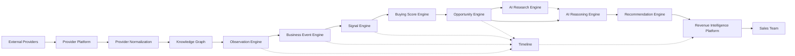

# 01 — Architecture Overview

> Status: **Living document — Architectural Constitution — RATIFIED**
> Audience: All engineers, EMs, and technical stakeholders at Signora
> Revision: **v2** — the Architecture Review Board has ratified the full technology stack, resolved every `TODO` that was resolvable at the engineering layer, and evolved the module map from eleven to thirteen core modules. See [08-technology-stack.md](08-technology-stack.md), [09-build-vs-buy.md](09-build-vs-buy.md), and [ADR-0025](adr/0025-module-boundary-evolution.md).
> Last reviewed: TODO (owner: Chief Architect) — process metadata, not a content gap; see [17-future-recommendations.md](17-future-recommendations.md) for the standing quarterly review cadence.

## Purpose

This document is the entry point into the Signora architecture documentation set. It explains what Signora is, what problem it solves, and how the rest of this documentation set (`docs/architecture/`) is organized. Every other document in this set assumes the reader has read this one first.

This documentation package is the **single source of truth** for how Signora is built. When code and documentation disagree, that is a bug — in the code, in the documentation, or both — and should be raised and resolved, not silently tolerated.

## What Signora Is

Signora is an **AI-powered Revenue Intelligence Platform**. It helps B2B sales teams identify buying opportunities by:

1. Collecting company intelligence from multiple external data providers, orchestrated by a dedicated provider platform.
2. Transforming that raw data, in stages, into increasingly valuable domain concepts:
   **raw provider data → observations → business events → signals → buying score → opportunities → AI research & reasoning → recommendations.**
3. Presenting the result to sales teams as a chronological **timeline** and actionable **recommendations**, scoped to their **workspace**, composed into a **Revenue Intelligence Platform**.

This transformation pipeline is the spine of the entire system. Every core module in [04-modules.md](04-modules.md) exists to perform one stage of this pipeline, and every architecture decision in this documentation set exists to make that pipeline correct, explainable, extensible, and scalable.

## The Core Idea, in One Diagram

Full module responsibilities are defined in [04-modules.md](04-modules.md); the event-driven wiring between them is defined in [05-module-dependencies.md](05-module-dependencies.md) and [06-events.md](06-events.md).

## Responsibilities of This Document

- Define what Signora is, in business and technical terms.
- Define the shape and purpose of the rest of the documentation package.
- Establish the vocabulary used consistently across every other document.
- Point readers to the correct document for their question.

This document does **not** define architecture principles (see [02-principles.md](02-principles.md)), module boundaries (see [04-modules.md](04-modules.md)), or technology choices (see [08-technology-stack.md](08-technology-stack.md)).

## Documentation Map

| # | Document | Answers the question |
|---|----------|----------------------|
| 01 | [Overview](01-overview.md) | What is Signora and how is this documentation organized? |
| 02 | [Principles](02-principles.md) | What non-negotiable engineering values govern every decision? |
| 03 | [System Architecture](03-system-architecture.md) | How is the system composed at the highest level? |
| 04 | [Modules](04-modules.md) | What are the bounded contexts and what does each own? |
| 05 | [Module Dependencies](05-module-dependencies.md) | Who is allowed to call/depend on whom, and how? |
| 06 | [Events](06-events.md) | What events exist, who publishes them, who consumes them? |
| 07 | [Data Flow](07-data-flow.md) | How does data move end-to-end for key scenarios? |
| 08 | [Technology Stack](08-technology-stack.md) | What technologies are used and why? |
| 09 | [Build vs. Buy](09-build-vs-buy.md) | What do we build ourselves vs. purchase? |
| 10 | [Security](10-security.md) | How is the system secured? |
| 11 | [Tenancy](11-tenancy.md) | How is multi-tenancy modeled and enforced? |
| 12 | [Scalability](12-scalability.md) | How does the system scale as load grows? |
| 13 | [Integrations](13-integrations.md) | How do we integrate with providers and third-party systems? |
| 14 | [AI Architecture](14-ai-architecture.md) | How is AI research/reasoning designed, and how do we stay model-agnostic? |
| 15 | [Project Structure](15-project-structure.md) | How is the codebase physically organized? |
| 16 | [Architecture Risks](16-architecture-risks.md) | What could go wrong, and who owns fixing it? |
| 17 | [Future Recommendations](17-future-recommendations.md) | What should we build next, and when? |
| 18 | [Authentication](18-authentication.md) | How is a caller's identity established at the API boundary? |
| 19 | [API Conventions](19-api-conventions.md) | What shape do requests, responses, and errors take? |
| — | [Architecture Decision Records](adr/README.md) | Why was each technology/vendor/module-boundary decision made? |

## Who This Documentation Is For

- **New engineers** ramping onto Signora — read 01 → 04 in order before writing code.
- **Feature engineers** working inside a single module — read 01, 02, 04 (your module's section), 06, and the relevant sections of 07.
- **Engineers proposing a new module, integration, or provider** — read 02, 04, 05, 09, and 13 before proposing anything.
- **Engineering leadership and staff engineers** — this entire package is the reference for architecture reviews and RFC evaluation.

## How to Propose a Change to This Architecture

This documentation set is not frozen, but it is not casual either. Architectural changes (new modules, changed module boundaries, new cross-module dependencies, new "build" decisions) must be proposed as an RFC, reviewed against [02-principles.md](02-principles.md), and — once accepted — result in a pull request updating the relevant document(s) in this set **in the same change** as the implementation. Documentation drift is treated as a bug.

> TODO: Link the RFC template and the architecture review board / approval process once formalized.

## Non-Goals of This Documentation Set

- This is **not** a product requirements document. Product scope, prioritization, and roadmap live elsewhere.
- This is **not** an API reference. Generated API documentation is out of scope for this set.
- This is **not** application code, and no application code is included here by design.
- This is **not** a runbook or on-call guide. Operational procedures should link back to this set but live in an operations handbook.

> TODO: Link the product requirements repository/space and the operations handbook once they exist.

## Glossary (Canonical Vocabulary)

The following terms are used with precise, consistent meaning across every document in this set. Do not use these terms loosely.

| Term | Meaning |
|------|---------|
| **Workspace** | The tenant boundary in Signora. All data belongs to exactly one workspace. See [11-tenancy.md](11-tenancy.md). |
| **Provider** | An external data source of company/people intelligence (e.g., firmographic data, news, hiring data, technographic data). See [13-integrations.md](13-integrations.md). |
| **Observation** | An atomic, timestamped, provenance-tracked fact recorded about an entity in the Knowledge Graph. |
| **Business Event** | A domain-meaningful occurrence (e.g., "funding round raised," "executive hired") derived from one or more observations. |
| **Signal** | A weighted, scored indicator of buying intent derived from correlating one or more business events. |
| **Buying Score** | A composite, time-decayed, account-level propensity-to-buy score aggregated across an entity's active signals. |
| **Opportunity** | A qualified, actionable sales opportunity derived from a sufficiently strong buying score. |
| **AI Research** | Deep, agentic, open-ended research synthesizing information about an entity beyond any single structured signal. |
| **AI Reasoning** | The structured LLM-driven analysis and explanation layer that reasons over opportunities, buying scores, and (optionally) AI research. |
| **Recommendation** | A concrete, actionable suggestion for a sales user, produced from AI reasoning. |
| **Module** | A bounded context implemented as an independently reasoned-about unit of code within the modular monolith. See [04-modules.md](04-modules.md). |
| **Internal Event Bus** | The mechanism modules use to communicate asynchronously without direct coupling: a PostgreSQL transactional outbox relayed to Redis/ARQ for dispatch. See [06-events.md](06-events.md). |
| **ADR** | Architecture Decision Record — the permanent record of why a specific technology, vendor, or module-boundary decision was made. See [docs/architecture/adr/](adr/README.md). |

## Design Rationale

Signora's core bet is that revenue intelligence is a **data transformation and reasoning problem**, not a CRUD problem. The architecture is therefore organized around a pipeline of well-defined domain transformations rather than around generic CRUD resources. This is the single most important thing to understand before reading any other document in this set.

## Best Practices

- Read this document, then [02-principles.md](02-principles.md), before proposing any architectural change.
- Use the glossary terms precisely in code, PRs, and discussion — precision here prevents entire classes of miscommunication.
- Treat this documentation set as versioned and reviewable, exactly like code.

## Anti-Patterns

- Do not introduce new top-level business terms that overload or duplicate the glossary above (e.g., inventing "insight" as a synonym for "signal").
- Do not treat this documentation as a one-time artifact — stale architecture docs are worse than none, because they actively mislead.
- Do not let module-specific documentation contradict this overview; this document wins on vocabulary, module docs win on implementation detail.

## Future Evolution

- This section will track major version milestones of the architecture itself (e.g., "v2: first module extracted to a standalone service").
- TODO: Establish a changelog convention for this documentation set (e.g., a top-level `CHANGELOG.md` under `docs/architecture/`).

## Decision Summary

- Signora is built as a **Modular Monolith**, not Microservices (see [02-principles.md](02-principles.md), [03-system-architecture.md](03-system-architecture.md)), on a fully **ratified technology stack** (see [08-technology-stack.md](08-technology-stack.md) and `docs/architecture/adr/`).
- The system's spine is a single, well-defined transformation pipeline across thirteen core modules: providers → observations → business events → signals → buying score → opportunities → AI research & reasoning → recommendations.
- This documentation set is the single source of truth and evolves under the same review discipline as code; open items that require non-engineering input are tracked explicitly in [16-architecture-risks.md](16-architecture-risks.md), never left as silent gaps.
