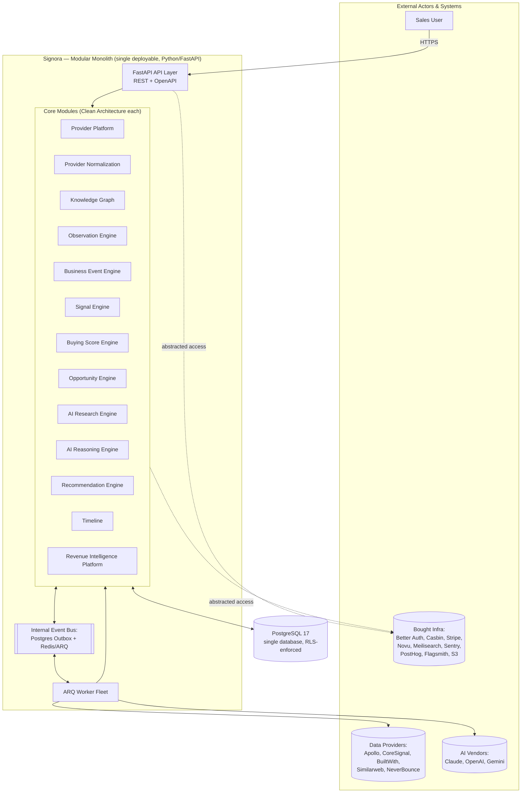
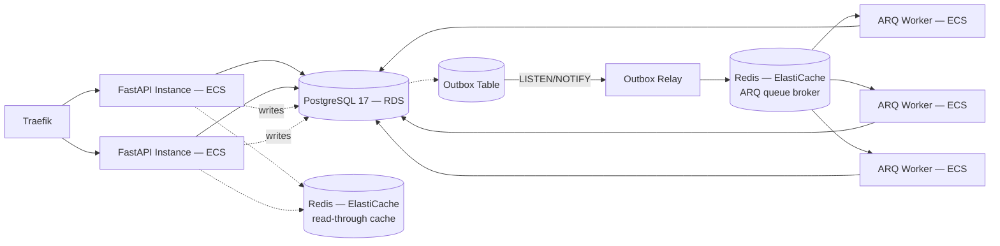
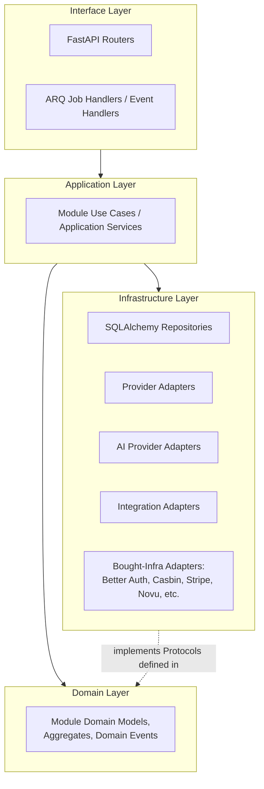

# 03 — System Architecture

> Status: **Living document — Architectural Constitution — RATIFIED**
> Audience: All engineers, EMs, and technical stakeholders at Signora
> Revision: **v2** — updated for the ratified stack (FastAPI/REST, PostgreSQL 17, Redis/ARQ, AWS ECS) and the thirteen-module map. See [08-technology-stack.md](08-technology-stack.md), [04-modules.md](04-modules.md).

## Purpose

This document describes Signora's system architecture at the highest level: the major runtime components, how they are deployed, and how they interact. It is the bridge between the principles in [02-principles.md](02-principles.md) and the module-level detail in [04-modules.md](04-modules.md).

## Responsibilities

- Define the runtime shape of the system (what processes exist, what they do).
- Show how external actors (users, providers, third-party systems) interact with the system.
- Establish the relationship between the API tier, the module layer, background workers, the database, and the internal event bus.
- Set the boundary between "inside Signora" and "outside Signora" (buy decisions, external providers).

## High-Level System Diagram

## Deployment Shape

Signora deploys as a **small number of runtime processes on AWS ECS**, not one process per module and not one process per external caller ([ADR-0022](adr/0022-devops-infrastructure-and-deployment-topology.md)):

1. **API process(es)** — a FastAPI ASGI app (`backend/apps/api`), stateless, horizontally scalable behind Traefik, serves synchronous requests from the frontend/API consumers. Handles request-scoped concerns (Better Auth session verification, Casbin authorization, workspace resolution, RLS session context) and delegates to module application services.
2. **ARQ worker process(es)** — (`backend/apps/worker`), stateless, horizontally scalable, consuming Redis-backed queues fed by the Postgres outbox relay, driving the asynchronous pipeline (Provider Platform → ... → Recommendation Engine). Workers are partitioned into per-stage pools from day one (see [12-scalability.md](12-scalability.md)).
3. **PostgreSQL 17 (RDS)** — the single system of record for all modules, including the durable event/outbox store.
4. **Redis (ElastiCache)** — two logically and physically separate clusters: one as the ARQ job-queue broker, one as the short-TTL read-through cache (see [ADR-0007](adr/0007-caching-layer.md)).

## Layered View

Within the single deployable, the system is layered as follows, consistent with Principle 4 (Clean Architecture) and the concrete folder layout in [15-project-structure.md](15-project-structure.md):

This layering is repeated **inside every module** (see [04-modules.md](04-modules.md) and [15-project-structure.md](15-project-structure.md)); it is not a system-wide layering that modules sit "inside of."

## Module Interactions at System Level

- **Synchronous (request path):** FastAPI router → module application service → domain logic → SQLAlchemy repository → PostgreSQL. Used for reads and for commands that must confirm acceptance within the request/response cycle.
- **Asynchronous (pipeline path):** Module publishes a domain event to the Postgres outbox → relay dispatches to Redis/ARQ → subscribing module's ARQ job handler → next module's domain logic. Used for the entire Provider Platform-to-Recommendation-Engine pipeline.
- **Cross-cutting reads:** Timeline and Revenue Intelligence Platform subscribe to events from multiple upstream modules to build read-optimized views; they do not sit "in-line" in the pipeline (see [04-modules.md](04-modules.md)).

Full dependency rules are in [05-module-dependencies.md](05-module-dependencies.md); the full event catalog is in [06-events.md](06-events.md); the transport is specified in [06-events.md](06-events.md) and [ADR-0011](adr/0011-background-processing-and-event-bus-transport.md).

## Design Rationale

Two process types (FastAPI API, ARQ worker), both horizontally scalable on ECS, keep operations simple while letting compute scale independently for request-serving vs. pipeline-processing workloads, which have very different load profiles (bursty/low-latency vs. steady/high-throughput/AI-vendor-latency-bound — see [12-scalability.md](12-scalability.md)). Keeping all thirteen modules in one deployable (Principle 1) while enforcing strict internal boundaries (Principle 5, mechanically via import-linter — [15-project-structure.md](15-project-structure.md)) preserves the option to extract a module into its own ECS service later by changing only its infrastructure layer, not its domain or application layers.

## Best Practices

- New API endpoints go through the interface layer of the owning module only; they never reach directly into another module's domain layer.
- Long-running or externally-dependent work (provider calls, AI vendor calls) always goes through an ARQ job, never inline in a FastAPI handler.
- Treat the Internal Event Bus as the default integration point between modules; treat direct synchronous module-to-module calls as the exception requiring justification (see [05-module-dependencies.md](05-module-dependencies.md)).

## Anti-Patterns

- Spinning up a new independently-deployed ECS service for a new module "to be safe" — contradicts Principle 1; extraction is justified by evidence, not default caution (see [12-scalability.md](12-scalability.md)).
- Performing provider or AI vendor calls synchronously inside a FastAPI request handler.
- Letting the API layer contain domain/business logic instead of delegating to module application services.

## Future Evolution

- Provider Platform and AI Research Engine are the leading module-extraction candidates once evidence-based triggers in [12-scalability.md](12-scalability.md) are met.
- The ARQ worker fleet is expected to split into more, narrower per-stage pools as pipeline throughput grows — see [12-scalability.md](12-scalability.md).

## Decision Summary

Signora runs as a modular monolith deployed on AWS ECS as two horizontally scalable process types (FastAPI API, ARQ workers) against a single PostgreSQL 17 database and two purpose-separated Redis clusters, internally layered with Clean Architecture per module across all thirteen core modules plus Workspace & Tenancy, and integrated via a Postgres-outbox-backed, Redis/ARQ-dispatched internal event bus.
