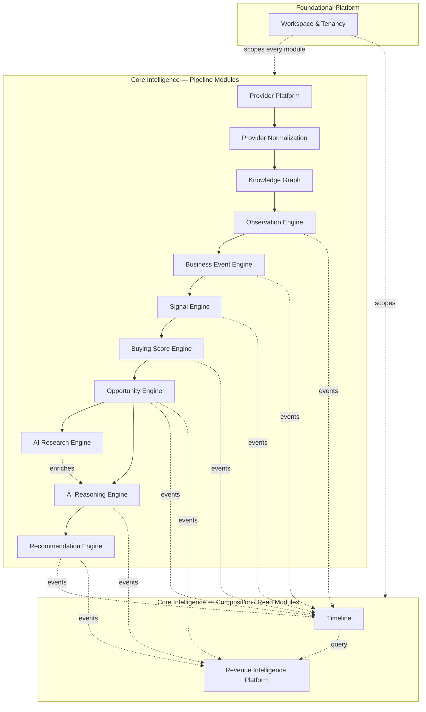

# 04 — Modules

> Status: **Living document — Architectural Constitution**
> Audience: All engineers, EMs, and technical stakeholders at Signora
> Revision: **v2** — supersedes the 11-module map in v1 following the Architecture Review Board's ratification of the final build-vs-buy matrix. See [ADR-0025](adr/0025-module-boundary-evolution.md) for the full rationale behind every change in this revision.

## Purpose

This document defines Signora's **bounded contexts** — the modules that make up the modular monolith — their responsibilities, the ubiquitous language each owns, and the boundaries between them. This is the primary reference when deciding "which module does this belong in?"

## What Changed in v2

The original architecture package left the module list at eleven items and marked one supporting module `[INFERRED]`. The Architecture Review Board's pass over the build-vs-buy matrix produced four substantive changes, each backed by [ADR-0025](adr/0025-module-boundary-evolution.md):

1. **Provider Platform** is promoted from "infrastructure shared kernel" to a full core module. Managing dozens of provider integrations at scale (credentials, quotas, polling cadence, cost tracking, health) is now judged a genuine competitive capability — "multi-provider intelligence" is explicit product scope, not incidental plumbing.
2. **Event Engine + Business Events are consolidated into Business Event Engine.** Running them as two separately-versioned bounded contexts added coordination overhead without a corresponding benefit at current team size; the taxonomy is now an internal concern of the module that detects against it, revisited if the taxonomy ever needs independent product ownership.
3. **Buying Score Engine is introduced** as a distinct aggregation stage between Signal Engine and Opportunity Engine, separating "how strong is this individual signal" (Signal Engine) from "what is this account's overall propensity to buy right now" (Buying Score Engine) — a composite, cross-signal, time-decayed score that Opportunity Engine consumes for qualification.
4. **AI Reasoning is split into AI Research Engine and AI Reasoning Engine.** Deep, agentic, open-ended research (synthesizing public information about an account beyond what providers supply) is a different workload — different latency budget, different cost profile, different failure mode — than structured reasoning over an already-qualified opportunity. Conflating them made both harder to operate and evaluate independently.
5. **Workspace & Tenancy is confirmed** (no longer `[INFERRED]`) as a foundational platform module, per [ADR-0010](adr/0010-identity-and-access.md).

## Module Classification

Signora has two classes of module:

1. **Core Intelligence Modules** — the thirteen modules in the ratified build list. These implement the provider → observation → business event → signal → buying score → opportunity → AI research → AI reasoning → recommendation pipeline and its supporting read models. This is where Signora's competitive advantage lives, per [09-build-vs-buy.md](09-build-vs-buy.md).
2. **Foundational Platform Module** — Workspace & Tenancy, required by every core module for correct operation but not itself part of the intelligence pipeline.

## Bounded Context Map

## Module Reference

Each module below follows the template: Purpose, Owns, Does Not Own, Core Concepts, Key Published Events, Key Consumed Events. Full event contracts are in [06-events.md](06-events.md); allowed call directions are in [05-module-dependencies.md](05-module-dependencies.md).

---

### Workspace & Tenancy

**Purpose:** Owns the Workspace aggregate — the tenancy root (Principle 8) — and workspace membership.

**Owns:** Workspace identity (`workspace_id`), workspace lifecycle, workspace-level settings, the mapping from an authenticated Better Auth identity to workspace membership and Casbin-evaluated role.

**Does Not Own:** Authentication (Better Auth, see [ADR-0010](adr/0010-identity-and-access.md)), fine-grained permission evaluation (Casbin), billing/subscription state (Stripe, see [ADR-0016](adr/0016-billing.md)).

**Core Concepts:** Workspace, Membership, Role Binding.

**Key Published Events:** `workspace.created`, `workspace.member_added`.

**Key Consumed Events:** none (root of the dependency graph).

---

### Provider Platform

**Purpose:** Orchestrates every external company-intelligence provider integration as a managed capability: credential lifecycle, per-provider rate-limit and quota compliance, polling/webhook scheduling, cost tracking, and adapter health monitoring. This is the runtime home of the Provider Abstraction Layer's adapters (Principle 9).

**Owns:** Provider registry (which providers are enabled per workspace/plan), provider credentials (via the secrets mechanism), scheduling and backoff policy per provider, per-provider cost/usage accounting, provider health/circuit-breaker state.

**Does Not Own:** Transforming raw payloads into canonical shape (Provider Normalization), entity resolution (Knowledge Graph).

**Core Concepts:** Provider Registration, Adapter, Quota, Poll/Webhook Schedule, Provider Health.

**Key Published Events:** `provider.payload.received`, `provider.health_changed`.

**Key Consumed Events:** none from other core modules (entry point of the pipeline; driven by scheduled jobs and inbound webhooks).

> Design note: Provider Platform is deliberately upstream of Provider Normalization. Provider Platform's job is "get raw data in reliably, safely, and cost-effectively from N vendors with N different rate limits and auth schemes"; Provider Normalization's job is "turn any provider's raw payload into Signora's canonical shape." Splitting these keeps vendor operational concerns (quotas, retries, cost) out of the normalization domain logic entirely. See [13-integrations.md](13-integrations.md).

---

### Provider Normalization

**Purpose:** Transforms raw payloads handed off by Provider Platform into Signora's canonical, provider-agnostic data shape.

**Owns:** The canonical claim vocabulary, per-provider mappers, and provenance — which provider asserted which attribute, when, from which raw record, under which mapper version.

**Does Not Own:** Provider credential/quota/scheduling concerns (Provider Platform), entity resolution/merging across providers (Knowledge Graph), and — deliberately — **any judgement of which claim is true**.

**Core Concepts:** Claim, Subject Hint, Claim Source, Canonical Attribute, Normalization Outcome, Rejection.

**Key Published Events:** `claim.recorded`.

**Key Consumed Events:** `provider.record.received`.

**Read port offered to other modules:** `ClaimReader` → `ClaimView`, `SubjectRef` (`public/claims.py`).

> **As built (M2.2): normalization produces *claims*, not normalized records, and carries no confidence field.** A claim says *this provider asserted this attribute had this value, as of this time, and here is the raw record it came from* — nothing more. The v2 framing above ("normalized record", "field-level confidence") was written before the evidence model was ratified: a single normalized record per subject collapses provider disagreement at the earliest possible moment, and a confidence estimated here would be a number invented with no evidence behind it, propagating into buying scores as though it meant something. Claims are **immutable**, enforced by the absent `UPDATE` grant on `claim`.

---

### Knowledge Graph

**Purpose:** Answers *"which company is this provider talking about?"* — the deduplicated graph of entities and relationships every downstream module reasons about.

**Owns:** Entity identity, deterministic resolution rules, identity bindings and their state, resolution decisions and their history, relationships between entities, and the claim-set query surface. Embedding references for semantic entity/relationship search (via pgvector — [ADR-0012](adr/0012-ai-platform-architecture.md)) remain planned, not built.

**Does Not Own:** **The truth of any attribute.** Also not: the atomic factual history of *changes* over time (Observation Engine), or business interpretation of what a change means (Business Event Engine).

**Core Concepts:** Entity, Identity Binding, Identity State (`IDENTIFIED` / `AMBIGUOUS` / `UNRESOLVED`), Resolution Decision, Resolution Reason, Match Strength, Relationship, Claim Set.

**Key Published Events:** `entity.created`, `entity.identity_bound`, `entity.resolution_ambiguous`, `relationship.established`, `relationship.ended`.

**Key Consumed Events:** `claim.recorded`.

**Read port offered to other modules:** `GraphQueries` → `ClaimSet`, `EntityEvidence` (`public/`).

> **The permanent invariant (ratified 2026-07-28):** *The Knowledge Graph resolves identity. The Knowledge Graph does not resolve truth.* Identity is irreducible — only this module is positioned to answer it. Attribute conflict is not: it is carried forward intact, because every downstream module has more context to weigh it than the graph does. `entity` therefore has **no attribute columns**, and `ClaimSet` returns every contributing claim rather than a chosen value. Changing this requires an RFC. See [22-knowledge-graph.md](22-knowledge-graph.md).
>
> The v2 events `entity.updated` and `entity.merged` were removed rather than implemented. An entity with no attributes cannot be "updated"; and a merge is a *resolution decision*, recorded as one, which is what makes it explainable and revisable. Corrections supersede rather than mutate — `resolution_decision` is immutable, with no `UPDATE` grant.

---

### Observation Engine

**Purpose:** Answers *"what changed?"* — detects structural change in what a provider asserts about an entity, forming the immutable factual substrate the rest of the pipeline builds on.

**Owns:** The Observation aggregate, the state/occurrence classification of every canonical attribute, deterministic observation identity and deduplication, observation provenance and timing, and refinement by supersession when evidence arrives late.

**Does Not Own:** **Whether a change matters** — materiality is the Business Event Engine's, answered against a curated taxonomy. Also not: business interpretation (Business Event Engine), or the entity graph itself (Knowledge Graph).

**Core Concepts:** Observation, Observation Kind (`VALUE_CHANGED` / `OCCURRENCE_OBSERVED`), Direction, Magnitude, Attribute Semantics (state vs occurrence), Occurrence Key, Refinement.

**Key Published Events:** `observation.recorded`, `observation.superseded`.

**Key Consumed Events:** `entity.evidence_attached`.

**Read port offered to other modules:** `ObservationQueries` → `Observation`, `ObservationEvidence` (`public/`).

> **The permanent layering principle (ratified 2026-07-29):** *the Observation Engine detects change; it does not determine business significance.* A threshold here would be a constant nobody can justify; the Business Event Engine owns a versioned, reviewable taxonomy where such a rule belongs. See [21-intelligence-pipeline.md](21-intelligence-pipeline.md) and [23-observation-engine.md](23-observation-engine.md).
>
> Two further invariants shape the module. **Change is only ever computed within one provider's series** — two providers reporting different values is *disagreement*, and merging their series would manufacture movement that never happened. And the **first value of an attribute establishes a baseline and produces no observation**: nothing changed, Signora merely learned, and emitting one would flood every consumer on an onboarding sync.

---

### Business Event Engine

**Purpose:** Owns both the **taxonomy** of business event types (Funding Round, Executive Change, Hiring Surge, Product Launch, Expansion, M&A, etc.) and the **detection/classification** runtime that correlates observations into instances of those types. Consolidated from the v1 Event Engine / Business Events split — see [ADR-0025](adr/0025-module-boundary-evolution.md).

**Owns:** The business event taxonomy — **a product asset, and Signora's business language** — its versioning, the detection rules, and the event lifecycle (detected / superseded).

**Does Not Own:** **Commercial judgement of any kind.** Not how important an account is, whether Sales should engage, what priority something deserves, how likely a purchase is, or what to recommend. Those belong to the Signal Engine and everything after it. Also not: scoring or aggregation into signals (Signal Engine).

**Core Concepts:** Business Event Type, Business Event, Taxonomy Version, Payload Version, Detection Rule, Parameters, Corroborating Providers, Supersession.

**Key Published Events:** `business_event.detected`, `business_event.superseded`.

**Key Consumed Events:** `observation.recorded`, `observation.superseded`.

**Read port offered to other modules:** `BusinessEventQueries` → `BusinessEvent`, `BusinessEventEvidence`, `Taxonomy` (`public/`).

> **The permanent layering principle (ratified 2026-07-29):** *the Business Event Engine answers "why is this business-relevant?" — never "should we engage this account?"* A business event carries no priority, score, urgency, or rank, asserted structurally. See [21-intelligence-pipeline.md](21-intelligence-pipeline.md) and [24-business-event-engine.md](24-business-event-engine.md).
>
> **Taxonomy defines language; rules define derivation.** The taxonomy is *data* — a versioned artifact reviewed like code, holding every materiality threshold — and the rules are *code*. Meaning evolves slowly; derivation may evolve fast, and a better rule must not change what a hiring surge *is*. A Security Invariant parses each rule module as a syntax tree and fails on any business constant, so the split is machine-enforced rather than conventional.
>
> Every type passes one test: *if a CRO opened Signora today, would they immediately understand what this event means?* No provider terminology, no implementation terminology — which is why its domains are `capital`, `leadership`, and `demand` rather than the claim vocabulary's `firmographic` or `technographic`. The v2 event `business_event_type.published` was removed rather than implemented: a repository artifact has no runtime publication to announce.

---

### Signal Engine

**Purpose:** Answers *"why might this matter to **this** customer?"* — turns globally-true business events into **commercial hypotheses** held by one workspace.

**Owns:** The signal catalog (Signora's vocabulary of commercial hypotheses), detection strategies, the per-workspace **signal profile** and its versioning, signal shelf life, and signal-to-business-event traceability.

**Does Not Own:** **Any commercial verdict.** Not how likely a purchase is, which account to prioritise, what to recommend, or what to do — those belong to the Buying Score, Opportunity, and Recommendation Engines. Also not: business event detection (Business Event Engine).

**Core Concepts:** Signal, Signal Type, Hypothesis, Detection Strategy, Relevance, Signal Profile, Shelf Life, Constituent.

**Key Published Events:** `signal.generated`, `signal.superseded`.

**Key Consumed Events:** `business_event.detected`, `business_event.superseded`.

**Read port offered to other modules:** `SignalQueries` → `Signal`, `SignalExplanation`, `SignalCatalog` (`public/`).

> **The permanent principle (ratified 2026-07-29):** *business events describe objective business phenomena; signals describe customer-specific commercial hypotheses.* Signals are the **first subjective layer** in the pipeline. Everything above the Signal Engine is globally true; everything below remains traceable back to globally true information. A signal carries no score, priority, likelihood, or rank, asserted structurally. See [21-intelligence-pipeline.md](21-intelligence-pipeline.md) and [25-signal-engine.md](25-signal-engine.md).
>
> **Ownership decides where configuration lives.** The signal *catalog* belongs to Signora and ships as a versioned repository artifact; the signal *profile* belongs to the customer and lives in versioned, immutable rows — they cannot be asked to wait for a release to say what matters to them. **A workspace can never invent a signal type**; it configures relevance over the global catalog, which is what keeps AI reasoning, benchmarking, analytics, and support able to speak about signals across customers.
>
> The v2 events `signal.scored` and the `score` field on `signal.generated` were **removed rather than implemented**: the Signal Engine produces no scores.

---

### Buying Score Engine

**Purpose:** Aggregates all of an entity's active signals, weighted and time-decayed, into a single composite **Buying Score** — Signora's account-level propensity-to-buy metric — used by Opportunity Engine as its primary qualification input.

**Owns:** The Buying Score aggregate, cross-signal weighting/decay models, score history and trend, score-to-signal traceability.

**Does Not Own:** Individual signal scoring (Signal Engine), the decision to qualify an opportunity from a score (Opportunity Engine).

**Core Concepts:** Buying Score, Score Trend, Decay Model, Weighting Model.

**Key Published Events:** `buying_score.updated`.

**Key Consumed Events:** `signal.generated`, `signal.scored`.

> Design note: Separating Buying Score Engine from Signal Engine keeps "is this one signal strong" (a per-event judgment) distinct from "is this account, in aggregate, worth pursuing right now" (a portfolio-level, time-aware judgment). This mirrors how experienced sales-intelligence practitioners actually reason, and gives each concern its own model lifecycle and evaluation criteria.

---

### Opportunity Engine

**Purpose:** Converts a sufficiently strong Buying Score into a qualified, actionable **opportunity**, and manages opportunity lifecycle.

**Owns:** Opportunity qualification rules/thresholds, the Opportunity aggregate, opportunity lifecycle/stage transitions, opportunity-to-buying-score traceability.

**Does Not Own:** Buying score computation (Buying Score Engine), AI-generated research or reasoning about an opportunity (AI Research Engine, AI Reasoning Engine), recommended next actions (Recommendation Engine).

**Core Concepts:** Opportunity, Qualification, Stage.

**Key Published Events:** `opportunity.created`, `opportunity.stage_changed`.

**Key Consumed Events:** `buying_score.updated`.

---

### AI Research Engine

**Purpose:** Performs deep, agentic, open-ended research on a qualified opportunity's entity — synthesizing public and provider-sourced information beyond what any single structured signal captures — producing a structured research artifact that AI Reasoning Engine consumes as additional context.

**Owns:** Research task orchestration (multi-step/agentic), research artifact structure and provenance, research-task cost/latency budgeting, semantic retrieval over the Knowledge Graph and prior research artifacts via embeddings (pgvector).

**Does Not Own:** The underlying model vendor integration (AI Provider Abstraction Layer, shared with AI Reasoning Engine — see [14-ai-architecture.md](14-ai-architecture.md)), turning research into an opportunity explanation (AI Reasoning Engine).

**Core Concepts:** Research Task, Research Artifact, Agentic Step, Retrieval Context.

**Key Published Events:** `ai_research.completed`.

**Key Consumed Events:** `opportunity.created`.

> Design note: AI Research Engine is invoked selectively (e.g., on opportunity creation or on demand), not on every observation — its cost and latency profile (multi-step agentic tool use, potentially minutes) are fundamentally different from AI Reasoning Engine's (a single structured reasoning call). Treating them as one module made both impossible to evaluate, budget, or scale independently — see [ADR-0025](adr/0025-module-boundary-evolution.md).

---

### AI Reasoning Engine

**Purpose:** Uses the AI Provider Abstraction Layer to reason over an opportunity, its buying score, signals, Knowledge Graph context, and (when available) AI Research Engine's artifact, producing structured explanations, prioritization, and analysis.

**Owns:** Prompt construction/orchestration against the Internal Prompt Registry, reasoning-chain composition, AI output validation and structuring, reasoning provenance (model/version/prompt-version).

**Does Not Own:** Open-ended research (AI Research Engine), the underlying model vendor integration (AI Provider Abstraction Layer), turning reasoning into a user-facing recommendation (Recommendation Engine).

**Core Concepts:** Reasoning Request, Reasoning Result, Prompt Template, Model Provenance.

**Key Published Events:** `ai_reasoning.completed`.

**Key Consumed Events:** `opportunity.created`, `opportunity.stage_changed`, `ai_research.completed`.

---

### Recommendation Engine

**Purpose:** Converts AI Reasoning Engine output and opportunity context into concrete, actionable **recommendations** for sales users.

**Owns:** Recommendation generation rules, recommendation prioritization/ranking, recommendation lifecycle (open/acted-on/dismissed/expired).

**Does Not Own:** The reasoning content itself (AI Reasoning Engine), presentation/aggregation for end users (Revenue Intelligence Platform).

**Core Concepts:** Recommendation, Action, Priority, Recommendation Status.

**Key Published Events:** `recommendation.created`, `recommendation.status_changed`.

**Key Consumed Events:** `ai_reasoning.completed`.

---

### Timeline

**Purpose:** A cross-cutting, read-optimized module that builds and serves a chronological feed of everything that has happened for a given entity.

**Owns:** The Timeline read model, chronological aggregation/materialization logic, timeline query API (backed by Meilisearch for full-text/faceted timeline search — see [ADR-0008](adr/0008-search-and-vector-retrieval.md)).

**Does Not Own:** Any of the source-of-truth data it displays — Timeline is a projection.

**Core Concepts:** Timeline Entry, Feed, Projection.

**Key Published Events:** none (pure read-side consumer).

**Key Consumed Events:** `observation.recorded`, `business_event.detected`, `signal.generated`, `buying_score.updated`, `opportunity.created`, `opportunity.stage_changed`, `recommendation.created`.

---

### Revenue Intelligence Platform

**Purpose:** The outward-facing composition domain that aggregates buying score, opportunity, AI research/reasoning, recommendation, and timeline data into the workspace-level views and APIs that constitute the product's core value delivery.

**Owns:** Cross-module composition/aggregation for presentation, workspace-level prioritization and reporting logic, the primary read APIs consumed by the frontend.

**Does Not Own:** Any of the underlying domain logic of the modules it composes.

**Core Concepts:** Workspace Intelligence View, Prioritized Opportunity List, Revenue Intelligence Report.

**Key Published Events:** none (top of the pipeline; product-facing).

**Key Consumed Events:** `opportunity.created`, `opportunity.stage_changed`, `ai_reasoning.completed`, `recommendation.created`, `recommendation.status_changed` (plus Timeline queried synchronously).

---

## Design Rationale

The pipeline modules map onto the eleven-stage flow named in the final build matrix (Provider Platform → Provider Normalization → Knowledge Graph → Observation Engine → Business Event Engine → Signal Engine → Buying Score Engine → Opportunity Engine → AI Research Engine → AI Reasoning Engine → Recommendation Engine), plus Timeline and Revenue Intelligence Platform as read/composition modules. Every split or merge relative to v1 was driven by a concrete operational or product argument, recorded in [ADR-0025](adr/0025-module-boundary-evolution.md) — not by aesthetic preference.

## Best Practices

- Before writing code, identify which module's bounded context the change belongs to using the "Owns / Does Not Own" sections above.
- If a change seems to require modifying two modules' domain logic at once, treat that as a signal to re-examine the boundary, not as normal.
- Keep each module's ubiquitous language inside that module's code and docs.

## Anti-Patterns

- Reintroducing provider credential/quota logic inside Provider Normalization instead of Provider Platform.
- Computing a composite account-level score inside Signal Engine instead of publishing signals for Buying Score Engine to aggregate.
- Running AI Research Engine's agentic research inline inside AI Reasoning Engine's request path.
- Letting Revenue Intelligence Platform grow new domain rules instead of composing what upstream modules already produce.

## Future Evolution

- AI Research Engine and AI Reasoning Engine are the modules most likely to need independent scaling (see [12-scalability.md](12-scalability.md)) given their AI-vendor-latency-bound profile.
- Provider Platform is the natural first candidate for extraction if provider count and polling volume grow to the point where its operational profile diverges sharply from the rest of the monolith.
- Additional core modules require the RFC process in [01-overview.md](01-overview.md) and a new ADR.

## Decision Summary

Signora is composed of thirteen ratified core intelligence modules plus one foundational platform module (Workspace & Tenancy). This revision formalizes Provider Platform as a first-class module, consolidates Event Engine/Business Events into Business Event Engine, introduces Buying Score Engine, and splits AI Reasoning into AI Research Engine and AI Reasoning Engine — each change backed by [ADR-0025](adr/0025-module-boundary-evolution.md).
