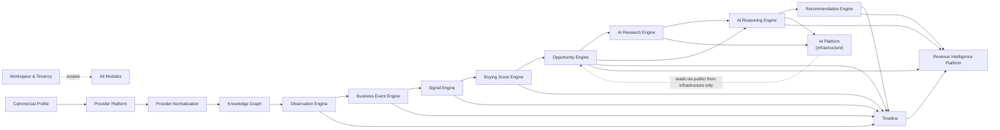

# 05 — Module Dependencies

> Status: **Living document — Architectural Constitution**
> Audience: All engineers, EMs, and technical stakeholders at Signora
> Revision: **v2** — updated for the thirteen-module map in [04-modules.md](04-modules.md). See [ADR-0025](adr/0025-module-boundary-evolution.md).

## Purpose

This document defines the **allowed dependency directions** between modules defined in [04-modules.md](04-modules.md): who may depend on whom, through what mechanism (event vs. synchronous call), and how these rules are enforced.

## The Dependency Rule

> **A module may depend only on modules "upstream" of it in the pipeline, and only through that module's published events or explicitly exposed public interface — never through direct access to another module's database tables, internal domain objects, or private application services.**

## Dependency Graph

This graph is, by design, **acyclic**. No module depends on a module downstream of it.

## Dependency Matrix

| Module | Depends on (via events, unless noted) |
|---|---|
| Workspace & Tenancy | none |
| Commercial Profile | Workspace & Tenancy (sync, for workspace scope) |
| Provider Platform | Workspace & Tenancy (sync, for workspace scope) · Commercial Profile (event, for the target account list — **slice 5**) |
| Provider Normalization | Provider Platform |
| Knowledge Graph | Provider Normalization |
| Observation Engine | Knowledge Graph |
| Business Event Engine | Observation Engine |
| Signal Engine | Business Event Engine |
| Buying Score Engine | Signal Engine |
| Opportunity Engine | Buying Score Engine |
| AI Platform | *(none from domain/application)* · Opportunity Engine `public/` **from `infrastructure/` only**, behind a Protocol |
| AI Research Engine | Opportunity Engine, AI Platform · **never the AI Reasoning Engine** (the edge is `ARE → AIR`; the reverse is a cycle, enforced by contract since T131) |
| AI Reasoning Engine | Opportunity Engine, Buying Score Engine, Signal Engine, AI Research Engine, AI Platform |
| Recommendation Engine | AI Reasoning Engine |
| Timeline | Observation Engine, Business Event Engine, Signal Engine, Buying Score Engine, Opportunity Engine, Recommendation Engine |
| Revenue Intelligence Platform | Opportunity Engine, AI Reasoning Engine, Recommendation Engine, Timeline (sync query) |

All modules implicitly depend on **Workspace & Tenancy** for tenant scoping (see [11-tenancy.md](11-tenancy.md)) — **except the AI Platform**, whose domain and application layers depend on no module at all. It receives a workspace-stamped Evidence Set from its caller and refuses one assembled from more than one workspace.

### The AI Platform's edge is deliberately asymmetric

It is the only node in this graph that is **consumed by** downstream modules while depending on none of them from its own domain or application layers. That asymmetry is the point: it is infrastructure, and infrastructure that accumulates pipeline knowledge stops being extractable.

The one reach it makes — `opportunity_engine.public`, to narrate an explanation the pipeline has already computed — happens **only in `infrastructure/`**, satisfying an `ExplanationSource` Protocol declared in `application/ports.py`. Three import-linter contracts hold the line: domain and application may not import a business module *at all*; infrastructure may reach one only through `public/`; and no business module may import the AI Platform. A Security Invariant asserts the contracts themselves are still registered, because a rule deleted from configuration cannot be broken.

This is the M5B `SignalReader` finding applied deliberately rather than discovered under pressure: **if a fake cannot stand in for a dependency, the dependency was never really a boundary.**

## Context map — what *kind* of coupling each edge is

> Added 2026-08-01, for parallel development. The graph above says *who depends on whom*; this says **how tightly**, in DDD's vocabulary — which is what tells a development lane whether it may change something freely, must tell another lane, or needs an ADR.

| Upstream → Downstream | Pattern | What it means for a lane |
|---|---|---|
| **Workspace & Tenancy → all** | Conformist | Every module conforms to `workspace_id`; none influences it |
| **Commercial Profile → Provider Platform** | Customer–Supplier | Downstream's needs shape the contract. Negotiable between lanes |
| **Provider Platform → Provider Normalization** | **Anticorruption Layer** | The clearest ACL in the codebase — it exists so vendor models cannot leak inward, and *"any judgement of which claim is true"* is explicitly refused |
| **Provider Normalization → Knowledge Graph** | **Published Language** | The canonical claim vocabulary; [34-knowledge-contract.md](34-knowledge-contract.md) is its specification |
| Knowledge Graph → Observation → Business Event | Customer–Supplier | Stages, negotiated at the boundary |
| **Business Event Engine → Signal Engine** | **Published Language** | The taxonomy is *"a product asset, and Signora's business language"*, versioned separately from payloads for exactly this reason |
| Signal → Buying Score → Opportunity | Customer–Supplier | Via `SignalExplanation`, `ContributionLedger` |
| **AI Research → AI Reasoning** | Customer–Supplier, **non-blocking** | Documented timeout and fallback. The template for any future optional edge |
| **AI Platform → both AI engines** | **Open Host Service** | One published protocol — port, registry, prompt registry, evidence set — for many consumers, vendor-neutral by construction |
| **AI Platform → Opportunity Engine `public/`** | Conformist | Reads, influences nothing. Infrastructure layer only |
| Everything → **Timeline**, **Revenue Intelligence Platform** | Conformist | Projections; they own none of what they display |
| **`signora_platform`** | **Shared Kernel, frozen** | Not a bounded context. CLAUDE.md §20a governs it |

**The rule this produces:** a lane may change anything behind a **Conformist** or **ACL** edge freely · a **Customer–Supplier** edge requires telling the downstream lane · a **Published Language** edge requires an ADR.

## Synchronous vs. Asynchronous Dependencies

Per Principle 3, event-driven is the default. Approved synchronous dependencies:

- Any module → Workspace & Tenancy: resolve/validate workspace context (read-only). **Since M6 this includes membership verification on opportunity assignment** — a `user_id` supplied by a caller is a claim about who should hold the work, and an unverified one would hand an account to somebody outside the workspace.
- AI Reasoning Engine → Buying Score Engine's published vocabulary: synchronous read of `ScoreTrigger`, `Trend` and the score's own temporal fields when composing a Decision Package. **Recorded 2026-07-30 (T125), and flagged as a correction rather than a new decision.** [ADR-0030](adr/0030-the-decision-package.md) already ratified M9 deriving *why now* from `BuyingScore.trigger`, *why not earlier* from `basis_at`, *what changed* from `delta`/`trend`, and Support from `contested`/`dissenting_signal_ids` — so the dependency was approved when the ADR was; this row simply predated it. The alternative, redefining those enums inside M9, would be duplicate truth for a vocabulary the Buying Score Engine owns and answers.

  **Note the contrast with the AI Platform's edge**, which is genuinely narrower: M8 reads buying-score data *transitively* through `OpportunityExplanation` and imports nothing, because a substrate must name no pipeline concept. M9 is a pipeline stage and legitimately speaks the pipeline's vocabulary.
- AI Reasoning Engine → Signal Engine's published catalog: synchronous read of signal-type definitions when composing a Decision Package. **Added 2026-07-30 (T122).** A signal type's *limitations* and *suggested validation* — what a conclusion does not imply, and how a human independently checks it — are properties of the type, authored once by a domain expert and versioned like the business event taxonomy (ADR-0030, Decision 5). The alternative, a parallel catalog inside AI Reasoning keyed by `SignalType`, would put a type's limitations somewhere other than where the type is defined. Read-only, no new storage, and the definitions already reach M9 transitively through `SignalExplanation`; this edge makes the *catalog itself* readable rather than only the definitions attached to signals that fired.
- AI Reasoning Engine → AI Research Engine's stored artifact: synchronous read of an already-completed research artifact when composing a reasoning request, if available at request time (falls back to reasoning without it if not yet complete — AI Research Engine is not a blocking dependency of the pipeline).
- Business Event Engine → its own taxonomy (internal, no longer cross-module per the v1→v2 consolidation — see [ADR-0025](adr/0025-module-boundary-evolution.md)).
- Revenue Intelligence Platform → Timeline: synchronous query when composing a workspace intelligence view.

Everything else in the pipeline is **event-driven and asynchronous**, dispatched through the transport defined in [06-events.md](06-events.md).

## AI Research Engine as a Non-Blocking Dependency

AI Research Engine sits in the graph between Opportunity Engine and AI Reasoning Engine, but it is explicitly **not** a hard blocking dependency: AI Reasoning Engine must be able to produce a valid (if less-informed) reasoning result even if AI Research Engine has not completed, timed out, or was skipped for cost reasons. This is enforced by treating `ai_research.completed` as an *optional* enrichment input consumed opportunistically, not a required upstream event AI Reasoning Engine blocks on. See [14-ai-architecture.md](14-ai-architecture.md) for the timeout/fallback policy.

## What Is Never Allowed

- Direct SQL queries against another module's tables.
- Importing another module's internal domain/application classes.
- Circular dependencies of any kind, sync or async.
- A downstream module publishing an event an upstream module subscribes to synchronously as a hidden feedback loop — new forward-flowing events are the only permitted mechanism (see `recommendation.status_changed` feeding Signal Engine in [07-data-flow.md](07-data-flow.md)).

## Reading another module's data

A module frequently needs data another module owns — Provider Normalization needs the raw record's payload; the Knowledge Graph needs the claims. Neither may reach for the table, the ORM model, or the use case that produced it.

The mechanism is a **read port on the owning module's `public/`**: a `Protocol` plus frozen view objects, implemented in that module's `infrastructure/` and injected by the composition root. Concretely, as of M3A:

| Port | Owner | Consumer |
|---|---|---|
| `RawRecordReader` → `RawRecordView` | Provider Platform | Provider Normalization |
| `ClaimReader` → `ClaimView`, `SubjectRef` | Provider Normalization | Knowledge Graph |
| `GraphQueries` → `ClaimSet`, `EntityEvidence` | Knowledge Graph | Observation Engine |
| `ObservationQueries` → `Observation`, `ObservationEvidence` | Observation Engine | Business Event Engine |
| `BusinessEventQueries` → `BusinessEvent`, `Taxonomy` | Business Event Engine | Signal Engine |
| `SignalQueries` → `Signal`, `SignalExplanation`, `SignalCatalog` | Signal Engine | Buying Score Engine |
| `BuyingScoreQueries` → `BuyingScore`, `ContributionLedger`, `BuyingScoreExplanation` | Buying Score Engine | Opportunity Engine |
| `OpportunityQueries` → `Opportunity`, `OpportunityState`, `OpportunityExplanation` | Opportunity Engine | (M7 onward) |

Three properties make this a boundary rather than a naming convention:

- **A frozen view, never an ORM instance.** An ORM object carries a session, lazy loaders, and a write path — handing one across a boundary hands over the ability to mutate another module's table by accident.
- **The consumer imports the Protocol, never the implementation.** Wiring the concrete reader is the composition root's job, so a module never learns that its neighbour is backed by SQL.
- **Read ports expose evidence, never resolutions.** `ClaimReader` deliberately has no `current_value(subject, attribute)`. Offering one would put truth resolution behind an innocuous call, and every consumer would use it instead of looking at the evidence. **`latest_observed_at(subjects)` was added 2026-08-03 and sits on the permitted side of that line**: it returns a *time*, never a value, so answering *when* the newest thing was seen still requires reading the claims to learn *what* was seen. It exists as a port method rather than a `max()` over `for_subjects` because the alternative fetches every claim about every account on a page to keep one timestamp each. **`subjects_named_like(text, limit)` was added the same day and sits on the same side**: it returns provider *identities*, never accounts and never a resolved name — mapping them to entities is the Knowledge Graph's job, and this module has no idea entities exist. For the same reason `BuyingScoreQueries` exposes no account representation — a read port that also served account state would become the place consumers get accounts from, and the score would have quietly replaced the intelligence it summarizes.

> **M5B required no new edge.** The Buying Score Engine reads signals and nothing else: the chain outward to business events, observations, claims and raw records is reachable through `SignalExplanation`, which the Signal Engine already returns. A direct Buying Score → Business Event edge was considered and rejected — reaching past the Signal Engine would let a weighting rule quietly become a detection rule, in the module least equipped to review it. That the module fits the existing graph unchanged is the strongest available evidence the M5A boundary was drawn in the right place.

### The canonical vocabulary is a platform-wide contract

`provider_normalization/public` — the canonical attributes, their value types, and the frozen claim views — is **the common language every downstream intelligence module speaks**, not Provider Normalization's private vocabulary. It was introduced there because that is where translation happens; it is consumed everywhere because reasoning happens everywhere.

*Ratified 2026-07-29.* Every downstream pipeline module may depend on it directly. The alternative — each module defining its own copy — is forbidden outright by the DDD rules: *never introduce a second definition of a concept a module already owns*, and a vocabulary duplicated across four modules diverges within a year.

The permission is narrow and worth stating precisely:

- **A vocabulary dependency, not a data-access one.** Reading claim *data* still goes through the owning module's read port, or through the Knowledge Graph's `ClaimSet` for modules downstream of resolution.
- **Extending it still requires an RFC.** Adding a canonical attribute is an architectural act; consuming one is routine engineering. That asymmetry is what lets provider integrations churn while the platform's language stays stable.

> **Events carry identity; ports carry payload.** `claim.recorded` names the record and its subject and stops. Embedding claim bodies in the envelope would make every vocabulary addition an event-contract change.

## Enforcement

- **Code review** against this document.
- **Import-linter** (Python) enforces module boundary rules in the local gate ([ADR-0027](adr/0027-local-first-development.md)) — see [ADR-0002](adr/0002-web-framework-and-api-style.md) and [15-project-structure.md](15-project-structure.md) for the concrete contract configuration. Since M3A the contracts are explicit per module pair: each module is forbidden from importing another's `domain/`, `application/`, `infrastructure/`, or `interface/`, and upstream modules are forbidden from importing downstream ones at all. A cross-module import of an ORM model compiles and runs perfectly well, which is exactly why the rule needs a machine behind it — the violation is invisible until the modules need to move apart.
- **Database roles per module**: each module's tables are owned by a dedicated PostgreSQL role with `GRANT` restricted to that module's application code path, providing a second line of defense beyond RLS (see [11-tenancy.md](11-tenancy.md)).

## Adding a New Dependency

1. Propose the change as an RFC referencing the specific modules and events involved.
2. Verify no cycle is introduced.
3. Update this document and [06-events.md](06-events.md) in the same PR as the implementation.
4. Get sign-off from the owning team(s) of both modules.

## Design Rationale

The graph mirrors the pipeline's real information flow. The one deliberate exception — AI Research Engine as an optional, non-blocking input to AI Reasoning Engine — reflects a real product tradeoff: users should not wait on multi-minute agentic research for a first reasoning pass, but should benefit from it when available. This is documented explicitly rather than left as an implicit assumption, because it is the one place in the graph where "upstream" does not mean "hard dependency."

## Best Practices

- Default to "this should be an event."
- Treat the AI Research Engine → AI Reasoning Engine relationship as the template for any future "enrichment, not blocking" dependency: a well-known optional event, a defined timeout, and an explicit fallback behavior.

## Anti-Patterns

- Making AI Reasoning Engine block on AI Research Engine's completion, reintroducing the latency coupling the split was designed to avoid.
- "Temporary" direct database access across module boundaries that never gets cleaned up.

## Tradeoffs

| Choice | We gain | We give up |
|---|---|---|
| Strict acyclic, mostly-async dependency graph | Extractability, testability, resilience to slow downstream stages | Immediate read-your-writes consistency (mitigated by Timeline and idempotent event processing) |
| AI Research Engine as optional/non-blocking | Fast baseline reasoning latency, graceful degradation | Reasoning quality varies depending on whether research completed in time (acceptable, explicit tradeoff) |

## Future Evolution

- If Provider Platform or the AI modules are extracted into standalone services (Principle 5, [12-scalability.md](12-scalability.md)), this dependency graph does not change — only the transport implementing the arrows changes.

## Decision Summary

Module dependencies form a strict, acyclic, primarily event-driven graph across all thirteen core modules plus Workspace & Tenancy, with one deliberate non-blocking optional dependency (AI Research Engine → AI Reasoning Engine) and a small, explicit allowlist of synchronous read-only exceptions, enforced by code review, `import-linter`, and per-module database roles.
