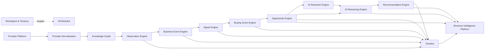

# 05 — Module Dependencies

> Status: **Living document — Architectural Constitution**
> Audience: All engineers, EMs, and technical stakeholders at Signora
> Revision: **v2** — updated for the thirteen-module map in [04-modules.md](04-modules.md). See [ADR-0025](adr/0025-module-boundary-evolution.md).

## Purpose

This document defines the **allowed dependency directions** between modules defined in [04-modules.md](04-modules.md): who may depend on whom, through what mechanism (event vs. synchronous call), and how these rules are enforced.

## The Dependency Rule

> **A module may depend only on modules "upstream" of it in the pipeline, and only through that module's published events or explicitly exposed public interface — never through direct access to another module's database tables, internal domain objects, or private application services.**

## Dependency Graph

This graph is, by design, **acyclic**. No module depends on a module downstream of it.

## Dependency Matrix

| Module | Depends on (via events, unless noted) |
|---|---|
| Workspace & Tenancy | none |
| Provider Platform | Workspace & Tenancy (sync, for workspace-scoped provider enablement) |
| Provider Normalization | Provider Platform |
| Knowledge Graph | Provider Normalization |
| Observation Engine | Knowledge Graph |
| Business Event Engine | Observation Engine |
| Signal Engine | Business Event Engine |
| Buying Score Engine | Signal Engine |
| Opportunity Engine | Buying Score Engine |
| AI Research Engine | Opportunity Engine |
| AI Reasoning Engine | Opportunity Engine, AI Research Engine |
| Recommendation Engine | AI Reasoning Engine |
| Timeline | Observation Engine, Business Event Engine, Signal Engine, Buying Score Engine, Opportunity Engine, Recommendation Engine |
| Revenue Intelligence Platform | Opportunity Engine, AI Reasoning Engine, Recommendation Engine, Timeline (sync query) |

All modules implicitly depend on **Workspace & Tenancy** for tenant scoping (see [11-tenancy.md](11-tenancy.md)).

## Synchronous vs. Asynchronous Dependencies

Per Principle 3, event-driven is the default. Approved synchronous dependencies:

- Any module → Workspace & Tenancy: resolve/validate workspace context (read-only).
- AI Reasoning Engine → AI Research Engine's stored artifact: synchronous read of an already-completed research artifact when composing a reasoning request, if available at request time (falls back to reasoning without it if not yet complete — AI Research Engine is not a blocking dependency of the pipeline).
- Business Event Engine → its own taxonomy (internal, no longer cross-module per the v1→v2 consolidation — see [ADR-0025](adr/0025-module-boundary-evolution.md)).
- Revenue Intelligence Platform → Timeline: synchronous query when composing a workspace intelligence view.

Everything else in the pipeline is **event-driven and asynchronous**, dispatched through the transport defined in [06-events.md](06-events.md).

## AI Research Engine as a Non-Blocking Dependency

AI Research Engine sits in the graph between Opportunity Engine and AI Reasoning Engine, but it is explicitly **not** a hard blocking dependency: AI Reasoning Engine must be able to produce a valid (if less-informed) reasoning result even if AI Research Engine has not completed, timed out, or was skipped for cost reasons. This is enforced by treating `ai_research.completed` as an *optional* enrichment input consumed opportunistically, not a required upstream event AI Reasoning Engine blocks on. See [14-ai-architecture.md](14-ai-architecture.md) for the timeout/fallback policy.

## What Is Never Allowed

- Direct SQL queries against another module's tables.
- Importing another module's internal domain/application classes.
- Circular dependencies of any kind, sync or async.
- A downstream module publishing an event an upstream module subscribes to synchronously as a hidden feedback loop — new forward-flowing events are the only permitted mechanism (see `recommendation.status_changed` feeding Signal Engine in [07-data-flow.md](07-data-flow.md)).

## Reading another module's data

A module frequently needs data another module owns — Provider Normalization needs the raw record's payload; the Knowledge Graph needs the claims. Neither may reach for the table, the ORM model, or the use case that produced it.

The mechanism is a **read port on the owning module's `public/`**: a `Protocol` plus frozen view objects, implemented in that module's `infrastructure/` and injected by the composition root. Concretely, as of M3A:

| Port | Owner | Consumer |
|---|---|---|
| `RawRecordReader` → `RawRecordView` | Provider Platform | Provider Normalization |
| `ClaimReader` → `ClaimView`, `SubjectRef` | Provider Normalization | Knowledge Graph |
| `GraphQueries` → `ClaimSet`, `EntityEvidence` | Knowledge Graph | (M3B onward) |

Three properties make this a boundary rather than a naming convention:

- **A frozen view, never an ORM instance.** An ORM object carries a session, lazy loaders, and a write path — handing one across a boundary hands over the ability to mutate another module's table by accident.
- **The consumer imports the Protocol, never the implementation.** Wiring the concrete reader is the composition root's job, so a module never learns that its neighbour is backed by SQL.
- **Read ports expose evidence, never resolutions.** `ClaimReader` deliberately has no `current_value(subject, attribute)`. Offering one would put truth resolution behind an innocuous call, and every consumer would use it instead of looking at the evidence.

> **Events carry identity; ports carry payload.** `claim.recorded` names the record and its subject and stops. Embedding claim bodies in the envelope would make every vocabulary addition an event-contract change.

## Enforcement

- **Code review** against this document.
- **Import-linter** (Python) enforces module boundary rules in CI — see [ADR-0002](adr/0002-web-framework-and-api-style.md) and [15-project-structure.md](15-project-structure.md) for the concrete contract configuration. Since M3A the contracts are explicit per module pair: each module is forbidden from importing another's `domain/`, `application/`, `infrastructure/`, or `interface/`, and upstream modules are forbidden from importing downstream ones at all. A cross-module import of an ORM model compiles and runs perfectly well, which is exactly why the rule needs a machine behind it — the violation is invisible until the modules need to move apart.
- **Database roles per module**: each module's tables are owned by a dedicated PostgreSQL role with `GRANT` restricted to that module's application code path, providing a second line of defense beyond RLS (see [11-tenancy.md](11-tenancy.md)).

## Adding a New Dependency

1. Propose the change as an RFC referencing the specific modules and events involved.
2. Verify no cycle is introduced.
3. Update this document and [06-events.md](06-events.md) in the same PR as the implementation.
4. Get sign-off from the owning team(s) of both modules.

## Design Rationale

The graph mirrors the pipeline's real information flow. The one deliberate exception — AI Research Engine as an optional, non-blocking input to AI Reasoning Engine — reflects a real product tradeoff: users should not wait on multi-minute agentic research for a first reasoning pass, but should benefit from it when available. This is documented explicitly rather than left as an implicit assumption, because it is the one place in the graph where "upstream" does not mean "hard dependency."

## Best Practices

- Default to "this should be an event."
- Treat the AI Research Engine → AI Reasoning Engine relationship as the template for any future "enrichment, not blocking" dependency: a well-known optional event, a defined timeout, and an explicit fallback behavior.

## Anti-Patterns

- Making AI Reasoning Engine block on AI Research Engine's completion, reintroducing the latency coupling the split was designed to avoid.
- "Temporary" direct database access across module boundaries that never gets cleaned up.

## Tradeoffs

| Choice | We gain | We give up |
|---|---|---|
| Strict acyclic, mostly-async dependency graph | Extractability, testability, resilience to slow downstream stages | Immediate read-your-writes consistency (mitigated by Timeline and idempotent event processing) |
| AI Research Engine as optional/non-blocking | Fast baseline reasoning latency, graceful degradation | Reasoning quality varies depending on whether research completed in time (acceptable, explicit tradeoff) |

## Future Evolution

- If Provider Platform or the AI modules are extracted into standalone services (Principle 5, [12-scalability.md](12-scalability.md)), this dependency graph does not change — only the transport implementing the arrows changes.

## Decision Summary

Module dependencies form a strict, acyclic, primarily event-driven graph across all thirteen core modules plus Workspace & Tenancy, with one deliberate non-blocking optional dependency (AI Research Engine → AI Reasoning Engine) and a small, explicit allowlist of synchronous read-only exceptions, enforced by code review, `import-linter`, and per-module database roles.
