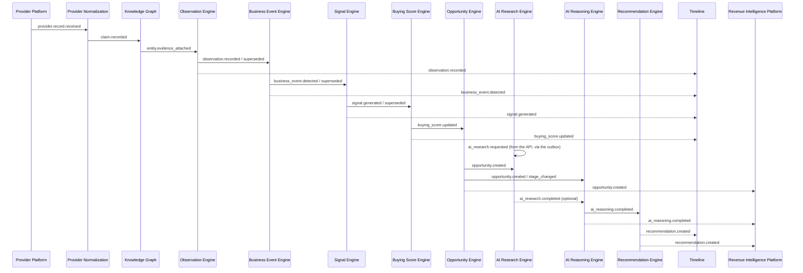
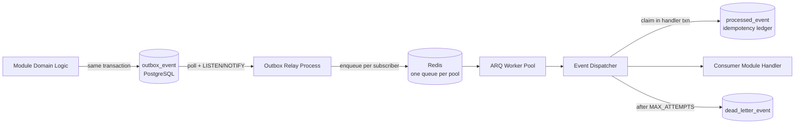

# 06 — Events

> Status: **Living document — Architectural Constitution**
> Audience: All engineers, EMs, and technical stakeholders at Signora
> Revision: **v7** — adds the Signal Engine (M5A) catalog, removes `signal.scored`, and drops `score` from `signal.generated`: the Signal Engine produces no scores. v6 added the Business Event Engine (M4) catalog and removed `business_event_type.published`, which assumed a runtime-mutable taxonomy. v5 added the Observation Engine (M3B) catalog and `entity.evidence_attached`. v4 added the Provider Normalization (M2.2) and Knowledge Graph (M3A) catalogs, and replaces the v2 placeholders `provider.record.normalized`, `entity.updated`, and `entity.merged` with the events the evidence-first model actually produces. v3 notes follow.
> Previous revision: **v3** — documents the dispatch layer as built in M1.1: relay semantics, the `processed_event` idempotency ledger, the `dead_letter_event` table, and the decision that **idempotency is platform-owned**. v2 catalog unchanged.

## Purpose

This document specifies Signora's **Internal Event Bus** (Principle 12): the event envelope contract, the full event catalog, delivery semantics, and the ratified transport implementation.

## Responsibilities

- Define the standard event envelope every domain event uses.
- Catalog every domain event, its producer, its consumer(s), and its payload shape at a high level.
- Define delivery, ordering, retry, and idempotency semantics.
- Define the transport implementation and its rationale.

## Event Envelope

```json
{
  "event_id": "uuid",
  "event_type": "opportunity.created",
  "event_version": 1,
  "workspace_id": "uuid",
  "occurred_at": "ISO-8601 timestamp",
  "producer_module": "opportunity-engine",
  "correlation_id": "uuid",
  "causation_id": "uuid | null",
  "payload": { "...": "event-specific, versioned shape" }
}
```

| Field | Meaning |
|---|---|
| `event_id` | Unique ID of this event instance; used for idempotency/dedup. |
| `event_type` | Dot-namespaced type, `<domain_concept>.<past_tense_verb>`. |
| `event_version` | Payload schema version for this event type. |
| `workspace_id` | Tenant scope — every event is workspace-scoped (Principle 8). |
| `occurred_at` | When the fact became true in the domain. |
| `producer_module` | The module that published the event. |
| `correlation_id` | Groups all events belonging to one end-to-end pipeline run, for tracing (see [07-data-flow.md](07-data-flow.md)). |
| `causation_id` | The `event_id` that directly caused this one. |
| `payload` | Event-specific data — validated as a Pydantic v2 model (see [ADR-0004](adr/0004-data-validation-and-serialization.md)); the canonical schema for each event type lives in `platform/event-bus/schemas/` (see [15-project-structure.md](15-project-structure.md)), not duplicated inline here. |

## Event Catalog

Events are listed in pipeline order. Payload fields below are illustrative and indicate intent; the Pydantic model is the binding contract.

| Event | Producer | Consumer(s) | High-level payload |
|---|---|---|---|
| `workspace.created` | Workspace & Tenancy | (informational) | `workspace_id`, `name`, `created_by` |
| `workspace.member_added` | Workspace & Tenancy | (informational) | `workspace_id`, `user_id`, `role` |
| `provider.payload.received` | Provider Platform | Provider Normalization | `provider`, `entity_type`, `raw_payload_ref`, `received_at` |
| `provider.health_changed` | Provider Platform | (operational; feeds monitoring, not domain modules) | `provider`, `status`, `reason` |
| `claim.recorded` | Provider Normalization | Knowledge Graph | `raw_record_id`, `provider`, `subject_external_id`, `claim_count` — see the M2.2 section below; this supersedes the v2 placeholder `provider.record.normalized`, which would have carried a normalized *record* rather than the claims the evidence model actually produces |
| `entity.created` | Knowledge Graph | Observation Engine | `entity_id`, `kind`, `decision_id` — **no attributes**, see the M3A section below |
| `entity.identity_bound` | Knowledge Graph | Observation Engine | `entity_id`, `provider`, `rule`, `strength`, `decision_id` |
| `entity.resolution_ambiguous` | Knowledge Graph | (operational work queue) | `candidate_entity_ids`, `decision_id` |
| `relationship.established` / `relationship.ended` | Knowledge Graph | Observation Engine | `relationship_id`, `kind`, `source_entity_id`, `target_entity_id` |
| `observation.recorded` | Observation Engine | Business Event Engine, Timeline | `observation_id`, `entity_id`, `provider`, `attribute`, `kind`, `direction`, `observed_at` — see the M3B section below |
| `observation.superseded` | Observation Engine | Business Event Engine, Timeline | `observation_id`, `supersedes`, `entity_id`, `attribute` |
| `business_event.detected` | Business Event Engine | Signal Engine, Timeline | `business_event_id`, `entity_id`, `type_key`, `domain`, `occurred_at`, `taxonomy_version` — see the M4 section below |
| `business_event.superseded` | Business Event Engine | Signal Engine, Timeline | `business_event_id`, `supersedes`, `entity_id`, `type_key` |
| `signal.generated` | Signal Engine | Buying Score Engine, Timeline | `signal_id`, `entity_id`, `signal_type`, `relevance`, `relevant_until`, `catalog_version`, `profile_version` — see the M5A section below |
| `signal.superseded` | Signal Engine | Buying Score Engine, Timeline | `signal_id`, `supersedes`, `entity_id`, `signal_type` |
| `action_batch.applied` | Action Batch | Timeline | `batch_id`, `name`, `item_count`, `approved_by`, `reversible_until` — see the R-03 section below |
| `action_batch.reversed` | Action Batch | Timeline | `batch_id`, `applied_at`, `reversed_by` |
| `action_batch.application_requested` | Action Batch | ⛔ **Action Batch itself, and nothing else** | `batch_id`, `name` — ⚡ **a work trigger, not an integration event; see the R-03 section below** |
| `buying_score.updated` | Buying Score Engine | Opportunity Engine, Timeline | `score_id`, `entity_id`, `score`, `trend`, `delta`, `contested`, `source_signal_ids`, `dissenting_signal_ids`, `trigger`, `valid_until`, `model_version` — see the M5B section below |
| `opportunity.created` | Opportunity Engine | AI Research Engine, AI Reasoning Engine, Timeline, Revenue Intelligence Platform | `opportunity_id`, `entity_id`, `originating_buying_score_id`, `score_at_creation`, `contested_at_creation`, `qualification`, `stage`, `policy_version` — see the M6 section below |
| `opportunity.stage_changed` | Opportunity Engine | AI Reasoning Engine, Timeline, Revenue Intelligence Platform | `opportunity_id`, `entity_id`, `previous_stage`, `new_stage`, `owner_id`, `actor_id`, `reason`, `sequence` |
| `ai_research.requested` | AI Research Engine | AI Research Engine (its own worker — see the M12.4 section below) | `request_id`, `entity_id`, `opportunity_id`, `requested_by`, `payload_version` |
| `ai_research.completed` | AI Research Engine | AI Reasoning Engine (optional/non-blocking, see [05-module-dependencies.md](05-module-dependencies.md)) | `research_id`, `opportunity_id`, `subject_kind`, `subject_id`, `synthesis_id`, `prompt_name`, `prompt_version`, `prompt_fingerprint`, `model`, `vendor`, `evidence_digest`, `finding_count`, `statement_count`, `inference_id`, `payload_version` — see the M10 section below |
| `notification.requested` | ⚡ **Any module with something worth telling a customer** — AI Research Engine today | Workspace & Tenancy (its `notification_requested` consumer) | `recipient_id`, `category`, `actor_kind`, `actor_person_id`, `actor_agent_name`, `subject_kind`, `subject_id`, `summary`, `expectation`, `channels`, `payload_version` — see the TASK-495 section below |
| `ai_reasoning.completed` | AI Reasoning Engine | Recommendation Engine, Revenue Intelligence Platform | `reasoning_id`, `opportunity_id`, `model_provenance`, `result_ref` |
| `recommendation.created` | Recommendation Engine | Timeline, Revenue Intelligence Platform | `recommendation_id`, `opportunity_id`, `action`, `priority` |
| `recommendation.status_changed` | Recommendation Engine | Timeline, Revenue Intelligence Platform, Signal Engine (feedback loop) | `recommendation_id`, `previous_status`, `new_status` |

## Event Flow Diagram



## Delivery Semantics

- **At-least-once delivery.** A handler can legitimately be invoked more than once for the same event.
- **Idempotency is owned by the platform, not by modules.** See below — this is a change from v2's framing, which implied each consumer would implement its own deduplication.
- **Per-entity ordering, not global ordering.**
- **Retry with exponential backoff, capped, then dead-lettering** after `MAX_ATTEMPTS` (5).
- **Durability first.** An event is not "published" until durably committed in PostgreSQL.

### Platform-owned idempotency

Requiring each of thirteen modules to implement deduplication correctly would mean thirteen chances to get it subtly wrong, and a bug would surface as duplicated domain state rather than as an obvious error. The bus owns it instead.

The dispatcher writes `(consumer_name, event_id)` into **`processed_event`** *in the same transaction as the handler's own work*. That transactional coupling is the whole point:

- If the ledger were written in a **separate, earlier** transaction, a crash in between would permanently skip a handler that never ran.
- If it were written in a **separate, later** transaction, a crash would re-run a handler that had already completed.

Sharing one transaction makes "handled" and "recorded as handled" atomically the same fact. The claim uses `INSERT … ON CONFLICT DO NOTHING` rather than SELECT-then-INSERT, which would race between concurrent workers.

The key is `(consumer_name, event_id)`, not `event_id` alone: several consumers subscribe to the same event and each must process it exactly once independently.

> **Consumer names are a permanent contract.** Renaming one resets its idempotency ledger, and every historical event would be re-processed on replay.

**Modules must not implement their own idempotency mechanism.** This is a per-module acceptance criterion in [IMPLEMENTATION_ROADMAP.md](../../IMPLEMENTATION_ROADMAP.md).

## Transport: Postgres Outbox + Redis/ARQ Dispatch

The v1 architecture proposed a pure Postgres-polling outbox. The Architecture Review Board revisited this once background processing was ratified as **Redis + ARQ** (see [ADR-0011](adr/0011-background-processing-and-event-bus-transport.md)) and reconciled the two:

1. A module writes its domain state change and an outbox row to PostgreSQL in the **same transaction** — this remains the source of truth and the durability guarantee. Nothing is considered "published" until this commits.
2. A lightweight **relay process** (part of the worker fleet) tails the outbox via `LISTEN/NOTIFY` and enqueues a corresponding ARQ job on Redis for each subscriber, marking the outbox row relayed.
3. **ARQ workers** — already required for general background processing — consume these jobs using the same worker pools, queues, and retry/backoff semantics as every other background job in the system, rather than requiring a second, bespoke dispatch mechanism.
4. The Internal Event Bus abstraction referenced throughout this document set wraps this two-hop path (Postgres commit → relay → ARQ dispatch); modules publish/subscribe against that abstraction only.



### Dispatch tables

Three platform-owned tables. **None carries Row-Level Security**: all are system infrastructure — never queried on behalf of an end user, never exposed through an API, and swept across every workspace by the relay, which RLS scoping would prevent. `workspace_id` is stored as event data, not as a scope key.

| Table | Purpose |
|---|---|
| `outbox_event` | Durable source of truth. Written in the domain transaction; `relayed_at`, `relay_attempts`, and `relay_failed_at` track hand-off. |
| `processed_event` | Idempotency ledger, keyed `(consumer_name, event_id)`. |
| `dead_letter_event` | Events whose handler exhausted retries. Retains the **full envelope** rather than referencing `outbox_event`, because the outbox may eventually be pruned while a dead letter must remain independently replayable. Marked `replayed_at` rather than deleted, so the record of what failed — and that it was addressed — survives. |

### Relay semantics

The relay claims unrelayed rows with `FOR UPDATE SKIP LOCKED`, publishes to one queue per subscribed consumer's pool, then marks `relayed_at`.

**Ordering is deliberate: enqueue first, mark second.** If rows were marked relayed before enqueueing, a crash in between would lose the event permanently. Marking after means the worst case is a duplicate, which the idempotency ledger absorbs. **Prefer duplicates over loss** is the rule the relay is built on.

- **Concurrency.** `SKIP LOCKED` lets relay instances partition the backlog rather than duplicating it, so the relay scales horizontally.
- **Wake-up.** Polls on a timer *and* listens on `NOTIFY signora_outbox`. Polling is the guarantee (notifications are not durable); the notification only collapses idle latency. Either alone is insufficient.
- **Failure isolation.** A row that fails to enqueue records `relay_attempts`/`relay_failed_at` and is skipped for a backoff window, so one persistently failing event cannot consume every batch.
- **No subscribers is not an error.** An event nobody consumes is relayed and marked done — publishing before anyone consumes is how the pipeline is built incrementally.

### Worker pools

Consumers are assigned to pools partitioned by **cost and latency profile**, not by module — see [12-scalability.md](12-scalability.md). Each pool is one Redis queue and one independently-scalable worker deployment, selected by `SIGNORA_WORKER_POOL`.

| Pool | Concurrency | Timeout | For |
|---|---|---|---|
| `ingestion` | 20 | 300s | Provider Platform, Provider Normalization |
| `graph` | 10 | 600s | Knowledge Graph, Observation Engine |
| `intelligence` | 10 | 300s | Business Event, Signal, Buying Score, Opportunity |
| `ai_reasoning` | 4 | 180s | AI Reasoning Engine |
| `ai_research` | 2 | 1800s | AI Research Engine — agentic, minutes not seconds |
| `read_model` | 20 | 120s | Timeline, Revenue Intelligence Platform |
| `default` | 10 | 300s | Unassigned consumers |

**Why not skip the outbox and publish directly to Redis?** Redis alone cannot participate in the same ACID transaction as the domain write, reintroducing the dual-write problem (state committed but event lost, or event published but state rolled back) that the outbox pattern exists to eliminate. The outbox keeps PostgreSQL as the single durable source of truth for "did this event definitely happen"; Redis/ARQ is purely a dispatch and worker-concurrency mechanism layered on top, and is disposable/rebuildable from the outbox if ever lost.

**Why not skip Redis/ARQ and dispatch straight from outbox polling?** Because Redis + ARQ is already a required piece of infrastructure for general asynchronous work (Principle 13, [ADR-0011](adr/0011-background-processing-and-event-bus-transport.md)), reusing it for event dispatch avoids operating two separate background-processing mechanisms with two separate concurrency models, retry policies, and monitoring surfaces.

## Schema Evolution

- Event payloads are versioned via `event_version`; the Pydantic model is the source of truth (see [ADR-0004](adr/0004-data-validation-and-serialization.md)).
- Breaking changes require a new `event_version`, with the producer publishing both versions for a defined deprecation window.
- No consumer may depend on undocumented payload fields.

## Design Rationale

Keeping PostgreSQL as the transactional source of truth while using the already-required Redis/ARQ stack purely as a dispatch mechanism gives Signora durability guarantees without a dual-write risk and without operating two independent async infrastructures. This is a direct consequence of ratifying Redis + ARQ for background processing — see [ADR-0011](adr/0011-background-processing-and-event-bus-transport.md) for the full alternatives analysis (including why a dedicated broker like Kafka was rejected at this stage).

## Best Practices

- Always propagate `correlation_id`/`causation_id`.
- Design event handlers to be idempotent on `event_id` from day one.
- Never publish directly to Redis, bypassing the outbox — this breaks the durability guarantee.

## Anti-Patterns

- Publishing an event to Redis before the causing transaction commits.
- Using events as a substitute for synchronous request/response.
- Fat events embedding another module's entire internal state.
- Non-idempotent event handlers.

## Tradeoffs

| Choice | We gain | We give up |
|---|---|---|
| Outbox (Postgres) + dispatch (Redis/ARQ) | Transactional durability + reuse of one worker infrastructure for all async work | An extra relay hop vs. either pure-Postgres-polling or pure-Redis-pubsub alone (acceptable; relay is simple and stateless) |
| At-least-once + idempotent consumers | Simplicity, no message loss | Consumers must handle duplicates |

## Future Evolution

- If outbox/relay throughput becomes a bottleneck (see triggers in [12-scalability.md](12-scalability.md)), the relay can be sharded per module or per `workspace_id` range without changing the Internal Event Bus abstraction.
- Migration to Temporal for the highest-value long-running/agentic workflows (notably AI Research Engine) is the ratified future path — see [ADR-0011](adr/0011-background-processing-and-event-bus-transport.md) and [17-future-recommendations.md](17-future-recommendations.md). This does not replace the event bus; it replaces ad hoc multi-step orchestration inside a single ARQ job with durable, resumable workflow execution for the specific workloads that need it.

## Decision Summary

The Internal Event Bus is a versioned, envelope-standardized, at-least-once, per-entity-ordered event system implemented as a PostgreSQL transactional outbox for durability, relayed via `LISTEN/NOTIFY` into Redis/ARQ for dispatch and worker concurrency — reusing, not duplicating, the platform's general background-processing infrastructure.

### Provider Platform (M2.1)

| Event | v | Payload | Notes |
|---|---|---|---|
| `provider.sync.requested` | 1 | `subject`, `provider`, `capability` | ⚡ **One declared company needs its first read** (TASK-901). Published by `SyncDeclaredTargets` — one per company that no watermark covers — and consumed by this module's own worker subscription. **The provider is resolved when the request is made, not when it runs**, so a replay cannot be sent somewhere the original was not. ⛔ **Modelled on `ai_research.requested`**: a module asking for its own long work publishes it, because `signora_platform/event_bus/queue.py` refuses a module enqueueing directly — *"modules never touch this directly"* |
| `provider.sync.started` | 1 | `sync_id`, `provider`, `capability` | One sync run begins |
| `provider.record.received` | 1 | `record_id`, `sync_id`, `provider`, `capability`, `external_id` | One raw record landed. **Carries identity, not payload** — putting a provider body in an envelope would make every vendor shape change an event contract change. |
| `provider.sync.completed` | 1 | `sync_id`, `provider`, `capability`, `records_received`, `pages_fetched` | Watermark advances only on this |
| `provider.sync.failed` | 1 | `sync_id`, `provider`, `capability`, `failure_kind`, `failure_message` | `failure_kind` ∈ `transient` \| `permanent` \| `contract`. Message is coarse — a message naming exactly which credential was rejected would reach a log aggregator with retention. |

**No event carries simulation state.** A consumer able to distinguish a simulated record from a real one would be a consumer with a reason to behave differently, which is the coupling AC-21 forbids.

### Provider Normalization (M2.2)

| Event | v | Payload | Notes |
|---|---|---|---|
| `claim.recorded` | 1 | `raw_record_id`, `provider`, `subject_external_id`, `claim_count`, `mapper_version` | Evidence was produced from one raw record. **Carries identity and counts, not claims.** Embedding claim bodies would make every vocabulary addition an event contract change; a consumer reads them through `provider_normalization.public.ClaimReader`. |

`subject_external_id` is the **claims'** subject, not the raw record's external id. A mapper legitimately identifies a subject differently from the way the sync addressed it — BuiltWith keys on the domain while the record was fetched by name — and a consumer must resolve the identity the evidence is filed under.

One event per raw record rather than one per claim: the claims from a record are a single unit of evidence about a single subject, and resolving identity once per record rather than once per attribute is the difference between one decision and fifteen identical ones. A record that produced no claims publishes nothing.

### Knowledge Graph (M3A)

| Event | v | Payload | Notes |
|---|---|---|---|
| `entity.created` | 1 | `entity_id`, `kind`, `decision_id` | A provider identity matched nothing existing |
| `entity.identity_bound` | 1 | `entity_id`, `provider`, `provider_external_id`, `rule`, `strength`, `decision_id` | A provider identity resolved to an entity. `strength` travels as the **string category** it is, never a number |
| `entity.resolution_ambiguous` | 1 | `provider`, `provider_external_id`, `candidate_entity_ids`, `decision_id` | Two candidates matched; **nothing merged** |
| `entity.evidence_attached` | 1 | `entity_id`, `provider`, `provider_external_id`, `raw_record_id`, `claim_ids` | Claims were attributed to an entity. Published on **every** batch, including one that changed no identity |
| `relationship.established` | 1 | `relationship_id`, `kind`, `source_entity_id`, `target_entity_id`, `valid_from` | An edge began |
| `relationship.ended` | 1 | `relationship_id`, `kind`, `source_entity_id`, `target_entity_id`, `valid_to` | An edge closed. The row survives — `valid_to` is set, never deleted |

**No Knowledge Graph event carries an attribute value.** The graph resolves identity, not truth (ratified 2026-07-28); an event announcing *"Acme has 120 employees"* would be the collapse the module exists to avoid. Every event names its `decision_id`, so any downstream conclusion traces back to the rule and the matched value that justified it.

`entity.resolution_ambiguous` is a **first-class event, not a log line** — it is a work queue and an operational signal that a provider's identity data has degraded.

**Why `entity.evidence_attached` exists separately.** A re-resolution that reaches the same answer writes no decision, so a nightly re-sync produces new claims and *no* identity event. A consumer subscribed to `entity.identity_bound` would therefore never see most of the evidence the pipeline ever receives. Attributing evidence to identity is the graph's own responsibility, so announcing it is the natural output of it — and it keeps the ratified Knowledge Graph → Observation Engine edge intact rather than adding a Provider Normalization → Observation Engine one. Published only for an `IDENTIFIED` binding: evidence attached to an ambiguous identity is evidence about a company that may be one of several.

> **Deferred:** `entity.superseded` appears in the M3A design but nothing publishes it yet. Correcting a *wrong merge* is an operator action whose interface belongs with the business UI (M12); an event with no producer would be a contract nobody is keeping.

### Observation Engine (M3B)

| Event | v | Payload | Notes |
|---|---|---|---|
| `observation.recorded` | 1 | `observation_id`, `entity_id`, `provider`, `attribute`, `kind`, `direction`, `observed_at` | Something changed, **according to one provider** |
| `observation.superseded` | 1 | `observation_id`, `supersedes`, `entity_id`, `attribute` | A late-arriving claim refined an earlier observation |

**Neither event carries the observed values.** A consumer reads them through `observation_engine.public.ObservationQueries`, so adding a canonical attribute is never an event-contract change.

**`observation.recorded` is not a claim that the change matters.** `kind` and `direction` are structural readings; the Business Event Engine applies its curated taxonomy to decide whether this is a hiring surge or a rounding error (the layering principle in [21-intelligence-pipeline.md](21-intelligence-pipeline.md)).

`observation.superseded` is a first-class event rather than a log line: a consumer that already acted on the coarser observation needs to know it was refined, or it will double-count the change. `occurred_at` is when Signora learned; **`observed_at` is when the provider says it was true**, and Timeline must order on the latter or a backfill renders as a wall of activity on its ingestion day.

### Business Event Engine (M4)

| Event | v | Payload | Notes |
|---|---|---|---|
| `business_event.detected` | 1 | `business_event_id`, `entity_id`, `type_key`, `domain`, `occurred_at`, `window_start`, `window_end`, `taxonomy_version`, `payload_version` | Something business-relevant happened |
| `business_event.superseded` | 1 | `business_event_id`, `supersedes`, `entity_id`, `type_key` | A phenomenon extended, or a conclusion was corrected |

**Neither event carries `facts` or the evidence list.** A consumer reads them through `business_event_engine.public.BusinessEventQueries`, so adding a fact to a type is never an event-contract change.

**Two version numbers travel together, deliberately.** `taxonomy_version` is the *meaning* — the parameters and conditions in force when this was detected. `payload_version` is the *wire shape*. Conflating them means tuning a threshold breaks a consumer contract, so nobody ever tunes a threshold; keeping them apart lets the taxonomy evolve while the contract stays stable for a year.

**`business_event.detected` is not a claim that anyone should act.** How important the account is, whether Sales should engage, and how likely a purchase is belong to the Signal Engine and everything after it (the layering principle in [21-intelligence-pipeline.md](21-intelligence-pipeline.md)).

`business_event.superseded` is first-class rather than a log line: a consumer that already acted on the earlier, smaller view of a phenomenon needs to know, or it will count the same thing twice.

### Signal Engine (M5A)

| Event | v | Payload | Notes |
|---|---|---|---|
| `signal.generated` | 1 | `signal_id`, `entity_id`, `signal_type`, `relevance`, `occurred_at`, `relevant_until`, `catalog_version`, `profile_version`, `payload_version` | A commercial hypothesis is supported **for this workspace** |
| `signal.superseded` | 1 | `signal_id`, `supersedes`, `entity_id`, `signal_type` | A hypothesis gained evidence, or a conclusion was corrected |

### R-03 · The Action Batch

**Two events, and the pair is the whole catalog for this context.** A batch has six transitions — proposed, approved, rejected, withdrawn, applied, reversed — and **only two of them change anything outside the module**: the moment it took effect, and the moment it was taken back.

### ⚡ `action_batch.application_requested` is a WORK TRIGGER, and the distinction is the whole of it

**Added by [TASK-465](../BACKLOG.md), slice 5.** ⛔ **Nothing outside `action_batch` may subscribe to it.** ⚡ **Its only consumer is that module's own worker**, and it exists because [§9](../../CLAUDE.md) forbids the alternative: *"never publish directly to Redis, bypassing the outbox."* 📁 **`ai_research_engine` established the shape** — it publishes `ai_research.requested` and subscribes to it itself — **and this follows it rather than introducing a second mechanism.**

🔴 **The two-event claim above is unchanged and still true**: *only `applied` and `reversed` change anything outside this module.* ⚠️ **This third one announces work that has NOT happened**, which is precisely why nothing outside may act on it — **the moment anything outside treats *accepted* as *applied*, the row's own risk has arrived**: *a customer told applied before the work finishes.*

⛔ **There is deliberately no `action_batch.approved`.** Approval is *permission to apply*, not the application. A subscriber acting on it would act before the work happened, and the gap between the two moments is real — `APPROVED` with no `applied_at` is a state the domain models on purpose. **P-C: an event exists when a consumer appears**, and nothing consumes an approval.

| Event | Version | Payload | Meaning |
|---|---|---|---|
| `action_batch.applied` | 1 | `batch_id`, `name`, `item_count`, `approved_by`, `reversible_until` | A named unit of work took effect. `name` is the customer's own words, so a history reads as a record of decisions rather than identifiers. `item_count` is a count and **never the payload** — what each item means belongs to the domain that proposed it. `reversible_until` is `null` when **reversal was never offered**, which is not the same as a window that has closed |
| `action_batch.application_requested` | 1 | `batch_id`, `name` | ⚡ **An approved batch was accepted for application and handed to a worker.** ⛔ **Identity, never payload** — the handler loads the batch rather than trusting the event, so a replayed message cannot apply one that has since been reversed. ⛔ **No consumer outside this module** |
| `action_batch.reversed` | 1 | `batch_id`, `applied_at`, `reversed_by` | The work was taken back inside its window. ⚠️ **Not a retraction of `applied`** — both happened, in that order, and a subscriber that dropped the first on seeing the second would lose the interval during which the work was live, which is exactly what a customer asks about. `applied_at` is **stated rather than inferred from ordering**, because a subscriber may see the two out of order |

**These are the first events in the pipeline that are not globally true.** Everything upstream describes what happened; a signal describes what it might mean *to one customer* — which is why both versions travel with it. `catalog_version` is Signora's vocabulary; `profile_version` is the customer's interpretation, and a historical signal missing either is unexplainable.

`relevance` travels as the **string category** it is — `primary`, `supporting`, `contextual` — so no consumer can read it as a weight. Mapping categories to weights is the Buying Score Engine's decision, in its own configuration.

**`signal.generated` is not a claim that anyone should act.** How likely a purchase is, which account to prioritise, and what to recommend belong downstream.

> **Two corrections to the v2 catalog.** `signal.generated` has **lost its `score`**, and **`signal.scored` is removed entirely**. The Signal Engine produces no scores at all: propensity belongs to the Buying Score Engine, which already publishes `buying_score.updated`. An event whose only possible producer lives in another module is a contract nobody is keeping — the same reasoning that removed `business_event_type.published`.

### Buying Score Engine (M5B)

| Event | v | Payload | Notes |
|---|---|---|---|
| `buying_score.updated` | 1 | `score_id`, `entity_id`, `score`, `trend`, `delta`, `contested`, `source_signal_ids`, `dissenting_signal_ids`, `trigger`, `valid_until`, `model_version`, `payload_version` | An account's commercial attention has been re-read |

**The first event in the pipeline carrying a number.** M5A ratified relevance as a category with no numeric meaning; this is where the first one is made. It is **not a probability and not a prediction** — an ordering of commercial attention, normalized against a ceiling the scoring model declares — and the payload deliberately carries no field implying otherwise.

**`contested` travels with the score**, added to the v2 shape. A consumer that cannot tell a fought-over account from a quiet one will reconstruct the distinction by querying signals itself, which puts scoring logic in Opportunity Engine. `dissenting_signal_ids` **names** the outweighed reading rather than counting it, because a consumer told only *"contested"* learns that something disagrees while being denied the means to look.

**`valid_until` states how long the published number is exactly correct**, not merely recent — and a consumer holding it past that moment knows it is reading a stale reading. This is what makes step decay a contract rather than an implementation detail: a continuously-decaying score could not honour it.

`source_signal_ids` carries **identity only**. The contribution ledger holds the arithmetic, and embedding it here would make every weighting change an event-contract change — *events carry identity; ports carry payload.*

**`trigger`** records why the reading exists: a signal arrived, a signal was superseded, configuration changed, or **evidence aged**. The last one is the reason the module has a sweep at all — shelf-life expiry publishes no event of its own, and a number that moved for an unexplainable reason is a number nobody trusts.

> **One addition to the v2 catalog**, made before the event had any implementation: `contested`, `dissenting_signal_ids`, `delta`, `trigger`, `valid_until`, and `score_id`. The v2 shape (`entity_id`, `score`, `trend`, `source_signal_ids`, `model_version`) survived design review unchanged and is still present — a good sign for the boundary.

### Opportunity Engine (M6)

| Event | v | Payload | Notes |
|---|---|---|---|
| `opportunity.created` | 1 | `opportunity_id`, `entity_id`, `originating_buying_score_id`, `score_at_creation`, `contested_at_creation`, `qualification`, `stage`, `policy_version`, `payload_version` | An account crossed the threshold for tracking |
| `opportunity.stage_changed` | 1 | `opportunity_id`, `entity_id`, `previous_stage`, `new_stage`, `owner_id`, `actor_id`, `reason`, `sequence`, `payload_version` | **A human** moved it |

**The first events that announce a decision rather than a derivation.** Everything upstream announces what Signora concluded from evidence; `opportunity.stage_changed` announces what a person did — which is why it carries `actor_id` and `reason`, and why neither is ever absent.

**`opportunity.created` is a suggestion, not a commitment.** `stage` is always `tracking`, the only stage Signora may author. *Intelligence suggests; humans commit* (ratified 2026-07-29).

`originating_buying_score_id` is the first link of the chain outward. Because buying scores are **immutable**, it resolves forever — the citation does not break when the score is later superseded, and a full pipeline rebuild reproduces byte-identical score ids, so it is not orphaned by regeneration either.

`contested_at_creation` travels so no consumer rediscovers it by querying signals, which would put scoring logic in the wrong module. `qualification` records whether Signora suggested it or a human opened it directly.

> **Additions to the v2 catalog**, made before either event had an implementation: `originating_buying_score_id` (replacing the vaguer `source_buying_score`), `score_at_creation`, `contested_at_creation`, `qualification`, `policy_version` on creation; and `entity_id`, `owner_id`, `actor_id`, `reason`, `sequence` on the stage change. **`opportunity.closed` was considered and not added** — `stage_changed` already carries it, and an event whose information is fully contained in another is a contract nobody keeps.

### AI Platform (M8)

| Event | v | Payload | Notes |
|---|---|---|---|
| `ai.narration_completed` | 1 | `narration_id`, `subject_kind`, `subject_id`, `prompt_name`, `prompt_version`, `prompt_fingerprint`, `model`, `vendor`, `evidence_digest`, `statement_count`, `inference_id`, `payload_version` | A grounded explanation was produced and stored |

**Exactly one event, and the restraint is the design.** A substrate emitting events nobody consumes is speculative by definition. `ai_reasoning.completed` was reserved here and is cataloged below, under its own producer; `ai_research.completed` was reserved for M10 and is now cataloged under its own producer too.

**It announces language, not a conclusion.** Every statement in the narration restates something the deterministic pipeline had already computed — grounding makes that mechanical rather than aspirational — so a consumer learns that an explanation now exists, never that Signora has decided anything new. This is the boundary between M8 and M9 expressed in the event contract.

**Identity and counts, never the prose.** `statement_count` says how many statements; nothing here says what they are. *Events carry identity; ports carry payload* — the same rule that keeps claim bodies out of `claim.recorded` and the contribution ledger out of `buying_score.updated`. Putting a paragraph of model output in an envelope would make every wording change an event-contract change, and would copy customer-visible text into a queue whose retention nobody has reasoned about.

**The subject is addressed in the AI Platform's own vocabulary** — `subject_kind` plus `subject_id`, the `EvidenceRef` shape — rather than as `entity_id`. The substrate does not name the pipeline's concepts, in its schema or in its contracts.

**`vendor` is provenance and never a decision input.** A consumer branching on it has reintroduced the vendor coupling the whole abstraction exists to prevent (CLAUDE.md §10). `prompt_fingerprint` travels because two narrations claiming version 1 with different fingerprints came from different text, and `inference_id` points at the operational record for anyone who needs tokens, latency or retries.

**No `ai.narration_failed`.** A failed inference is already recorded in `ai_inference` with its outcome and detail; an event whose information is fully contained elsewhere is a contract nobody keeps — the same reasoning that removed `signal.scored` and `opportunity.closed`.

> **Added 2026-07-30**, with its producer, in the change that built it. The M8 proposal reserved exactly this event and stated it would be cataloged in the same change or not at all.

### AI Reasoning Engine (M9)

| Event | v | Payload | Notes |
|---|---|---|---|
| `ai_reasoning.completed` | 1 | `reasoning_id`, `subject_kind`, `subject_id`, `prompt_name`, `prompt_version`, `prompt_fingerprint`, `model`, `vendor`, `evidence_digest`, `support`, `contested`, `conclusion_count`, `inference_id`, `payload_version` | A Decision Package was produced and stored |

**Exactly one, again.** It announces that a conclusion now *exists* — never what a consumer should do about it, which is the Recommendation Engine's question (M11). An event that told a consumer to act would move the decision out of the module that owns it and into an envelope nobody reviews.

**This is the event `ai.narration_completed` deliberately is not.** M8 announces *language*: every statement restates something the pipeline already computed. M9 announces a *conclusion* — a proposition a customer may disagree with, carrying the support and contradiction needed to do so. The two events differ because the two modules differ, which is the M8/M9 boundary expressed in the contract.

**Identity and counts, never the prose.** `conclusion_count` says how many statements; nothing here says what they are. *Events carry identity; ports carry payload* — the rule that keeps claim bodies out of `claim.recorded` and the contribution ledger out of `buying_score.updated`. A consumer reads the package through the module's repository.

**`support` and `contested` travel as string categories, never numbers.** Exactly as `MatchStrength` and `Relevance` do. A consumer given a number would average it; a consumer given `contested` as a flag *alongside* `support` can see that contention was preserved rather than netted away — which is the property six upstream stages exist to protect. `contested` travels so no consumer rediscovers it by querying signals, which would put scoring logic in the wrong module.

**`vendor` is provenance and never a decision input**, and vendor neutrality binds consumers exactly as it binds the platform (CLAUDE.md §10). `prompt_fingerprint` travels because two packages claiming version 1 with different fingerprints came from different text.

**No `ai_reasoning.failed`.** A failed inference is already recorded in `ai_inference` with its outcome and detail — the same reasoning that removed `signal.scored`, `opportunity.closed` and `ai.narration_failed`.

> **Added 2026-07-30**, with its producer, in the change that built it (T130). The payload was fixed in `domain/events.py` at T127; §5 of ADR-0030 records why the v2 placeholders `model_provenance` and `result_ref` were replaced by explicit provenance fields.

> **Removed:** `business_event_type.published` from the v2 catalog. It assumed a runtime-mutable taxonomy that notified the system when it changed. The taxonomy is a versioned repository artifact — **the deployment is the notification** — so the event had no producer, and an event with no producer is a contract nobody is keeping.

---

## M10 — AI Research Engine

| Event | v | Payload | Meaning |
|---|---|---|---|
| `ai_research.completed` | 1 | `research_id`, `opportunity_id`, `subject_kind`, `subject_id`, `synthesis_id`, `prompt_name`, `prompt_version`, `prompt_fingerprint`, `model`, `vendor`, `evidence_digest`, `finding_count`, `statement_count`, `inference_id`, `payload_version` | A research artifact was produced and stored |

**It means the run finished** — findings derived, brief written, all of it stored. Not that planning completed, and not that some steps executed. The AI Reasoning Engine consumes it opportunistically precisely because it may never arrive, so a consumer treating it as *"work is available"* would read a partial run as a complete one.

**This replaces the v2 placeholders.** The catalog reserved `artifact_ref` and `model_provenance` — the same two shapes M9 found and replaced at T127, and for the same reason: neither is a field, both are *categories* of field, and no consumer can be written against either. `artifact_ref` becomes `synthesis_id` plus the subject it concerns; `model_provenance` becomes the five provenance fields an auditor actually needs.

**Identity and counts, never the prose.** `finding_count` says how many comparisons ran; nothing here says what they found, and `statement_count` says how long the brief is rather than what it claims. *Events carry identity; ports carry payload.*

**`finding_count` is a count, never a quality.** A run with one finding is not worse than one with three — it looked at an account with less to compare.


---

## M12.4 — `ai_research.requested`, and the first production consumer

*Added 2026-08-01 with research on demand.*

**The first event in this catalog whose producer and consumer are the same
module**, and the first with a *production* subscription at all: every
`registry.subscribe` call before it was in a test.

### Why a command travels on the event bus

An API handler may not call a model (CLAUDE.md §7), and a research run is two
model calls and about a minute. So the request endpoint writes the
`research_request` row and publishes `ai_research.requested` **in the same
transaction**, through the outbox. The relay delivers it to the `ai_research`
pool, and a worker runs it.

Publishing directly to Redis would enqueue work whose cause might never commit —
a worker researching an account nobody successfully asked about. That is exactly
the failure the outbox exists to prevent, and it is why this is an event rather
than a direct enqueue.

**It is deliberately not a `started` event.** Nothing is published between the
ask and `ai_research.completed`: a *started* announcement would describe work
that has changed nothing, and the surface a customer watches reads the request's
own append-only state history instead.

### Identity only, as everywhere else

The handler reads the request row the envelope names rather than trusting the
payload — so a replayed event cannot start a run against an account the request
no longer points at. *Events carry identity; ports carry payload.*

`requested_by` is carried because it is what a later reader needs in order to
explain a model call in a bill, and it is not derivable from anything else on
the envelope.

### A finding raised by building it

**The dispatcher opens a tenant-scoped session and does not pass it to the
handler.** `EventHandler` is `Callable[[EventEnvelope], Awaitable[None]]`, so a
consumer cannot join the transaction that is already open for it, and the
idempotency claim and the work therefore commit separately.

`ai_research_engine` opens its own sessions and the consequence is stated in
`interface/handlers.py` rather than smoothed over: if the claim were lost after
the work committed, redelivery would find a settled request, the domain would
refuse to advance it, and the event would **dead-letter loudly and without a
second model call.**

Widening `EventHandler` is a `signora_platform/` change and belongs to the
platform's owner (§20a). **Raised, not fixed.**


## TASK-495 — `notification.requested`

**Ratified by [ADR-0017](adr/0017-notifications.md), scoped by [D-239](../DECISION_REGISTER.md).**

| Event | v | Payload | Meaning |
|---|---|---|---|
| `notification.requested` | 1 | `recipient_id`, `category`, `actor_kind`, `actor_person_id`, `actor_agent_name`, `subject_kind`, `subject_id`, `summary`, `expectation`, `channels`, `payload_version` | One person should be told that one thing happened |

### The one event in the catalog whose producer is *any module*

Every other event here is owned by the module that publishes it. This one is
owned by the module that **consumes** it: `workspace_tenancy` publishes the
contract, and any module with something worth telling a customer conforms to it.

That is deliberate, and it is what makes the trigger interface ADR-0017 requires
— *"one shared internal trigger interface, never per-channel bespoke code"* —
reachable without a new architectural edge.

**[05-module-dependencies.md](05-module-dependencies.md) approves exactly one
kind of synchronous edge into Workspace & Tenancy, and every instance of it is
read-only**: *"Any module → Workspace & Tenancy: resolve/validate workspace
context (read-only)."* A producer calling a `notify()` port directly would be a
synchronous **write** into another module's data — not on that list, and
extending the list is an architectural decision rather than an implementation
detail.

Publishing instead lands on the edge 05 already ratifies: **Workspace & Tenancy
→ all, Conformist — *"Every module conforms; none influences it."***

### Delivery is asynchronous, and the alternative was worse

The producer's outbox row commits in the same transaction as the thing it
announces, so a run that failed to record its own outcome never tells a customer
it succeeded. The relay delivers, the dispatcher claims `event_id`, and the
consumer resolves channels and writes.

**No business module reads `outbox_event`** (`CLAUDE.md` §8): a producer
publishes through the `EventPublisher` port it already holds, and the consumer
receives an `EventEnvelope`.

### The read side, and why the feed carries a read time

**Added 2026-08-19, slice ⓑ.** The event delivers; three reads serve the shell's
notification panel.

| | |
|---|---|
| `GET /workspaces/{id}/notifications` | The feed, newest first, bounded. **Each item carries `read_at`** |
| `POST /workspaces/{id}/notifications/unread` | The badge — a count over **ids the caller names**, capped at 99. ⚠️ **`POST`, and the verb is carrying the question**: a list does not fit in a query string |
| `POST /workspaces/{id}/notifications/read` | Marks **named ids** read, and answers with the resulting badge |

> 🔴 **The shell does not call the second one, and the row above used to say
> `GET`.** ⚠️ **The shell's badge was written against that sentence, issued a
> `GET`, and took a `405` on every authenticated screen** until the journey was
> written on 2026-08-19. ⛔ **Calling it correctly would have been the wrong
> repair**: it was built (TASK-480) against a feed that did not carry read state,
> and slice ⓐ changed that. ✅ **The badge is `read_at === null` counted over the
> feed** — one read, and no second question whose answer the first already
> contained.

**`read_at` is on the item and not derived from the badge**, because the design's
panel draws *"a 6px dot on the right"* per row: **the count says how many without
saying which**, and a panel reading the count would mark every row unread.

**The feed left-joins `notification_read`**, and the join is per person as well as
per notification — one colleague reading an item must not mark it read for
everyone it was sent to. **The RLS policy on `notification_read` is what enforces
that**; the join's predicate is defence in depth, and
`test_notification_feed_carries_read_state` records which of the two is
load-bearing rather than implying both are.

> **`FeedItem` keeps the two facts apart.** The notification records *what
> happened*; `read_at` records *when this person read it*, which is a later event
> with its own row. **Folding a read time onto the notification would put a
> mutable-looking field on a record the module refuses to let anything update.**

**Marking is per item and never on open** — the design is explicit: *"opening the
panel does not mark items read; opening an item does."* **A mark-everything call
on open would destroy the only signal the badge carries.** ⚠️ **The panel's
*"Mark all read"* control is not that**: it is somebody deciding, which is why it
is a control and not an effect.

### The subject is the record the customer acted on

**Corrected 2026-08-19, slice ⓑ.** `ai_research_engine` addressed its
notification at the **opportunity** the run belonged to. It now addresses the
**account**.

**The design's criterion is what forced it** — App Shell §10: *"each item states
who or what acted, **on which record**, and what is expected of the reader."*
**The shell cannot turn an opportunity id into anything a person recognises, and
there is no route to open one.** The account is also what the customer actually
did: they pressed *"Research this account"* on an account page, and the
opportunity is an internal artifact of the run.

**The payload shape is unchanged** — `subject_kind` and `subject_id` were always
a free pair, so this is a change of value rather than of contract, and no version
bump is owed. **What it establishes for the next producer**: address the record
the reader would recognise, not the one the work happened to be filed under.

### A channel with no adapter fails; it never degrades

`channels` is a required, non-empty, comma-separated set. The consumer resolves
**every** named channel before delivering **any** of them, and an unregistered
channel raises — so the event dead-letters rather than delivering a subset.

All-or-none is what makes redelivery safe. A partial delivery followed by a
retry is how *"a customer sees that something happened, once"* becomes twice.

The registry is `ai_platform`'s pattern applied one module along: *"An adapter is
registered only when its credentials exist… There is deliberately no fallback
between them."* In-app is the only channel registered today, and it is a
**channel**, never a substitute for one that failed to configure.

### No display name for a person, and that is C-203

`actor_person_id` carries identity; there is deliberately no `actor_name`.
[C-203](../LANE_COORDINATION.md) is `DEFERRED` with a concrete trigger —
[D-116](../DECISION_REGISTER.md), *M-E, when a provider supplies a person
identifier* — and its impact line names notifications directly. It was renumbered
from `C-024` by QE on 2026-08-02; `C-024` is a different, closed finding about
mounting Timeline. A field here would have answered it by accident, for Timeline,
comments, audit history, AI attribution and mentions at the same time.

`actor_agent_name` **is** carried, because an agent has no Better Auth identity
to resolve: the platform authored the name. It names a **capability** —
*"Research"* — never a model and never a vendor (`CLAUDE.md` §10).

### The workspace comes from the envelope

`to_payload()` deliberately emits no `workspace_id`. Every event is
workspace-scoped and the envelope is the only trustworthy statement of which
workspace; a payload that could name its own tenant would be a cross-workspace
write one typo away. Asserted in
`tests/security_invariants/test_notification_handler_scopes_to_the_envelope.py`.

### `channels` is serialized sorted

A `frozenset` has no order, and an event whose bytes vary with the process hash
seed is not replayable — `CLAUDE.md` §2, *hidden inputs are architecture
defects*.
