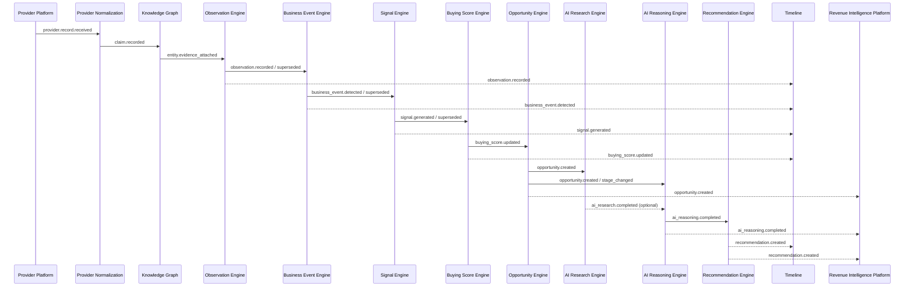
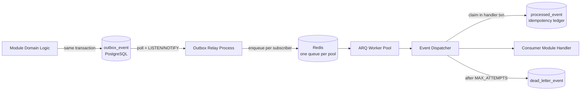

# 06 — Events

> Status: **Living document — Architectural Constitution**
> Audience: All engineers, EMs, and technical stakeholders at Signora
> Revision: **v7** — adds the Signal Engine (M5A) catalog, removes `signal.scored`, and drops `score` from `signal.generated`: the Signal Engine produces no scores. v6 added the Business Event Engine (M4) catalog and removed `business_event_type.published`, which assumed a runtime-mutable taxonomy. v5 added the Observation Engine (M3B) catalog and `entity.evidence_attached`. v4 added the Provider Normalization (M2.2) and Knowledge Graph (M3A) catalogs, and replaces the v2 placeholders `provider.record.normalized`, `entity.updated`, and `entity.merged` with the events the evidence-first model actually produces. v3 notes follow.
> Previous revision: **v3** — documents the dispatch layer as built in M1.1: relay semantics, the `processed_event` idempotency ledger, the `dead_letter_event` table, and the decision that **idempotency is platform-owned**. v2 catalog unchanged.

## Purpose

This document specifies Signora's **Internal Event Bus** (Principle 12): the event envelope contract, the full event catalog, delivery semantics, and the ratified transport implementation.

## Responsibilities

- Define the standard event envelope every domain event uses.
- Catalog every domain event, its producer, its consumer(s), and its payload shape at a high level.
- Define delivery, ordering, retry, and idempotency semantics.
- Define the transport implementation and its rationale.

## Event Envelope

```json
{
  "event_id": "uuid",
  "event_type": "opportunity.created",
  "event_version": 1,
  "workspace_id": "uuid",
  "occurred_at": "ISO-8601 timestamp",
  "producer_module": "opportunity-engine",
  "correlation_id": "uuid",
  "causation_id": "uuid | null",
  "payload": { "...": "event-specific, versioned shape" }
}
```

| Field | Meaning |
|---|---|
| `event_id` | Unique ID of this event instance; used for idempotency/dedup. |
| `event_type` | Dot-namespaced type, `<domain_concept>.<past_tense_verb>`. |
| `event_version` | Payload schema version for this event type. |
| `workspace_id` | Tenant scope — every event is workspace-scoped (Principle 8). |
| `occurred_at` | When the fact became true in the domain. |
| `producer_module` | The module that published the event. |
| `correlation_id` | Groups all events belonging to one end-to-end pipeline run, for tracing (see [07-data-flow.md](07-data-flow.md)). |
| `causation_id` | The `event_id` that directly caused this one. |
| `payload` | Event-specific data — validated as a Pydantic v2 model (see [ADR-0004](adr/0004-data-validation-and-serialization.md)); the canonical schema for each event type lives in `platform/event-bus/schemas/` (see [15-project-structure.md](15-project-structure.md)), not duplicated inline here. |

## Event Catalog

Events are listed in pipeline order. Payload fields below are illustrative and indicate intent; the Pydantic model is the binding contract.

| Event | Producer | Consumer(s) | High-level payload |
|---|---|---|---|
| `workspace.created` | Workspace & Tenancy | (informational) | `workspace_id`, `name`, `created_by` |
| `workspace.member_added` | Workspace & Tenancy | (informational) | `workspace_id`, `user_id`, `role` |
| `provider.payload.received` | Provider Platform | Provider Normalization | `provider`, `entity_type`, `raw_payload_ref`, `received_at` |
| `provider.health_changed` | Provider Platform | (operational; feeds monitoring, not domain modules) | `provider`, `status`, `reason` |
| `claim.recorded` | Provider Normalization | Knowledge Graph | `raw_record_id`, `provider`, `subject_external_id`, `claim_count` — see the M2.2 section below; this supersedes the v2 placeholder `provider.record.normalized`, which would have carried a normalized *record* rather than the claims the evidence model actually produces |
| `entity.created` | Knowledge Graph | Observation Engine | `entity_id`, `kind`, `decision_id` — **no attributes**, see the M3A section below |
| `entity.identity_bound` | Knowledge Graph | Observation Engine | `entity_id`, `provider`, `rule`, `strength`, `decision_id` |
| `entity.resolution_ambiguous` | Knowledge Graph | (operational work queue) | `candidate_entity_ids`, `decision_id` |
| `relationship.established` / `relationship.ended` | Knowledge Graph | Observation Engine | `relationship_id`, `kind`, `source_entity_id`, `target_entity_id` |
| `observation.recorded` | Observation Engine | Business Event Engine, Timeline | `observation_id`, `entity_id`, `provider`, `attribute`, `kind`, `direction`, `observed_at` — see the M3B section below |
| `observation.superseded` | Observation Engine | Business Event Engine, Timeline | `observation_id`, `supersedes`, `entity_id`, `attribute` |
| `business_event.detected` | Business Event Engine | Signal Engine, Timeline | `business_event_id`, `entity_id`, `type_key`, `domain`, `occurred_at`, `taxonomy_version` — see the M4 section below |
| `business_event.superseded` | Business Event Engine | Signal Engine, Timeline | `business_event_id`, `supersedes`, `entity_id`, `type_key` |
| `signal.generated` | Signal Engine | Buying Score Engine, Timeline | `signal_id`, `entity_id`, `signal_type`, `relevance`, `relevant_until`, `catalog_version`, `profile_version` — see the M5A section below |
| `signal.superseded` | Signal Engine | Buying Score Engine, Timeline | `signal_id`, `supersedes`, `entity_id`, `signal_type` |
| `buying_score.updated` | Buying Score Engine | Opportunity Engine, Timeline | `entity_id`, `score`, `trend`, `source_signal_ids`, `model_version` |
| `opportunity.created` | Opportunity Engine | AI Research Engine, AI Reasoning Engine, Timeline, Revenue Intelligence Platform | `opportunity_id`, `entity_id`, `source_buying_score`, `stage` |
| `opportunity.stage_changed` | Opportunity Engine | AI Reasoning Engine, Timeline, Revenue Intelligence Platform | `opportunity_id`, `previous_stage`, `new_stage` |
| `ai_research.completed` | AI Research Engine | AI Reasoning Engine (optional/non-blocking, see [05-module-dependencies.md](05-module-dependencies.md)) | `research_id`, `opportunity_id`, `artifact_ref`, `model_provenance` |
| `ai_reasoning.completed` | AI Reasoning Engine | Recommendation Engine, Revenue Intelligence Platform | `reasoning_id`, `opportunity_id`, `model_provenance`, `result_ref` |
| `recommendation.created` | Recommendation Engine | Timeline, Revenue Intelligence Platform | `recommendation_id`, `opportunity_id`, `action`, `priority` |
| `recommendation.status_changed` | Recommendation Engine | Timeline, Revenue Intelligence Platform, Signal Engine (feedback loop) | `recommendation_id`, `previous_status`, `new_status` |

## Event Flow Diagram



## Delivery Semantics

- **At-least-once delivery.** A handler can legitimately be invoked more than once for the same event.
- **Idempotency is owned by the platform, not by modules.** See below — this is a change from v2's framing, which implied each consumer would implement its own deduplication.
- **Per-entity ordering, not global ordering.**
- **Retry with exponential backoff, capped, then dead-lettering** after `MAX_ATTEMPTS` (5).
- **Durability first.** An event is not "published" until durably committed in PostgreSQL.

### Platform-owned idempotency

Requiring each of thirteen modules to implement deduplication correctly would mean thirteen chances to get it subtly wrong, and a bug would surface as duplicated domain state rather than as an obvious error. The bus owns it instead.

The dispatcher writes `(consumer_name, event_id)` into **`processed_event`** *in the same transaction as the handler's own work*. That transactional coupling is the whole point:

- If the ledger were written in a **separate, earlier** transaction, a crash in between would permanently skip a handler that never ran.
- If it were written in a **separate, later** transaction, a crash would re-run a handler that had already completed.

Sharing one transaction makes "handled" and "recorded as handled" atomically the same fact. The claim uses `INSERT … ON CONFLICT DO NOTHING` rather than SELECT-then-INSERT, which would race between concurrent workers.

The key is `(consumer_name, event_id)`, not `event_id` alone: several consumers subscribe to the same event and each must process it exactly once independently.

> **Consumer names are a permanent contract.** Renaming one resets its idempotency ledger, and every historical event would be re-processed on replay.

**Modules must not implement their own idempotency mechanism.** This is a per-module acceptance criterion in [IMPLEMENTATION_ROADMAP.md](../../IMPLEMENTATION_ROADMAP.md).

## Transport: Postgres Outbox + Redis/ARQ Dispatch

The v1 architecture proposed a pure Postgres-polling outbox. The Architecture Review Board revisited this once background processing was ratified as **Redis + ARQ** (see [ADR-0011](adr/0011-background-processing-and-event-bus-transport.md)) and reconciled the two:

1. A module writes its domain state change and an outbox row to PostgreSQL in the **same transaction** — this remains the source of truth and the durability guarantee. Nothing is considered "published" until this commits.
2. A lightweight **relay process** (part of the worker fleet) tails the outbox via `LISTEN/NOTIFY` and enqueues a corresponding ARQ job on Redis for each subscriber, marking the outbox row relayed.
3. **ARQ workers** — already required for general background processing — consume these jobs using the same worker pools, queues, and retry/backoff semantics as every other background job in the system, rather than requiring a second, bespoke dispatch mechanism.
4. The Internal Event Bus abstraction referenced throughout this document set wraps this two-hop path (Postgres commit → relay → ARQ dispatch); modules publish/subscribe against that abstraction only.



### Dispatch tables

Three platform-owned tables. **None carries Row-Level Security**: all are system infrastructure — never queried on behalf of an end user, never exposed through an API, and swept across every workspace by the relay, which RLS scoping would prevent. `workspace_id` is stored as event data, not as a scope key.

| Table | Purpose |
|---|---|
| `outbox_event` | Durable source of truth. Written in the domain transaction; `relayed_at`, `relay_attempts`, and `relay_failed_at` track hand-off. |
| `processed_event` | Idempotency ledger, keyed `(consumer_name, event_id)`. |
| `dead_letter_event` | Events whose handler exhausted retries. Retains the **full envelope** rather than referencing `outbox_event`, because the outbox may eventually be pruned while a dead letter must remain independently replayable. Marked `replayed_at` rather than deleted, so the record of what failed — and that it was addressed — survives. |

### Relay semantics

The relay claims unrelayed rows with `FOR UPDATE SKIP LOCKED`, publishes to one queue per subscribed consumer's pool, then marks `relayed_at`.

**Ordering is deliberate: enqueue first, mark second.** If rows were marked relayed before enqueueing, a crash in between would lose the event permanently. Marking after means the worst case is a duplicate, which the idempotency ledger absorbs. **Prefer duplicates over loss** is the rule the relay is built on.

- **Concurrency.** `SKIP LOCKED` lets relay instances partition the backlog rather than duplicating it, so the relay scales horizontally.
- **Wake-up.** Polls on a timer *and* listens on `NOTIFY signora_outbox`. Polling is the guarantee (notifications are not durable); the notification only collapses idle latency. Either alone is insufficient.
- **Failure isolation.** A row that fails to enqueue records `relay_attempts`/`relay_failed_at` and is skipped for a backoff window, so one persistently failing event cannot consume every batch.
- **No subscribers is not an error.** An event nobody consumes is relayed and marked done — publishing before anyone consumes is how the pipeline is built incrementally.

### Worker pools

Consumers are assigned to pools partitioned by **cost and latency profile**, not by module — see [12-scalability.md](12-scalability.md). Each pool is one Redis queue and one independently-scalable worker deployment, selected by `SIGNORA_WORKER_POOL`.

| Pool | Concurrency | Timeout | For |
|---|---|---|---|
| `ingestion` | 20 | 300s | Provider Platform, Provider Normalization |
| `graph` | 10 | 600s | Knowledge Graph, Observation Engine |
| `intelligence` | 10 | 300s | Business Event, Signal, Buying Score, Opportunity |
| `ai_reasoning` | 4 | 180s | AI Reasoning Engine |
| `ai_research` | 2 | 1800s | AI Research Engine — agentic, minutes not seconds |
| `read_model` | 20 | 120s | Timeline, Revenue Intelligence Platform |
| `default` | 10 | 300s | Unassigned consumers |

**Why not skip the outbox and publish directly to Redis?** Redis alone cannot participate in the same ACID transaction as the domain write, reintroducing the dual-write problem (state committed but event lost, or event published but state rolled back) that the outbox pattern exists to eliminate. The outbox keeps PostgreSQL as the single durable source of truth for "did this event definitely happen"; Redis/ARQ is purely a dispatch and worker-concurrency mechanism layered on top, and is disposable/rebuildable from the outbox if ever lost.

**Why not skip Redis/ARQ and dispatch straight from outbox polling?** Because Redis + ARQ is already a required piece of infrastructure for general asynchronous work (Principle 13, [ADR-0011](adr/0011-background-processing-and-event-bus-transport.md)), reusing it for event dispatch avoids operating two separate background-processing mechanisms with two separate concurrency models, retry policies, and monitoring surfaces.

## Schema Evolution

- Event payloads are versioned via `event_version`; the Pydantic model is the source of truth (see [ADR-0004](adr/0004-data-validation-and-serialization.md)).
- Breaking changes require a new `event_version`, with the producer publishing both versions for a defined deprecation window.
- No consumer may depend on undocumented payload fields.

## Design Rationale

Keeping PostgreSQL as the transactional source of truth while using the already-required Redis/ARQ stack purely as a dispatch mechanism gives Signora durability guarantees without a dual-write risk and without operating two independent async infrastructures. This is a direct consequence of ratifying Redis + ARQ for background processing — see [ADR-0011](adr/0011-background-processing-and-event-bus-transport.md) for the full alternatives analysis (including why a dedicated broker like Kafka was rejected at this stage).

## Best Practices

- Always propagate `correlation_id`/`causation_id`.
- Design event handlers to be idempotent on `event_id` from day one.
- Never publish directly to Redis, bypassing the outbox — this breaks the durability guarantee.

## Anti-Patterns

- Publishing an event to Redis before the causing transaction commits.
- Using events as a substitute for synchronous request/response.
- Fat events embedding another module's entire internal state.
- Non-idempotent event handlers.

## Tradeoffs

| Choice | We gain | We give up |
|---|---|---|
| Outbox (Postgres) + dispatch (Redis/ARQ) | Transactional durability + reuse of one worker infrastructure for all async work | An extra relay hop vs. either pure-Postgres-polling or pure-Redis-pubsub alone (acceptable; relay is simple and stateless) |
| At-least-once + idempotent consumers | Simplicity, no message loss | Consumers must handle duplicates |

## Future Evolution

- If outbox/relay throughput becomes a bottleneck (see triggers in [12-scalability.md](12-scalability.md)), the relay can be sharded per module or per `workspace_id` range without changing the Internal Event Bus abstraction.
- Migration to Temporal for the highest-value long-running/agentic workflows (notably AI Research Engine) is the ratified future path — see [ADR-0011](adr/0011-background-processing-and-event-bus-transport.md) and [17-future-recommendations.md](17-future-recommendations.md). This does not replace the event bus; it replaces ad hoc multi-step orchestration inside a single ARQ job with durable, resumable workflow execution for the specific workloads that need it.

## Decision Summary

The Internal Event Bus is a versioned, envelope-standardized, at-least-once, per-entity-ordered event system implemented as a PostgreSQL transactional outbox for durability, relayed via `LISTEN/NOTIFY` into Redis/ARQ for dispatch and worker concurrency — reusing, not duplicating, the platform's general background-processing infrastructure.

### Provider Platform (M2.1)

| Event | v | Payload | Notes |
|---|---|---|---|
| `provider.sync.started` | 1 | `sync_id`, `provider`, `capability` | One sync run begins |
| `provider.record.received` | 1 | `record_id`, `sync_id`, `provider`, `capability`, `external_id` | One raw record landed. **Carries identity, not payload** — putting a provider body in an envelope would make every vendor shape change an event contract change. |
| `provider.sync.completed` | 1 | `sync_id`, `provider`, `capability`, `records_received`, `pages_fetched` | Watermark advances only on this |
| `provider.sync.failed` | 1 | `sync_id`, `provider`, `capability`, `failure_kind`, `failure_message` | `failure_kind` ∈ `transient` \| `permanent` \| `contract`. Message is coarse — a message naming exactly which credential was rejected would reach a log aggregator with retention. |

**No event carries simulation state.** A consumer able to distinguish a simulated record from a real one would be a consumer with a reason to behave differently, which is the coupling AC-21 forbids.

### Provider Normalization (M2.2)

| Event | v | Payload | Notes |
|---|---|---|---|
| `claim.recorded` | 1 | `raw_record_id`, `provider`, `subject_external_id`, `claim_count`, `mapper_version` | Evidence was produced from one raw record. **Carries identity and counts, not claims.** Embedding claim bodies would make every vocabulary addition an event contract change; a consumer reads them through `provider_normalization.public.ClaimReader`. |

`subject_external_id` is the **claims'** subject, not the raw record's external id. A mapper legitimately identifies a subject differently from the way the sync addressed it — BuiltWith keys on the domain while the record was fetched by name — and a consumer must resolve the identity the evidence is filed under.

One event per raw record rather than one per claim: the claims from a record are a single unit of evidence about a single subject, and resolving identity once per record rather than once per attribute is the difference between one decision and fifteen identical ones. A record that produced no claims publishes nothing.

### Knowledge Graph (M3A)

| Event | v | Payload | Notes |
|---|---|---|---|
| `entity.created` | 1 | `entity_id`, `kind`, `decision_id` | A provider identity matched nothing existing |
| `entity.identity_bound` | 1 | `entity_id`, `provider`, `provider_external_id`, `rule`, `strength`, `decision_id` | A provider identity resolved to an entity. `strength` travels as the **string category** it is, never a number |
| `entity.resolution_ambiguous` | 1 | `provider`, `provider_external_id`, `candidate_entity_ids`, `decision_id` | Two candidates matched; **nothing merged** |
| `entity.evidence_attached` | 1 | `entity_id`, `provider`, `provider_external_id`, `raw_record_id`, `claim_ids` | Claims were attributed to an entity. Published on **every** batch, including one that changed no identity |
| `relationship.established` | 1 | `relationship_id`, `kind`, `source_entity_id`, `target_entity_id`, `valid_from` | An edge began |
| `relationship.ended` | 1 | `relationship_id`, `kind`, `source_entity_id`, `target_entity_id`, `valid_to` | An edge closed. The row survives — `valid_to` is set, never deleted |

**No Knowledge Graph event carries an attribute value.** The graph resolves identity, not truth (ratified 2026-07-28); an event announcing *"Acme has 120 employees"* would be the collapse the module exists to avoid. Every event names its `decision_id`, so any downstream conclusion traces back to the rule and the matched value that justified it.

`entity.resolution_ambiguous` is a **first-class event, not a log line** — it is a work queue and an operational signal that a provider's identity data has degraded.

**Why `entity.evidence_attached` exists separately.** A re-resolution that reaches the same answer writes no decision, so a nightly re-sync produces new claims and *no* identity event. A consumer subscribed to `entity.identity_bound` would therefore never see most of the evidence the pipeline ever receives. Attributing evidence to identity is the graph's own responsibility, so announcing it is the natural output of it — and it keeps the ratified Knowledge Graph → Observation Engine edge intact rather than adding a Provider Normalization → Observation Engine one. Published only for an `IDENTIFIED` binding: evidence attached to an ambiguous identity is evidence about a company that may be one of several.

> **Deferred:** `entity.superseded` appears in the M3A design but nothing publishes it yet. Correcting a *wrong merge* is an operator action whose interface belongs with the business UI (M12); an event with no producer would be a contract nobody is keeping.

### Observation Engine (M3B)

| Event | v | Payload | Notes |
|---|---|---|---|
| `observation.recorded` | 1 | `observation_id`, `entity_id`, `provider`, `attribute`, `kind`, `direction`, `observed_at` | Something changed, **according to one provider** |
| `observation.superseded` | 1 | `observation_id`, `supersedes`, `entity_id`, `attribute` | A late-arriving claim refined an earlier observation |

**Neither event carries the observed values.** A consumer reads them through `observation_engine.public.ObservationQueries`, so adding a canonical attribute is never an event-contract change.

**`observation.recorded` is not a claim that the change matters.** `kind` and `direction` are structural readings; the Business Event Engine applies its curated taxonomy to decide whether this is a hiring surge or a rounding error (the layering principle in [21-intelligence-pipeline.md](21-intelligence-pipeline.md)).

`observation.superseded` is a first-class event rather than a log line: a consumer that already acted on the coarser observation needs to know it was refined, or it will double-count the change. `occurred_at` is when Signora learned; **`observed_at` is when the provider says it was true**, and Timeline must order on the latter or a backfill renders as a wall of activity on its ingestion day.

### Business Event Engine (M4)

| Event | v | Payload | Notes |
|---|---|---|---|
| `business_event.detected` | 1 | `business_event_id`, `entity_id`, `type_key`, `domain`, `occurred_at`, `window_start`, `window_end`, `taxonomy_version`, `payload_version` | Something business-relevant happened |
| `business_event.superseded` | 1 | `business_event_id`, `supersedes`, `entity_id`, `type_key` | A phenomenon extended, or a conclusion was corrected |

**Neither event carries `facts` or the evidence list.** A consumer reads them through `business_event_engine.public.BusinessEventQueries`, so adding a fact to a type is never an event-contract change.

**Two version numbers travel together, deliberately.** `taxonomy_version` is the *meaning* — the parameters and conditions in force when this was detected. `payload_version` is the *wire shape*. Conflating them means tuning a threshold breaks a consumer contract, so nobody ever tunes a threshold; keeping them apart lets the taxonomy evolve while the contract stays stable for a year.

**`business_event.detected` is not a claim that anyone should act.** How important the account is, whether Sales should engage, and how likely a purchase is belong to the Signal Engine and everything after it (the layering principle in [21-intelligence-pipeline.md](21-intelligence-pipeline.md)).

`business_event.superseded` is first-class rather than a log line: a consumer that already acted on the earlier, smaller view of a phenomenon needs to know, or it will count the same thing twice.

### Signal Engine (M5A)

| Event | v | Payload | Notes |
|---|---|---|---|
| `signal.generated` | 1 | `signal_id`, `entity_id`, `signal_type`, `relevance`, `occurred_at`, `relevant_until`, `catalog_version`, `profile_version`, `payload_version` | A commercial hypothesis is supported **for this workspace** |
| `signal.superseded` | 1 | `signal_id`, `supersedes`, `entity_id`, `signal_type` | A hypothesis gained evidence, or a conclusion was corrected |

**These are the first events in the pipeline that are not globally true.** Everything upstream describes what happened; a signal describes what it might mean *to one customer* — which is why both versions travel with it. `catalog_version` is Signora's vocabulary; `profile_version` is the customer's interpretation, and a historical signal missing either is unexplainable.

`relevance` travels as the **string category** it is — `primary`, `supporting`, `contextual` — so no consumer can read it as a weight. Mapping categories to weights is the Buying Score Engine's decision, in its own configuration.

**`signal.generated` is not a claim that anyone should act.** How likely a purchase is, which account to prioritise, and what to recommend belong downstream.

> **Two corrections to the v2 catalog.** `signal.generated` has **lost its `score`**, and **`signal.scored` is removed entirely**. The Signal Engine produces no scores at all: propensity belongs to the Buying Score Engine, which already publishes `buying_score.updated`. An event whose only possible producer lives in another module is a contract nobody is keeping — the same reasoning that removed `business_event_type.published`.

> **Removed:** `business_event_type.published` from the v2 catalog. It assumed a runtime-mutable taxonomy that notified the system when it changed. The taxonomy is a versioned repository artifact — **the deployment is the notification** — so the event had no producer, and an event with no producer is a contract nobody is keeping.
