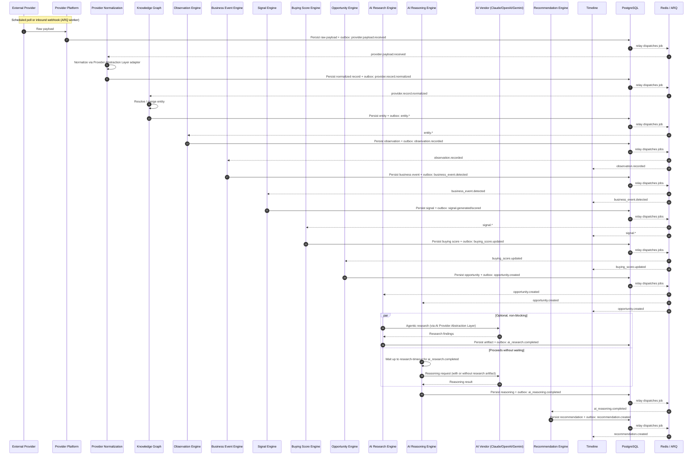
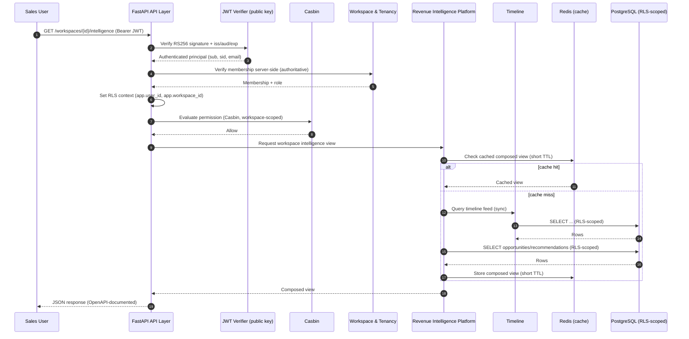
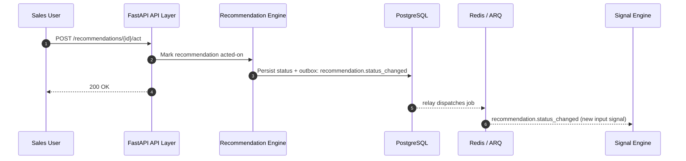

# 07 — Data Flow

> Status: **Living document — Architectural Constitution**
> Audience: All engineers, EMs, and technical stakeholders at Signora
> Revision: **v2** — updated for the thirteen-module pipeline and the ratified stack (FastAPI, PostgreSQL 17, Redis/ARQ). See [08-technology-stack.md](08-technology-stack.md).

## Purpose

This document traces **end-to-end data flow** through Signora for the system's key scenarios, connecting the module/event definitions into concrete, time-ordered stories.

## Primary Flow: Provider Data → Recommendation

**Characteristics of this flow:**

- Entirely **asynchronous** and **ARQ-worker-driven** end to end (Principle 13); no step blocks a user-facing HTTP request.
- Every domain state change commits to PostgreSQL first (outbox), then is relayed to Redis/ARQ for dispatch — see [06-events.md](06-events.md).
- `correlation_id`, assigned at `provider.payload.received`, threads through every subsequent event.
- The **AI Research Engine / AI Reasoning Engine fork** is the one explicitly non-blocking relationship in the graph: AI Reasoning Engine proceeds once either the research artifact arrives or a bounded timeout elapses, whichever is first — see [05-module-dependencies.md](05-module-dependencies.md) and [14-ai-architecture.md](14-ai-architecture.md) for the timeout policy.
- Latency across this flow is dominated by AI Research Engine (multi-step agentic tool use, potentially minutes) and, secondarily, AI Reasoning Engine (a single structured LLM call) — the primary input into worker pool sizing in [12-scalability.md](12-scalability.md).

## Secondary Flow: Revenue Intelligence Dashboard Read (Synchronous)

**Characteristics of this flow:**

- Synchronous, served by the FastAPI API tier.
- Reads only already-materialized data; Revenue Intelligence Platform never triggers pipeline processing inline.
- Every query is RLS-scoped by `workspace_id` (see [11-tenancy.md](11-tenancy.md)).
- Redis is used as a short-TTL read-through cache for composed views — never as a system of record (Principle 6).

## Secondary Flow: Recommendation Acted On (Feedback Loop)

## Tracing a Request End-to-End

`workspace_id`, `correlation_id`, and `causation_id` are carried on every OpenTelemetry span and structured log line, per [17-future-recommendations.md](17-future-recommendations.md) §Observability and [ADR-0018](adr/0018-monitoring-and-observability.md). To debug "why didn't this company get a recommendation":

1. Find `provider.payload.received` for the entity — was the data ingested at all?
2. Follow `correlation_id` through the outbox table and ARQ job history (Sentry/Grafana dashboards, see [ADR-0018](adr/0018-monitoring-and-observability.md)).
3. Identify at which stage the chain stopped.

## Design Rationale

Separating the primary async pipeline from secondary sync reads mirrors the real operational distinction engineers need. The AI Research Engine fork is drawn explicitly (`par`/non-blocking) rather than implied, because it is the one place in the flow where naive reasoning about "the pipeline runs in order" would be wrong.

## Best Practices

- Always propagate and log `correlation_id` and `workspace_id`.
- Cache only already-materialized, non-authoritative read data (Redis), never treat cache as the source of truth.
- Bound every AI Research Engine invocation with an explicit timeout that AI Reasoning Engine respects.

## Anti-Patterns

- Triggering AI Research Engine or AI Reasoning Engine synchronously from an API request.
- Making AI Reasoning Engine block indefinitely on AI Research Engine.
- Debugging pipeline issues without `correlation_id`.
- Caching authoritative pipeline state in Redis instead of PostgreSQL.

## Future Evolution

- As AI Research Engine's agentic workloads grow in complexity (multi-tool, multi-step, requiring durable resumability across process restarts), this flow's research step is the leading candidate to migrate from an ARQ job to a Temporal workflow — see [ADR-0011](adr/0011-background-processing-and-event-bus-transport.md).

## Decision Summary

Signora's dominant data flow is asynchronous, PostgreSQL-durable, Redis/ARQ-dispatched, and traceable end-to-end via `correlation_id`. The one deliberately non-blocking relationship — AI Research Engine enriching AI Reasoning Engine within a bounded timeout — is modeled explicitly rather than assumed.
