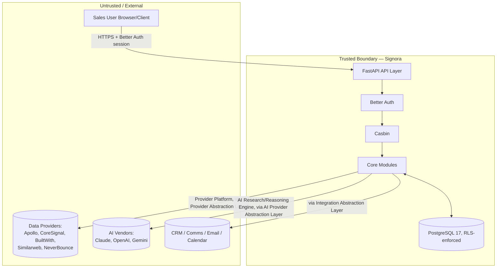

# 10 — Security

> Status: **Living document — Architectural Constitution — RATIFIED**
> Audience: All engineers, EMs, and technical stakeholders at Signora
> Revision: **v2** — identity/authorization vendor and secrets management decisions ratified. See [ADR-0010](adr/0010-identity-and-access.md).

## Purpose

This document describes Signora's security architecture: how identity, tenant isolation, data protection, and third-party trust boundaries are designed. It complements [11-tenancy.md](11-tenancy.md) (tenancy mechanics in depth).

## Trust Boundary Diagram

## Identity & Access

- **Authentication** is **Better Auth**, per [ADR-0010](adr/0010-identity-and-access.md). Signora never stores raw credentials; Better Auth manages credential storage, session issuance, and OAuth flows for Google and Microsoft.
- **Authorization** is **Casbin**, evaluated in the request path after Better Auth establishes identity. Casbin policy is workspace-scoped: every permission check is evaluated with `workspace_id` as part of the policy request, never globally.
- **OAuth identity providers**: Google and Microsoft are supported for sign-in, distinct from the OAuth connections used for Gmail/Microsoft 365 email and Google/Outlook Calendar integrations (see [13-integrations.md](13-integrations.md)), which are separate, scoped, per-integration OAuth grants — a sign-in OAuth token must never be reused as an integration access token.
- **Service-to-service / worker identity**: ARQ workers act with a system-level identity when processing pipeline events, scoped to a single `workspace_id` per unit of work derived from the event envelope, never a broad cross-workspace credential.

## Tenant Data Isolation

Enforced in layers, per Principle 7:

1. **PostgreSQL 17 Row-Level Security** as the primary, database-enforced control — see [11-tenancy.md](11-tenancy.md).
2. **Module-owned database roles**, so a bug in one module's queries cannot bypass another module's access patterns (see [05-module-dependencies.md](05-module-dependencies.md)).
3. **Application-level `workspace_id` filtering** as defense-in-depth on every query, via SQLAlchemy query construction conventions enforced in code review (see [15-project-structure.md](15-project-structure.md)).
4. **Event payloads always carry `workspace_id`** (see [06-events.md](06-events.md)), so async processing via ARQ cannot cross tenant boundaries.
5. **Casbin policy evaluation is workspace-scoped**, so authorization decisions themselves cannot leak across workspace boundaries even if a request somehow carried an inconsistent context.

## Data Protection

- **In transit:** TLS everywhere — user-to-API, module-to-provider, module-to-AI-vendor, module-to-integration, and internal service-to-database connections.
- **At rest:** RDS for PostgreSQL and ElastiCache for Redis encryption at rest, enabled by default in the production topology — see [ADR-0022](adr/0022-devops-infrastructure-and-deployment-topology.md).
- **Secrets:** Provider/AI vendor/integration/OAuth credentials are stored in **AWS Secrets Manager**, never hardcoded or stored in application tables. Local development uses a `.env`-based equivalent that is never committed and never shares values with production. See [ADR-0022](adr/0022-devops-infrastructure-and-deployment-topology.md).
- **PII handling:** Signora's Knowledge Graph stores personal data about individuals (people entities). `TODO`: a formal PII classification, retention, and right-to-erasure policy is a compliance-critical gap that remains open — see [16-architecture-risks.md](16-architecture-risks.md) (Risk R-04), where it is tracked as a prioritized, owned risk rather than a silent gap. This is a deliberate, explicit exception to this revision's otherwise-complete resolution of open items, because it requires legal/compliance input this Review Board does not have standing to invent.

## AI-Specific Security Considerations

- **What workspace data may be included in AI prompts**: `TODO`, tracked as Risk R-05 in [16-architecture-risks.md](16-architecture-risks.md) — requires an explicit data-classification policy before AI Research Engine or AI Reasoning Engine is enabled for workspaces handling regulated data categories.
- **Vendor data-retention terms**: Claude (Anthropic), OpenAI, and Gemini (Google) are all evaluated for no-training/no-retention API terms as a condition of use, per [ADR-0012](adr/0012-ai-platform-architecture.md) — commercial API usage for all three vendors is confirmed not used for model training by default as of vendor policy at time of writing; this must be re-verified at each vendor contract renewal, not assumed permanently true.
- **Prompt-injection risk**: provider-sourced data (news text, job postings, firmographic free-text fields) flowing into AI Research Engine's and AI Reasoning Engine's prompts is a known risk surface. Output from both modules is treated as untrusted content by Recommendation Engine and never used to trigger privileged or outbound actions (e.g., a CRM write) without explicit validation — see [14-ai-architecture.md](14-ai-architecture.md).

## Provider & Integration Trust

- All providers (Apollo, CoreSignal, BuiltWith, Similarweb, NeverBounce) and all integrations (Salesforce, HubSpot, Pipedrive, Zoho, Slack, Teams, Resend, Gmail, Microsoft 365, Google Calendar, Outlook Calendar) are external, less-trusted systems by default.
- Inbound provider data is treated as untrusted input, validated and normalized by Provider Normalization before entering the Knowledge Graph.
- Outbound integration calls go through the Integration Abstraction Layer, the single enforcement point for what workspace data leaves Signora.

See [13-integrations.md](13-integrations.md).

## Design Rationale

Layering tenant isolation reflects that Signora's async, event-driven pipeline creates many more code paths touching tenant data than a simple CRUD app. Choosing Better Auth + Casbin as two separately-swappable, narrowly-scoped vendors (rather than one bundled auth-and-authz platform) keeps each concern independently replaceable and keeps authorization policy — which is genuinely workspace-and-product-specific — under Signora's own version control as Casbin policy files, rather than locked inside a vendor's proprietary rules UI. See [ADR-0010](adr/0010-identity-and-access.md) for the full comparison against bundled alternatives (Auth0, Clerk, WorkOS).

## Best Practices

- Every new database query must be written assuming RLS is authoritative, but must still explicitly filter by `workspace_id` as defense-in-depth.
- Every new ARQ job handler must establish RLS session context from the event envelope before touching the database.
- Every Casbin policy check must include `workspace_id` as part of the request tuple.
- Treat all AI vendor output as untrusted content requiring validation.
- Route every outbound call to a provider, AI vendor, or integration through its respective abstraction layer.
- Never reuse a sign-in OAuth token as an integration access token, or vice versa.

## Anti-Patterns

- Relying on RLS alone without application-level `workspace_id` filters.
- A Casbin policy check that omits `workspace_id`, evaluating permissions globally.
- An ARQ job processing an event without re-establishing RLS session context.
- Including unclassified workspace data in AI prompts without regard to the pending data-classification policy (Risk R-05).
- Storing provider/AI vendor/integration credentials outside AWS Secrets Manager.

## Tradeoffs

| Choice | We gain | We give up |
|---|---|---|
| Better Auth + Casbin (unbundled) | Independent swap-ability, policy-as-code under our own version control, no vendor lock-in on authorization logic | Slightly more integration work than a single bundled AuthN+AuthZ vendor (justified, see [ADR-0010](adr/0010-identity-and-access.md)) |
| AWS Secrets Manager | Native AWS integration, IAM-scoped access, audit trail | AWS lock-in for secrets specifically (acceptable given AWS is already the ratified cloud provider — [ADR-0022](adr/0022-devops-infrastructure-and-deployment-topology.md)) |

## Future Evolution

- PII classification/retention policy (Risk R-04) and AI prompt data-classification policy (Risk R-05) are the two highest-priority open items from this revision and should be resolved before scaling regulated-industry workspace volume — see [16-architecture-risks.md](16-architecture-risks.md).
- Re-verify AI vendor data-retention terms at each contract renewal.
- Consider a formal third-party security review/penetration test once the stack is in production.

## Decision Summary

Signora's security model rests on Better Auth for authentication, Casbin for workspace-scoped authorization, OAuth via Google/Microsoft for sign-in, AWS Secrets Manager for credential storage, defense-in-depth PostgreSQL RLS tenant isolation, TLS-everywhere data protection, and abstraction-layer-enforced boundaries for all external provider, AI, and integration traffic. PII policy and AI prompt data-classification remain explicitly tracked open risks (R-04, R-05), not silent gaps.
