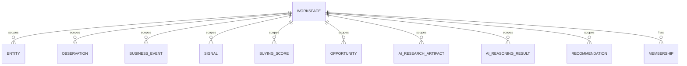

# 11 — Tenancy

> Status: **Living document — Architectural Constitution — RATIFIED**
> Audience: All engineers, EMs, and technical stakeholders at Signora
> Revision: **v4** — adds the **self-sufficient RLS** requirement and the `SECURITY DEFINER` membership predicates (migration 0003), after integration testing showed policies that referenced another RLS-protected table were being silently filtered to nothing. v3 closed two earlier gaps during the Workspace & Tenancy build: the **non-superuser connection requirement** (without which RLS does nothing at all) and the **workspace-creation bootstrap pattern** (the standard policy is circular for the tenancy root itself). Both were discovered by integration testing against a real PostgreSQL 17 and are now specified below. v2 content otherwise unchanged. See [ADR-0006](adr/0006-data-platform-primary-database-and-multi-tenancy.md).

## Purpose

This document specifies Signora's multi-tenancy model in depth: the Workspace as tenancy root (Principle 8), and how PostgreSQL 17 Row-Level Security (Principle 7) enforces it on the shared single database (Principle 6).

## The Tenancy Root: Workspace

Every piece of tenant-owned data in Signora belongs to exactly one **Workspace**. Every workspace-owned table carries a `workspace_id` column, and every domain event carries `workspace_id` in its envelope (see [06-events.md](06-events.md)).



**Resolved:** the Business Event taxonomy (business event types and schemas, owned internally by Business Event Engine per [ADR-0025](adr/0025-module-boundary-evolution.md)) is **global reference data, not workspace-scoped**. It is domain knowledge Signora curates across all customers, not tenant data — it lives in tables without `workspace_id` and without RLS, read by every workspace's pipeline but writable only by Business Event Engine's own internal taxonomy-management path (not exposed to workspace-scoped users). This was an open question in v1; it is resolved here.

## Row-Level Security Model

Per Principle 7 and [ADR-0006](adr/0006-data-platform-primary-database-and-multi-tenancy.md):

1. Every workspace-owned table has `workspace_id NOT NULL` and an RLS policy:
   ```sql
   CREATE POLICY workspace_isolation ON <table>
     USING (workspace_id = current_setting('app.workspace_id')::uuid);
   ```
2. Every database session (API request or ARQ job) sets the session variable at the start of its unit of work:
   ```sql
   SET LOCAL app.workspace_id = '<resolved workspace_id>';
   ```
3. `SET LOCAL` scopes the setting to the current transaction, essential given SQLAlchemy's async connection pooling.
4. RLS is enabled and forced (`FORCE ROW LEVEL SECURITY`) on every workspace-owned table.
5. PostgreSQL 17's RLS policy planner improvements (over prior major versions) reduce the historical performance tax of RLS-qualified queries on large, indexed tables — a material input into the version choice in [ADR-0006](adr/0006-data-platform-primary-database-and-multi-tenancy.md).

### The Application Must Connect as a Non-Superuser Role

**This is the single most important operational requirement on this page.** PostgreSQL superusers, and any role holding `BYPASSRLS`, ignore Row-Level Security entirely — *including* on tables declared `FORCE ROW LEVEL SECURITY`. An application connecting as a superuser has **no tenant isolation whatsoever**, no matter how correct its policies are.

Accordingly:

- The application connects as **`signora_app`**: a dedicated role that is `NOSUPERUSER`, `NOBYPASSRLS`, and holds only `SELECT, INSERT, UPDATE, DELETE` on the tables it needs (migration `0002`). Least privilege, per [10-security.md](10-security.md).
- Migrations run under a **separate, privileged identity**. The application role holds only `SELECT` on `alembic_version` and can never alter schema.
- Adding a table to any module requires granting it to `signora_app` in the same migration that creates it, or the application fails closed with a permission error.
- The integration suite asserts, session-wide, that its connection cannot bypass RLS (`verify_app_role_is_rls_bound`). Without that guard, every isolation test in the suite would pass vacuously against a superuser connection — which is exactly how this gap was originally found.

### Platform Infrastructure Tables

Not every table holds tenant data. `outbox_event`, `processed_event`, `dead_letter_event`, and `alembic_version` are **platform infrastructure**: owned by platform services, spanning every workspace by design. The relay cannot sweep the outbox one tenant at a time, so tenant-scoped RLS on these tables would prevent them from doing their job.

**Their isolation is by privilege, not by policy** (migration `0006`):

| Role | `outbox_event` | `dead_letter_event` | `processed_event` |
|---|---|---|---|
| `signora_app` (API, workers) | `INSERT` | `INSERT` | `SELECT`, `INSERT` |
| `signora_relay` (outbox relay) | `SELECT`, `UPDATE` | full | `SELECT`, `INSERT` |

**The application publishes; only the relay consumes.** Business modules must never query an infrastructure table. Before migration `0006` the application role held full DML on all of them, which meant an unfiltered `SELECT * FROM outbox_event` in any module returned every workspace's event payloads — RLS was absent by design, and the grant was the only thing that could have stopped it.

Two consequences worth knowing:

- **`processed_event` keeps `SELECT` for `signora_app`.** The idempotency claim is `INSERT ... ON CONFLICT DO NOTHING`, and PostgreSQL requires `SELECT` on the table to evaluate the conflict target — verified empirically, not assumed. The ledger holds only `(consumer_name, event_id)`, no payload, so it is not a cross-tenant read path.
- **ORM models on these tables must not rely on server-side defaults.** SQLAlchemy fetches them back with `INSERT ... RETURNING`, which requires `SELECT`. `OutboxEventModel.relay_attempts` therefore carries a Python-side `default` alongside its `server_default`.

### Append-Only Tenant Tables, and the Security Event Stream

Some tenant-owned tables record **facts about a moment**, and a fact about a moment is never corrected in place. They carry `SELECT`, `INSERT` and `DELETE` and **never `UPDATE`** — and the policies match the grants exactly, because **a policy without a grant is decorative and a grant without a policy is a tenancy hole.** Both are withheld rather than one.

`opportunity_state` (`0014`) established the shape, `action_batch` and `action_batch_transition` (`0042`) repeated it deliberately rather than inventing a second one, and **`security_event` (`0046`) is the third.**

**`security_event` is one append-only record every module writes to** — an *account activity* stream rather than a security log, because compliance, support and the customer's own timeline all read the same facts, and a security-only log means building the second one later.

| | |
|---|---|
| **Owner** | `workspace_tenancy`, which already owned `membership_role_change` — an audit row that did not know it |
| **Tenancy** | `workspace_id` non-nullable, RLS `ENABLE` **and** `FORCE`, separate `SELECT`/`INSERT`/`DELETE` policies, **no `UPDATE` grant and no `UPDATE` policy** |
| **Classification** | `TENANT_OWNED_TABLES` **and** `IMMUTABLE_TENANT_TABLES`, both in migration `0046`'s own change |
| **Written through** | `SecurityEventWriter` in `workspace_tenancy/public/`. **No other module writes the table directly** (§8) |

**Two columns carry identity and both are non-nullable from the first migration.** `subject_id` is who the event is *about*; `acting_for` is on whose authority it happened. **A line naming only the agent cannot answer *who authorised this*, and one naming only the human is a lie whenever an agent acted.** When a person acts directly the two are equal and the row says so — a `NULL` would have meant *unattributed* and *self-directed* at once. **Retrofitting an attribution column is how audit history becomes "everything before March has no actor", and that gap is permanent**, which is why both are in the creating migration rather than added when a consumer needs them.

**`occurred_at` and `created_at` are different questions.** The first is when the fact happened and belongs to the caller, which is the only thing that knows; the second is when the row was written and belongs to the database, which cannot be mistaken. Under a retry or a replay they differ.

**`subject_id` carries no foreign key**, deliberately: an event about somebody whose membership was later deleted must survive that deletion, or the stream loses precisely the rows an investigation wants.

> **`DELETE` is granted, and it is an open question rather than a settled one.** It matches every immutable tenant table since `0008` on erasability grounds — being able to remove a workspace's data is a tenancy property, and withholding it would make a deletion request unservable. **A security stream a workspace can delete from is nonetheless a different compliance story from one it cannot**, and QE recorded that as a product-owner question at cycle 157.

### Every Tier Connects Under Its Own Role

The rule above applies to *every* process holding a connection string, not only the API. A single tier connecting as the owner reopens the gap for the whole database.

| Role | Used by | Privileges |
|---|---|---|
| owner (`signora`) | Migrations only, as a release step | Full |
| `signora_app` | FastAPI API, ARQ workers | DML on tenant tables; publish-only on infrastructure tables; `NOBYPASSRLS`; **no access to `auth`** |
| `signora_auth` | Next.js / Better Auth | Owns the `auth` schema; `NOBYPASSRLS`; no grant on application tables |
| `signora_relay` | Outbox relay (`SIGNORA_RELAY_DATABASE_URL`) | Read/write on infrastructure tables; `NOBYPASSRLS`; **no grant on any tenant table** |

`signora_relay` is privileged with respect to *platform* tables and powerless with respect to *tenant* ones. It reads events across all workspaces because that is its function; it still cannot read a workspace's rows.

`signora_app` and `signora_auth` are mutually exclusive by construction: migration `0005` revokes `signora_app` from the `auth` schema, and `signora_auth` is never granted anything in `public`. A compromise of either tier reaches only that tier's data.

**Verify the relationship, not just each side.** Both roles were individually correct while the frontend still connected as the owner, which made the revoke inert — the isolation existed in the migration and nowhere else (M1.2 Finding 3). A privilege check that passes for one role in isolation proves very little; assert what each role *cannot* reach.

### RLS Must Be Self-Sufficient: Use `SECURITY DEFINER` Predicates

**A policy that queries another RLS-protected table is silently filtered by that table's own policy.** This is the subtlest failure mode in this document, because it fails *closed* — it looks like missing data, not like a security bug, and only appears in the session shapes where the referenced table's context is absent.

Signora hit this concretely: `workspace_select` decided visibility with a subquery over `membership`, but `membership`'s policy keys on `app.workspace_id`. In a **user-scoped session** — authenticated, no workspace selected, which is exactly the state "list the workspaces I belong to" runs in — that variable is unset, the subquery matched nothing, and members could see none of their own workspaces.

The same investigation exposed a second, more serious problem. `membership`'s policy granted reads on the sole basis of `workspace_id = app.workspace_id`, and **never required the caller to actually be a member**. The only thing preventing a session from reading another tenant's member list was that application code verifies membership before setting the variable — which makes the application, not the database, the real enforcement point. That is precisely the inversion this document exists to prevent.

Both are fixed by `SECURITY DEFINER` helper functions that answer "is the current user a member (or owner) of this workspace?" while bypassing RLS on `membership` itself — the standard PostgreSQL escape from this recursion:

```sql
CREATE FUNCTION app_is_workspace_member(target_workspace uuid) RETURNS boolean
LANGUAGE sql STABLE SECURITY DEFINER
SET search_path = pg_catalog, public   -- not optional; see below
AS $$
  SELECT EXISTS (
    SELECT 1 FROM membership
    WHERE workspace_id = target_workspace AND user_id = app_current_user_id()
  )
$$;
```

Rules for these functions:

- **Keep them minimal**: read-only, single-purpose, returning a boolean. A `SECURITY DEFINER` function runs with its owner's privileges, so its body is trusted code and must stay small enough to audit at a glance.
- **Always pin `search_path`.** Without it, a caller able to create objects in an earlier schema on the path could shadow `membership` and change what the function returns.
- **Grant `EXECUTE` to the application role**, and to nothing else.

Read policies are now membership-based rather than context-based, so isolation holds regardless of whether the application scoped the session correctly. Write policies remain context-based, because the founding membership of a new workspace is written by a user who is not yet a member — the bootstrap case below.

### Policy Predicates Must Coerce Empty String to NULL

Use `NULLIF(current_setting('app.workspace_id', true), '')::uuid`, never a bare `current_setting(...)::uuid`.

After a transaction that used `SET LOCAL` commits, the setting reverts to **empty string**, not NULL, on that pooled connection. A bare `''::uuid` cast raises `invalid input syntax for type uuid`, turning a missing-context bug into a confusing runtime error far from its cause. Coercing `''` to NULL makes the comparison evaluate to NULL → false, so the query returns zero rows: the policy fails closed, quietly and correctly.

```mermaid
sequenceDiagram
    participant Req as FastAPI Request or ARQ Job
    participant Sess as SQLAlchemy Async Session (pooled)
    participant PG as PostgreSQL 17 (RLS-enforced tables)

    Req->>Sess: Resolve workspace_id (Better Auth + Casbin context, or event envelope)
    Req->>Sess: BEGIN; SET LOCAL app.workspace_id = '...'
    Req->>Sess: Application queries (RLS auto-applied; explicit workspace_id filter as defense-in-depth)
    Sess->>PG: Queries executed with RLS policy auto-applied
    PG-->>Sess: Only rows matching current workspace_id
    Sess->>Req: COMMIT
```

## Establishing Workspace Context

Two session variables are set, both transaction-scoped:

- **`app.user_id`** — the authenticated principal. Required to evaluate the `workspace` table's membership-based policies.
- **`app.workspace_id`** — the workspace being operated on. Required by every workspace-owned table's isolation policy.

1. **Synchronous request path:** FastAPI's dependency-injected auth chain verifies an RS256 JWT issued by Better Auth ([18-authentication.md](18-authentication.md)), takes `app.user_id` from the token's `sub` claim, and resolves `workspace_id` from the request path or the `active_workspace_id` claim — then **verifies membership against Workspace & Tenancy before setting RLS context**. Neither the request parameter nor the token claim is trusted on its own. A request parameter may *select* which of a user's workspaces to operate in, but membership must be verified server-side before `SET LOCAL app.workspace_id` is issued. Casbin's policy check is evaluated in the same request-scoped context.
2. **Asynchronous event path:** every event envelope carries `workspace_id` (see [06-events.md](06-events.md)); an ARQ worker sets `SET LOCAL app.workspace_id` from the event envelope, never re-derives it.

Both are set through `signora_platform.db`'s `tenant_scoped_session` / `user_scoped_session` helpers — module infrastructure code never issues these statements itself. The helpers use `set_config(..., true)` rather than literal `SET LOCAL` because PostgreSQL's `SET` family does not accept bound parameters, and `set_config` does; this avoids interpolating caller-supplied values into SQL text.

## The Workspace-Creation Bootstrap Pattern

The standard workspace-scoped policy is **circular for the `workspace` table itself**: a new workspace row cannot be checked against an `app.workspace_id` that does not exist until that row is created. The `workspace` table therefore uses split, operation-specific policies rather than one blanket policy:

| Operation | Policy | Rationale |
|---|---|---|
| `INSERT` | `WITH CHECK (true)` | Any authenticated principal may create a workspace. Authorization for *whether* they may (plan limits, invitation rules) is a Casbin/application concern, not an RLS one. |
| `SELECT` | Caller must be a member (`app.user_id` ∈ that workspace's memberships) | Prevents reading — or enumerating the existence of — workspaces you do not belong to. |
| `UPDATE` | Caller must be a member **with role `owner`** | Only owners may modify workspace-level settings. |

Workspace creation therefore proceeds in one transaction, in this order:

1. Open a session with only `app.user_id` set (`user_scoped_session`) — there is no workspace to scope to yet.
2. Insert the `workspace` row (permitted by the open `INSERT` policy).
3. **Activate `app.workspace_id` mid-transaction** for the row just created.
4. Insert the founding `OWNER` membership, which now satisfies the ordinary workspace-scoped policy on `membership`.
5. Publish `workspace.created` and `workspace.member_added` to the outbox and commit — all atomically.

Step 3 is why the application layer defines a `TenantContext` port: activating workspace scope is a legitimate mid-flow domain need here, not a leaked infrastructure detail.

> Note on read behavior: because `SELECT` on `workspace` requires membership, requesting a workspace you do not belong to surfaces as **"not found"**, never "forbidden". This is deliberate — a distinct "forbidden" response would let a caller enumerate which workspace ids exist. Preserve this property in any new read path.

## Cross-Workspace Operations

Business Event Engine's global taxonomy management (resolved above) is the one built-in, by-design cross-workspace read path — it reads reference data with no RLS, by definition, because that data isn't tenant-owned.

Beyond that, platform admin/support tooling requiring cross-workspace access remains an explicitly tracked open item — see Risk R-06 in [16-architecture-risks.md](16-architecture-risks.md). It must run under a distinct, narrowly-scoped database role with audit logging, and must never be used as a convenience escape hatch for routine application logic.

## Workspace Lifecycle

- **Creation, suspension, and deletion flows**, including PII/data retention on offboarding, remain open — see Risk R-04 in [16-architecture-risks.md](16-architecture-risks.md). These depend on GTM/product decisions (self-serve vs. sales-assisted onboarding) and compliance input outside this Review Board's technical mandate.
- **Membership** is managed by Workspace & Tenancy in coordination with Better Auth (identity) and Casbin (role/permission evaluation) — see [ADR-0010](adr/0010-identity-and-access.md).

## Design Rationale

Using native PostgreSQL 17 RLS rather than application-only filtering means tenant isolation survives bugs in any individual module's query code — a property that matters more in a modular monolith where many ARQ workers touch tenant data far from the original authenticated request. Resolving the taxonomy-scoping question (global, not per-workspace) removes an ambiguity that would otherwise have let RLS policy design drift inconsistently across the codebase.

## Best Practices

- Never construct a database session without first setting `app.workspace_id` for that unit of work.
- Always use transaction-scoped settings (`SET LOCAL` / `set_config(..., true)`), never session-scoped ones.
- Treat `workspace_id` as required, non-nullable on every new workspace-owned table and event from day one.
- Grant every new tenant table to `signora_app` in the same migration that creates it.
- Declare every new table in `backend/tests/security_invariants/tenancy_policy.py` as either tenant-owned or platform infrastructure. A table in neither list fails the build — classification is never inferred, because a table that simply forgot its `workspace_id` would otherwise be exempted by omission rather than caught.
- Write at least one integration test per new workspace-owned table that issues a **`WHERE`-less query** and asserts only the current workspace's rows come back.
- Test both session shapes: **user-scoped** (no workspace selected) and **workspace-scoped**. A policy can be correct in one and broken in the other, which is exactly how the migration-0003 defect went unnoticed.
- Prove a regression test bites before trusting it: roll the fixing migration back, confirm the test fails, roll forward. A test that has never been seen to fail is not known to work. That is the assertion that actually proves RLS is doing the work rather than the application's own filtering.
- Business Event Engine's taxonomy tables are the one deliberate exception to "every table has `workspace_id`" — do not use this as precedent for any other table without an explicit design review.

## Anti-Patterns

- **Connecting the application as a superuser or any `BYPASSRLS` role.** Silently disables every policy on this page.
- **Pointing an integration test suite at a superuser connection.** Every isolation assertion then passes for the wrong reason — worse than having no tests, because it manufactures false confidence.
- Trusting a client-supplied `workspace_id` request parameter without verifying membership.
- Using session-scoped `SET` instead of transaction-scoped `SET LOCAL`, which leaks one tenant's context onto the next request sharing that pooled connection.
- A bare `current_setting(...)::uuid` in a policy predicate, without `NULLIF(..., '')`.
- **A policy that subqueries another RLS-protected table directly.** Use a `SECURITY DEFINER` predicate instead, or the subquery will be silently filtered by that table's own policy.
- A read policy whose only condition is `workspace_id = current_setting('app.workspace_id')`. That checks which workspace the session *claims* to be operating in, not whether the caller belongs to it — it delegates enforcement back to application code.
- A `SECURITY DEFINER` function without a pinned `search_path`, or one that does more than answer a single boolean question.
- Adding a workspace-owned table without `FORCE ROW LEVEL SECURITY`.
- Adding `workspace_id` to a genuinely global reference-data table "just to be safe," fragmenting what should be shared, centrally-curated data.
- Using an admin/cross-workspace bypass role for routine application logic.

## Tradeoffs

| Choice | We gain | We give up |
|---|---|---|
| Shared DB + RLS over DB/schema-per-tenant | Simple operations, easy cross-tenant platform analytics, no per-tenant migration fan-out | Coarser resource isolation between noisy-neighbor tenants (mitigated in [12-scalability.md](12-scalability.md)) |
| Global (non-RLS) taxonomy tables | Single, centrally-curated source of truth for what a "business event" is across all customers | None of Signora's other domain modules follow this pattern — a documented, deliberate, single exception |

## Future Evolution

- If a small number of very large tenants eventually justify dedicated resources, consider tenant-aware read replicas or `workspace_id` partitioning before database-per-tenant — see [12-scalability.md](12-scalability.md).
- The admin/cross-workspace access model (Risk R-06) and workspace lifecycle/PII policy (Risk R-04) should be formalized before customer-facing support tooling or regulated-industry customers are onboarded at scale.

## Decision Summary

Workspace is Signora's tenancy root on PostgreSQL 17; every table and event is workspace-scoped except Business Event Engine's global taxonomy, which is deliberately shared reference data outside RLS. Transaction-scoped `app.user_id` / `app.workspace_id` settings with `FORCE ROW LEVEL SECURITY` remain the authoritative isolation mechanism across both FastAPI requests and ARQ jobs — **and are only effective because the application connects as the non-superuser, non-`BYPASSRLS` `signora_app` role.** Membership predicates are evaluated through `SECURITY DEFINER` functions so that policies never depend on another RLS-protected table, and so that read isolation is enforced by the database rather than by application discipline. The `workspace` table itself uses split INSERT/SELECT/UPDATE policies to break the bootstrap circularity of the tenancy root, and all policy predicates coerce empty string to NULL so missing context fails closed.
