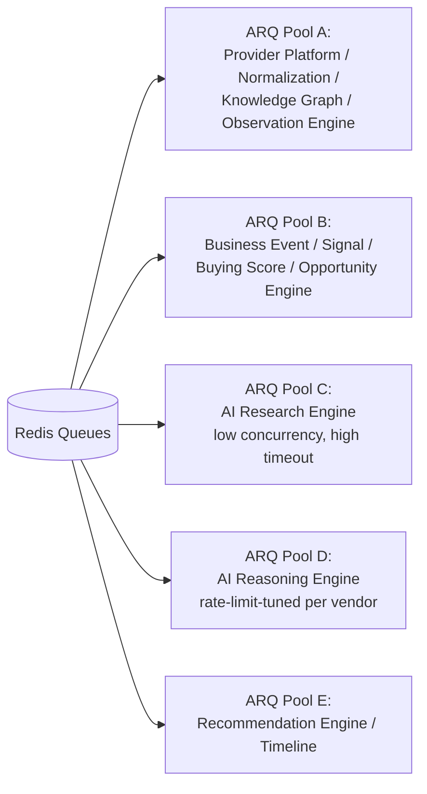

# 12 — Scalability

> Status: **Living document — Architectural Constitution — RATIFIED**
> Audience: All engineers, EMs, and technical stakeholders at Signora
> Revision: **v2** — scaling levers and triggers made concrete against the ratified stack (AWS ECS, RDS, ElastiCache, Redis/ARQ, Temporal path).

## Purpose

This document explains how Signora scales under load, and defines explicit, evidence-based triggers for evolving the architecture, now grounded in the specific, ratified infrastructure rather than generic descriptions.

## Load Dimensions

Unchanged in shape from v1, now mapped to concrete infrastructure:

1. **API request volume** — served by FastAPI on ECS, behind Traefik.
2. **Pipeline throughput** — ARQ workers on ECS, consuming Redis queues fed by the Postgres outbox relay.
3. **AI Research Engine / AI Reasoning Engine latency & cost** — the pipeline's slowest, most expensive stage; latency-bound by Claude/OpenAI/Gemini round-trips.
4. **Tenant count & data volume** — number of workspaces and per-workspace Knowledge Graph/Observation history size on RDS for PostgreSQL.

## Scaling the API Tier

FastAPI instances run as an ECS service, stateless and horizontally scalable behind Traefik, autoscaled on request concurrency/CPU. Target P95/P99 latency SLOs remain `TODO` — tracked as Risk R-07 in [16-architecture-risks.md](16-architecture-risks.md), pending real traffic data.

## Scaling the Pipeline (ARQ Worker Fleet)

Per Principle 13, all pipeline work runs in ARQ workers on ECS, consuming Redis-backed queues:

- Workers scale horizontally; ARQ's Redis-backed queue naturally supports multiple concurrent consumers.
- **Worker pools are partitioned per pipeline stage from day one** (not deferred as in v1), because the stage latency/cost profile is now known concretely at design time: a fast pool for Provider Platform/Normalization/Knowledge Graph/Observation Engine, a medium pool for Business Event Engine/Signal Engine/Buying Score Engine/Opportunity Engine, and a dedicated, low-concurrency, high-timeout pool for AI Research Engine and AI Reasoning Engine, sized against each AI vendor's rate limits.

## Scaling AI Research Engine & AI Reasoning Engine

Given the [ADR-0025](adr/0025-module-boundary-evolution.md) split, these two modules now have independently tunable scaling levers:

1. **AI Reasoning Engine**: dedicated ARQ pool, concurrency tuned to each AI vendor's rate limits; multi-vendor routing (Claude/OpenAI/Gemini) via the AI Provider Abstraction Layer for cost/latency/capacity balancing — see [ADR-0012](adr/0012-ai-platform-architecture.md).
2. **AI Research Engine**: lower concurrency, higher per-task timeout, and is the **ratified first candidate for Temporal migration** (see [ADR-0011](adr/0011-background-processing-and-event-bus-transport.md)) once its agentic, multi-step research tasks need durable resumability across process restarts — an ARQ job that dies mid-research today must restart from scratch, which Temporal would fix by checkpointing workflow state.
3. Result caching for near-duplicate research/reasoning inputs, to control both cost and latency, once volume justifies it.

**Trigger for Temporal migration on AI Research Engine specifically:** any of — research tasks routinely exceed a single ARQ job's practical timeout ceiling; a measurable fraction of research tasks are lost/restarted due to worker restarts/deploys; multi-tool agentic steps need conditional branching/human-in-the-loop pauses that ARQ's simple job model cannot express cleanly.

## Scaling the Database

Ratified levers, in order:

1. **Vertical scaling** of the RDS for PostgreSQL primary instance.
2. **RDS read replicas** for read-heavy, latency-tolerant paths (Timeline/Revenue Intelligence Platform dashboard queries), keeping the primary free for pipeline writes.
3. **Table partitioning** by `workspace_id` or time (the Observation table, expected to be highest-volume, is the leading partitioning candidate).
4. **Connection pooling**: SQLAlchemy's async engine pool sized per ECS task, backed by RDS Proxy (or equivalent PgBouncer-class pooling) to support high ARQ worker concurrency without exhausting PostgreSQL connection limits — required well before most of the above and tracked as an early infrastructure task, not deferred.

## Scaling Redis

ElastiCache for Redis serves two distinct roles — the ARQ job/queue broker and the short-TTL read-through cache (see [07-data-flow.md](07-data-flow.md)). These are **provisioned as separate ElastiCache clusters**, not shared, so cache eviction pressure can never starve queue durability, and queue load can never evict cache entries needed for read latency.

## When to Extract a Module Into a Standalone Service

Unchanged principle from v1 (Principle 5) — extraction is evidence-triggered, not anticipatory. With the module split ratified in this revision, the concrete near-term candidates are:

- **AI Research Engine** — if its resource profile (low concurrency, long-running, eventually Temporal-orchestrated) diverges enough from the rest of the ECS fleet that shared deployment cadence becomes a real constraint.
- **Provider Platform** — if provider count and polling volume grow to the point where its scheduling/quota logic needs an independent deployment and on-call surface from the rest of the pipeline.

Extraction mechanics are unchanged from v1: only the infrastructure layer changes (in-process/outbox event handling → network calls), not the domain/application layers, per Principle 4 and [05-module-dependencies.md](05-module-dependencies.md).

## When to Split the Event Transport

Unchanged trigger conditions from v1 (Postgres outbox contention, relay latency exceeding SLA, fan-out volume). With Redis/ARQ now the ratified dispatch mechanism, the additional concrete trigger is: **ARQ/Redis queue depth sustained growth that ECS worker autoscaling cannot drain within the pipeline's latency SLA** — at that point, evaluate a dedicated broker (Kafka/NATS/SQS) behind the same Internal Event Bus abstraction, or sharding the outbox relay per module.

## Scaling for Tenant Count

Toward the "hundreds of thousands of workspaces" target explicitly named in this project's scope:

- RLS-based isolation scales to a large tenant count without per-tenant infrastructure overhead.
- Noisy-neighbor risk is the primary concern at this tenant count; mitigations are tenant-aware query/resource monitoring (via OpenTelemetry + Grafana, see [ADR-0018](adr/0018-monitoring-and-observability.md)) and, if needed, tenant-aware RDS read replica routing for the largest workspaces — before ever considering database-per-tenant, which would violate Principle 6.
- Meilisearch and pgvector indices should be evaluated for per-tenant vs. shared-index performance at scale as workspace count grows — tracked as Risk R-08 in [16-architecture-risks.md](16-architecture-risks.md), since neither has been load-tested at hundreds-of-thousands-of-workspaces scale as of this revision.

## Design Rationale

Concretizing worker-pool partitioning at design time (rather than "defer until divergence is observed," as v1 stated) is a deliberate departure for the AI stages specifically: their cost/latency profile relative to the rest of the pipeline is already well understood from the [ADR-0025](adr/0025-module-boundary-evolution.md) split rationale, so waiting for evidence here would be waiting for something already known. Every other scaling lever in this document remains evidence-triggered, consistent with Principle 1.

## Best Practices

- Instrument every ARQ pool's queue depth, per-job latency, and failure rate from day one via OpenTelemetry.
- Provision separate ElastiCache clusters for queueing vs. caching.
- Set up RDS Proxy/connection pooling before, not after, ARQ worker concurrency is scaled up.

## Anti-Patterns

- Sharing one Redis instance for both ARQ queues and application caching.
- Extracting Provider Platform or AI Research Engine pre-emptively without the trigger evidence above.
- Choosing database-per-tenant to solve a noisy-neighbor problem addressable with read-replica routing.

## Tradeoffs

| Choice | We gain | We give up |
|---|---|---|
| Pre-partitioned ARQ worker pools for AI stages | Avoids a known, predictable bottleneck from day one | Slightly more operational surface upfront (justified — the divergence is already known, not speculative) |
| Separate ElastiCache clusters for queue vs. cache | Isolation between durability-critical and best-effort workloads | Marginally higher infrastructure cost (justified given queue durability is correctness-critical) |

## Future Evolution

- Fill in Risk R-07 (latency SLOs) and Risk R-08 (Meilisearch/pgvector at scale) with real production data as soon as available.
- Revisit the Temporal migration trigger for AI Research Engine at each quarterly architecture review.

## Decision Summary

Signora scales through ECS-based horizontal API/worker scaling with AI-stage worker pools partitioned from day one given their known cost/latency divergence, RDS-based database scaling (vertical → read replicas → partitioning, backed by connection pooling from the start), and separate ElastiCache clusters for queueing versus caching. Module extraction and transport changes remain reserved for evidence-based triggers, now stated concretely against the ratified AWS/Redis/ARQ/Temporal stack.
