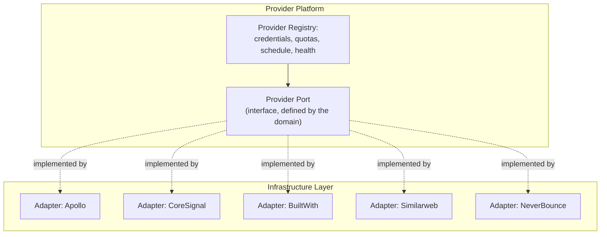
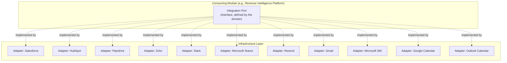

# 13 — Integrations

> Status: **Living document — Architectural Constitution — RATIFIED**
> Audience: All engineers, EMs, and technical stakeholders at Signora
> Revision: **v2** — all provider and integration vendors ratified. See [ADR-0013](adr/0013-company-intelligence-provider-strategy.md), [ADR-0014](adr/0014-crm-integration-strategy.md), [ADR-0015](adr/0015-communication-email-and-calendar-integrations.md).

## Purpose

This document specifies how Signora integrates with the outside world: inbound data **providers** (Principle 9, orchestrated by Provider Platform) and outbound/third-party **integrations** (Principle 11).

## Two Distinct Abstraction Layers

| | Provider Abstraction Layer (Principle 9) | Integration Abstraction Layer (Principle 11) |
|---|---|---|
| Direction | **Inbound** | **Outbound** (occasionally bidirectional) |
| Orchestrated/consumed by | Provider Platform (registry, credentials, scheduling) + Provider Normalization (canonicalization) | Any module needing to push/sync data externally |
| Ratified vendors | Apollo, CoreSignal, BuiltWith, Similarweb, NeverBounce | Salesforce, HubSpot, Pipedrive, Zoho, Slack, Microsoft Teams, Resend, Gmail, Microsoft 365, Google Calendar, Outlook Calendar |

(The **AI Provider Abstraction Layer** is specified separately in [14-ai-architecture.md](14-ai-architecture.md).)

## Provider Abstraction Layer

### Ratified Providers (Active)

| Provider | Data Category | Consumed by |
|---|---|---|
| **Apollo** | Firmographic and contact intelligence (company + people records, org structure) | Knowledge Graph (entity attributes), Business Event Engine (contact/role-change signals) |
| **CoreSignal** | Company and people data enrichment at scale, employee headcount trends | Knowledge Graph, Signal Engine (headcount-trend signals) |
| **BuiltWith** | Technographic data (technology stack detection) | Knowledge Graph (tech-stack attributes), Business Event Engine (tech-adoption events) |
| **Similarweb** | Web traffic and engagement data | Signal Engine (traffic-trend signals) |
| **NeverBounce** | Email verification | Provider Normalization (contact data-quality gate before it reaches the Knowledge Graph) |

See [ADR-0013](adr/0013-company-intelligence-provider-strategy.md) for the full evaluation against ZoomInfo, Bombora, Crunchbase, 6sense, and PitchBook, and the specific gaps each future candidate would close.

### Future Provider Candidates

ZoomInfo, Bombora, Crunchbase, 6sense, PitchBook — evaluated and deliberately deferred, not rejected; see [ADR-0013](adr/0013-company-intelligence-provider-strategy.md) for the specific trigger conditions (e.g., Bombora for intent data once Buying Score Engine's model calls for third-party intent as an input; 6sense/PitchBook overlap significantly with capabilities Signora is building in-house via Signal Engine/Buying Score Engine and should only be added if they cover a data category, not a scoring capability, Signora doesn't already produce).

### Provider Onboarding

1. Register the provider in Provider Platform's registry (credentials via AWS Secrets Manager, quota/rate-limit configuration, polling or webhook schedule).
2. Implement an adapter behind the existing Provider Port — no domain-layer changes if the port already covers the data category.
3. Provider Normalization adds mapping rules for the new provider's raw shape.
4. Add the provider to this document's table.

## Integration Abstraction Layer

### Ratified Integrations (Active)

| Category | Vendors | Primary use case |
|---|---|---|
| CRM | Salesforce, HubSpot, Pipedrive, Zoho | Sync opportunities/recommendations outward; pull CRM-native activity as an observation source. See [ADR-0014](adr/0014-crm-integration-strategy.md). |
| Team communication | Slack, Microsoft Teams | Deliver recommendations and notifications into the channels sales teams already work in — the Novu notification layer (see [ADR-0017](adr/0017-notifications.md)) targets these as delivery channels. |
| Transactional email | Resend | Signora-originated transactional email (not a CRM integration). |
| Email account integration | Gmail, Microsoft 365 | Observation source (engagement signals) and optional recommendation delivery via the rep's own inbox. |
| Calendar | Google Calendar, Outlook Calendar | Observation source (meeting activity) and recommendation-to-action scheduling. |
| CRM (future) | Microsoft Dynamics 365 | Deferred until enterprise pipeline demand justifies a fourth CRM adapter — see [ADR-0014](adr/0014-crm-integration-strategy.md). |

### Integration Onboarding

1. Confirm the port exists on the relevant consuming module, or define a new one via RFC.
2. Implement an adapter for the vendor.
3. Credentials via AWS Secrets Manager (per-workspace OAuth grants stored per-tenant, RLS-scoped, distinct from Better Auth's sign-in credentials — see [10-security.md](10-security.md)).
4. Add the integration to this document's table.

## Failure Handling

- Provider/integration failures are handled at the adapter level with ARQ's native retry/backoff, surfaced to the domain layer as a small set of outcomes (success, transient failure, permanent failure) — never raw vendor exceptions.
- Because ingestion (Provider Platform) and outbound integration calls happen in ARQ workers, transient failures are scoped and retried per unit of work, never blocking the rest of the pipeline for unrelated entities/workspaces.
- Provider Platform tracks per-provider health (`provider.health_changed`) and applies circuit-breaking to avoid hammering a degraded vendor, surfaced via OpenTelemetry/Grafana (see [ADR-0018](adr/0018-monitoring-and-observability.md)).

## Design Rationale

Five providers were selected to cover five genuinely distinct data categories (firmographic/contact, bulk enrichment, technographic, web engagement, deliverability) rather than five overlapping firmographic vendors — see [ADR-0013](adr/0013-company-intelligence-provider-strategy.md) for the category-coverage matrix that drove this. CRM breadth (four vendors at launch) reflects that B2B sales orgs are heterogeneous in CRM choice and Signora's value is diminished if it only serves Salesforce shops.

## Best Practices

- Design ports around what the domain needs, not around what a specific vendor's API offers.
- Keep vendor-specific quirks entirely inside the adapter.
- Log provenance for every inbound record.

## Anti-Patterns

- A domain type that mirrors Apollo's or CoreSignal's specific JSON shape instead of Signora's canonical shape.
- Branching domain logic on `if provider == "apollo"` instead of adding an adapter.
- Calling Salesforce's SDK directly from Revenue Intelligence Platform's presentation logic instead of through the Integration Abstraction Layer.
- Reusing a Better Auth sign-in credential as an integration OAuth token.

## Tradeoffs

| Choice | We gain | We give up |
|---|---|---|
| Five category-distinct providers over one bundled vendor | Best-of-breed data per category, no single-vendor dependency for the entire intelligence layer | More adapters to build/maintain (mitigated by the shared Provider Port contract) |
| Four CRMs at launch | Broad enterprise applicability | More integration surface area to maintain (justified — CRM is the primary "last mile" integration point for the product) |

## Future Evolution

- Bombora (intent data) is the leading future-provider candidate once Buying Score Engine's model formally calls for third-party intent signals as an input — see [ADR-0013](adr/0013-company-intelligence-provider-strategy.md).
- Microsoft Dynamics 365 CRM support is deferred to enterprise pipeline demand.

## Decision Summary

Provider Platform orchestrates five ratified, category-distinct data providers (Apollo, CoreSignal, BuiltWith, Similarweb, NeverBounce) behind the Provider Abstraction Layer; the Integration Abstraction Layer covers four CRMs, two communication platforms, transactional email plus two email-account integrations, and two calendar integrations — all vendor-specific detail isolated in adapters, all credentials in AWS Secrets Manager, all failures handled via ARQ retry/circuit-breaking.
