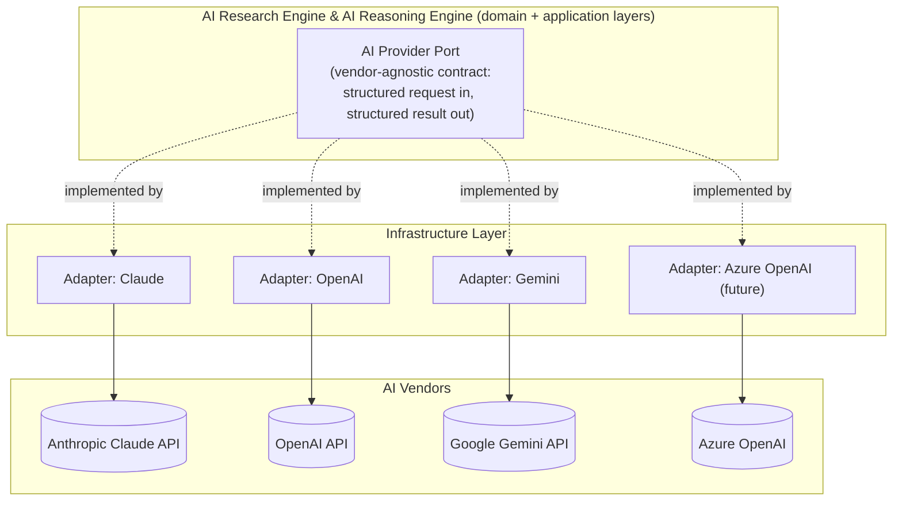
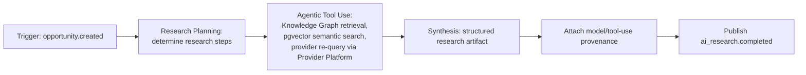
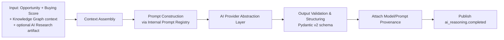

# 14 — AI Architecture

> Status: **Living document — Architectural Constitution — RATIFIED**
> Audience: All engineers, EMs, and technical stakeholders at Signora
> Revision: **v2** — model vendors, embeddings, vector store, and prompt management ratified; AI Reasoning split into AI Research Engine and AI Reasoning Engine. See [ADR-0012](adr/0012-ai-platform-architecture.md), [ADR-0025](adr/0025-module-boundary-evolution.md).

## Purpose

This document specifies how AI/LLM capability is architected within Signora: the AI Provider Abstraction Layer, AI Research Engine and AI Reasoning Engine's internal design, embeddings/vector retrieval, and prompt management.

## Why Two AI Modules, Not One

v1 had a single "AI Reasoning" module. The Review Board split it because it was carrying two workloads with incompatible operating characteristics:

| | AI Research Engine | AI Reasoning Engine |
|---|---|---|
| Shape | Agentic, multi-step, tool-using, open-ended | Single structured request/response |
| Typical latency | Seconds to minutes | Seconds |
| Cost profile | Variable, potentially high (multiple tool calls/model turns) | Predictable, bounded |
| Failure mode | Partial completion, needs resumability | Retry-from-scratch is cheap and safe |
| Scaling lever | Low concurrency, eventual Temporal migration | High concurrency, rate-limit-tuned |

Conflating them meant every reasoning call paid research's latency/cost tax, and research's failure modes were handled with reasoning's (inadequate) retry-from-scratch model. See [ADR-0025](adr/0025-module-boundary-evolution.md).

## AI Provider Abstraction Layer

Both AI Research Engine and AI Reasoning Engine consume the same port; each maintains its own model-routing configuration (which vendor/model for which task), since research and reasoning have different quality/latency/cost tradeoffs even when using the same underlying abstraction. See [ADR-0012](adr/0012-ai-platform-architecture.md) for the full three-way (Claude/OpenAI/Gemini) evaluation and why all three are kept active rather than consolidating to one.

## Embeddings & Vector Retrieval

- **Embeddings model:** OpenAI Embeddings, used uniformly across Knowledge Graph (entity/relationship semantic search), AI Research Engine (retrieval over prior research artifacts and Knowledge Graph context), and Timeline (semantic search alongside Meilisearch's full-text search) — see [ADR-0012](adr/0012-ai-platform-architecture.md).
- **Vector store:** **pgvector**, colocated in the same PostgreSQL 17 instance as the rest of Signora's data (Principle 6). See [ADR-0008](adr/0008-search-and-vector-retrieval.md) for the full comparison against dedicated vector databases (Pinecone, Weaviate, Qdrant) — rejected primarily because they would introduce a second datastore with its own consistency/backup/tenancy story, directly against Principle 6, without a demonstrated need pgvector cannot meet at Signora's current and near-term embedding volume.
- Embedding vectors are stored on the owning module's own tables (e.g., a `knowledge_graph.entity_embeddings` table), workspace-scoped and RLS-enforced exactly like any other workspace-owned data — embeddings are not exempt from tenancy rules.

## Prompt Management: Internal Prompt Registry

Rather than a third-party prompt-management SaaS, Signora builds a lightweight **Internal Prompt Registry**:

- Prompt templates are versioned, code-reviewed artifacts (not database rows edited outside version control), living alongside the module that owns them (AI Research Engine's and AI Reasoning Engine's respective `application/` layers — see [15-project-structure.md](15-project-structure.md)).
- Every reasoning/research result records the exact prompt template version used, alongside model/vendor provenance.
- Prompt changes ship through the same review process as code, per [CLAUDE.md](../../CLAUDE.md) §10.

**Why internal, not bought:** prompt content is domain IP — the specific way Signora asks a model to reason about a B2B buying signal is itself part of the product's differentiation (Principle 14). A third-party prompt-management tool would add a vendor dependency around exactly the wrong layer: the one place genuinely worth owning outright. See [ADR-0012](adr/0012-ai-platform-architecture.md).

## AI Research Engine — Internal Design

- Bounded by an explicit **research timeout** (`TODO`: exact value pending production latency data — tracked as Risk R-09 in [16-architecture-risks.md](16-architecture-risks.md)); AI Reasoning Engine does not block indefinitely on it, per [05-module-dependencies.md](05-module-dependencies.md).
- Every agentic step (tool call, retrieval, sub-query) is logged with provenance, so a research artifact's provenance chain is fully reconstructable.
- The first migration candidate to Temporal once ARQ's non-resumable job model becomes a measured constraint — see [12-scalability.md](12-scalability.md).

## AI Reasoning Engine — Internal Design

- Context assembly is strictly scoped to the current `workspace_id`.
- Output is validated against a Pydantic v2 schema before being trusted downstream — malformed or low-confidence output is a first-class failure, retried or escalated, never silently passed through.
- If `ai_research.completed` has not arrived within the research timeout, AI Reasoning Engine proceeds without it and records that fact in its provenance, so Recommendation Engine and Revenue Intelligence Platform can distinguish research-enriched reasoning from baseline reasoning.

## Model-Agnosticism in Practice

- Both AI modules' application/domain code are tested with a fake AI Provider Abstraction Layer port implementation.
- Prompt templates in the Internal Prompt Registry are written to be portable across the three active vendors where feasible; vendor-specific capabilities (e.g., a specific tool-calling format) are translated inside that vendor's adapter.
- Multi-vendor routing (which of Claude/OpenAI/Gemini handles a given research or reasoning task) is configuration, not code, evaluated for cost/latency/quality per task type — see [ADR-0012](adr/0012-ai-platform-architecture.md).

## Evaluation & Quality

`TODO`: a formal evaluation methodology (golden test sets, human review sampling, regression testing on prompt template changes) remains open — tracked as Risk R-10 in [16-architecture-risks.md](16-architecture-risks.md). This is a prioritized gap, not a deferred nicety: reasoning and research quality are the product's core value proposition.

## Safety & Output Handling

- AI output (both research artifacts and reasoning results) is **untrusted content** until validated, per [10-security.md](10-security.md) — never used to trigger a privileged action (e.g., an outbound CRM write) without explicit validation.
- Prompt-injection risk from provider-sourced free text is a known surface for both modules; structured input (rather than raw free-text interpolation) is used wherever the domain permits it — a concrete mitigation, not a deferred `TODO`, though its coverage should be audited as new provider data categories are added.
- Vendor data-retention/training terms for Claude, OpenAI, and Gemini are re-verified at each contract renewal — see [10-security.md](10-security.md).

## How Recommendation Engine Consumes AI Reasoning

Unchanged from v1: Recommendation Engine consumes `ai_reasoning.completed` and never calls the AI Provider Abstraction Layer itself — only AI Research Engine and AI Reasoning Engine do, keeping "who talks to AI vendors" a single, auditable answer.

## Design Rationale

Splitting research from reasoning, ratifying a three-vendor strategy instead of a single-vendor bet, and colocating vector search in PostgreSQL via pgvector are three expressions of the same underlying judgment: keep the system's moving parts as few and as centrally-owned as possible, while keeping the specific, high-value AI capability (research + reasoning quality) fully in Signora's control rather than delegated to a vendor.

## Best Practices

- Never call an AI vendor SDK outside an AI Provider Abstraction Layer adapter.
- Version prompt templates in the Internal Prompt Registry; record which version produced each result.
- Validate structured output before trusting it downstream.
- Respect AI Research Engine's timeout in AI Reasoning Engine without exception.

## Anti-Patterns

- Hardcoding a specific vendor's prompt format directly inside domain/application logic.
- Treating raw AI vendor output as trusted domain data.
- Letting Recommendation Engine call the AI Provider Abstraction Layer directly.
- Making AI Reasoning Engine block indefinitely on AI Research Engine.
- Storing prompt templates as mutable, unversioned database rows.

## Tradeoffs

| Choice | We gain | We give up |
|---|---|---|
| Split AI Research Engine / AI Reasoning Engine | Independent scaling, failure handling, and evaluation per workload; faster baseline reasoning latency | More coordination complexity between two modules vs. one (mitigated by the well-defined, optional/non-blocking event relationship) |
| Three active model vendors (Claude, OpenAI, Gemini) | No single-vendor dependency for the product's core differentiator; cost/quality routing flexibility | More adapters and more per-vendor evaluation overhead (justified given how much rides on model quality) |
| pgvector over a dedicated vector database | One datastore, one backup/consistency/tenancy story | Lower ceiling on vector-search-specific performance at extreme scale (explicitly tracked as Risk R-08, revisit if hit) |
| Internal Prompt Registry over a bought prompt-ops SaaS | Prompt IP stays fully owned and version-controlled | We build and maintain the versioning/provenance tooling ourselves (small, justified given this is core IP) |

## Future Evolution

- AI Research Engine → Temporal migration once the triggers in [12-scalability.md](12-scalability.md) are met.
- A formal evaluation harness (Risk R-10) is the single highest-leverage near-term investment for AI quality.
- Azure OpenAI as a fourth vendor is deferred to specific enterprise customer requirements (e.g., data-residency or existing Azure commitments) — see [ADR-0012](adr/0012-ai-platform-architecture.md).

## Decision Summary

AI capability is split into AI Research Engine (agentic, resumable-in-future, Temporal-bound) and AI Reasoning Engine (structured, fast, ARQ-bound), both behind a shared AI Provider Abstraction Layer routing across Claude, OpenAI, and Gemini (Azure OpenAI reserved for future enterprise need). Embeddings use OpenAI Embeddings stored in pgvector, colocated in PostgreSQL. Prompts are managed via a versioned Internal Prompt Registry, treated as owned domain IP rather than outsourced. Evaluation methodology and the AI Research Engine timeout value remain open, prioritized, explicitly tracked risks.
