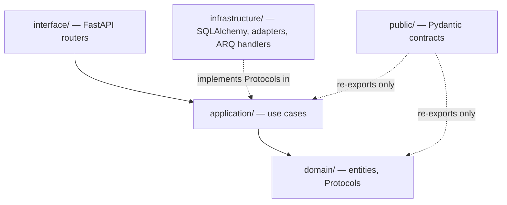

# 15 — Project Structure

> Status: **Living document — Architectural Constitution — RATIFIED**
> Audience: All engineers, EMs, and technical stakeholders at Signora
> Revision: **v3** — the platform layer directory is `signora_platform/`, not `platform/`, which collides with a Python standard library module (rationale below). Adds the concrete import-linter contract shape now that it is running. v2 layout otherwise unchanged.

## Purpose

This document defines how the Signora codebase is physically organized on disk, so the logical architecture in [04-modules.md](04-modules.md) and [05-module-dependencies.md](05-module-dependencies.md) is visible and mechanically enforceable from the folder structure and local tooling.

## Top-Level Repository Layout

```
signora/
├── docs/
│   └── architecture/             # this documentation set + adr/
├── backend/
│   ├── pyproject.toml            # uv-managed, Python 3.13+
│   ├── modules/
│   │   ├── workspace_tenancy/
│   │   ├── provider_platform/
│   │   ├── provider_normalization/
│   │   ├── knowledge_graph/
│   │   ├── observation_engine/
│   │   ├── business_event_engine/
│   │   ├── signal_engine/
│   │   ├── buying_score_engine/
│   │   ├── opportunity_engine/
│   │   ├── ai_research_engine/
│   │   ├── ai_reasoning_engine/
│   │   ├── recommendation_engine/
│   │   ├── timeline/
│   │   └── revenue_intelligence_platform/
│   ├── signora_platform/         # NB: not "platform/" — see note below
│   │   ├── event_bus/            # Internal Event Bus: outbox model, relay, ARQ dispatch (06-events.md)
│   │   ├── db/                   # SQLAlchemy async engine/session, RLS session-context helper
│   │   ├── provider_abstraction/ # shared Provider Port + adapter base classes (13-integrations.md)
│   │   ├── ai_provider_abstraction/ # shared AI Provider Port + adapter base classes (14-ai-architecture.md)
│   │   ├── integration_abstraction/ # shared Integration Port + adapter base classes
│   │   └── bought_infra_adapters/   # thin adapters: Better Auth, Casbin, Stripe, Novu, PostHog, Flagsmith, Resend
│   ├── apps/
│   │   ├── api/                  # FastAPI ASGI app entry point
│   │   └── worker/                # ARQ worker entry point(s), one per pool (12-scalability.md)
│   ├── migrations/                # Alembic migrations (single database, Principle 6)
│   └── tests/                     # cross-module/integration/e2e tests
├── frontend/
│   ├── package.json               # Next.js 15+, TypeScript
│   ├── app/                       # Next.js App Router
│   ├── components/                # shared UI components (shadcn/ui-based)
│   ├── lib/                       # API client (TanStack Query), utilities
│   └── tests/                     # Vitest + Playwright
├── infra/                         # Docker Compose, Terraform/IaC for AWS (ADR-0022)
└── .github/workflows/              # retained, manual-dispatch only (ADR-0027)
```

### Why `signora_platform/` and not `platform/`

`platform` is a **Python standard library module**. A top-level package with that name shadows it, and once anything in the process imports the stdlib `platform` first — Alembic does, among others — the local package becomes unreachable and imports fail with `'platform' is not a package`.

This is environment- and import-order-dependent, which makes it especially unpleasant: unit tests and MyPy both resolved the name correctly and passed, and the conflict only appeared when running migrations. The package is therefore named `signora_platform`.

This is a naming correction, not an architectural change: the platform *layer* — shared technical infrastructure, distinct from `modules/`, containing no business logic — is exactly as ratified. The rest of this document refers to it as "the platform layer" throughout.

**Rule: never name a top-level package after a Python standard library module.** Check `python -c "import <name>"` before introducing one.

## Standard Backend Module Internal Structure

Every entry under `backend/modules/` follows the same Clean Architecture layout (Principle 4):

```
backend/modules/<module_name>/
├── domain/                # entities, value objects, domain events, domain services
│                          #   — no framework/infra imports (no FastAPI, no SQLAlchemy, no httpx)
├── application/            # use cases / application services; defines ports (Python Protocols)
│                          #   that infrastructure/ implements
├── infrastructure/         # SQLAlchemy repositories, provider/AI/integration adapters,
│                          #   ARQ job handlers that call into application/
├── interface/               # FastAPI routers (interface layer) — the module's HTTP entry points
│                          #   — the only place other code calls into this module synchronously
└── public/                  # this module's explicit exported contract:
                            #   Pydantic event payload models + any approved synchronous
                            #   query interface (05-module-dependencies.md) — the ONLY thing
                            #   other modules may import
```



**`public/` is the physical, machine-enforced boundary.** Other modules may import only from `backend/modules/<name>/public/`. This is enforced by **import-linter**, configured under `[tool.importlinter]` in `backend/pyproject.toml` and run locally as part of every milestone gate (see [ADR-0027](adr/0027-local-first-development.md)), not by convention alone.

Three contracts are enforced today:

| Contract | What it prevents |
|---|---|
| `modules: Clean Architecture layering` | An inner layer importing an outer one (e.g. `domain/` importing `infrastructure/`). Uses a `containers` list, so bringing a new module under enforcement is a one-line addition. `interface` is declared optional — modules without an HTTP surface yet must not fail the build. |
| `workspace_tenancy: domain has no infrastructure/framework dependencies` | `domain/` importing SQLAlchemy, FastAPI, httpx, arq, or the platform layer. Requires `include_external_packages = true`. |
| `signora_platform must not depend on any module` | Business logic leaking into the platform layer. |

Verify the contracts actually bite rather than passing vacuously: add a deliberate violating import, confirm the build fails, then remove it. A contract that has never been seen to fail is not known to work.

## Where the Abstraction Layers Live

- **Provider Port** (Principle 9): base Protocol defined in `backend/signora_platform/provider_abstraction/`, implemented per-vendor inside `backend/modules/provider_platform/infrastructure/adapters/{apollo,coresignal,builtwith,similarweb,neverbounce}.py`.
- **AI Provider Port** (Principle 10): base Protocol in `backend/signora_platform/ai_provider_abstraction/`, implemented per-vendor inside both `ai_research_engine/infrastructure/adapters/` and `ai_reasoning_engine/infrastructure/adapters/` (each module wires its own routing config against the shared adapters).
- **Integration Port** (Principle 11): base Protocol in `backend/signora_platform/integration_abstraction/`, implemented per-vendor by the consuming module (e.g., `revenue_intelligence_platform/infrastructure/adapters/{salesforce,hubspot,pipedrive,zoho}.py`).

`signora_platform/` contains only technical shared infrastructure — never business/domain logic. An import-linter contract (`signora_platform must not depend on any module`) enforces that dependencies point from `modules/` into it and never the reverse.

## Migrations

Alembic migrations live in `backend/migrations/`, one linear history for the single PostgreSQL database (Principle 6), named `<revision>_<module>_<description>.py`. A module's tables are only ever migrated by that module's own changes; cross-module migration PRs are a review flag.

## Testing Layout

- **Unit tests** live inside each module (`backend/modules/<name>/tests/`), predominantly testing `domain/` and `application/` with fakes for `infrastructure/` Protocols, using **Pytest** and **pytest-mock**.
- **HTTP-layer tests** use **HTTPX**'s async test client against the FastAPI app.
- **Integration tests** (module + real test database, module + real ARQ dispatch) live in `backend/tests/integration/`.
- **End-to-end/pipeline tests** (full provider → recommendation flow, per [07-data-flow.md](07-data-flow.md)) live in `backend/tests/e2e/`.
- **Frontend** unit/component tests use **Vitest**; **Playwright** covers end-to-end browser flows against a running stack.

## Code Quality Enforcement

- **Ruff** (lint + format) and **MyPy** (strict mode) run locally for `backend/`.
- **ESLint** and **Prettier** run locally for `frontend/`.
- **import-linter** runs locally to enforce the module-boundary contract described above.

See [ADR-0024](adr/0024-code-quality-and-static-analysis.md) for the exact tool configuration.

## Design Rationale

Making the module boundary a literal folder boundary — and, critically, a machine-enforced one via import-linter — turns [05-module-dependencies.md](05-module-dependencies.md) from a policy document into something that fails the build automatically when violated. Python's Protocol-based structural typing is what makes "ports defined by the domain, implemented by infrastructure" idiomatic in this stack without requiring an abstract-base-class hierarchy — see [ADR-0001](adr/0001-backend-language-and-runtime.md).

## Best Practices

- Orient in any module using the standard `domain/application/infrastructure/interface/public` layout.
- Add new cross-module functionality by deliberately extending a module's `public/` contract.
- Keep `platform/` additions strictly technical.

## Anti-Patterns

- Importing from another module's `domain/`, `application/`, or `infrastructure/` instead of its `public/`.
- Business logic inside `platform/`.
- A module's `domain/` importing SQLAlchemy, FastAPI, or an AI/provider vendor SDK directly.
- Skipping the import-linter contract update when a new module is added.

## Tradeoffs

| Choice | We gain | We give up |
|---|---|---|
| Uniform per-module Clean Architecture layout | Predictable navigation, mechanically enforceable boundaries | Some boilerplate for very small modules (acceptable) |
| import-linter as a binding gate | Boundary violations fail the build automatically, not just in review | Contract file must be kept up to date as modules are added (a small, worthwhile maintenance cost) |

## Future Evolution

- When a module is extracted into a standalone service (per [12-scalability.md](12-scalability.md)), its folder moves out of `backend/modules/` into its own repository/deployable; its internal `domain/application/infrastructure/interface` structure should not need to change.
- As `apps/worker` pools multiply per [12-scalability.md](12-scalability.md)'s per-stage partitioning, each pool gets its own entry point file under `apps/worker/` while sharing the same module code.

## Decision Summary

Signora's codebase mirrors its logical architecture exactly: `backend/modules/<name>/` per module (Clean Architecture layers, Python Protocols as ports, `public/` as the sole machine-enforced cross-module import surface), `backend/platform/` for shared technical infrastructure, `backend/apps/{api,worker}` as the two runtime entry points, and a separate `frontend/` Next.js application — with import-linter, Ruff, MyPy, ESLint, and Prettier all running locally as the mechanical enforcement of this document.
