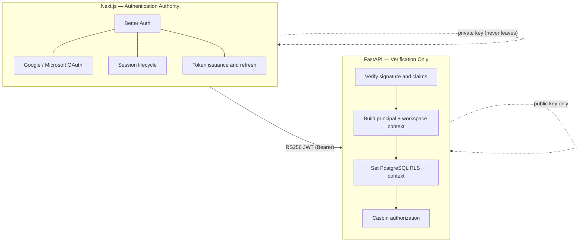
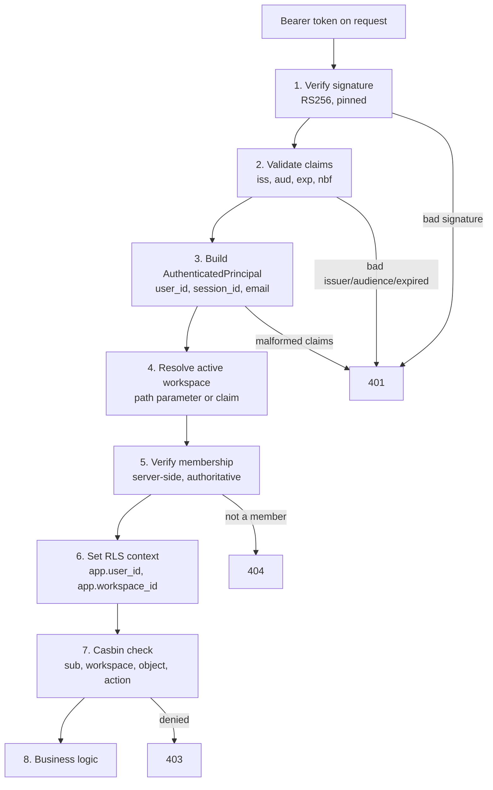

# 18 — Authentication

> Status: **Living document — Architectural Constitution — RATIFIED**
> Audience: All engineers, EMs, and technical stakeholders at Signora
> Revision: **v2** — records the issuer-side configuration as built in M1.2, plus the authentication event vocabulary and health checks. The contract in v1 is unchanged and is now verified by a cross-tier test, run in the suite and asserted by `make smoke` stage 9b.

## Purpose

This document specifies how a caller's identity is established at Signora's API boundary: the division of responsibility between Next.js and FastAPI, the JWT contract between them, the per-request authentication pipeline, and the rules engineers must follow when writing protected endpoints.

It covers **authentication** — *who is this caller* — only. Authorization (*what may they do*) is Casbin's concern, specified in [10-security.md](10-security.md). Tenant isolation mechanics are in [11-tenancy.md](11-tenancy.md). The error contract is in [19-api-conventions.md](19-api-conventions.md).

## The Division of Responsibility



**Next.js owns** user authentication, OAuth flows with Google and Microsoft, session management, token issuance, and token refresh.

**FastAPI owns** signature verification, claim validation, principal construction, workspace-context resolution, RLS establishment, and Casbin delegation — and nothing else related to identity.

### Hard prohibitions on the Python tier

These are absolute. A pull request violating any of them should be rejected outright.

- **Never store passwords or any credential material.**
- **Never implement an OAuth flow**, callback handler, or authorization-code exchange.
- **Never authenticate a user directly** — no login endpoint, no credential comparison.
- **Never mint or sign a token.** The API is configured with a public key only and is cryptographically incapable of issuing a token it would accept. Do not add a private key to its configuration for any reason, including tests — test tokens are signed with an ephemeral key pair generated inside the test itself.

## The JWT Contract

### Signing and verification

- **Algorithm: `RS256`**, asymmetric. Next.js signs with the private key; FastAPI verifies with the public key.
- **Allowed algorithms are pinned to exactly `["RS256"]`.** This is a security control, not configuration hygiene. An unpinned verifier is vulnerable to the `alg: none` forgery and to algorithm confusion, where a token is re-signed with HS256 using the RSA *public* key — which is not secret — as the HMAC secret.
- **Clock skew leeway: 60 seconds**, applied to `exp` and `nbf`. Deliberately small: a generous leeway silently extends the life of expired tokens.
- **Access-token TTL: 15 minutes.** Refresh is entirely Next.js's responsibility; FastAPI has no refresh endpoint and no concept of one.

### Claims

```json
{
  "iss": "https://auth.signora.example",
  "aud": "signora-api",
  "sub": "3f6c…",
  "sid": "sess_9a2f…",
  "email": "rep@customer.example",
  "email_verified": true,
  "active_workspace_id": "8b0f…",
  "iat": 1750000000,
  "exp": 1750000900,
  "jti": "tok_4c71…"
}
```

| Claim | Required | Meaning and use |
|---|---|---|
| `iss` | yes | Issuer. Rejected unless it matches configuration exactly. |
| `aud` | yes | Audience. Prevents a token minted for another service being replayed against this API. |
| `sub` | yes | Better Auth user id. Becomes `app.user_id` in the RLS session context. |
| `sid` | yes | Better Auth session id. Supports session-level revocation and correlates API activity to a sign-in. |
| `email` | yes | Authenticated email address. |
| `email_verified` | yes | Verification status of that address. |
| `active_workspace_id` | no | Workspace the user has selected. Absent or null immediately after sign-in. **A routing hint, never a grant** — see below. |
| `iat` / `exp` | yes | Issued-at and expiry. |
| `jti` | yes | Unique token id, for future replay detection and revocation. |

### What the token deliberately omits — including *how* somebody signed in

**No claim names the authentication method**, and this is the property that makes every future method free (ADR-0033). A password sign-in, a Google redirect and a Microsoft redirect all produce one session shape and one claim set; the Python tier cannot distinguish them because there is nothing in the token to distinguish.

This was true by omission from M1.2 and is asserted from M12.3, so a future author adding `provider` "for analytics" breaks a test rather than shipping a security decision keyed to a method. The reasoning is the same as vendor neutrality in the AI Platform: **method is provenance, never an input to a decision** — and here it is not even carried.

Magic link, enterprise SSO and passkeys therefore need no backend change at all. They add a method in Better Auth and nothing downstream knows.


**No permissions, capabilities, or authorization decisions.** Casbin is the single source of authorization truth, evaluated per request against policy held in Signora's own version control. Embedding permissions would fork authorization across two systems and delay every policy change until tokens expire.

**No workspace membership list.** Only the single `active_workspace_id` is carried, because a list would be unbounded in size (a user may belong to many workspaces), would grow staler the longer it is, and — decisively — could never be authoritative anyway, since [11-tenancy.md](11-tenancy.md) already requires server-side membership verification before RLS context is established.

### `active_workspace_id` is a hint, not a grant

The API re-verifies membership against Workspace & Tenancy on **every** request before setting `app.workspace_id`. A token carrying a workspace the user does not belong to — whether stale, mistaken, or forged — fails that check and the request is rejected. Treat the claim as a default selection the caller may also override with an explicit path parameter; either way it is verified, never trusted.

## The Per-Request Pipeline

Implemented once as a composable FastAPI dependency chain in `signora_platform/api/dependencies.py`. **Never re-implement any stage inside a route handler.**



### Status codes, and why

| Failure | Status | Reasoning |
|---|---|---|
| Missing, malformed, or unverifiable token | `401` | The caller is unauthenticated. |
| Valid token, but not a member of the workspace | `404` | Deliberately indistinguishable from "no such workspace." A `403` here would confirm the workspace exists, letting a caller enumerate workspace ids. Preserves the non-enumerability property in [11-tenancy.md](11-tenancy.md). |
| Member, but Casbin denies the action | `403` | Membership is already established, so the caller demonstrably knows the workspace exists. The only new information is that their role is insufficient — which is not sensitive. |

That `404`-versus-`403` distinction is easy to "fix" into an inconsistency during review. It is intentional.

## Writing a Protected Endpoint

Depend on the shared context dependency; never parse a token, read a header, or set RLS context by hand.

- Endpoints scoped to a workspace take the workspace-scoped context dependency, which yields a verified principal, a verified workspace, an RLS-scoped session, and a Casbin enforcer already bound to that subject and workspace.
- Endpoints that are authenticated but not workspace-scoped (for example, "list the workspaces I belong to") take the principal-only dependency. These run with `app.user_id` set and no `app.workspace_id`, so workspace-owned tables are correctly invisible.
- Unauthenticated endpoints are limited to operational probes (`/health`, `/ready`) and OpenAPI. Adding any other unauthenticated route requires explicit review.

## As Built (M1.2)

### Issuer side — Next.js

| Concern | Location |
|---|---|
| Better Auth instance, OAuth providers | `frontend/lib/auth/server.ts` |
| Signing-key loading and pair validation | `frontend/lib/auth/keys.ts` |
| Token minting | `frontend/lib/auth/jwt.ts` |
| Session → token exchange | `frontend/app/api/token/route.ts` |
| Better Auth routes (sign-in, callback, sign-out) | `frontend/app/api/auth/[...all]/route.ts` |
| Auth subsystem health | `frontend/lib/auth/health.ts`, `frontend/app/api/health/route.ts` |

Password authentication is **disabled** (`emailAndPassword.enabled: false`). Sign-in is OAuth-only, so no credential is stored in either tier.

Better Auth's tables live in a dedicated **`auth` schema** (migration `0005`), owned by a `signora_auth` role. `signora_app` is explicitly revoked from that schema — the API tier could not read authentication data even if code attempted to.

### Verification side — FastAPI

| Concern | Location |
|---|---|
| Signature and claim verification | `signora_platform/auth/jwt_verifier.py` |
| Principal construction | `signora_platform/auth/principal.py` |
| Configuration health | `signora_platform/auth/health.py` |
| Auth events | `signora_platform/auth/events.py` |

### Cross-tier contract test

`backend/tests/integration/test_jwt_cross_tier_contract.py` mints a token with the **real** frontend issuance path and verifies it with the **real** Python verifier. Neither side's claim set is restated in the test, so drift on either side fails the local gate. `make smoke` stage 9b runs it and **fails if it is skipped** — the skip path is what a missing frontend install would otherwise hide ([ADR-0027](adr/0027-local-first-development.md)).

This is the only check that proves the two tiers agree; every other test verifies one tier's understanding of the boundary in isolation.

## Authentication Events

Both tiers emit structured events sharing one vocabulary, so the two log streams are queryable as one rather than needing manual correlation.

| Event | Emitted by | Meaning |
|---|---|---|
| `AUTH_LOGIN_SUCCESS` | Frontend | Sign-in completed |
| `AUTH_LOGIN_FAILURE` | Frontend | Sign-in failed |
| `AUTH_OAUTH_CALLBACK` | Frontend | OAuth provider callback received |
| `AUTH_TOKEN_ISSUED` | Frontend | Access token minted from a session |
| `AUTH_TOKEN_REFRESH` | Frontend | Token refreshed |
| `AUTH_LOGOUT` | Frontend | Session ended |
| `AUTH_TOKEN_ACCEPTED` | API | Token verified successfully |
| `AUTH_TOKEN_REJECTED` | Both | Token missing, malformed, expired, or unverifiable |
| `AUTH_WORKSPACE_SWITCH` | Both | Caller operating on a workspace other than the token's hint |
| `AUTH_WORKSPACE_ACCESS_DENIED` | API | Caller is not a member of the named workspace |

**Rules, enforced structurally rather than by convention:**

- **Never log a token or PII.** A user id is an opaque UUID and is safe; an email address is not. The frontend's event context is a closed type that drops email- and token-shaped keys at emit time; the backend emitter accepts only a fixed set of fields. The logging formatter redacts on top of both.
- **`jti` is permitted** — it is an opaque identifier, not a credential, and is what makes a token traceable to a future revocation decision.
- **`outcome` is derived from the event name, never passed in**, so a failure cannot be recorded as a success by a mistaken argument.
- **Failure reasons stay coarse.** A reason naming exactly which claim failed would help an attacker converge on a forgeable token.

## Authentication Health

Both tiers expose readiness covering the auth subsystem.

**Frontend — `GET /api/health`:** Better Auth database connectivity and `auth` schema presence · signing-key availability **and pair-match** · JWT issuer/audience configuration · OAuth provider configuration.

**API — `GET /ready`:** public-key validity · JWT issuer/audience configuration · algorithm pinning · **rejection of a private key supplied as the public key**.

Two design points:

- **The key-pair-match check is the one that earns its place.** Both keys can load cleanly, every token mints, and every request 401s with no obvious cause. A sign-then-verify round trip at startup turns that into a clear configuration error.
- **`degraded` and `unavailable` are distinguished deliberately.** No OAuth provider configured is `degraded`: the process is healthy and restarting it would not help, but no human can sign in and an operator needs to know. A missing signing key is `unavailable` — the tier genuinely cannot function.

## Local Development and Testing

- **Better Auth's tables are created by `npm run auth:migrate`**, once, and again after a Better Auth upgrade. Backend migration `0005` creates the `auth` *schema*; the tables inside it are the vendor's and Alembic must not own them — a hand-written copy of another system's schema disagrees with it on the first upgrade. **Until M12.3 nothing created them at all**, so sign-in could not work by any method on a fresh clone.
- **Sign in with email and password.** Verification and reset links are written to the dev server's stdout by the console transport, which refuses to start in a deployed environment (ADR-0033). The flow is not shortened — real token, real expiry, real route.
- Tests generate an **ephemeral RSA key pair in-process**, sign tokens with the private half, and configure the verifier with the public half. No key material is committed, and no fixture private key exists to leak.
- `npm run keys:generate` produces a local development pair, printed to stdout rather than written to disk so key material never lands in a file by accident. It emits the private key for `frontend/.env.local` and the public key for both tiers — making the asymmetry visible at the point of use.
- Because the API cannot mint tokens, there is no "dev mode" that skips verification. A test needing an authenticated caller mints a token exactly as Next.js would, which keeps the test path and the production path identical.

## Best Practices

- Treat the dependency chain as the only entry point to identity. If a handler needs something the principal does not carry, extend the principal — do not read the token again.
- Keep the allowed-algorithm list pinned and explicit.
- Log `user_id`, `session_id`, and `workspace_id` alongside `correlation_id` (see [07-data-flow.md](07-data-flow.md)), and never log the token itself.
- Prefer an explicit workspace path parameter over the `active_workspace_id` claim for workspace-scoped resources; it makes the scope of a request legible from its URL alone.

## Anti-Patterns

- Parsing or trusting a JWT anywhere outside `signora_platform/auth/`.
- Trusting `active_workspace_id` without server-side membership verification.
- Returning `403` where the table above requires `404`, reintroducing workspace enumeration.
- Adding a private signing key, a login route, or a refresh route to the Python tier.
- A "skip auth in development" flag. It diverges the test path from production and inevitably reaches production.
- Widening the clock-skew leeway to resolve intermittent expiry failures — fix host time synchronisation instead.

## Tradeoffs

| Choice | We gain | We give up |
|---|---|---|
| JWT boundary over shared session store | No coupling to Better Auth's internal schema; upgrades cannot silently break the backend | An explicit contract to maintain between two codebases |
| Asymmetric RS256 over shared-secret HS256 | The API cannot forge tokens even if fully compromised | Key distribution and rotation must be managed |
| Stateless verification over per-request session lookup | Sub-millisecond, locally deterministic; API availability decoupled from the frontend | Revocation is not immediate — bounded by the 15-minute TTL |

## Future Evolution

- **JWKS-based key rotation** with a cached key set, replacing the current configured-public-key approach in which rotation requires a deploy.
- **Revocation list** keyed on `jti` or `sid`, should the 15-minute residual window prove unacceptable. Both claims are carried today specifically so this can be added without a contract change.
- **Enterprise SSO/SCIM**, which remains a Better Auth-side concern and does not alter this boundary.

## Decision Summary

Better Auth in Next.js is Signora's sole Authentication Authority, issuing short-lived RS256 JWTs. FastAPI verifies signature and claims with a public key it cannot sign with, builds a principal, re-verifies workspace membership server-side, establishes PostgreSQL RLS context, and delegates the authorization decision to Casbin. The Python tier never stores credentials, never implements OAuth, and never authenticates a user directly.
