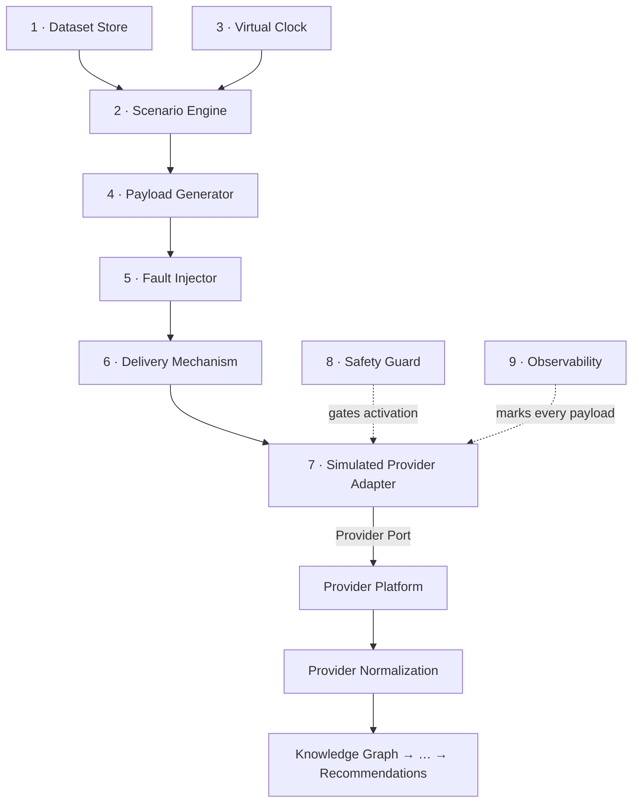

# 20 — Provider Simulation Framework

> Status: **RATIFIED** — approved 2026-07-28
> Audience: All engineers, EMs, and technical stakeholders at Signora
> Revision: **v1** — the Simulation Architecture Review required before M2.0 implementation begins. Design intent is fixed by [IMPLEMENTATION_ROADMAP.md §8](../../IMPLEMENTATION_ROADMAP.md#8-provider-simulation-framework--design); this document specifies the pipeline that realises it.
>
> **No implementation exists yet.** The eight principles in *Permanent architectural principles* are now binding; the five Phase 1 providers, the payload provenance rule, Scenario Manifests, and the webhook deferral are ratified. An accompanying ADR is authored alongside implementation.

## Scope discipline — the simulator is infrastructure, not product

**Ratified 2026-07-28.** The framework exists to enable local development, automated testing, end-to-end testing, demonstrations, and regression testing. **It is not intended to become a provider emulation platform.**

Where improving the simulator and improving the core intelligence platform compete, **the core product wins**. The simulator stays only as sophisticated as required to:

- produce realistic provider payloads
- exercise the complete ingestion pipeline
- support deterministic testing
- support customer demonstrations

Nothing beyond that is expected during the current roadmap.

### Explicitly out of scope for M2.0

Deferred as future enhancements, introduced later only if they show measurable value:

| Deferred | Why it can wait |
|---|---|
| Richer provider behaviour | A payload realistic enough to exercise normalization is realistic enough |
| Additional providers beyond the ratified five | Five already cover every intelligence category |
| Advanced traffic modelling | No performance question is being asked yet |
| Multi-tenant simulation | One workspace exercises every tenancy path RLS enforces |
| Complex behavioural modelling | Beyond what a scenario needs to produce a signal |
| Performance benchmarking | Requires a pipeline to benchmark; that is M6 at the earliest |
| Large-scale load generation | Same |

**The success of M2.0 is not measured by the number of simulated providers.** It is measured by whether the platform can consume simulated provider payloads **through the same production pipeline used by real providers**. That is the primary objective; everything else in this document is in service of it.

## Purpose

The Provider Simulation Framework produces **realistic provider payloads without a provider**. It is the first concrete implementation of the Provider Port, and a permanent platform capability serving eight ongoing purposes — local development, integration testing, end-to-end testing, product demonstrations, AI evaluation, regression testing, performance benchmarking, and customer onboarding demos.

Its value rests entirely on one property: **what it produces must be indistinguishable, to every downstream stage, from what a real provider produces.** The moment the simulated path diverges from the production path, everything the simulator proves becomes worthless — a demo that demonstrates nothing, a regression suite that regresses against itself.

Everything in this document is in service of that property.

---

## Permanent architectural principles

Eight principles, ratified 2026-07-28. These are permanent — a change to any of them is an RFC, not an implementation decision.

1. **The simulator behaves exactly like a production provider.**
2. **The simulator has no privileged downstream knowledge.**
3. **The simulator never bypasses the Provider Port.**
4. **Payloads are validated exactly as production payloads are.**
5. **Deduplication remains the platform's responsibility**, never the simulator's.
6. **Faults surface through production error semantics.**
7. **Webhooks traverse the real inbound HTTP endpoint** once it exists.
8. **Shared contract tests are the primary guarantee** that simulated and production adapters remain interchangeable.
9. **Provider Independence.** Each provider generator is **independently removable** without affecting the Provider Platform, Normalization, Knowledge Graph, Observation Engine, or Scenario Engine. **Scenarios compose providers; providers never depend on each other.** The framework must never become dependent on any single provider — including Bombora.

## The governing constraints

Four constraints are already ratified and are treated here as fixed:

1. **Identical contract.** Simulated adapters implement exactly the same Provider Port as production ones — same signatures, same return types, same error semantics, same rate-limit surface.
2. **Configuration-only switching.** No `if simulated:` may exist in any layer.
3. **Entry at the Provider layer only.** No later stage may be entered directly.
4. **Determinism.** Same dataset version + scenario + seed ⇒ byte-identical payloads, on every run and every machine.

A fifth follows from them and is stated explicitly because it is the one most easily violated by accident:

5. **The simulator has no privileged knowledge.** It never reads the Knowledge Graph to decide what to emit, never consults an Observation, never knows what a Signal is. It knows only its dataset and its scenario. A simulator that peeks downstream can manufacture a passing test for a pipeline that does not work.

---

## Pipeline overview



Stages 1–6 are the framework in `signora_platform/simulation/`. Stage 7 is the adapter in `modules/provider_platform/infrastructure/adapters/simulated/`. Stages 8 and 9 are cross-cutting and apply at every stage.

**The boundary that matters is between 7 and Provider Platform.** Everything left of it is simulation; everything right of it is production code that cannot tell the difference. The Provider Port is the seam, and it is the only seam.

---

## Stage 1 — Dataset Store

**Responsibilities.** Hold versioned, immutable fixture data: companies, people, technographics, traffic, job postings, funding events. Resolve a dataset reference (`saas-growth@3`) to its content. Refuse to serve an unpublished or mutated dataset.

**Inputs.** A dataset identifier and version.

**Outputs.** An immutable in-memory dataset: entities with stable identifiers, and a timeline of raw facts each carrying an `occurred_at`.

**Contracts.**
- Datasets are files under `signora_platform/simulation/datasets/`, versioned in the filename and content-hashed. Reviewable and diffable as code, because they are code.
- **A published version is immutable.** A correction ships as a new version. Regenerating a dataset in place invalidates every historical AI comparison built on it, which is the entire reason regression datasets exist.
- Identifiers are stable across versions, so `acme-corp` in v1 and v4 are the same company and a diff shows what changed about it.

**Failure handling.** A missing or unknown dataset version is a **startup failure**, not a runtime one — the simulator refuses to start rather than emitting an empty scenario that looks like a pipeline producing nothing. A content-hash mismatch is treated identically: a mutated dataset is a corrupted one.

**Idempotency.** Trivially satisfied — datasets are immutable values. Loading the same reference twice yields the same content.

**Observability.** The resolved dataset version and content hash are logged once at load and recorded on **every payload emitted**. This is what makes an AI quality change attributable to a dataset change rather than a model change.

**Testing strategy.** Round-trip every published dataset through load-and-hash. Assert immutability by attempting a mutation and expecting a failure. Assert that every entity referenced by any scenario exists in the dataset it names — a dangling reference is otherwise discovered only when that scenario runs.

---

## Stage 2 — Scenario Engine

**Responsibilities.** Turn a dataset plus a scenario definition into an **ordered timeline of provider events**. A scenario is the narrative — "hiring surge", "competitor displacement"; the dataset is the cast.

**Inputs.** A dataset, a scenario definition, a seed, and a clock mode.

**Outputs.** An ordered sequence of `ScenarioEvent`, each carrying its provider, its logical timestamp, and the dataset facts it references. Not yet a payload — that is stage 4.

**Contracts.**
- Scenario definitions are versioned files under `simulation/scenarios/`, separate from datasets so the same cast can play different narratives.
- **Ordering is by logical time, not emission order.** The engine may emit an event whose `occurred_at` precedes one already emitted — that is how late arrival is simulated, and the pipeline must tolerate it.
- All randomness is drawn from the supplied seed. **No wall-clock, no ambient state, no `random()` without a seeded generator.** Determinism is an acceptance criterion, not an aspiration.

**Failure handling.** A scenario referencing an entity absent from its dataset fails at **load**, before any event is emitted. A scenario producing zero events fails loudly rather than silently — a demo that shows nothing is indistinguishable from a broken pipeline, and that ambiguity is expensive in front of a customer.

**Idempotency.** Running the same `(dataset, scenario, seed)` twice yields an identical event sequence. This is asserted by hashing the sequence, not by inspection.

**Observability.** Scenario name and version, seed, event count, and logical time span logged at start. Each event carries a `scenario_event_id`, stable across runs, so a downstream anomaly traces back to the exact event that caused it.

**Testing strategy.** The determinism test is the important one: generate a sequence twice with the same seed and assert byte-identical output, then generate with a different seed and assert it differs — the second half catches a seed that is accepted and ignored, which would make every determinism test pass vacuously.

---

## Stage 3 — Virtual Clock

**Responsibilities.** Own the notion of "now" for the entire simulation, and control the rate at which logical time advances.

**Inputs.** A clock mode: `instant` (no delay), `realtime` (wall-clock pacing), or `accelerated` (a multiplier).

**Outputs.** Logical timestamps, and the delays between deliveries.

**Contracts.**
- **Nothing in the simulation framework calls `datetime.now()` directly.** Every timestamp comes from the clock. A single direct call reintroduces non-determinism that is very hard to find later, because it produces a test that fails once a week.
- The clock is injected, never global — consistent with the dependency-injection standard (CLAUDE.md §6).
- `occurred_at` on a payload is **logical** time; the `created_at` the outbox records is **real** time. They differ, deliberately, and the pipeline must handle a large gap between them — that is exactly what a backfill looks like.

**Failure handling.** An accelerated clock that would emit faster than the pipeline can consume is a **backpressure** condition, not an error: the delivery mechanism (stage 6) blocks rather than dropping events. Dropping under load is how a benchmark quietly measures the wrong thing.

**Idempotency.** Not applicable — the clock produces no side effects. Its determinism property is that `instant` mode yields timestamps depending only on the scenario, never on how long generation took.

**Observability.** Clock mode and multiplier logged at start. In accelerated mode, the ratio of logical to real elapsed time is reported, so a run that fell behind its intended rate is visible rather than assumed.

**Testing strategy.** Assert that `instant` mode produces identical timestamps across two runs of differing real duration. Assert that no module in `simulation/` references `datetime.now` — a structural test, because this is a rule that erodes one call at a time.

---

## Stage 4 — Payload Generator

**Responsibilities.** Render a `ScenarioEvent` into a **vendor-shaped payload** — the JSON a real provider would actually return, with that vendor's field names, nesting, casing, null conventions, and pagination envelope.

**Inputs.** A `ScenarioEvent`, and the target provider's identity.

**Outputs.** A payload byte-identical in shape to the real vendor's documented response.

**Contracts.**
- **One generator per provider**, each owning that vendor's quirks. A shared generator with per-vendor branches would converge on a house format, and the pipeline would be tested against a shape no vendor produces.
- Payloads are **untrusted output**, treated exactly as a real provider's would be: validated and normalized by Provider Normalization, never trusted because "we generated it". Skipping validation here would leave the validation path untested precisely where it matters.
- Generators encode **documented** vendor formats. Where a format is unknown, that is a `TODO` and an explicit gap — never a guess, because a guessed shape produces a normalizer that works only against the guess.

**Failure handling.** A generator unable to render an event fails the run rather than emitting a partial payload. Partial output is worse than none: it exercises the pipeline with data no vendor would send, and the resulting bug is unreproducible against the real provider.

**Idempotency.** Pure function of `(event, provider, seed)`. No accumulated state between calls — a generator that remembers previous calls is a generator whose output depends on invocation order.

**Observability.** Every payload carries `simulated: true` in its ingestion log line (never in the payload body — that would change the shape and defeat the point), plus dataset version, scenario, seed, and `scenario_event_id`.

**Testing strategy.** Golden-file tests per provider: a payload rendered today must match the committed fixture byte for byte. Schema tests asserting each generator's output validates against the vendor's documented schema. A cross-check that generated payloads survive Provider Normalization without error — which is the first place a wrong shape shows up.

---

## Stage 5 — Fault Injector

**Responsibilities.** Turn a healthy payload into a realistic failure: timeout, 5xx, rate limit, malformed body, partial response, duplicate delivery, out-of-order arrival.

**Inputs.** A payload, and a fault profile from the scenario.

**Outputs.** Either the payload unchanged, or the failure the scenario called for — raised through the **same error surface a real provider failure would take**.

**Contracts.**
- **Faults are expressed as the Provider Port's declared failure outcomes**, never as bespoke simulator exceptions. A simulated rate limit must be indistinguishable from a real one to the retry logic above it, or the retry logic is untested (CLAUDE.md §15).
- Fault selection is **seeded**. "Fails 10% of the time" must fail on the same 10% every run, or a scenario passes and fails at random and nobody trusts the suite.
- **Duplicate delivery is a first-class fault**, not an afterthought. At-least-once delivery guarantees duplicates in production; this is where platform-owned idempotency is actually exercised rather than assumed.

**Failure handling.** The injector is the thing that produces failures, so its own failure mode is narrow: an unknown fault type in a scenario fails at **load**, not at injection time — otherwise a typo surfaces as a scenario that silently never faults, and a fault-tolerance test that never tests fault tolerance.

**Idempotency.** Deterministic given the seed and the event's position in the sequence. Re-running a scenario reproduces the same faults at the same points, which is what makes a fault-triggered bug debuggable.

**Observability.** Every injected fault logged with type, target event, and reason, distinguishable from a genuine failure. An operator debugging a scenario must never wonder whether a failure was intentional.

**Testing strategy.** For each fault type, assert the pipeline's documented response: a timeout retries with backoff, a rate limit backs off and resumes, a malformed payload is rejected by normalization and dead-lettered with context, a duplicate is processed exactly once. **These are the tests that justify the whole framework** — they are unwritable against a real provider, because a real provider cannot be asked to fail on demand.

---

## Stage 6 — Delivery Mechanism

**Responsibilities.** Deliver payloads to the adapter in the shape the real integration takes: a polled sync, an incremental delta since a watermark, a full snapshot, or an inbound webhook.

**Inputs.** Payloads, a delivery mode, and the clock.

**Outputs.** Calls into the simulated adapter, paced by the clock.

**Contracts.**
- The four delivery modes exercise genuinely different pipeline paths and are **not interchangeable**: a full snapshot tests dedup and merge, a delta tests watermark handling, a webhook tests the inbound path and its authentication, a poll tests scheduling. A framework offering only one would leave three untested.
- **Webhook delivery goes through the real inbound HTTP path**, including signature verification — not a direct function call. The verification code is otherwise never exercised until a real webhook arrives in production.
- Backpressure blocks; it never drops.

**Failure handling.** A delivery that cannot be accepted is retried per the adapter's declared retry semantics. Exhausted retries surface as the Provider Port's permanent-failure outcome, which is what a real integration would do.

**Idempotency.** Delivery is at-least-once by design, matching production. **The simulator deliberately does not deduplicate** — deduplication is the platform's job, and doing it here would hide whether the platform actually does it.

**Observability.** Delivery mode, watermark (where applicable), batch sizes, and per-batch latency. In accelerated mode, whether delivery kept pace with the clock.

**Testing strategy.** One test per delivery mode asserting the pipeline path it exercises. A watermark test asserting a delta after a snapshot produces no duplicate entities. A webhook test asserting an invalid signature is rejected — the negative case, since the positive one passes trivially.

---

## Stage 7 — Simulated Provider Adapter

**Responsibilities.** Implement the Provider Port. This is the only stage production code ever sees, and it is the seam the entire design rests on.

**Inputs.** Provider Port calls from Provider Platform — the same calls a real adapter receives.

**Outputs.** The same return types a real adapter returns.

**Contracts.**
- **Identical to the production contract, without exception.** Same signatures, same types, same error semantics, same rate-limit surface. A simulated adapter that cannot satisfy the real contract is a defect in the *contract*, not a licence to special-case the simulator.
- Selected by **configuration only**. No `if simulated:` in any layer — enforced by a test that scans for it, because this is a rule that decays under deadline pressure.
- Lives in `modules/provider_platform/infrastructure/adapters/simulated/`, alongside the real adapters. Adapters belong with adapters; the framework it calls lives in `signora_platform/simulation/`, and `modules → platform` is the allowed direction.

**Failure handling.** Propagates the fault injector's outcomes through the Port's declared failure surface. **No simulator-specific exception may escape the adapter** — the boundary rule that applies to every other adapter in the system (CLAUDE.md §15) applies here too.

**Idempotency.** The adapter holds no state between calls. Any state a scenario needs — a watermark, a cursor — belongs to the scenario engine, so that two adapter instances behave identically.

**Observability.** Every ingestion log line marks the payload as simulated, names the dataset version, scenario, and seed. **This is a safety control as much as an observability one:** if simulated data ever reaches a place it should not, the logs must say so unambiguously and immediately.

**Testing strategy.** A **contract test suite run against both the simulated and the real adapter**, asserting identical behaviour for every method, error, and edge case. This is the single most valuable test in the framework — it is what turns "identical contract" from an intention into a verified property, and it fails the moment the two paths drift.

---

## Stage 8 — Safety Guard (cross-cutting)

**Responsibilities.** Ensure the simulator cannot run in production. **This is the highest-risk control in the milestone** — a simulator active in production fabricates customer intelligence, which is a trust failure rather than a bug.

**Contracts.**
- Refuses activation when `environment == "production"`, absent an explicit and **logged** override.
- Ingestion logs mark simulated payloads unambiguously.
- Simulator state is exposed in non-production health output.
- An alert fires if the simulator is active anywhere it should not be.

**Failure handling.** The guard **fails closed**: an environment it cannot determine is treated as production. An unrecognised value must not be an implicit "not production".

**Testing strategy.** All four controls are test-enforced, not conventions. Each is verified to *fail* when its guarantee is removed — the standard every guard in this codebase is held to, and the only way to know a guard is doing anything.

---

## Stage 9 — Observability (cross-cutting)

Every payload carries, end to end: `dataset_version`, `scenario`, `scenario_event_id`, `seed`, `simulated: true`, plus the platform's standard `workspace_id` and `correlation_id`.

Together these answer the question that makes the framework useful for AI evaluation: **when output changes, what changed?** With dataset, model, and prompt versions all recorded against every run, a quality shift is attributable to exactly one of them. Without it, a change in AI output is an anecdote.

---

## Progressive assertion

Scenario assertions **extend at each milestone; regression datasets are never recreated.** A scenario authored in M2.0 accumulates layers as the pipeline is built, so by M11 each of the ten scenarios is a full end-to-end regression test.

| Milestone | Layer added | Cumulative depth |
|---|---|---|
| M2.0 | Raw provider payloads | Payloads |
| M2.1/M2.2 | Normalized entities | + Normalization |
| M3A/M3B | Graph entities, observations | + Substrate |
| M4 | Business Events | + Interpretation |
| M5A/M5B | Signals, Buying Scores | + Scoring |
| M6 | Opportunities | + Qualification |
| M9 | Reasoning output, confidence scores | + Reasoning |
| M11 | Recommendations | **Full pipeline** |

Confidence scores are asserted as **calibration ranges, not exact values**. An exact float makes the suite brittle against justified model improvements; a band catches real regressions without punishing progress.

---

## Testing strategy — summary

| Layer | What it proves |
|---|---|
| **Adapter contract suite** (both adapters) | Simulated and real behave identically. The keystone test. |
| **Determinism** | Same inputs ⇒ byte-identical output; different seed ⇒ different output. |
| **Golden payloads** | Vendor shapes have not drifted. |
| **Fault behaviour** | Retry, backoff, dead-lettering, idempotency work — unwritable against a real provider. |
| **Delivery modes** | Snapshot, delta, webhook, poll each exercise their own path. |
| **Safety guards** | All four fail closed, each verified by removal. |
| **Structural** | No `if simulated:` anywhere; no `datetime.now()` in `simulation/`. |
| **Scenario regression** | Ten scenarios, assertions deepening each milestone. |

---

## Phase 1 providers

Five, chosen to cover different **categories of intelligence** rather than five variations of company enrichment. Each exercises a distinct pathway through the pipeline.

| Provider | Category | Emits |
|---|---|---|
| **Apollo** | Company enrichment | Firmographics, contacts, employee counts, revenue estimates |
| **BuiltWith** | Technographics | Technology stack, additions, removals, website infrastructure |
| **Crunchbase** | Capital events | Funding rounds, acquisitions, investors, company lifecycle |
| **CoreSignal** | Workforce | Hiring activity, workforce growth, organizational change, employee movement |
| **Bombora** | Behavioural intent | Intent topics, weekly surge scores, intent over time, decay, spikes, competitive overlap |

**Bombora is categorically different from the other four** and is treated as such throughout. Apollo, BuiltWith, Crunchbase, and CoreSignal describe *what a company is and what changed*. Bombora describes *how a company is behaving over time* — a time series, not a snapshot. A simulator that emits a static intent score has not simulated intent at all; it has emitted a number.

### Bombora — temporal intent modelling

Intent is only meaningful as a trajectory. The simulator must model:

| Capability | Why it matters downstream |
|---|---|
| Intent topics | The unit of intent; multiple topics per company simultaneously |
| Weekly surge scores | The observable a Business Event is derived from |
| Rising intent | The pattern that should produce a signal |
| Falling intent | Must *not* produce the same signal — a decaying topic is not a buying one |
| Sustained intent | Distinguishable from a single spike |
| Topic decay | Intent that fades without a purchase |
| Topic reactivation | A company returning months later; the graph must recognise it as the same company |
| Noise and false positives | Real intent data is noisy. A pipeline tuned against clean data is tuned wrong. |
| Delayed reporting | Intent arrives late relative to `occurred_at` — exercises out-of-order handling |
| Competitive intent overlap | Multiple companies surging on the same topic |
| Seasonal variation | Distinguishes a genuine surge from an annual pattern |

**Worked example — SaaS ERP evaluation:**

```
Week 1: Cloud ERP = 18   ← baseline noise
Week 2: Cloud ERP = 42
Week 3: Cloud ERP = 71
Week 4: Cloud ERP = 88   ← sustained rise
   ↓  Business Event: intent surge detected
   ↓  Signal: high buying intent
   ↓  Buying Score contribution
   ↓  Opportunity
```

**Worked example — security modernization:** *Identity Management*, *Zero Trust*, and *Endpoint Protection* all rising together. This must produce **stronger downstream intelligence than any single topic alone** — correlated intent across related topics is a materially different claim from one topic surging, and the pipeline is expected to reflect that. A simulator emitting three independent series would not test the correlation.

**Intent datasets evolve through the Virtual Clock. Static snapshots are insufficient** — the whole point of the provider is the shape of the curve, and a snapshot has no shape.

---

## Payload provenance rule

**Simulated payloads must originate from one of four sources:**

1. Official vendor documentation
2. Vendor sandbox responses
3. Recorded test-account responses
4. Sanitized production responses

**If none is available, defer that provider. Never invent a provider payload.**

The reason is not pedantry. A fabricated schema produces a normalizer that works perfectly against the fabrication and fails against the vendor — and the failure surfaces during a paid integration, after the shape has been assumed by every downstream stage. Deferring a provider costs one provider; fabricating one costs the credibility of everything the simulator proves.

**This applies to Bombora exactly as it applies to the other four.** If Bombora's payload format cannot be verified through documentation or a legitimately recorded response, Bombora is deferred — its behavioural importance is not a reason to guess its schema.

### Provider Qualification

Provenance is assessed **per provider, before its generator is built** (task T34, *Provider Qualification*). Each provider receives one of three statuses, recorded in `docs/architecture/provider-qualification.md`:

| Status | Meaning | Consequence |
|---|---|---|
| **Qualified** | A permitted source is in hand and recorded | Generator may be implemented |
| **Conditional** | Architecture is settled; a legitimate payload source is still required | Generator waits; **nothing else does** |
| **Deferred** | Not pursued in this phase, with a documented reason | Remains in the roadmap; implementable later **without architectural change** |

A Conditional or Deferred provider **never blocks the milestone**. That is what Provider Independence buys: the framework, the Port, the contract suite, the scenario engine, the fault injector, and the delivery mechanism are all provider-agnostic, so qualification outcomes change *which generators exist*, never *whether the framework works*.

**Bombora is an independent track.** Its failure to qualify must not block completion of the Provider Simulation Framework. If it qualifies, it is implemented; if not, it is recorded as deferred with a reason, every architectural contract is preserved, and implementation continues with the remaining qualified providers.

---

## Scenario Manifests

Scenarios are **version-controlled manifests**, not code. Each declares the full expected journey through the pipeline:

| Field | Content |
|---|---|
| Scenario name | Stable identifier |
| Participating providers | Which of the five take part |
| Timeline | Ordered events with logical timestamps |
| Virtual clock progression | Mode and span |
| Expected raw payloads | Asserted from M2.0 |
| Expected normalized entities | Asserted from M2.1/M2.2 |
| Expected observations | From M3B |
| Expected business events | From M4 |
| Expected signals | From M5A |
| Expected buying scores | From M5B |
| Expected opportunities | From M6 |
| Expected Knowledge Graph state | From M3A |
| Expected AI reasoning | From M9 |
| Expected recommendations | From M11 |

**Later sections are declared now and asserted later.** A manifest written in M2.0 already states what a scenario *should* eventually produce; each milestone activates the next layer of assertions. This is what makes the progressive-assertion model concrete rather than aspirational — the expected outcome is written before the code that produces it, so a milestone cannot quietly redefine success.

**Phase 1 scenario library — 13 scenarios:**

| # | Scenario | Providers | Primary pathway |
|---|---|---|---|
| 1 | SaaS Hypergrowth | Apollo, CoreSignal, Crunchbase | Composite growth |
| 2 | Hiring Surge | CoreSignal | Workforce velocity |
| 3 | Technology Migration | BuiltWith | Technographic displacement |
| 4 | Executive Leadership Change | CoreSignal, Apollo | Organizational change |
| 5 | Funding Round | Crunchbase | Capital event |
| 6 | Security Modernization | Bombora, BuiltWith | **Correlated multi-topic intent** |
| 7 | ERP Replacement | Bombora, BuiltWith | Intent → technographic change |
| 8 | Cloud Migration | BuiltWith, Bombora | Infrastructure shift |
| 9 | Office Expansion | Apollo, CoreSignal | Geographic expansion |
| 10 | Competitive Displacement | BuiltWith, CoreSignal, Bombora | Combined evidence |
| 11 | High Intent Buying Cycle | Bombora | Sustained rise |
| 12 | Intent Cooling | Bombora | **Decay must not signal** |
| 13 | Intent Reactivation | Bombora | Return after months |

Scenarios 11–13 exist specifically to prove the pipeline distinguishes *rising*, *falling*, and *returning* intent. A pipeline that treats all three as "intent present" is one that will recommend outreach to a company that already bought elsewhere.

---

## Simulation independence

The simulator produces **provider payloads only**. It must never read:

- the Knowledge Graph
- Observations
- Business Events
- Signals
- Buying Scores
- Opportunities
- AI Recommendations

Everything downstream is **discovered by the platform**. This is enforced structurally — an import-linter contract forbidding `signora_platform/simulation/` from importing any module — because it is the rule whose violation is most tempting and least visible: reading a Signal to decide what payload to emit next would make every scenario pass while proving nothing about the pipeline.

---

## Deterministic replay

**Every execution records five values**, without which a regression result is unattributable:

| Recorded | Why |
|---|---|
| Scenario | Which narrative ran |
| Seed | The randomness that produced this exact sequence |
| Manifest version | What outcome was expected |
| Generator version | Which payload shapes were emitted |
| Virtual clock (mode, span) | Whether timing affected the result |

Together these make any run reproducible from its record alone. Without generator version in particular, a change in AI output could be caused by a model change, a prompt change, a dataset change, *or* a quietly-updated payload shape — and distinguishing them after the fact is impossible.

## Contract testing — a permanent invariant

**One contract test suite executes against both the simulated and the production adapter, and the normalized output must be identical.**

This is principle 8 and the keystone of the design. It is the only mechanism that catches drift between the two paths, and drift is the single failure mode that would invalidate every other guarantee here — demos, regression, AI evaluation, benchmarking all rest on the simulated path behaving like the real one.

Identical **normalized output**, not merely identical adapter behaviour: the assertion runs past the adapter through Provider Normalization, because a difference that the adapter hides but normalization exposes is exactly the kind that reaches production.

---

## Webhooks — deferred

Webhook simulation is implemented **only after the real inbound webhook endpoint exists**. Building it against a route that does not exist means testing a mock of our own code, which proves nothing about the path a real webhook takes.

Until then, the delivery mechanism (stage 6) exercises: polling · scheduled synchronization · incremental sync · pagination · rate limiting · retry · duplicate delivery · ordering · fault injection.

When webhook support lands, **simulated webhooks traverse the real HTTP endpoint including signature verification** (principle 7). The verification code is otherwise never exercised until a real webhook arrives in production, which is the worst possible place to discover it is wrong.

---

## Decision Summary

The simulator produces realistic provider payloads through nine stages, entering the system **only** at the Provider Port. Datasets are immutable and versioned; scenarios are seeded and deterministic; payloads are vendor-shaped and treated as untrusted; faults surface through the Port's real failure semantics; delivery matches the four real integration modes; the adapter satisfies the identical production contract, verified by a contract suite run against both implementations. Four test-enforced guards prevent production activation. Every payload carries the dataset, scenario, seed, and correlation identifiers that make AI quality changes attributable.

**The framework's worth reduces to one question: can any downstream stage tell the difference?** Every contract above is chosen so the answer is no.

---

## `playground@2` — the demonstration dataset *(M12.1.5, 2026-07-31)*

`playground@1` established that twelve *evidence* shapes were worth having. It did not survive contact with the product: every account read *"evidence expired"*, and the account whose story was *stale evidence* showed a fresh ledger (D17). `playground@2` supersedes it. **The first version is retained and unedited** — a published dataset is immutable, and every result recorded against it would otherwise become uncheckable.

### Real companies, invented stories

The cast names twelve companies a reviewer recognises, because a revenue-intelligence demonstration is illegible without them. **Every business event, signal, score and narrative attached to them is fictional**, declared in the dataset's own `_comment` and asserted by a test — including that the notice names screenshots, which is how this data leaves the context that explains it.

`playground@1` took the opposite decision and used placeholder companies. That was the safer choice and it was overruled by the product owner on demonstration grounds; the mitigation is that the declaration is *inside the artifact*, so it travels with any copy of it.

### The epoch belongs to the runner, not the narrative

A scenario declares offsets. **Where those offsets sit is the decision of whoever tells the story** — the same narrative is today's book or a historical replay depending only on the epoch. `playground@2` therefore carries no date at all, and a test asserts it never acquires one; the Playground seeder anchors it relative to today and owns that number.

This is what makes freshness vary on its own. The narrative spans roughly five months against a shortest relevance window of ninety days, so *current*, *recent*, *ageing* and *expired* all occur — produced by the band arithmetic from the dates in the file. **No state is declared anywhere.**

### Three claims the simulator could describe and the pipeline could never produce

Building the dataset surfaced three gaps of one kind: a capability complete in every layer except the one that had to supply the evidence. None was a demo problem; each was a shipped feature with **no possible input**.

| Gap | What was unreachable |
|---|---|
| Only Apollo claimed `LEGAL_NAME` | `AGREED` and `DISPUTED` — the naming resolver's two multi-source states, which M12.2 built the product to display |
| Neither Crunchbase nor CoreSignal offered a domain | Identity resolves on provider id, exact domain, or legal name **plus** country. A registry could reach an existing company only by naming it *identically*, so disagreeing produced a second company rather than a disagreement about one. Worse: **every workforce fact resolved to a nameless entity of CoreSignal's own** — the account a seller could see and the account the hiring evidence described were two different rows, and the interesting one had no name |
| Crunchbase declared `acquisitions` in `known_fields` and never translated them | `acquisition_announced` (taxonomy), `consolidation_underway` (catalog) and its weight in the scoring model — a complete chain, dead at the source since M2.2 |

All three are fixed in the mappers, and each is faithful to the real vendor independent of the demo: a registry reports a company's homepage and its name; a workforce provider identifies companies by website or it could not tell two employers with the same name apart; and a registry that lists acquisitions is reporting them.

**The finding worth keeping is the shape**: a fixture set rich enough to demonstrate the product is also the first thing that exercises every declared attribute end to end. Three capabilities passed every test they had and could not run.

---

## `playground@3` — the cast stops being real *(TASK-1480, 2026-08-13)*

**`playground@2`'s twelve entities were real companies, and the argument for that is recorded above unedited** — a dated record of what was decided then, not a claim about now.

**What overruled it was not a policy change; it was reading what the product actually says about an account.** Signora asserts *worth verifying*, *ranked on ageing evidence*, *a declining-engagement signal* — **fabricated commercial claims, attached to a named business that exists.** ⛔ **The `_comment` mitigation does not travel with a screenshot**, which is the one way this data leaves the context that explains it.

**Twelve invented companies replace them, and nothing else moves**: the same nine countries, eight stages, five canonical revenue bands, 60 → 12,000 employees. **Recognisability is not what makes a demonstration land; plausibility is.**

⚠️ **One defect fell out of building it, and it was in the seeder rather than the data.** `tests/playground/seed.py` anchored on a hardcoded `"snowflake"`, so it broke the moment the cast changed. **It anchors on `subjects[0]` now** — a seeder that names a company knows something about the dataset that only the dataset should know.

---

## `playground@4` — the people have names *(TASK-429, 2026-08-13)*

**Identical to `playground@3` in every company, domain, country, industry, founding year, headcount, revenue band and stage.** The single change: each company's `contact_titles` becomes `people`, and **every contact now has a name.**

**A new version rather than an edit, and the loader says why in its own error message**: a published dataset is immutable, every recorded run cites a content hash, and `playground@3` is on `main` inside cycle 225's certification. **Mutating it would make TASK-1480's evidence describe a dataset that no longer exists.**

### Why the named cast could not have landed on `playground@2`

⛔ **This is the sequencing reason TASK-429 sat behind TASK-1480, and it is one level more severe than TASK-1480's own case.** An invented individual carrying an invented `stance` of `damaged` is a fabricated claim about a real business **and** a false claim about a real person's employer. **`playground@2` supplies no `people`, so it can render no named contact — and a test fails the moment somebody adds a cast to it.**

### What the fixture derives rather than stores

| Field | Author | Why |
|---|---|---|
| `person_id` | **the generator**, `sha256(company/ref)` | **Opaque, so nothing downstream can parse a company out of it** — a readable id becomes a second copy of facts the payload already carries. And a derivation cannot collide unless its inputs do, where thirty-six hand-written ids are thirty-six chances to paste one twice |
| `email` | **the generator**, from name + domain | An address can never point at a company the person does not work for — the one way a fictional address could become misleading rather than merely fictional |

⛔ **`hashlib`, never `hash()`.** Python's is seeded per process, so a provider identifier built on it would differ between two runs of one scenario. **The test that catches this is pinned to a literal value**, because a same-process comparison would pass just as happily against the defect.

### The org chart, and the four fields that are deliberately absent

**Each company's roster carries reporting lines** — 21 edges across the twelve, **8 of them `inferred`**, and **15 people the vendor sees no manager for**, which is honest rather than a gap: Finance does not report into IT, and an edge pointing at nothing would be worse than none. ⚡ **The design draws an `inferred` edge beside a `confirmed` one, so the dataset has to be able to produce that picture rather than the renderer faking it.**

⛔ **`reports_to` is the ONLY relationship fact this fixture emits**, and the reason is what each fact is *about*. **An org chart is a fact about the company, which a contact vendor observes. A stance is a fact about the customer's deal, which it has never seen.** ⚠️ **`stance`, `engagement_last_90d`, `relationship_strength` and `committee_role` are therefore NOT here** — [C-1509](../LANE_COORDINATION.md), raised rather than emitted, because 📁 *"replacing a fixture with a real payload is a one-file change"* holds only while the fixture's shape is one a real payload could have.

### The fourth claim the simulator could describe and the pipeline could never produce

**A fourth instance of the class the `playground@2` table above names**, found the same way and worth adding to it:

| Gap | What was unreachable |
|---|---|
| **Apollo declared `contacts` in `known_fields` and never translated them** | **Every person at every account.** The field arrived, the strict unknown-field check accepted it, and no consumer could ever see it — **the identical shape as Crunchbase's `acquisitions`, dead at the source since M2.2.** `people` recorded the cost in its own docstrings as a duplicate-person defect it could not fix: **every arrival minted a new subject, because the identifier that would have matched one stopped here** |

⚠️ **And a smaller one beside it.** Contact seniority was **positional** — `executive` for the first contact and `manager` for every other — while the taxonomy qualifies `executive`, `vp` and `director`. **So no leadership rule could fire for any contact below index 0**, whatever their actual title. Seniority is now per person, from the dataset.

---

## Proportionality review — 2026-08-01, before M12.3's second slice

> **The simulator exists to make Signora better. It is not a product.** Reviewed against one question, applied to every candidate: *what specific Signora capability does this validate?* Where the answer was unclear, the item is recorded and not built.

### What the Playground already exercises

Measured against the twelve seeded accounts, not asserted:

| Capability | Exercised |
|---|---|
| Providers with generators | **5 of 5** |
| Business event types | **10 of 11** — all but `revenue_contraction` |
| Signal types | **9 of 9**, across all three postures |
| Evidence states | current · cooling · stale |
| Identity states | agreed · single-source · disputed · nobody-has-named-it |
| Contested scoring | one account, with the minority named |
| Uncounted ledger lines | three accounts |
| Corroboration | one business event with **two** providers agreeing |
| Narration | ~10 of 12 accounts, real model, real release rule |
| Opportunity lifecycle | `tracking` only |
| Research | **never** |

### Required Now — **none**

**That is the finding.** Every path M12.3's citation resolution must render already occurs in the Playground: a single-provider event, a corroborated one, a signal with several contributing events, a dissenting signal, an uncounted contribution, an expired signal, and narration citing all four evidence kinds. The four kinds themselves — `opportunity`, `buying_score`, `signal_contribution`, `business_event` — each address a real row, so nothing about the data blocks the slice.

**One corroborated event out of sixteen is the right number, not a shortfall.** In reality most facts come from one provider; a Playground where everything is corroborated would be less realistic, not more. It sits on the top-ranked account, which is the one a reviewer opens.

**The temptation resisted:** building a disagreement scenario *before* the viewer that would display it. The honest sequence is to build the viewer against real data and let it show what is thin — otherwise the scenario is written to flatter a design nobody has tested.

### Required Soon

**S-1 · Two providers disagreeing about a value.** Adobe disagrees about a *name*; no account disagrees about a *number*. The evidence viewer's *"did the providers corroborate?"* column is only interesting when the answer is sometimes no, and R2-01 — identical guidance on two accounts — is partly the same gap: the checks point at evidence that is never in tension. **Validates:** J3's second iteration, and the explainability claim that disagreement is surfaced rather than resolved. **Cost:** one entity, two providers, different employee counts. *Trigger:* the evidence viewer exists and reads thin.

**S-2 · `revenue_contraction` never fires.** One of eleven business event types has never run end to end — the counterpart to `revenue_growth`, feeding `contraction_risk`. **Validates:** a declared capability that no gate has ever executed, which is precisely the class F-10 came from. **Cost:** one Apollo step with a lower revenue band on an existing account. *Trigger:* the next dataset version; it does not deserve one of its own.

**S-3 · Research on a Playground account.** `make demo` produces no research artifact, so M12.4's surface will have nothing to render. **Validates:** M12.4 directly. *Trigger:* M12.4 starts.

### Future — recorded, not built

**Provider faults.** The fault injector exists and the Playground never uses it. No customer-visible behaviour currently depends on a provider failing, and building outage scenarios before there is a surface that reports degraded ingestion would be simulator work with no product to validate.

**Volume.** Twelve accounts answer *does the row scan in a column*; they do not answer *does the list work at three hundred*. D6, D10 and D20 are all partly waiting on this. **Deferred deliberately:** the list's hierarchy questions are unanswered at twelve, and answering them at three hundred first would design for a scale no customer has yet.

**Several workspaces with different profiles.** Would exercise relevance and scoring-model variation. Nothing in the product currently lets a customer see two workspaces at once.

**Opportunity lifecycle beyond `tracking`.** Every account sits at `tracking` because **only a human may move one** — the simulator must not, and a seeder that manufactured `engaged` rows would be forging the one thing in the pipeline that records a human decision. M12.3's transitions are exercised by a reviewer clicking, which is the correct way.

### The rule this review establishes

**A simulator gap is only a gap when a shipped or next-slice capability cannot be demonstrated without it.** Everything else is a note. The Playground earned its milestone by finding F-10, D17, D18, D19, D22 and F-9 — and the way it keeps earning it is by growing *after* the product asks a question the data cannot answer, never before.

---

## Composition — which adapters a process serves *(TASK-436, 2026-08-05)*

**[ADR-0404](adr/0404-platform-composition.md) capability 3, and until now no composition root built a provider registry at all.** `ProviderRegistry` has existed in the domain since M2; nothing constructed one outside a test. **[TASK-419](../BACKLOG.md) sized its own half as *"`WorkerRuntime` gains a `providers` field, built at the worker's composition root exactly as the API's registry already is"* — and the registry that sentence compares it to is the AI Platform's.** A different thing with a similar name, which is why the two halves separated.

**`build_provider_registry(settings)`** — `modules/provider_platform/infrastructure/composition.py`. Selection is configuration and nothing else; every layer below receives a `ProviderAdapter` and cannot tell what is behind it.

### Two settings objects, and the split was made by a Security Invariant

**The first draft put `scenario`, `seed` and `page_size` on `ProviderSettings`**, and `TestPipelineNeutrality::test_only_the_composition_root_knows_a_simulator_exists` refused the file.

**The refusal was right for a better reason than the one that made it fail.** It matched on the word; **the actual defect was that those fields are not *provider* configuration.** A real vendor adapter needs an API key and a base URL and has no use for a seed — so a `ProviderSettings` holding them is a settings object that knows a simulator exists, and every process reading it inherits that knowledge.

| | Owns | Reads |
|---|---|---|
| **`ProviderSettings`** · `infrastructure/settings.py` | `environment` · `providers` | `SIGNORA_ENVIRONMENT` · `SIGNORA_PROVIDERS` |
| **`SimulationSettings`** · `infrastructure/adapters/simulated/settings.py` | `scenario` · `scenario_version` · `seed` · `page_size` | `SIGNORA_SIMULATION_*` |

**§6 one level down: the adapter that reads a value owns it.** When a production adapter is written it brings its own settings object beside itself, and **neither of the other two files changes** — which is the test of whether the split was drawn in the right place.

### The guard that may never fail open

**A simulated adapter registered outside a local environment raises `ProviderRegistrationError` at startup.** The same invariant §10 states for the AI mock, and the stakes are higher: a deployed service answering from the simulator returns well-formed enrichment, intent and funding events about real companies a customer named. **It is indistinguishable from one that is working**, and every score, signal and opportunity built on it is fabricated with nothing downstream able to tell.

**The guard is on registering a simulator, not on the environment.** A deployed process with `SIGNORA_PROVIDERS` empty has nothing to fabricate and is allowed — refusing it would be the guard exceeding its own reason, and the refusal message names that escape.

### One table, and the contract suite reads it

**`SIMULATED_PROVIDERS` maps each provider to its capability and its generator.** The mapping previously existed only in `tests/contract/test_simulated_adapters.py`, hand-written five times; **a copy in production code would have been a second answer to *"what does Apollo do?"***, and the two would have disagreed the first time a capability moved (§2).

**The suite now reads the table**, so a provider added to it is contract-tested by existing — and `test_every_recognised_provider_has_an_adapter` asserts `ProviderName` and `SIMULATED_PROVIDERS` stay equal, which is the same fact `build_provider_registry` refuses at startup, caught in a suite instead of in a deployment.
