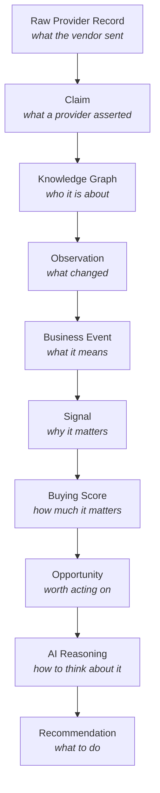

# 21 — The Intelligence Pipeline

> Status: **Living document — the primary architectural reference for how Signora thinks**
> Audience: Engineers, architects, prospective hires, customers, and investors
> Revision: **v3** — updated at the close of M4. This document tracks the **implemented** architecture, not future intent; stages are marked built only once they run against a real database in `make smoke`.
>
> Prerequisite reading: none. This is the document to read first.

---

## What this document is for

Signora is not a database of companies. It is a machine for turning what vendors say into something a seller can act on — and for being able to explain, at every step, why it said what it said.

This document describes that machine. It follows a single fact from the moment a vendor asserts it to the moment a seller is told what to do about it, and it names what each stage adds and what each stage is forbidden from doing.

It exists because the forbidden half is the harder half. Any team can build a pipeline that produces a recommendation. The difficulty is building one where the recommendation can still be traced back, six months later, to the raw vendor payload that started it — and where nobody along the way quietly collapsed the evidence to make the next stage simpler.

---

## The shape of it



Nine stages. Each one adds business understanding. **None of them destroys what came before.**

---

## The layering principle

> **Each stage answers one question, and refuses the next one.**
>
> Claims **preserve evidence** · the Knowledge Graph **resolves identity** · the Observation Engine **detects change** · the Business Event Engine **determines business meaning** · the Signal Engine **determines commercial meaning**.
>
> Read as questions: *what was asserted?* · *who is it about?* · *what changed?* · *why is that business-relevant?* · *should we act on it?*
>
> *Permanent architectural principle, ratified 2026-07-29.* A stage that answers the next stage's question puts a rule where it cannot be reviewed — a threshold buried in derivation code is not a rule anyone can argue with, and cannot be versioned, tested against a taxonomy, or cited in an explanation.

## The governing principle

> **Preserve information. Delay interpretation. Never destroy evidence.**

Every stage of this pipeline is a decision about *when* to interpret. The architecture's consistent answer is: **as late as possible, by the component with the most context, and always in a way that can be traced back.**

This is not caution for its own sake. It is what makes three product capabilities possible that are otherwise unbuildable:

- **"Why are you telling me this?"** — a seller can follow a recommendation back through reasoning, score, signals, events, observations, and claims to the vendor payload that started it.
- **"Your sources disagree."** — because disagreement is preserved rather than resolved at ingestion, AI Reasoning can say *"confidence is lower here because Apollo and CoreSignal report different headcounts"*. A pipeline that picked one number at the first opportunity can never say this.
- **"Rebuild it."** — every derived stage can be regenerated from the stage before it. A bad mapper, a bad resolution rule, or a bad scoring model is a re-run, not a data-loss incident.

The corresponding discipline: **a stage that collapses information to make itself simpler has stolen a capability from every stage after it.** That trade is never made locally.

---

## Stage 1 — Raw Provider Record

**What it is.** Exactly what the vendor sent, stored before anybody interprets it.

**Adds:** durability, tenancy, and provenance. The record knows which workspace it belongs to, which provider produced it, which sync run fetched it, and when the provider says it was true.

**Refuses:** interpretation of any kind. No parsing, no reshaping, no validation beyond "is this a payload". A vendor changing its JSON shape must not be able to cause data loss at this layer.

**Why it exists at all.** Every later stage is derived, which means every later stage can be rebuilt — but only if the input survived. Storing raw payloads is what makes a corrected mapper a re-run rather than a re-ingestion, and what lets an engineer answer *"is this our bug or theirs?"* six months after the fact.

**Owned by:** Provider Platform · **Table:** `raw_provider_record` · **Publishes:** `provider.record.received`

> The event carries the record's *identity*, not its body. Putting a vendor payload in an event envelope would make every vendor shape change an event-contract change.

---

## Stage 2 — Claim

**What it is.** *This provider asserted that this attribute had this value, as of this time, and here is the raw record it came from.* Nothing more.

**Adds:** Signora's canonical vocabulary. Apollo's `estimated_num_employees`, CoreSignal's `workforce.employee_count`, and a third vendor's `headcount` all become `EMPLOYEE_COUNT`. Every downstream module reasons in one language, and adding a vendor is a mapper, not a schema change.

**Refuses:** everything else. A claim does not rank, reconcile, resolve identity, or estimate confidence.

Three properties carry the design:

- **Immutable.** New information is a new claim, never an overwrite. Enforced at three levels: frozen dataclasses, no update method on the repository, and no `UPDATE` grant on the table. An invariant guarded only by convention lasts until the first inconvenient deadline.
- **Never without provenance.** Provider, raw record, observed time, mapper version, and payload provenance are all required. A claim that cannot be traced is worse than no claim: it looks like knowledge.
- **No confidence field.** Normalization has no authority to estimate one. A number invented here, with no evidence behind it, would propagate into buying scores as though it meant something.

**The vocabulary is a controlled language.** Adding a canonical attribute requires an RFC; adding a *mapper* is routine engineering. That asymmetry is what lets provider integrations churn while the platform's language stays stable.

**Owned by:** Provider Normalization · **Table:** `claim` (immutable) · **Publishes:** `claim.recorded` · **Read port:** `ClaimReader`

> **Why claims and not "normalized records".** One normalized record per company would mean choosing a headcount at the earliest possible moment — before anything knows the two sources disagree. The disagreement *is* product value.

---

## Stage 3 — Knowledge Graph

**What it is.** The answer to *"which company is this provider talking about?"*

**Adds:** identity. Apollo's `acme-corp` and BuiltWith's `acme.example` either are the same company or they are not, and the entire pipeline downstream is meaningless until something answers it. It also derives relationships between entities — which company uses which technology, and when it stopped.

**Refuses:** truth.

> **The Knowledge Graph resolves identity. The Knowledge Graph does not resolve truth.** *(Permanent invariant, ratified 2026-07-28. Changing it requires an RFC.)*

Identity is *irreducible* — only this module is positioned to answer it. Attribute conflict is not: it can be carried forward intact, and every downstream module has more context to weigh it. So `entity` has **no attribute columns at all** — no name, no headcount, no industry. Those live in claims, and a column here would immediately disagree with them.

Instead the graph offers a **claim set**: for `(entity, attribute)`, every contributing claim with its provider, value, and time — a *set*, deliberately not a value. The graph adds knowledge (these claims describe the same company) without destroying evidence (they disagree, and here is exactly how).

**How identity is decided.** Deterministic rules only, in precedence order — the provider's own key, exact domain, exact legal name plus country. No fuzzy matching, no similarity thresholds. A threshold is a magic number nobody can justify that four modules will trust within a year, and identity is the worst possible place to start guessing.

**The asymmetry that shapes everything:**

| | Consequence |
|---|---|
| **Under-merge** — two entities for one company | Visible in the UI, reported by a user, fixable by a new decision. Annoying. |
| **Over-merge** — two companies become one | One customer's intelligence contaminates another's. **Invisible** — the data looks clean — and it silently corrupts every downstream signal, score, and recommendation. |

They are not equally bad, so the graph is deliberately biased against merging. When two candidates both match, it records an `AMBIGUOUS` decision naming both and **merges nothing**. That is enforced by a database constraint, not by the code path that happens to write the row.

**Every decision explains itself.** A `ResolutionDecision` names the rule *and the value that matched* — `domain=acme.example`, not merely "a domain rule fired". Decisions are immutable and corrected by supersession, so the history of what was believed, when, and why survives. Knowledge has history for the same reason evidence does.

**Owned by:** Knowledge Graph · **Tables:** `entity`, `identity_binding`, `resolution_decision` (immutable), `relationship` · **Publishes:** `entity.created`, `entity.identity_bound`, `entity.resolution_ambiguous`, `relationship.established`, `relationship.ended`

---

## Stage 4 — Observation

**What it is.** *This changed.* Acme's headcount went from 120 to 145 between January and March, **according to CoreSignal**.

**Adds:** change over time. A claim is a point; an observation is a difference between points, attributed to the source that reported it. It carries the previous value, the current value, the direction, the magnitude, the provider, the window, and the entity — so no downstream module ever has to reconstruct a transition from claim history, which would mean every consumer reimplementing this stage and diverging from it.

**Refuses:** meaning, and — just as importantly — **significance**.

> **The Observation Engine detects change. It does not determine whether the change matters.** Whether a headcount move of five is noise or a signal depends on commercial context: it is noise at Acme and a signal at a 12-person startup. A threshold here would be a constant nobody can justify that four modules trust within a year. The Business Event Engine owns a curated, versioned taxonomy where such a rule can be stated, reviewed, and changed.

**Two things are never observations**, and the restraint is most of the work:

- **Re-assertion.** A nightly sync repeating the same headcount for six weeks produces nothing. In a polling pipeline this is the dominant case by an enormous margin, and an engine that fires on it is worse than no engine.
- **Disagreement.** Apollo reporting 120 on Monday and CoreSignal 145 on Tuesday is not growth of 25 in a day. Change is computed **within one provider's series**, never across them — merging them would manufacture movement that never happened, and correcting for it would mean deciding which provider is authoritative, which is truth resolution.

The **first value of an attribute establishes a baseline and produces no observation.** Nothing changed; Signora merely learned. Emitting one would mean an onboarding sync of five thousand companies flooding every consumer with tens of thousands of messages that all say the same empty thing — and `entity.created` already says it, once, per company.

**Why it is separate from the graph.** This is precisely why the graph must not store a collapsed current value. Change is only visible across a *series*, and a collapsed value has no series — the Observation Engine would have to diff successive collapses, losing which provider drove the change.

**Late arrival refines rather than rewrites.** A claim landing out of order does not make an earlier observation false; it makes it *less precise*. The finer observations name the coarser one they replace, which stays readable as what was believed then, and downstream sees a correction it can react to instead of a value quietly changing underneath it.

**Owned by:** Observation Engine · **Table:** `observation` (immutable) · **Publishes:** `observation.recorded`, `observation.superseded` · **Read port:** `ObservationQueries`

---

## Stage 5 — Business Event

**What it is.** *This means something.* **"Acme is in a hiring surge: grew headcount 40% over 90 days."** Not a measurement — a sentence a CRO would recognise.

**Adds:** business vocabulary and **materiality**. This is the first stage that interprets, deliberately placed after identity and after change detection: by here the pipeline knows *who* and *what moved*, so interpretation has something solid to stand on.

**Refuses:** commercial judgement. A business event says what happened in business terms, never how important the account is, whether Sales should engage, what priority this deserves, or how likely a purchase is. It carries **no priority, score, urgency, or rank** — asserted structurally.

### The taxonomy is a product asset

The set of business event types is **Signora's business language** — the vocabulary the product, analytics, AI reasoning, recommendations, customer interfaces, documentation, and future integrations all speak. Every type passes one test:

> *If a CRO opened Signora today, would they immediately understand what this event means?*

That rules out provider terminology, implementation terminology, and engineering terminology. A type describes **what happened in the customer's business**, never how Signora discovered it — which is why its domains are `capital`, `technology`, `leadership`, `workforce`, `growth`, `demand`, and not the claim vocabulary's `firmographic` or `technographic`. Those describe where data came from; these describe what happened.

Types are split by direction wherever the two directions mean opposite things commercially: `LEADERSHIP_APPOINTED` and `LEADERSHIP_DEPARTED`, `REVENUE_GROWTH` and `REVENUE_CONTRACTION`, `HIRING_SURGE` and `HEADCOUNT_DECLINE`. A consumer that has to read a field to know whether the news is good has been handed the wrong vocabulary.

### Taxonomy defines language; rules define derivation

**The taxonomy is data** — a versioned artifact reviewed like code, holding the types, their meanings, and **every materiality threshold**. **The rules are code** — the correlation logic that decides whether a type's conditions are met.

The split is the useful part. Parameters change often, need review by people who are not engineers, and must be recorded against every event. Correlation logic needs a type checker. Expressing correlation as configuration would mean inventing a DSL — a programming language with no debugger and no test framework — and burying a threshold in code puts it where a seller asking *"why was I told this?"* gets an answer that bottoms out in a constant.

**Meaning evolves slowly; derivation may evolve fast.** A better hiring-surge rule must not change what a hiring surge *is*.

> **Enforced structurally, not by convention.** A Security Invariant parses every rule module as a syntax tree and fails on any numeric literal in a comparison other than `0` or `1` — those two are structural (*nothing* and *something*); anything else is a claim about the world somebody must be able to argue with. A second test reconciles declared parameters against read ones, in both directions.

### Agreement is evidence, not truth

This is the pipeline's **first cross-provider reasoning**, and it is deliberately narrow. Each provider's series is evaluated **alone**, so no rule ever combines two providers' values into a synthetic truth. Two providers independently reaching the same conclusion produce **one** event that records both — a set of corroborating providers, never a coefficient. Turning agreement into confidence is the Signal Engine's decision, with its own reviewable rule.

### One vocabulary, referenced rather than re-derived

Business events are where the pipeline's language becomes the *product's* language. Everything downstream — signals, buying scores, opportunities, AI explanations, the customer interface, the documentation — **references business event types directly** rather than re-deriving meaning from observations.

A module that reconstructs *"this looks like a hiring surge"* from raw observations has forked the vocabulary, and two definitions of one concept diverge within a year. Referencing the type keeps one definition, one threshold, and one sentence a customer reads.

**Owned by:** Business Event Engine · **Table:** `business_event` (immutable) · **Publishes:** `business_event.detected`, `business_event.superseded` · **Read port:** `BusinessEventQueries`

---

## Stage 6 — Signal *(planned — M5)*

**What it is.** *This matters, and here is the shape of why.* One or more business events, correlated with graph context, into a weighted indicator of buying intent.

**Adds:** relevance. A funding round matters more for a company already showing intent on your category than for one that is not — and knowing that requires both the events and the graph.

**Refuses:** the overall verdict. A signal is one indicator among several.

**Owned by:** Signal Engine · **Publishes:** `signal.generated`, `signal.scored`

---

## Stage 7 — Buying Score *(planned — M5B)*

**What it is.** *How much it matters, right now, with a direction.*

**Adds:** aggregation across signals, and **trajectory**. A company at 71 on the way up and one at 71 on the way down warrant opposite actions, and a consumer given only today's number cannot tell them apart. This is the same reason Bombora intent is stored as one claim per observed week rather than a flattened current value: the trajectory is product value, not implementation detail.

**Refuses:** the decision to act. A score is an input to that decision.

**Owned by:** Buying Score Engine · **Publishes:** `buying_score.updated`

---

## Stage 8 — Opportunity *(planned — M6)*

**What it is.** *This is worth a person's time.* The threshold crossing where analysis becomes work.

**Adds:** commitment and lifecycle. An opportunity has a stage, an owner, and a history. It is the first artifact a human is expected to act on, and the first with a cost attached: everything downstream of it — agentic research, model reasoning — is expensive, so this is where the pipeline stops doing things to everything and starts doing things to a chosen few.

**Owned by:** Opportunity Engine · **Publishes:** `opportunity.created`, `opportunity.stage_changed`

---

## Stage 9 — AI Reasoning *(planned — M8/M9)*

**What it is.** *How to think about this one.* Structured explanation and analysis over the opportunity, its score, its signals, and its graph context.

Two distinct modules sit here, deliberately split by cost and latency profile:

- **AI Research Engine** — agentic, multi-step, minutes not seconds. Expensive and slow.
- **AI Reasoning Engine** — structured, single-call, bounded latency.

Research is an **optional, non-blocking enrichment**: reasoning proceeds without it after a documented timeout. Users should not wait on multi-minute agentic research for a first pass, but should benefit from it when it lands.

**Constraints that are not negotiable at this stage:**

- All vendor access goes through the AI Provider Abstraction Layer. No domain or application code touches a model SDK.
- **AI output is untrusted** until validated against an expected Pydantic structure, and never triggers a privileged or irreversible action without explicit validation.
- Prompts are versioned artifacts, reviewed like code, with the version recorded against every result.
- Context is **strictly workspace-scoped**. A prompt that could include another workspace's data is a tenancy breach, not a bug.

**Owned by:** AI Research Engine, AI Reasoning Engine · **Publishes:** `ai_research.completed`, `ai_reasoning.completed`

---

## Stage 10 — Recommendation *(planned — M10)*

**What it is.** *Do this.* A specific, prioritised action, attached to an opportunity, with the reasoning that produced it.

**Adds:** the last mile — and a feedback loop. `recommendation.status_changed` flows forward into the Signal Engine, so what sellers actually act on informs what the pipeline surfaces next. It is a *new forward-flowing event*, never a downstream module reaching back: the dependency graph stays acyclic.

**Owned by:** Recommendation Engine · **Publishes:** `recommendation.created`, `recommendation.status_changed`

---

## The chain that must never break

```
raw record → claim → decision → entity → observation → business event
           → signal → buying score → opportunity → reasoning → recommendation
```

Traversal must work in **both** directions:

- **Forward — *"what did this depend on?"*** Correct a mapper and you need to know the blast radius: which claims, which decisions, which scores were built on the version you just fixed.
- **Backward — *"why do we believe this?"*** A seller asks why they are being told to call someone. An enterprise customer asks for an evidence export. An auditor asks how a conclusion was reached. All three are the same traversal.

Two mechanisms hold it together:

**`correlation_id` propagates end to end.** Every event in one pipeline run carries it, and every log line emitted while handling one includes it alongside `workspace_id`. This is the primary debugging tool for an asynchronous pipeline, and it is treated as a correctness property rather than as plumbing — an untraceable background process is not production-ready.

**Every derived artifact cites its evidence.** A decision names the claims it was made from. A relationship names the claims that established and ended it. Nothing in the pipeline is allowed to be an orphan.

---

## How the stages are connected

Every arrow in the diagram is an **event on the internal bus**, not a function call.

- **Durably first.** An event is written to the `outbox_event` table in the *same transaction* as the state change that caused it. Nothing is "published" until that commits, so a crash can never leave state without its event or an event without its state.
- **Relayed, then dispatched.** A relay process tails the outbox and enqueues work per subscriber onto Redis/ARQ. It enqueues *before* marking relayed: the worst case is a duplicate, which the ledger absorbs, rather than a loss, which nothing can.
- **Exactly-once effect from at-least-once delivery.** The platform — not each module — writes `(consumer, event_id)` into an idempotency ledger in the same transaction as the handler's own work. Requiring thirteen modules to each get deduplication right would be thirteen chances to get it subtly wrong.
- **Failures are bounded.** Retry with capped backoff, then dead-lettering with the full envelope retained, so a poisoned event is independently replayable after the fix.
- **Events carry identity; ports carry payload.** `claim.recorded` names the record and its subject. A consumer that needs the claims reads them through the owning module's public read port. Fat events embedding another module's state are an anti-pattern here.

And one rule that shapes the whole system: **every stage runs in a background worker.** No API request ever waits on a provider call, an AI vendor, or a pipeline stage. A request is answered when the work is durably *accepted*, never when it is complete.

---

## What every stage inherits

These hold at every stage, without exception, and are asserted by a permanent Security Invariants suite rather than left to review:

**Tenancy is layered and mandatory.** Row-Level Security is the authoritative control — enabled *and forced*, so not even a table's owner is exempt. On top of it: module-owned tables, explicit `workspace_id` filtering as defence in depth, and workspace-scoped event payloads. Every unit of work establishes `SET LOCAL app.workspace_id` from a *server-verified* source before touching workspace data. A `workspace_id` supplied by a client is a routing hint, never a grant.

**Runtime and migration identities are separate, always.** A service connected as the schema owner is exempt from RLS on every table it touches, which silently voids the entire tenancy model no matter how correct the policies are. Migrations run under the migration identity as a discrete release step; the API and workers run as `signora_app`, the auth tier as `signora_auth`, the relay as `signora_relay`.

**Platform infrastructure tables are not module data.** `outbox_event`, `processed_event`, and `dead_letter_event` span every workspace by design and deliberately carry no RLS — so the *grant* is the only thing separating tenants there. The application role can publish and cannot read; only the relay identity consumes. No business module may query one, for any reason, including debugging.

**Immutable things are immutable at the database.** `claim`, `resolution_decision`, `observation`, and `business_event` carry no `UPDATE` grant. An attempted overwrite fails with a permission error rather than succeeding quietly. Where a later fact must correct an earlier one, the correction is a **new row naming its predecessor** — supersession pointing backwards, because a forward pointer would need the grant immutability withholds.

**Modules reach each other only through `public/`.** Enforced by import-linter in CI, per module pair. A cross-module import of an ORM model compiles and runs perfectly well — which is exactly why the rule needs a machine behind it.

---

## Where the pipeline stands

| Stage | Module | State |
|---|---|---|
| Raw Provider Record | Provider Platform | **Built** — M2.1 |
| Claim | Provider Normalization | **Built** — M2.2 |
| Knowledge Graph | Knowledge Graph | **Built** — M3A |
| Observation | Observation Engine | **Built** — M3B |
| Business Event | Business Event Engine | **Built** — M4 |
| Signal | Signal Engine | Planned — M5 |
| Buying Score | Buying Score Engine | Planned — M5B |
| Opportunity | Opportunity Engine | Planned — M6 |
| AI Research / AI Reasoning | AI Research Engine, AI Reasoning Engine | Planned — M8/M9 |
| Recommendation | Recommendation Engine | Planned — M10 |

The first five stages are built and exercised end to end against a real database on every run of `make smoke`. Provider payloads currently come from the **Provider Simulation Framework** — deterministic, seeded, replayable — through the same Provider Port a production vendor adapter will implement. Nothing downstream of that port can tell the difference, and that neutrality is asserted rather than assumed.

Those payloads are presently **development fixtures**, marked as such and carried through to every claim's `payload_provenance`. They are not represented as authentic vendor payloads, and a conclusion built on one can be found when authentic payloads arrive.

---

## The tests this document has to survive

If Signora is doing this right, all of these are answerable at any point in the pipeline:

1. **Where did this number come from?** Name the provider, the raw record, and the time it was asserted.
2. **Do the sources agree?** If not, show both, with who said what and when.
3. **Why is this company one company?** Name the rule and the matched value.
4. **What if that was wrong?** Correct it with a new decision; the old one remains readable and the claims underneath are untouched.
5. **What happened between January and March?** Answerable from the series, not reconstructed from a current value — and answerable *per source*, so "CoreSignal shows growth; Apollo has not reported since January" is expressible.
6. **Rebuild everything from the claims.** Same graph, same structure, regardless of processing order.
7. **Could tenant A's data ever reach tenant B?** Four independent controls say no, and a permanent test suite proves each of them still bites.

An architecture that can answer these is one a customer can trust with their pipeline and an engineer can debug at 3am. That is the whole ambition.
