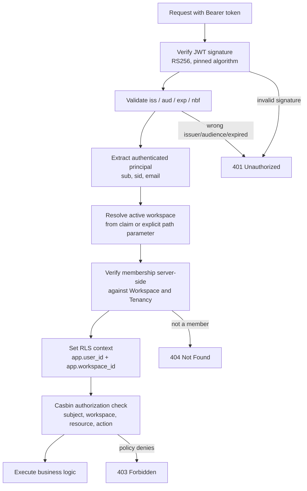

# ADR-0026: JWT Boundary Architecture — Authentication in Next.js, Verification in FastAPI

**Status:** Accepted
**Amends:** [ADR-0010](0010-identity-and-access.md)
**Resolves:** Risk R-13 in [16-architecture-risks.md](../16-architecture-risks.md)

## Context

[ADR-0010](0010-identity-and-access.md) ratified **Better Auth** for authentication, describing it as "framework-native." That is accurate for the Next.js frontend ([ADR-0021](0021-frontend-application-stack.md)) but not for the FastAPI backend ([ADR-0002](0002-web-framework-and-api-style.md)): Better Auth is a TypeScript library with no official Python SDK. ADR-0010 never specified how a Python API establishes who a caller is.

This surfaced during implementation of the Workspace & Tenancy module and blocked its entire HTTP surface — every authenticated route depends on resolving a principal. It was raised as Risk R-13 rather than resolved unilaterally.

## Decision

Adopt a **JWT boundary** between the Next.js application and the FastAPI API.

**Better Auth, running in Next.js, remains the sole Authentication Authority.** It owns credential storage, OAuth flows with Google and Microsoft, session lifecycle, token issuance, and token refresh.

**FastAPI never authenticates users.** It performs exactly five things per request:

1. Verify the JWT signature.
2. Validate the token's claims (issuer, audience, expiry, not-before).
3. Build an authenticated user context from the verified claims.
4. Resolve and verify the active workspace, then establish PostgreSQL RLS context.
5. Delegate the authorization decision to Casbin.

The separation of concerns is absolute:

```
Authentication  ->  Better Auth (Next.js)
Authorization   ->  Casbin (FastAPI, in-process)
Business Logic  ->  Application modules
```

**The Python tier must never** store passwords, implement an OAuth flow, mint tokens, or authenticate a user directly. It holds a *public* key only — it is cryptographically incapable of issuing a token it would itself accept.

## Alternatives Considered

| Alternative | Why not chosen |
|---|---|
| **Shared session store** — Better Auth writes sessions to PostgreSQL/Redis; FastAPI reads them directly | Couples the Python tier to Better Auth's internal session schema, which is a third-party implementation detail free to change across minor versions. Every Better Auth upgrade would become a backend compatibility risk, and the coupling is invisible to type checking. |
| **Replace Better Auth with a vendor that ships a Python SDK** (Clerk, WorkOS, Auth0) | Would resolve the gap, but requires superseding ADR-0010 entirely and reopening its central reasoning — that authorization policy belongs in version control rather than a vendor's rules UI, and that per-MAU pricing scales badly toward hundreds of thousands of workspaces. A vendor change is a disproportionate response to an integration-pattern gap. |
| **Symmetric signing (HS256) with a shared secret** | Rejected on security grounds. A shared secret makes the API capable of *minting* tokens it will accept, so a read-only compromise of API configuration becomes full identity forgery. Asymmetric signing keeps that capability exclusively in the issuer. |
| **FastAPI calls a Next.js `/session` endpoint per request** | Correct but adds a synchronous network hop to the critical path of every authenticated request, coupling API availability and latency to the frontend deployment. JWT verification is local, deterministic, and sub-millisecond. |

## The JWT Contract

### Signing

- **Algorithm: `RS256`** (RSA + SHA-256), asymmetric. Next.js holds the private key; FastAPI holds only the public key.
- **The allowed-algorithm list is pinned to exactly `["RS256"]` at the verifier.** This is not incidental configuration — it defeats two classic JWT attacks: the `alg: none` forgery, and algorithm-confusion, where an attacker re-signs a token with HS256 using the *public* key as the shared secret and a naive verifier accepts it.
- Key rotation is currently a configuration change requiring a deploy. JWKS-based rotation is the documented follow-up — see Risks below.

### Claims

| Claim | Type | Purpose |
|---|---|---|
| `iss` | string | Issuer. Must equal the configured Better Auth issuer; rejected otherwise. |
| `aud` | string | Audience. Must equal the configured API audience; prevents a token minted for another service being replayed here. |
| `sub` | UUID string | Subject — the Better Auth user id. Becomes `app.user_id` in the RLS context. |
| `sid` | string | Better Auth session id. Enables session-level revocation and correlates API activity to a sign-in session. |
| `email` | string | The authenticated user's email. |
| `email_verified` | bool | Whether the address is verified. |
| `active_workspace_id` | UUID string \| null | The workspace the user has selected. Null immediately after sign-in, before a workspace is chosen or created. |
| `iat` | int | Issued-at. |
| `exp` | int | Expiry. Access tokens are short-lived (15 minutes); refresh is Next.js's responsibility. |
| `jti` | string | Unique token id, for replay detection and revocation lists. |

### What the JWT deliberately does *not* carry

**No authorization decisions, and no permission or capability lists.** Casbin remains the single source of authorization truth, evaluated per request against policy under Signora's version control. Embedding permissions in a token would fork authorization logic across two systems and make every policy change wait for token expiry to take effect.

**No workspace membership list.** Only the single `active_workspace_id` is carried. Three reasons:

1. **Bounded token size.** A user in fifty workspaces would otherwise carry fifty entries in every request header.
2. **Staleness.** A membership list is a mutable set; the longer the list, the higher the chance some entry is wrong by the time the token is used.
3. **It would be redundant regardless.** [11-tenancy.md](../11-tenancy.md) already requires that membership be verified server-side before RLS context is established. A membership claim could never be *authoritative*, so carrying the full list buys nothing.

`active_workspace_id` is a **routing hint, not a grant.** The API re-verifies membership against Workspace & Tenancy on every request before setting `app.workspace_id`. A forged or stale workspace id fails that check and the request is rejected.

## The Authentication Pipeline

Every protected endpoint follows this sequence. It is implemented once, as a composable FastAPI dependency chain, never re-implemented per route.



Two response codes in that diagram are deliberate and worth stating explicitly:

- **Failing membership verification returns `404`, not `403`.** A distinct "forbidden" response would confirm that a workspace id exists, letting a caller enumerate workspaces. This preserves the non-enumerability property already established in [11-tenancy.md](../11-tenancy.md).
- **Failing a Casbin check returns `403`.** At that point membership is already established, so the caller demonstrably knows the workspace exists; the only new information is that their role is insufficient.

## Tradeoffs

**We gain:** ADR-0010's vendor decision and its reasoning are preserved intact. Credential handling stays entirely out of the Python tier, which materially shrinks its security surface — no password storage, no OAuth callback handling, no token minting capability. Verification is local, so API latency and availability are decoupled from the frontend. The boundary is explicit and type-checked rather than an implicit schema dependency.

**We give up:** immediate revocation. A token remains valid until it expires, so a session revoked in Better Auth can still authenticate against the API for up to the access-token TTL. This is the standard JWT tradeoff and is mitigated by the short 15-minute TTL; `sid` and `jti` are carried specifically so that a revocation list can be introduced later without a contract change if the residual window proves unacceptable.

## Risks

- **Key rotation currently requires a deploy.** JWKS-based rotation with a cached key set is the intended follow-up; until then, rotating the signing key is a coordinated release. Tracked as a follow-up rather than built now, because JWKS adds a cache, a fetch path, and a failure mode that are not yet justified.
- **Clock skew** between the Next.js and FastAPI hosts can cause spurious `exp`/`nbf` failures. Mitigated by a small, explicit leeway (60 seconds) at the verifier rather than a generous one, which would extend the effective life of expired tokens.
- **Residual revocation window**, as described under Tradeoffs.

## Migration Strategy

The verifier lives in `signora_platform/auth/`, behind a narrow interface consumed only through FastAPI dependencies. Moving to JWKS, adding a revocation list, or switching issuer changes that module only; no module's domain, application, or interface code is aware of how a principal was established. Should Signora ever move to a vendor with a Python SDK, the same dependency contract is satisfied by a different verifier implementation.

## Consequences

- `signora_platform/auth/` owns JWT verification and the `AuthenticatedPrincipal` model. No module implements authentication.
- The Python tier requires the JWT **public key**, issuer, and audience as configuration. It must never be given a private key.
- Membership is re-verified server-side on every request; the `active_workspace_id` claim is never trusted on its own.
- Casbin evaluation always includes `workspace_id` in the request tuple, per [ADR-0010](0010-identity-and-access.md).
- Full specification of the flow lives in [18-authentication.md](../18-authentication.md); the error contract lives in [19-api-conventions.md](../19-api-conventions.md).
